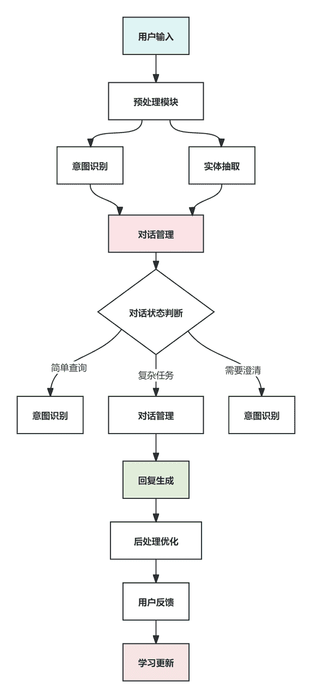
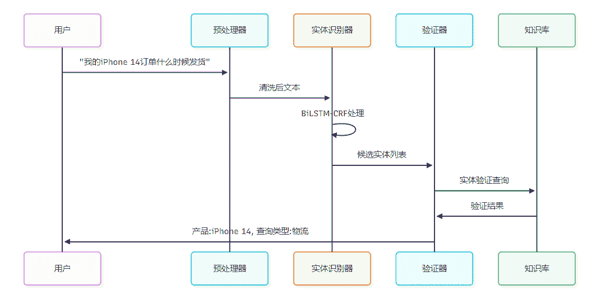
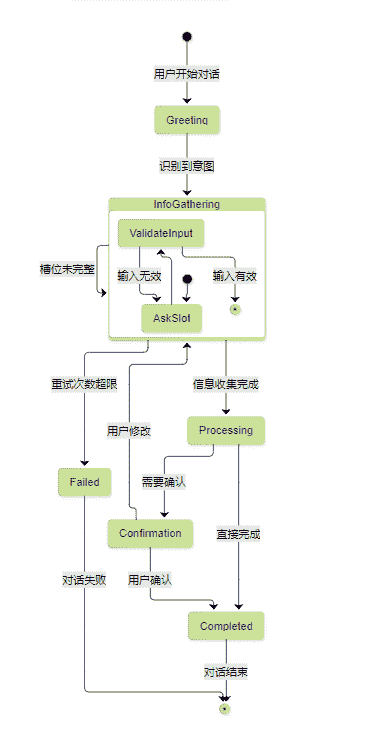
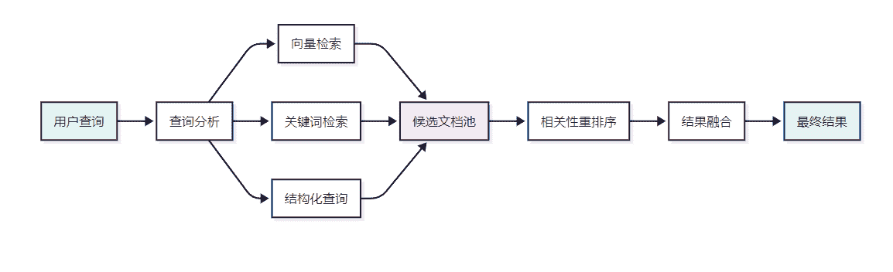
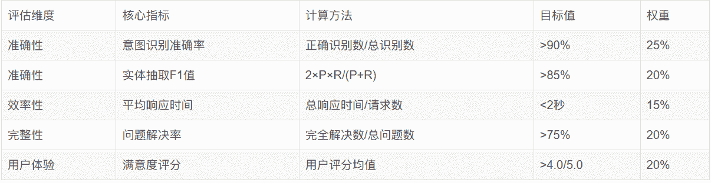
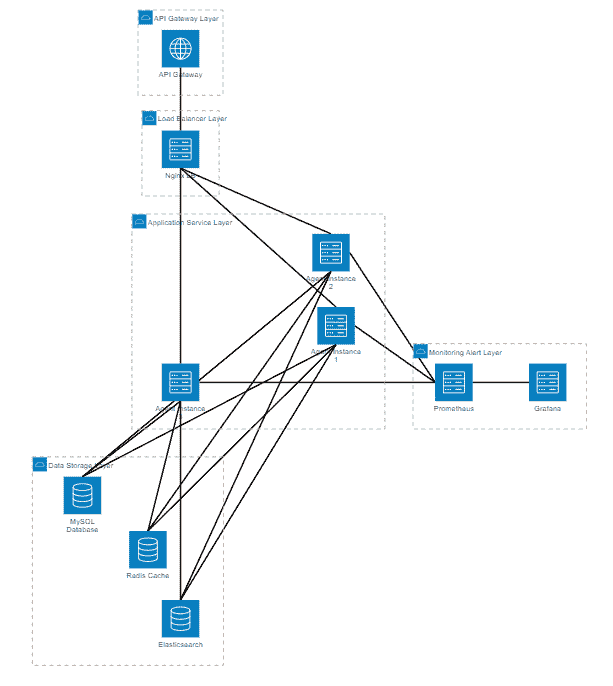
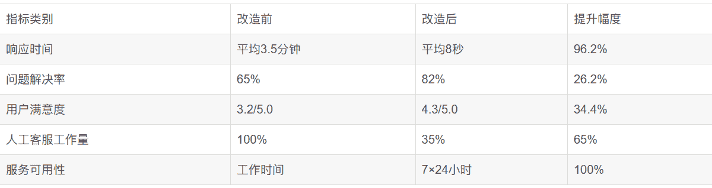
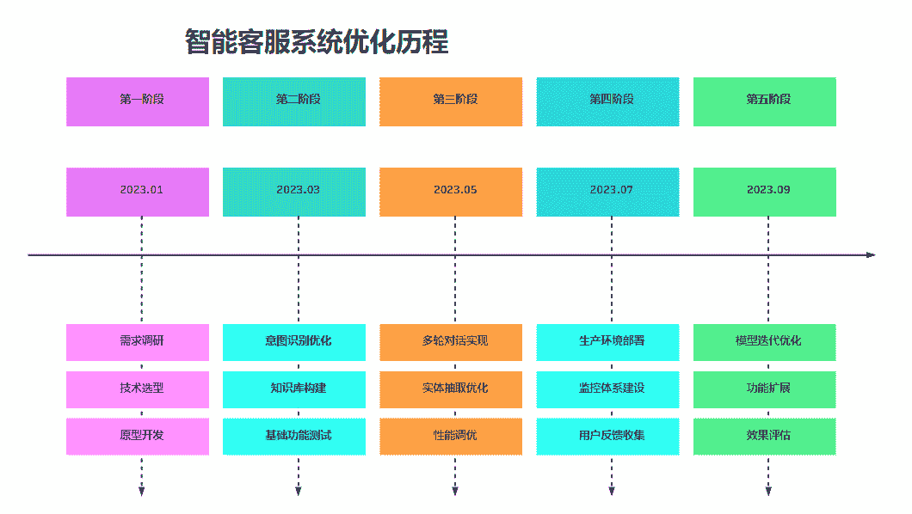

# 基于Agent的智能客服项目（已交付）

> 来源：[https://v11enp9ok1h.feishu.cn/docx/TV6adagSOo6jvmx9FU1cK5Zonng](https://v11enp9ok1h.feishu.cn/docx/TV6adagSOo6jvmx9FU1cK5Zonng)

## 智能客服Agent技术架构概览

### 1.1 整体架构设计

智能客服Agent的技术架构需要考虑多个层面的协同工作，从用户交互到后端处理，每个环节都至关重要。



这个架构图展示了从用户输入到系统响应的完整流程。预处理模块负责文本清洗和标准化，意图识别和实体抽取并行处理用户输入，对话管理器根据当前状态决定后续处理路径。

### 1.2 核心组件详解

在实际实现中，每个组件都有其特定的技术选型和优化策略：

```
class CustomerServiceAgent:
    def __init__(self):
        self.preprocessor = TextPreprocessor()
        self.intent_classifier = IntentClassifier()
        self.entity_extractor = EntityExtractor()
        self.dialog_manager = DialogManager()
        self.knowledge_base = KnowledgeBase()
        self.response_generator = ResponseGenerator()
        
    def process_user_input(self, user_input, session_id):
        """处理用户输入的主流程"""
        # 1. 预处理
        cleaned_text = self.preprocessor.clean(user_input)
        
        # 2. 意图识别和实体抽取
        intent = self.intent_classifier.predict(cleaned_text)
        entities = self.entity_extractor.extract(cleaned_text)
        
        # 3. 对话状态管理
        dialog_state = self.dialog_manager.update_state(
            session_id, intent, entities
        )
        
        # 4. 生成响应
        if dialog_state.is_complete():
            response = self._generate_final_response(dialog_state)
        else:
            response = self._generate_clarification(dialog_state)
            
        return response
    
    def _generate_final_response(self, dialog_state):
        """生成最终回复"""
        # 知识库检索
        relevant_docs = self.knowledge_base.search(
            dialog_state.intent, 
            dialog_state.entities
        )
        
        # 回复生成
        response = self.response_generator.generate(
            dialog_state, relevant_docs
        )
        
        return response
```

这段代码展示了智能客服Agent的核心处理逻辑。关键在于`process_user_input`方法的设计，它将复杂的处理流程分解为清晰的步骤，每个步骤都可以独立优化和测试。

## 意图识别与实体抽取技术实现

### 2.1 基于BERT的意图分类器

意图识别是智能客服的核心能力，直接决定了系统能否准确理解用户需求。

```
import torch
import torch.nn as nn
from transformers import BertModel, BertTokenizer
 
class BertIntentClassifier(nn.Module):
    def __init__(self, num_intents, bert_model_name='bert-base-chinese'):
        super().__init__()
        self.bert = BertModel.from_pretrained(bert_model_name)
        self.dropout = nn.Dropout(0.3)
        self.classifier = nn.Linear(self.bert.config.hidden_size, num_intents)
        
    def forward(self, input_ids, attention_mask):
        # BERT编码
        outputs = self.bert(input_ids=input_ids, attention_mask=attention_mask)
        pooled_output = outputs.pooler_output
        
        # 分类层
        output = self.dropout(pooled_output)
        logits = self.classifier(output)
        
        return logits
 
class IntentClassifier:
    def __init__(self, model_path, intent_labels):
        self.device = torch.device('cuda' if torch.cuda.is_available() else 'cpu')
        self.tokenizer = BertTokenizer.from_pretrained('bert-base-chinese')
        self.model = BertIntentClassifier(len(intent_labels))
        self.model.load_state_dict(torch.load(model_path, map_location=self.device))
        self.model.to(self.device)
        self.model.eval()
        self.intent_labels = intent_labels
        
    def predict(self, text, confidence_threshold=0.8):
        """预测用户意图"""
        # 文本编码
        encoding = self.tokenizer(
            text,
            truncation=True,
            padding=True,
            max_length=128,
            return_tensors='pt'
        )
        
        input_ids = encoding['input_ids'].to(self.device)
        attention_mask = encoding['attention_mask'].to(self.device)
        
        # 模型推理
        with torch.no_grad():
            logits = self.model(input_ids, attention_mask)
            probabilities = torch.softmax(logits, dim=-1)
            confidence, predicted_idx = torch.max(probabilities, dim=-1)
            
        # 置信度检查
        if confidence.item() < confidence_threshold:
            return {"intent": "unknown", "confidence": confidence.item()}
            
        predicted_intent = self.intent_labels[predicted_idx.item()]
        return {"intent": predicted_intent, "confidence": confidence.item()}
```

这个实现使用了预训练的BERT模型作为特征提取器，在其基础上添加分类层。关键的设计考虑包括：置信度阈值设置、未知意图处理、以及GPU加速支持。

### 2.2 命名实体识别系统

实体抽取用于从用户输入中提取关键信息，如产品名称、订单号、时间等。




```python
import torch
import torch.nn as nn
from torch.nn.utils.rnn import pad_packed_sequence, pack_padded_sequence

class BiLSTMCRF(nn.Module):
    def __init__(self, vocab_size, tag_size, embedding_dim=100, hidden_dim=128):
        super().__init__()
        self.embedding_dim = embedding_dim
        self.hidden_dim = hidden_dim
        self.vocab_size = vocab_size
        self.tag_size = tag_size

        # 词嵌入层
        self.word_embeds = nn.Embedding(vocab_size, embedding_dim)

        # BiLSTM层
        self.lstm = nn.LSTM(embedding_dim, hidden_dim // 2,
                           num_layers=1, bidirectional=True, batch_first=True)

        # 线性变换层
        self.hidden2tag = nn.Linear(hidden_dim, tag_size)

        # CRF层参数
        self.transitions = nn.Parameter(torch.randn(tag_size, tag_size))
        self.transitions.data[tag_size-2, :] = -10000  # START标签
        self.transitions.data[:, tag_size-1] = -10000  # END标签

    def forward(self, sentence, lengths):
        # 词嵌入
        embeds = self.word_embeds(sentence)

        # BiLSTM编码
        packed_embeds = pack_padded_sequence(embeds, lengths, batch_first=True, enforce_sorted=False)
        lstm_out, _ = self.lstm(packed_embeds)
        lstm_out, _ = pad_packed_sequence(lstm_out, batch_first=True)

        # 线性变换
        lstm_feats = self.hidden2tag(lstm_out)

        return lstm_feats

class EntityExtractor:
    def __init__(self, model_path, vocab, tag_vocab):
        self.device = torch.device('cuda' if torch.cuda.is_available() else 'cpu')
        self.vocab = vocab
        self.tag_vocab = tag_vocab
        self.model = BiLSTMCRF(len(vocab), len(tag_vocab))
        self.model.load_state_dict(torch.load(model_path, map_location=self.device))
        self.model.to(self.device)
        self.model.eval()

    def extract(self, text):
        """抽取命名实体"""
        # 文本预处理和编码
        tokens = list(text)
        token_ids = [self.vocab.get(token, self.vocab['<UNK>']) for token in tokens]

        # 模型推理
        with torch.no_grad():
            sentence_tensor = torch.tensor([token_ids], dtype=torch.long).to(self.device)
            lengths = torch.tensor([len(token_ids)], dtype=torch.long)

            # 获取特征
            lstm_feats = self.model(sentence_tensor, lengths)

            # Viterbi解码（简化版本）
            tag_seq = self._viterbi_decode(lstm_feats[0])

        # 实体提取和格式化
        entities = self._extract_entities(tokens, tag_seq)
        return entities

    def _extract_entities(self, tokens, tags):
        """从BIO标签序列中提取实体"""
        entities = []
        current_entity = None

        for i, (token, tag) in enumerate(zip(tokens, tags)):
            if tag.startswith('B-'):
                if current_entity:
                    entities.append(current_entity)
                current_entity = {
                    'text': token,
                    'label': tag[2:],
                    'start': i,
                    'end': i + 1
                }
            elif tag.startswith('I-') and current_entity:
                current_entity['text'] += token
                current_entity['end'] = i + 1
            else:
                if current_entity:
                    entities.append(current_entity)
                    current_entity = None

        if current_entity:
            entities.append(current_entity)

        return entities
```

这个实现采用了 `BiLSTM-CRF` 架构，能够有效处理序列标注任务。`BiLSTM` 负责特征提取，`CRF` 层确保标签序列的合理性。

## 对话管理与状态跟踪

### 3.1 多轮对话状态管理

对话管理是智能客服 Agent 的大脑，负责维护对话上下文和决策下一步行动。

```python
from enum import Enum
from dataclasses import dataclass
from typing import Dict, List, Optional
import json

class DialogState(Enum):
    GREETING = "greeting"
    INFORMATION_GATHERING = "info_gathering"
    PROCESSING = "processing"
    CONFIRMATION = "confirmation"
    COMPLETED = "completed"
    FAILED = "failed"

@dataclass
class DialogContext:
    session_id: str
    current_state: DialogState
    intent: Optional[str] = None
    entities: Dict[str, any] = None
    required_slots: List[str] = None
    filled_slots: Dict[str, any] = None
    conversation_history: List[Dict] = None
    retry_count: int = 0

    def __post_init__(self):
        if self.entities is None:
            self.entities = {}
        if self.required_slots is None:
            self.required_slots = []
        if self.filled_slots is None:
            self.filled_slots = {}
        if self.conversation_history is None:
            self.conversation_history = []

class DialogManager:
    def __init__(self):
        self.sessions = {}  # 存储会话状态
        self.slot_requirements = {
            "order_inquiry": ["order_number"],
            "product_consultation": ["product_name"],
            "complaint_handling": ["issue_type", "order_number"],
            "refund_request": ["order_number", "reason"]
        }

    def update_state(self, session_id: str, intent: str, entities: Dict):
        """更新对话状态"""
        # 获取或创建会话上下文
        if session_id not in self.sessions:
            self.sessions[session_id] = DialogContext(
                session_id=session_id,
                current_state=DialogState.GREETING
            )

        context = self.sessions[session_id]

        # 更新意图和实体
        if intent != "unknown":
            context.intent = intent
            context.required_slots = self.slot_requirements.get(intent, [])

        # 更新槽位信息
        for entity_type, entity_value in entities.items():
            if entity_type in context.required_slots:
                context.filled_slots[entity_type] = entity_value

        # 状态转换逻辑
        context.current_state = self._determine_next_state(context)

        # 记录对话历史
        context.conversation_history.append({
            "intent": intent,
            "entities": entities,
            "state": context.current_state.value
        })

        return context

    def _determine_next_state(self, context: DialogContext) -> DialogState:
        """确定下一个对话状态"""
        if not context.intent:
            return DialogState.GREETING

        # 检查必需槽位是否已填充
        missing_slots = [slot for slot in context.required_slots
                        if slot not in context.filled_slots]

        if missing_slots:
            if context.retry_count < 3:
                return DialogState.INFORMATION_GATHERING
            else:
                return DialogState.FAILED
        else:
            return DialogState.PROCESSING

    def get_missing_slots(self, session_id: str) -> List[str]:
        """获取缺失的槽位信息"""
        if session_id not in self.sessions:
            return []

        context = self.sessions[session_id]
        return [slot for slot in context.required_slots
                if slot not in context.filled_slots]

    def is_dialog_complete(self, session_id: str) -> bool:
        """判断对话是否完成"""
        if session_id not in self.sessions:
            return False

        context = self.sessions[session_id]
        return context.current_state in [DialogState.COMPLETED, DialogState.FAILED]
```

这个对话管理器采用了基于状态机的设计，能够有效跟踪多轮对话的进展。关键特性包括槽位填充、状态转换和重试机制。

### 3.2 对话流程可视化



这个状态图清晰展示了对话管理的核心逻辑，每个状态都有明确的转换条件和处理逻辑。

## 知识库构建与检索优化

### 4.1 向量化知识库设计


知识库是智能客服的知识来源，需要支持快速准确的信息检索。

```
import numpy as np
from sentence_transformers import SentenceTransformer
import faiss
import pickle
from typing import List, Dict, Tuple

class VectorKnowledgeBase:
    def __init__(self, model_name='paraphrase-multilingual-MiniLM-L12-v2'):
        self.encoder = SentenceTransformer(model_name)
        self.index = None
        self.documents = []
        self.metadata = []
        
    def build_index(self, documents: List[Dict]):
        """构建向量索引"""
        print("正在构建知识库索引...")
        
        # 提取文档文本
        texts = []
        for doc in documents:
            # 组合标题和内容
            text = f"{doc.get('title', '')} {doc.get('content', '')}"
            texts.append(text)
            
        # 文本向量化
        embeddings = self.encoder.encode(texts, show_progress_bar=True)
        
        # 构建FAISS索引
        dimension = embeddings.shape[1]
        self.index = faiss.IndexFlatIP(dimension)  # 内积相似度
        
        # 归一化向量（用于余弦相似度）
        faiss.normalize_L2(embeddings)
        self.index.add(embeddings.astype('float32'))
        
        # 存储文档和元数据
        self.documents = documents
        self.metadata = [
            {
                'doc_id': i,
                'title': doc.get('title', ''),
                'category': doc.get('category', ''),
                'tags': doc.get('tags', [])
            }
            for i, doc in enumerate(documents)
        ]
        
        print(f"索引构建完成，共 {len(documents)} 个文档")
    
    def search(self, query: str, top_k: int = 5, 
               category_filter: str = None) -> List[Dict]:
        """搜索相关文档"""
        if self.index is None:
            return []
            
        # 查询向量化
        query_embedding = self.encoder.encode([query])
        faiss.normalize_L2(query_embedding)
        
        # 向量检索
        scores, indices = self.index.search(
            query_embedding.astype('float32'), 
            min(top_k * 2, len(self.documents))  # 检索更多候选
        )
        
        # 结果过滤和排序
        results = []
        for score, idx in zip(scores[0], indices[0]):
            if idx == -1:  # FAISS返回-1表示无效索引
                continue
                
            doc = self.documents[idx]
            metadata = self.metadata[idx]
            
            # 类别过滤
            if category_filter and metadata['category'] != category_filter:
                continue
                
            results.append({
                'document': doc,
                'metadata': metadata,
                'score': float(score),
                'relevance': self._calculate_relevance(query, doc, score)
            })
            
            if len(results) >= top_k:
                break
                
        return results
    
    def _calculate_relevance(self, query: str, document: Dict, 
                           vector_score: float) -> float:
        """计算综合相关性分数"""
        # 基础向量相似度
        relevance = vector_score * 0.7
        
        # 关键词匹配加分
        query_words = set(query.lower().split())
        doc_words = set((document.get('content', '') + ' ' + 
                        document.get('title', '')).lower().split())
        
        keyword_overlap = len(query_words & doc_words) / len(query_words)
        relevance += keyword_overlap * 0.2
        
        # 文档质量加分
        quality_score = document.get('quality_score', 0.5)
        relevance += quality_score * 0.1
        
        return min(relevance, 1.0)
    
    def save_index(self, filepath: str):
        """保存索引到文件"""
        faiss.write_index(self.index, f"{filepath}.faiss")
        
        with open(f"{filepath}.pkl", 'wb') as f:
            pickle.dump({
                'documents': self.documents,
                'metadata': self.metadata
            }, f)
    
    def load_index(self, filepath: str):
        """从文件加载索引"""
        self.index = faiss.read_index(f"{filepath}.faiss")
        
        with open(f"{filepath}.pkl", 'rb') as f:
            data = pickle.load(f)
            self.documents = data['documents']
            self.metadata = data['metadata']
```

这个向量化知识库使用了`Sentence-BERT`进行文本编码，`FAISS`进行高效的向量检索。关键优化包括：向量归一化、多重相关性计算、以及索引持久化。

## 4.2 混合检索策略



## 效果评估体系设计

### 5.1 多维度评估指标



建立科学的评估体系是优化智能客服系统的关键。我们需要从多个维度来衡量系统效果。

这个评估体系涵盖了技术指标和业务指标，能够全面反映系统的实际效果。权重分配考虑了不同指标对业务价值的贡献度。

### 5.2 自动化评估框架


```
import time
import json
import numpy as np
from typing import Dict, List
from dataclasses import dataclass
from datetime import datetime, timedelta

@dataclass
class EvaluationResult:
    accuracy_metrics: Dict[str, float]
    efficiency_metrics: Dict[str, float]
    satisfaction_metrics: Dict[str, float]
    overall_score: float
    timestamp: datetime

class CustomerServiceEvaluator:
    def __init__(self):
        self.test_cases = []
        self.evaluation_history = []

    def load_test_cases(self, filepath: str):
        """加载测试用例"""
        with open(filepath, 'r', encoding='utf-8') as f:
            self.test_cases = json.load(f)

    def evaluate_intent_recognition(self, agent, test_cases: List[Dict]) -> Dict:
        """评估意图识别准确性"""
        correct_predictions = 0
        total_predictions = len(test_cases)
        confusion_matrix = {}

        for case in test_cases:
            user_input = case['input']
            expected_intent = case['expected_intent']

            # 获取预测结果
            result = agent.intent_classifier.predict(user_input)
            predicted_intent = result['intent']
            confidence = result['confidence']

            # 统计准确性
            if predicted_intent == expected_intent:
                correct_predictions += 1

            # 构建混淆矩阵
            if expected_intent not in confusion_matrix:
                confusion_matrix[expected_intent] = {}
            if predicted_intent not in confusion_matrix[expected_intent]:
                confusion_matrix[expected_intent][predicted_intent] = 0
            confusion_matrix[expected_intent][predicted_intent] += 1

        accuracy = correct_predictions / total_predictions

        return {
            'accuracy': accuracy,
            'confusion_matrix': confusion_matrix,
            'total_cases': total_predictions
        }

    def evaluate_entity_extraction(self, agent, test_cases: List[Dict]) -> Dict:
        """评估实体抽取效果"""
        true_positives = 0
        false_positives = 0
        false_negatives = 0

        for case in test_cases:
            user_input = case['input']
            expected_entities = set(case['expected_entities'])

            # 获取预测结果
            predicted_entities = agent.entity_extractor.extract(user_input)
            predicted_set = set([f"{e['label']}:{e['text']}" for e in predicted_entities])

            # 计算P/R/F1
            true_positives += len(expected_entities & predicted_set)
            false_positives += len(predicted_set - expected_entities)
            false_negatives += len(expected_entities - predicted_set)

        precision = true_positives / (true_positives + false_positives) if (true_positives + false_positives) > 0 else 0
        recall = true_positives / (true_positives + false_negatives) if (true_positives + false_negatives) > 0 else 0
        f1_score = 2 * precision * recall / (precision + recall) if (precision + recall) > 0 else 0

        return {
            'precision': precision,
            'recall': recall,
            'f1_score': f1_score
        }

    def evaluate_response_time(self, agent, test_cases: List[Dict], 
                             iterations: int = 100) -> Dict:
        """评估响应时间"""
        response_times = []

        for _ in range(iterations):
            case = np.random.choice(test_cases)
            user_input = case['input']
            session_id = f"test_session_{time.time()}"

            start_time = time.time()
            response = agent.process_user_input(user_input, session_id)
            end_time = time.time()

            response_times.append(end_time - start_time)

        return {
            'mean_response_time': np.mean(response_times),
            'median_response_time': np.median(response_times),
            'p95_response_time': np.percentile(response_times, 95),
            'max_response_time': np.max(response_times)
        }

    def evaluate_dialog_completion(self, agent, dialog_test_cases: List[Dict]) -> Dict:
        """评估对话完成率"""
        completed_dialogs = 0
        total_dialogs = len(dialog_test_cases)

        for case in dialog_test_cases:
            session_id = f"eval_session_{time.time()}"
            dialog_turns = case['dialog_turns']
            expected_completion = case['should_complete']

            # 模拟多轮对话
            for turn in dialog_turns:
                agent.process_user_input(turn['user_input'], session_id)

            # 检查对话是否完成
            is_completed = agent.dialog_manager.is_dialog_complete(session_id)

            if is_completed == expected_completion:
                completed_dialogs += 1

        completion_rate = completed_dialogs / total_dialogs

        return {
            'completion_rate': completion_rate,
            'total_dialogs': total_dialogs
        }

    def run_comprehensive_evaluation(self, agent) -> EvaluationResult:
        """运行综合评估"""
        print("开始综合评估...")

        # 意图识别评估
        intent_results = self.evaluate_intent_recognition(
            agent, [case for case in self.test_cases if 'expected_intent' in case]
        )

        # 实体抽取评估
        entity_results = self.evaluate_entity_extraction(
            agent, [case for case in self.test_cases if 'expected_entities' in case]
        )

        # 响应时间评估
        time_results = self.evaluate_response_time(agent, self.test_cases)

        # 对话完成率评估
        dialog_results = self.evaluate_dialog_completion(
            agent, [case for case in self.test_cases if 'dialog_turns' in case]
        )

        # 计算综合得分
        accuracy_score = (intent_results['accuracy'] * 0.6 + 
                         entity_results['f1_score'] * 0.4)
        efficiency_score = min(2.0 / time_results['mean_response_time'], 1.0)
        completion_score = dialog_results['completion_rate']

        overall_score = (accuracy_score * 0.4 + 
                        efficiency_score * 0.3 + 
                        completion_score * 0.3)

        result = EvaluationResult(
            accuracy_metrics={
                'intent_accuracy': intent_results['accuracy'],
                'entity_f1': entity_results['f1_score']
            },
            efficiency_metrics={
                'mean_response_time': time_results['mean_response_time'],
                'p95_response_time': time_results['p95_response_time']
            },
            satisfaction_metrics={
                'completion_rate': dialog_results['completion_rate']
            },
            overall_score=overall_score,
            timestamp=datetime.now()
        )

        self.evaluation_history.append(result)
        return result
```

这个评估框架提供了全面的性能测试能力，包括准确性、效率和完整性的多维度评估。关键特性包括自动化测试执行、结果历史记录和综合评分计算。

## 实际部署与优化策略

### 6.1 生产环境架构

在生产环境中，智能客服`Agent`需要考虑高并发、高可用和可扩展性。



这个架构设计考虑了系统的各个层面，从API网关到数据存储，每一层都有相应的优化策略。

### 6.2 性能优化实践


```
import asyncio
import aioredis
from concurrent.futures import ThreadPoolExecutor
import logging
 
class OptimizedCustomerServiceAgent:
    def __init__(self):
        # 基础组件初始化
        self.preprocessor = TextPreprocessor()
        self.intent_classifier = IntentClassifier()
        self.entity_extractor = EntityExtractor()
        self.dialog_manager = DialogManager()
        self.knowledge_base = VectorKnowledgeBase()
        
        # 性能优化组件
        self.redis_client = None
        self.thread_pool = ThreadPoolExecutor(max_workers=4)
        self.response_cache = {}
        
        # 配置日志
        logging.basicConfig(level=logging.INFO)
        self.logger = logging.getLogger(__name__)
        
    async def initialize_async_components(self):
        &quot;&quot;&quot;初始化异步组件&quot;&quot;&quot;
        self.redis_client = await aioredis.from_url(&quot;redis://localhost:6379&quot;)
        
    async def process_user_input_async(self, user_input: str, session_id: str):
        &quot;&quot;&quot;异步处理用户输入&quot;&quot;&quot;
        start_time = time.time()
        
        try:
            # 1. 缓存检查
            cache_key = f&quot;response:{hash(user_input)}&quot;
            cached_response = await self.redis_client.get(cache_key)
            
            if cached_response:
                self.logger.info(f&quot;缓存命中: {session_id}&quot;)
                return json.loads(cached_response)
            
            # 2. 并行处理意图识别和实体抽取
            intent_task = asyncio.create_task(
                self._async_intent_recognition(user_input)
            )
            entity_task = asyncio.create_task(
                self._async_entity_extraction(user_input)
            )
            
            # 等待并行任务完成
            intent_result, entity_result = await asyncio.gather(
                intent_task, entity_task
            )
            
            # 3. 对话管理
            dialog_state = self.dialog_manager.update_state(
                session_id, intent_result[&#x27;intent&#x27;], entity_result
            )
            
            # 4. 响应生成
            if dialog_state.current_state == DialogState.PROCESSING:
                response = await self._async_generate_response(dialog_state)
            else:
                response = await self._async_generate_clarification(dialog_state)
            
            # 5. 缓存结果
            await self.redis_client.setex(
                cache_key, 3600, json.dumps(response)
            )
            
            # 6. 记录性能指标
            processing_time = time.time() - start_time
            self.logger.info(f&quot;处理完成: {session_id}, 耗时: {processing_time:.3f}s&quot;)
            
            return response
            
        except Exception as e:
            self.logger.error(f&quot;处理错误: {session_id}, 错误: {str(e)}&quot;)
            return {&quot;error&quot;: &quot;系统暂时无法处理您的请求，请稍后重试&quot;}
    
    async def _async_intent_recognition(self, text: str):
        &quot;&quot;&quot;异步意图识别&quot;&quot;&quot;
        loop = asyncio.get_event_loop()
        return await loop.run_in_executor(
            self.thread_pool, 
            self.intent_classifier.predict, 
            text
        )
    
    async def _async_entity_extraction(self, text: str):
        &quot;&quot;&quot;异步实体抽取&quot;&quot;&quot;
        loop = asyncio.get_event_loop()
        return await loop.run_in_executor(
            self.thread_pool, 
            self.entity_extractor.extract, 
            text
        )
    
    async def _async_generate_response(self, dialog_state):
        &quot;&quot;&quot;异步响应生成&quot;&quot;&quot;
        # 知识库检索
        search_results = await self._async_knowledge_search(
            dialog_state.intent, dialog_state.filled_slots
        )
        
        # 响应模板匹配
        template = self._get_response_template(dialog_state.intent)
        
        # 生成个性化回复
        response = self._format_response(template, search_results, dialog_state)
        
        return response
    
    async def _async_knowledge_search(self, intent: str, entities: Dict):
        &quot;&quot;&quot;异步知识库搜索&quot;&quot;&quot;
        query = f&quot;{intent} &quot; + &quot; &quot;.join([str(v) for v in entities.values()])
        
        loop = asyncio.get_event_loop()
        return await loop.run_in_executor(
            self.thread_pool,
            self.knowledge_base.search,
            query,
            5
        )
```

**这个优化版本采用了异步处理、缓存机制、线程池等技术，能够显著提升系统的并发处理能力和响应速度。**

## 实际案例分析与效果展示

### 7.1 某电商平台客服系统改造

在我参与的某大型电商平台客服系统改造项目中，我们面临的主要挑战包括：

**"传统客服系统无法应对双11期间的咨询高峰，人工客服成本居高不下，用户等待时间过长，满意度持续下降。我们需要一个能够7×24小时服务，同时保持高质量回复的智能客服解决方案。"**

项目实施前后的关键指标对比：



## 7.2 系统优化历程

这个时间线展示了智能客服系统从概念到成熟产品的完整演进过程，每个阶段都有明确的目标和交付物。



## 总结

通过这篇文章，我和大家分享了智能客服`Agent`从技术架构到实际部署的完整实现过程。作为一名深度参与多个智能客服项目的技术人员，我深刻体会到这个领域的技术挑战和业务价值。

> 智能客服`Agent`的成功实施需要在多个技术层面做出正确的选择：意图识别需要结合预训练模型和领域适配，实体抽取要考虑业务场景的特殊性，对话管理需要平衡灵活性和可控性，知识库构建要兼顾检索效率和内容质量。更重要的是，我们需要建立科学的评估体系，从技术指标和业务指标两个维度持续优化系统效果。

> 在实际项目中，我发现最大的挑战往往不是单个技术组件的实现，而是如何将各个组件有机整合，形成一个稳定可靠的整体系统。这需要我们在架构设计时就考虑到扩展性、可维护性和性能优化。同时，用户体验的持续改进也是系统成功的关键因素，需要我们建立完善的反馈机制和迭代优化流程。

展望未来，随着大语言模型技术的快速发展，智能客服`Agent`将具备更强的理解能力和生成能力。但无论技术如何演进，以用户为中心的设计理念和严谨的工程实践都将是系统成功的基础。我相信，通过持续的技术创新和经验积累，智能客服`Agent`将在更多场景中发挥重要作用，为企业和用户创造更大的价值。

## 参考文档

Transformers官方文档 - Hugging Face

FAISS向量检索库 - Facebook AI Research

Sentence-BERT论文 - 语义文本相似度计算

对话系统设计指南 - Microsoft Bot Framework

智能客服行业报告 - 中国信通院
