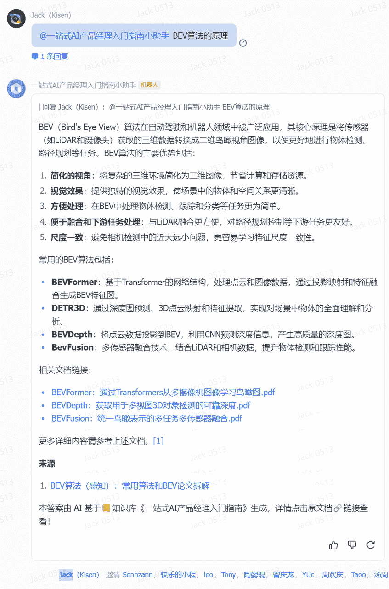
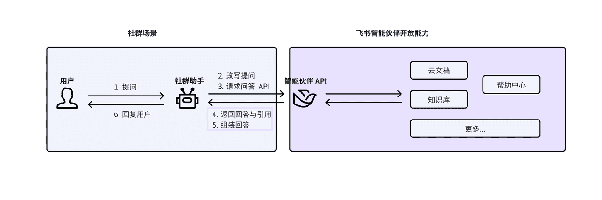
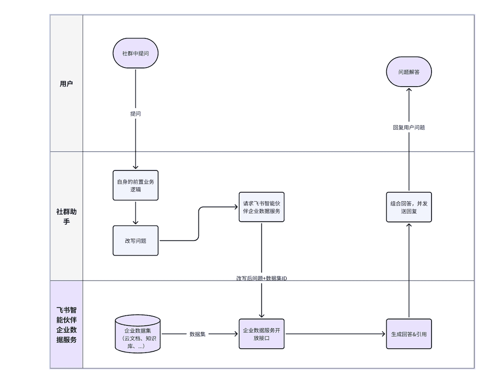

# 案例：基于飞书搭建问答机器人

> 来源：[https://v11enp9ok1h.feishu.cn/docx/JwpkdpafQoyLDXxWhxWcsuAknh8](https://v11enp9ok1h.feishu.cn/docx/JwpkdpafQoyLDXxWhxWcsuAknh8)

# 加入下方外部群体验飞书问答机器人

# 为什么要做问答机器人

1.  整个知识库的内容已经非常庞大，内容越来越丰富的同时，作为一个刚进入知识库的用户，并没有办法可以很快的找到知识库的内容。

1.  传统的搜索是基于关键词及关键词的相关性。例如搜索“吃了吗?"和”昨天晚上鸡腿好吃”，在字面意义上的差异和语义上的价值。

1.  作为一个 AI 知识库，需要用更先进的办法来解决:RAG 技术,

1.  在群中提供一个可以快速供大家检索信息的方式，使用更加便捷。

# 如何基于飞书能力来开发问答机器人

# 问答机器人的底层原理介绍 RAG 技术

## 定义:

RAG(Retrieval-Augmented Generation)是一种结合了检索和生成的技术，它可以让大语言模型在生成文本时利用额外的数据源，从而提高生成的质量和准确性。

## 流程:

RAG的基本流程是:首先，给定一个用户的输入，例如一个问题或一个话题，RAG会从一个数据源中检索出与之相关的文本片段，例如网页、文档或数据库记录。这些文本片段称为上下文(context)。然后，RAG会将用户的输入和检索到的上下文拼接成一个完整的输入，传递给一个大语言模型，例如GPT。这个输入通常会包含一些提示(prompt)，指导模型如何生成期望的输出，例如一个答案或一个摘要。最后，RAG会从大语言模型的输出中提取或格式化所需的信息，返回给用户。

## 优点:

RAG技术的优点是可以利用额外的数据源提供模型所缺乏的知识和信息，从而提高生成的质量和多样性。

## 能力边界:

RAG技术的缺点是也可能引入一些错误和幻觉，例如检索出不相关或不准确的文本片段，或者生成与输入或上下文不一致的输出。

### 参考文档：

[开发：LangChain应用开发指南-大模型的知识外挂RAG](https://v11enp9ok1h.feishu.cn/wiki/L9qswLSbhieYBlkMQwhccNolnxb)

[开发：LangChain应用开发指南-大模型的知识外挂RAG](https://v11enp9ok1h.feishu.cn/wiki/MNEZw2QVqimOGXk0ZFrcfZuQn3e)

[开发：产品视角的大模型 RAG 应用](https://v11enp9ok1h.feishu.cn/wiki/Ny51wDitLi0gGFkSjOeczs5snre)

[通过增强PDF结构识别，革新检索增强生成技术(RAG)](https://v11enp9ok1h.feishu.cn/wiki/ZS1Nwtrqmi2QO3kcUFWcuFbjnHb)

[开发：LangChain应用开发指南-TruLens用量化对抗幻觉](https://v11enp9ok1h.feishu.cn/wiki/FBA1w67ebiITVJkMmKCcfZy5ntd)

[RAG 系统开发中的 12 大痛点及解决方案 ](https://v11enp9ok1h.feishu.cn/wiki/RUsewyZnJiO3UzkqGxncy18dnFd)

当前该接口默认(且目前仅支持)是基于字节的云雀大模型

为什么要开发代码，开发代码和非开发代码的优劣

> **更**[欢迎使用「飞书智能伙伴创建平台」](https://v11enp9ok1h.feishu.cn/wiki/AI7xwymxXiAtqQkhDT3c7byEnQb?from=from_copylink)易使用的解决方案：飞书 AILY

<https://bytedance.larkoffice.com/minutes/embed/obcnpl26f285w26v16227366?from=ccm>

<https://v11enp9ok1h.feishu.cn/sync/Ipw1d27gNsv3OAbo3N7cks4ZnJf>