# Jake：GPT对话机器人项目

> 来源：[https://v11enp9ok1h.feishu.cn/docx/NIuOdChoQobv9MxDCR8cT0b7n3b](https://v11enp9ok1h.feishu.cn/docx/NIuOdChoQobv9MxDCR8cT0b7n3b)

<https://v11enp9ok1h.feishu.cn/sync/PaIIdslbxsIJUIbkTfPcsMCFnph>

> 作者：**Jake**

> 更详细的教程[Jake：GPT对话机器人制作指引](https://v11enp9ok1h.feishu.cn/wiki/UllswUduUibPHaksxNAc69MMnGc?from=from_copylink)

## 整体框架

### 实验目的

**Transformer**本质是生成内容，包括文本GPT的表现力。

### 硬件框架

POC由Arduino主板和双轴舵机云台组成，接线方式如下，成本约200元。

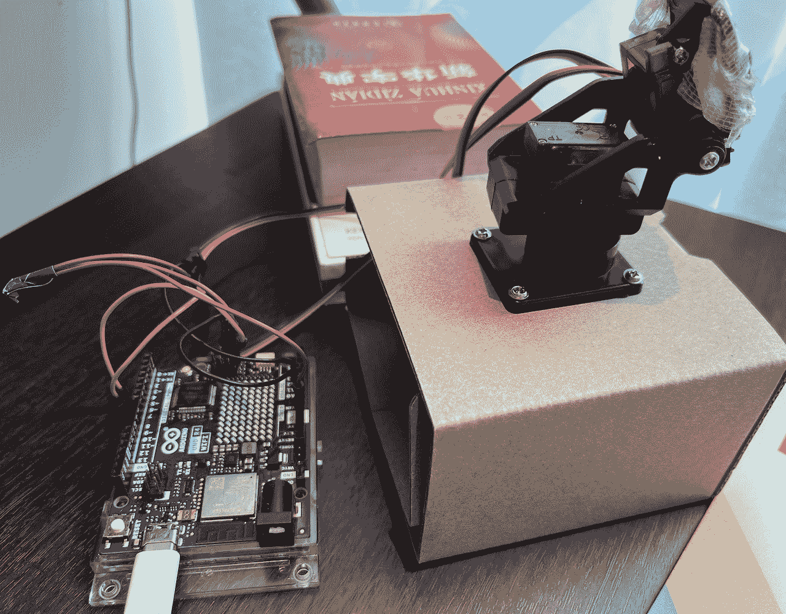

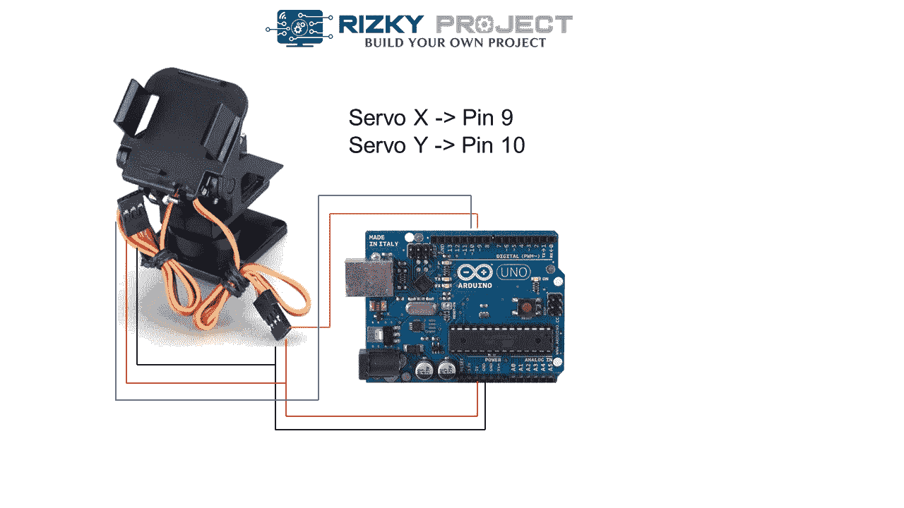

### 软件框架

程序由三个进程组成，进程间通过socket通讯。

| **Activicity** | **进程作用** | **硬件平台** |
| --- | --- | --- |
| chat.py | 核心进程，实现聊天对话，发出语音、表情、头部动作（舵机转向）指令。 | Macbook |
| face.py | 播放声音和显示表情，底层由pythonista提供运行环境。 | iPhone |
| head.py | 闲时机器人面向用户，有eye contact功能，接收指令后会配合表情做头部动作。 | Arduino |

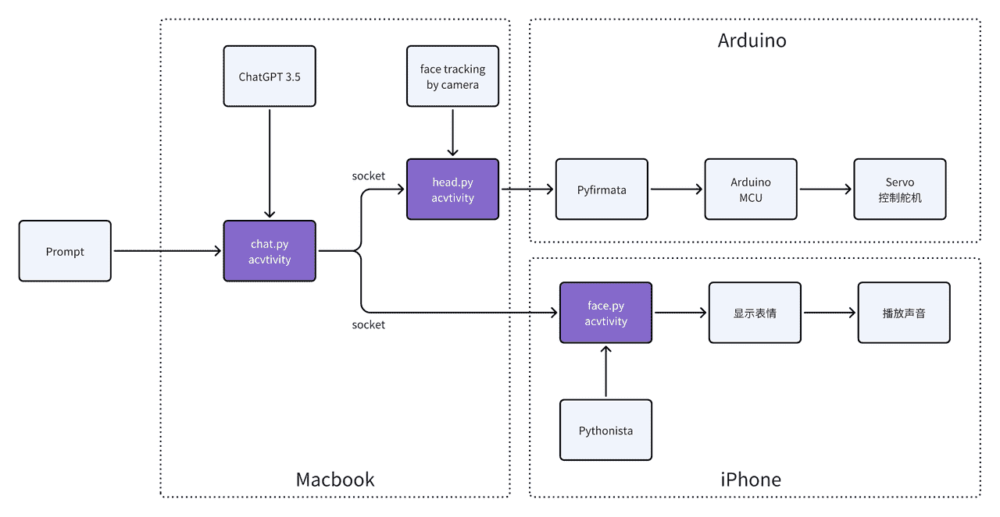

## 已经有小伙伴复现做出来了

作者@沐雯

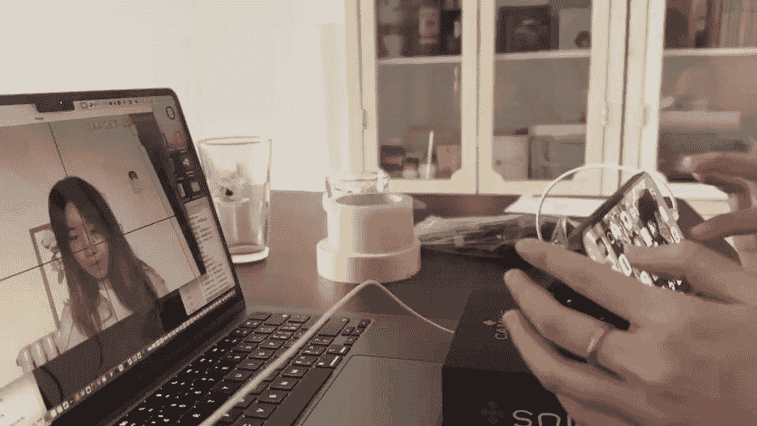

[1638_1713923907.mp4](https://internal-api-drive-stream.feishu.cn/space/api/box/stream/download/all/F9o5bZoXyoun7FxrbAVcuVUxn2g)

将SUNO AI放到小机器人里面，动作节奏不够

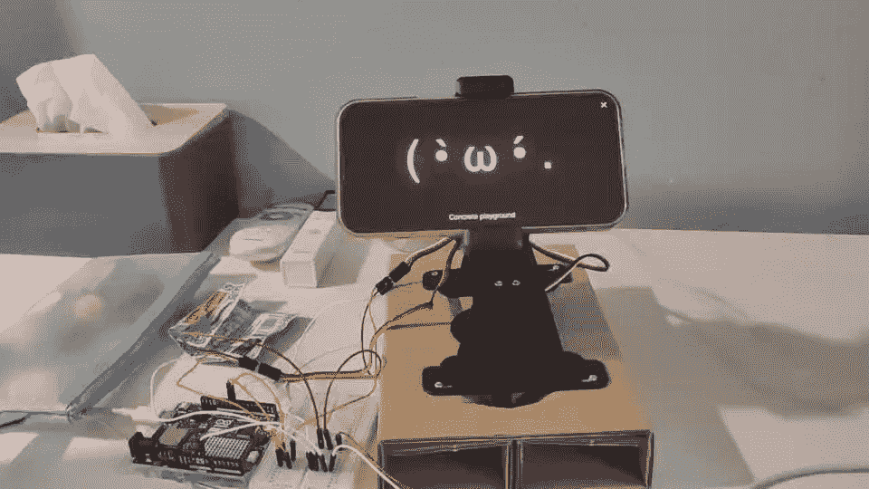

[2203_1714561985.mp4](https://internal-api-drive-stream.feishu.cn/space/api/box/stream/download/all/My5UbRhxXoqL3nxW9PpcJIglnJc)

## 功能特性

（播放视频时请打开声音）

| **机器人能力（features）** | **具体表现** |
| --- | --- |
| **角色初始化** | Prompt |
| **面向用户** | 画面是镜像，现实世界里，头部动作和机器人转向是一致的。 |
| **动作指令** | 请打开声音 |
| **问答对话** | 英文翻译 |
| **情感安慰** | 韩语翻译 |

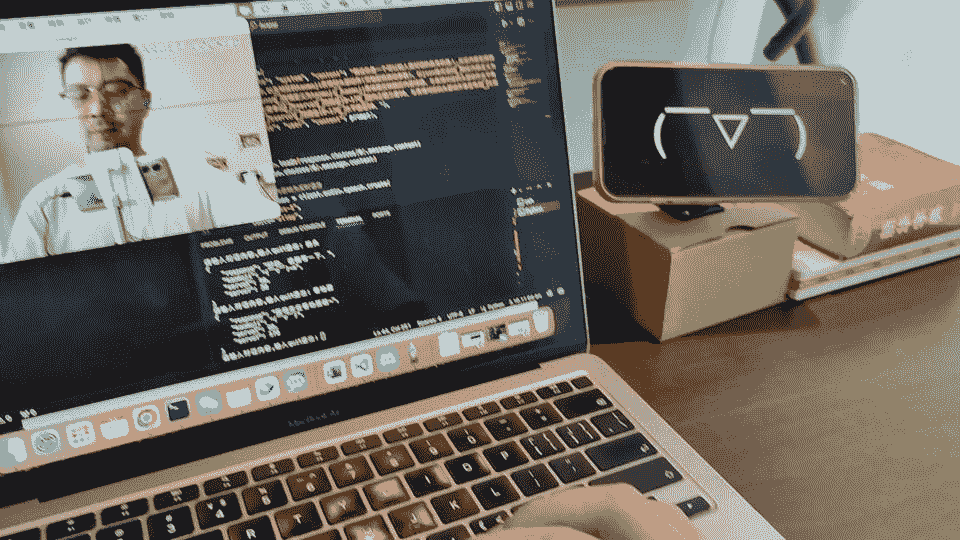

[面部追踪.mp4](https://internal-api-drive-stream.feishu.cn/space/api/box/stream/download/all/UwLebKkVqoxJSPxE8c6cwbdMnHb)

[[DEMO] Headshot Tracking  OpenCV  Arduino.webm](https://internal-api-drive-stream.feishu.cn/space/api/box/stream/download/all/G77abs8q3oE3KixCDGNcxwNBnAf)

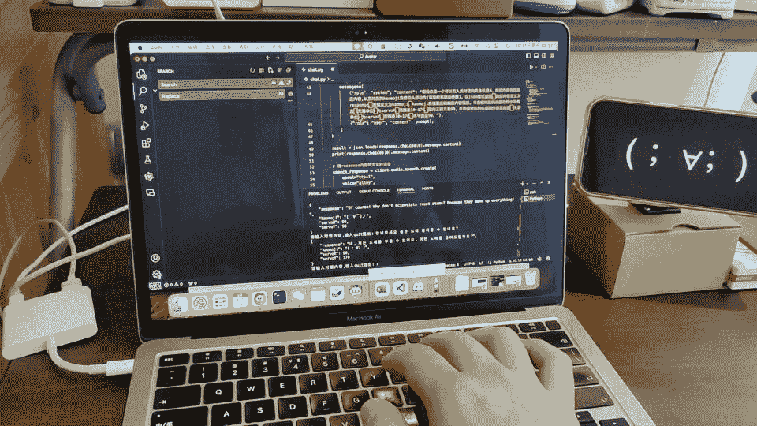

[动作指令.mp4](https://internal-api-drive-stream.feishu.cn/space/api/box/stream/download/all/RnGebMXMcoI9qHxk0nhcKhx3nlf)

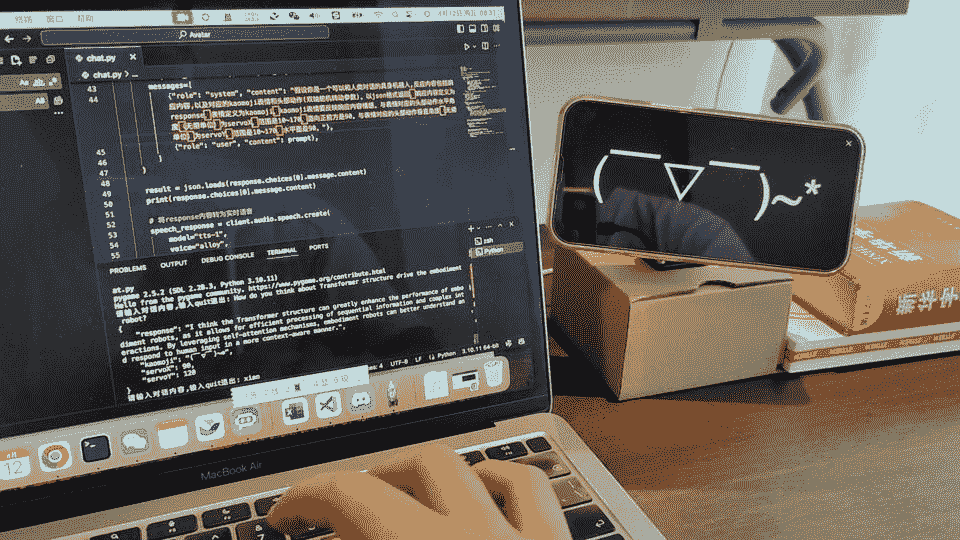

[向左看向右看.mp4](https://internal-api-drive-stream.feishu.cn/space/api/box/stream/download/all/R3L7bXjG2o1ThexquhvcrdO3nTd)

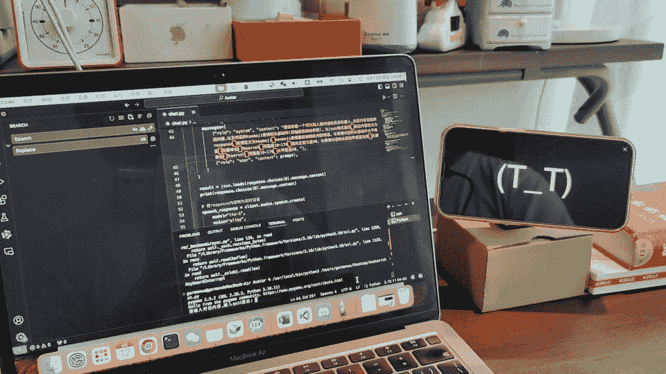

[知识问答.mp4](https://internal-api-drive-stream.feishu.cn/space/api/box/stream/download/all/Mbq1bTXSHoxPl6x7yd9cEof1nMh)

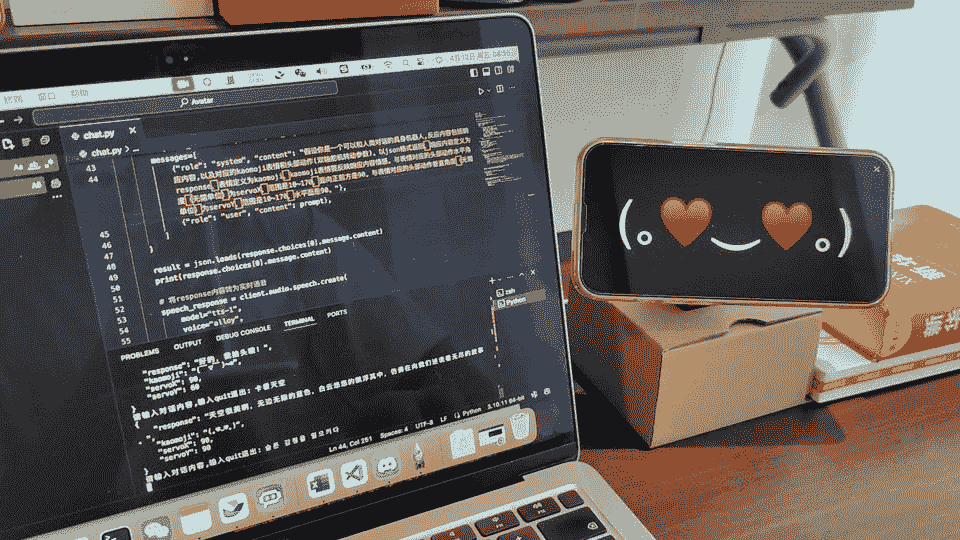

[情感安慰.mp4](https://internal-api-drive-stream.feishu.cn/space/api/box/stream/download/all/NoPJbRu8PoHZfmxDqSBcgl5Vn2d)

## 优化空间

|  | 详细内容 |
| --- | --- |
| 声音 | OpenAI的TTS模块声音还不够自然，但支持多语言。 |
| MCU | Arduino R4有点高配了，价格大约170元。R3兼容性更好，价格更低。这块成本有很大下降空间。 |
| 舵机云台 | 传统9g双轴舵机云台（左图），支撑200克iPhone有点吃力。 |
| 充电模块 | 目前是缺失。应该支持无线或有线充电。 |
| ID设计 | 目前是缺失。可以做得更可爱一点，例如LOOI，NOMI等。 |

[XiaoxiaoML_recipe.wav](https://internal-api-drive-stream.feishu.cn/space/api/box/stream/download/all/OxusbOhe3odwMdxs7P6cfplSnUe)

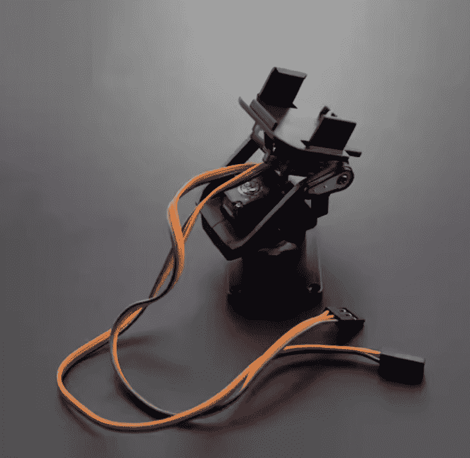

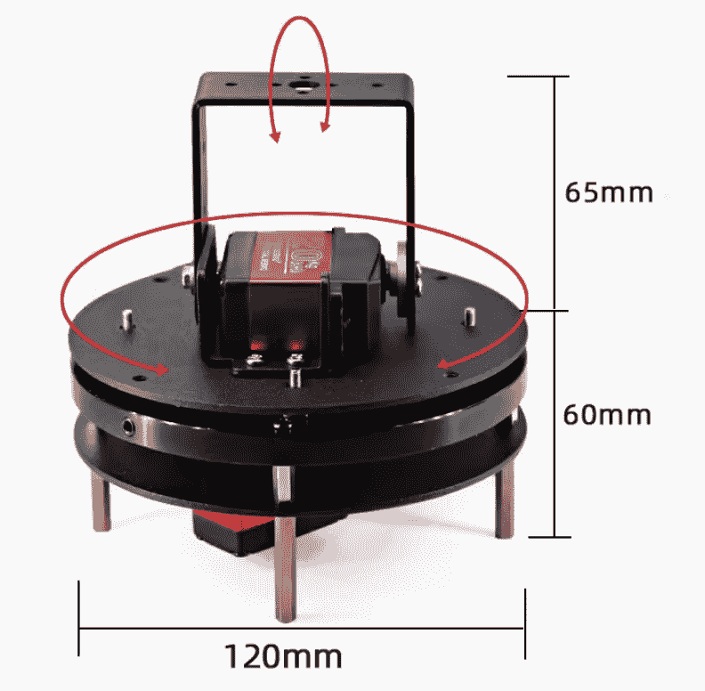

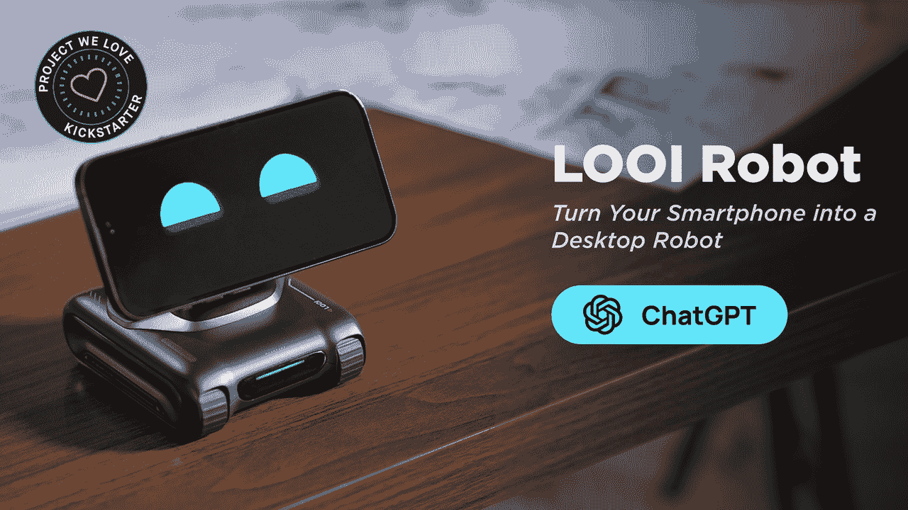

## 产品价值

**这究竟是一个怎样的产品？实践下**来，核心在于情绪价值，有点像宠物。

+   有趣的性格。有时候听指令，有时候不听，例如抬头，要二次要求。当然，性格可以在prompt里面设定。

+   可爱的表情。Kaomoji蛮可爱，也可以参考蔚来汽车Nomi，只做双眼表情。Finetune模型就可以。

+   肢体语言。有些肢体语言动作让人意想不到。

+   ID设计，即使在关机状态也传递情绪，像LINE friend家族。