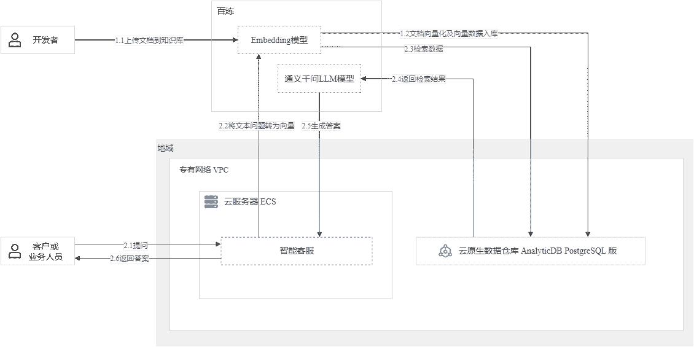

# AnalyticDB与通义千问搭建AI智能客服

> 来源：[https://v11enp9ok1h.feishu.cn/docx/XdwVdbLKUogTqyxhFGJcSzYFnwc](https://v11enp9ok1h.feishu.cn/docx/XdwVdbLKUogTqyxhFGJcSzYFnwc)

基于AnalyticDB for PostgreSQL的高性能RAG引擎与阿里云自主研发的通义千问LLM模型，构建一个高性能的检索增强生成（Retrieval-Augmented Generation, RAG）应用，实现企业的AI智能客服，更高效地解决客户问题。

## 一、引言

基于RAG技术的AI智能客服能够高效地检索企业私域知识库，并利用大语言模型理解问题的上下文和意图，生成准确、贴切的答案。开发者将企业私域知识上传到智能问答系统后，企业业务人员就能通过提问快速获取公司政策、操作流程、专业知识等信息，客户也能快速得到产品知识、售后问题的答案。

基于AnalyticDB for PostgreSQL的高效向量引擎与阿里云自主研发的通义千问LLM模型，构建一个高性能的检索增强生成（Retrieval-Augmented Generation, RAG）应用，实现企业的AI智能客服，更高效地解决客户问题。

## 二、搭建AI智能客服方案概览

大模型虽然可以理解并生成自然语言，但由于缺乏特定领域的专业知识、没有企业的私域知识、知识更新不及时等问题，无法直接用于企业的AI智能客服。为了解决这一问题，企业可以采用RAG技术，从外部知识库（企业的私域知识）检索知识。召回的知识将和原始查询融合成prompt，为大模型提供更丰富的上下文信息，从而生成更加准确的回答。本方案将指导您快速创建一个RAG应用（AnalyticDB for PostgreSQL向量存储+通义千问LLM模型），实现企业的AI智能客服，更高效地解决客户问题。

### 1、方案优势

简单易用：只需简单的页面点击，即可实现知识检索增强，使大模型有更丰富的上下文信息并生成更准确的答案。同时，本方案提供智能客服的示例代码，方便您快速体验AI智能客服。

灵活且安全管理：向量数据存储在AnalyticDB for PostgreSQL，企业可灵活管理数据。配套的审计、权限管理等功能可满足企业安全合规需求。

性价比高：完成本方案的部署及体验，预计产生费用不超过10元（假设您选择部署准备中相关规格资源，且运行时间不超过1小时，如果调整了资源规格，请以控制台显示的价格以及最终账单为准）。

## 2、方案架构

在阿里云上搭建的云上私有网络如图所示。实际部署时，您可以根据资源规划修改部分设置，但最终形成的运行环境与下图相似。

本方案的技术架构包括以下基础设施和云服务：

+   1个专有网络 VPC：将云原生数据仓库 AnalyticDB PostgreSQL 版部署在专有网络中。

+   1台交换机：将云服务器 ECS实例和云原生数据仓库 AnalyticDB PostgreSQL 版实例部署在交换机中，实现它们之间的网络通信。

+   1台云服务器 ECS：用于部署智能客服。

+   1个云原生数据仓库 AnalyticDB PostgreSQL 版实例：提供向量数据存储和检索服务。

+   百炼：一站式的企业专属大模型生产平台。在本方案中，提供通义千问LLM模型的调用以及知识索引功能。

## 三、部署准备

开始部署前，请按以下指引完成账号申请、账号充值和授权。

### 准备账号

1、如果您还没有阿里云账号，请访问阿里云账号注册页面，根据页面提示完成注册并进行个人实名认证。阿里云账号是您使用云资源的付费实体，因此是部署方案的必要前提。

2、为阿里云账号充值。本方案的云资源支持按量付费，且默认设置均采用按量付费引导操作。如果确定任何一个云资源采用按量付费方式部署，账户余额都必须大于等于100元。

## 四、一键部署

资源编排（ROS）可以让您通过YAML或JSON文件清晰简洁地描述所需的云资源及其依赖关系，然后自动化地创建和配置这些资源。您可以通过下方提供的ROS一键部署链接，来自动化地完成这些资源的创建和配置。

+   部署1个专有网络 VPC。

+   部署1台交换机。

+   部署1台云服务器 ECS，并在服务器上部署Python3.9环境和AI智能客服的示例代码。

+   部署1个云原生数据仓库 AnalyticDB PostgreSQL 版实例。

## 五、体验智能问答

1.  在ROS控制台资源栈列表页，找到目标资源栈，单击资源栈ID，然后切换到输出页签。

1.  复制WebUrl的地址，粘贴到浏览器地址栏，访问AI智能客服。

1.  在提问框中提问，例如“哪款手机续航时间最长”。

您可以看到此时大模型的回答参考了您上传的百炼系列手机产品介绍。

## 六、完成及清理

**清理资源**

在本方案中，您创建了1台云服务器 ECS实例、1个云原生数据仓库 AnalyticDB PostgreSQL 版实例、1个百炼应用、1个安全组、1个交换机、1个专有网络 VPC。完成本文方案的体验后，如需删除资源，可按下文操作。

+   删除云服务器 ECS实例、云原生数据仓库 AnalyticDB PostgreSQL 版实例、安全组、交换机、专有网络 VPC，可以在ROS控制台找到目标资源栈，单击删除，选择删除方式为释放资源。

+   **删除百**炼应用，需要登录百炼控制台我的应用页面，在应用右上角单击三个点删除应用。在数据处理页面和数据应用 > 知识索引页面，找到上传的数据和创建的知识库，单击删除。