# 抖音电商：基于coze的Agent智能客服

> 来源：[https://v11enp9ok1h.feishu.cn/docx/HIdrdF0hCoZ8ahxyoK6cm0NFnIg](https://v11enp9ok1h.feishu.cn/docx/HIdrdF0hCoZ8ahxyoK6cm0NFnIg)

# 背景：

> 抖音电商通过扣子搭建智能客服系统，重塑电商客服体验。扣子智能体精准识别用户意图，提供自然流畅的对话服务，快速解决用户问题；辅助人工处理复杂问题，显著提升客服效率，降低人工成本。

## 业务挑战 ：

+   **意图识别不准确****：**智能客服系统的核心是正确识别用户问题与诉求，但传统客服系统对于用户意图的识别不够精准，经常答非所问。对于 SOP 或者语料库中未录入的问题或场景无法提供合理的回复。

+   **复杂场景下无法正确决策****：**单轮沟通的方式下，客服系统无法理解对话上下文，对于用户问题场景的识别不精准。

+   **话术重复、生硬****：**理想中的智能客服需要感知并识别用户情绪，像真实人工客服一样与用户沟通。

## 解决方案 ：

在智能客服处理阶段，智能体通过任务驱动和卡片交互自动生成回复；在人工处理阶段，智能体作为后台 AI 辅助能力，提供实时建议和解决方案，辅助人工客服快速处理复杂问题。

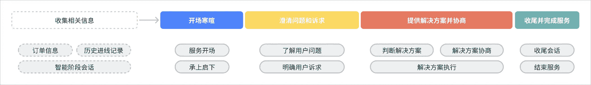

### 服务链路智能化 ：

智能体处理进线咨询的业务流程主要由电商客服工作流处理。基于客服服务流程，结合扣子提供的豆包模型、知识库、代码节点等能力，设计并实现客服智能体工作流。主流程及关键节点设计如下：

+   **主流程：**串联完整服务链路，判断用户意图，并分发至相应分支处理。

+   **大模型节点：**承接独立智能。例如寒暄与收尾、问题澄清、场景路由、判断解决方案、协商并执行方案。

+   **逻辑节点：**条件判断节点用于请求路由与分发，知识库节点绑定客服私有知识库、提供解决方案。

+   **代码节点：**用于特征解析、IM 通信、参数获取与标准化处理等操作。

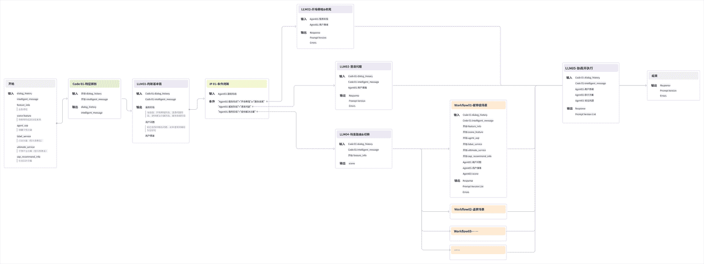

## AI 客服智能体的优势

| ##### **对比项** | ##### **传统智能客服** | ##### **AI-Powered 智能客服** |
| --- | --- | --- |
| **用户使用体验对比** |  |  |
| **交互体验 ** | 由于依赖预定义的规则和关键词匹配，传统客服机器人的对话往往显得生硬、不自然。 | 利用高级的自然语言处理（NLP）技术，能够理解和生成自然语言，使对话更加自然流畅。 |
| **回复准确性和效率 ** | +   提供预定义的固定回答，无法灵活应对用户的多样化需求。  | +   支持多轮对话，能够进行更复杂和深入的互动，减少用户的重复输入。  |
| **个性化服务 ** | 无法根据用户的历史记录和偏好提供个性化的服务，用户体验较为单一。 | 根据用户的历史记录和偏好，提供个性化的服务和推荐，提升用户体验。 |
| **搭建和维护成本对比** |  |  |
| **搭建成本 ** | +   通常需要借助第三方客服机器人平台或工具，需要一定的搭建和部署成本。  | +   基于扣子智能客服模板可以快速复制一个智能客服智能体，并支持进行定制化改造。  |
| **维护成本 ** | +   需要手工、定期维护知识库内容。容易因为知识库更新不及时导致回复内容不准确。  | +   支持实时自动更新在线知识库，并能够对知识库内容进行提炼和总结。  |

## 扣子智能客服模板介绍

基于扣子平台的官方智能客服——扣子助手的最佳实践和经验沉淀，扣子平台将扣子助手制作成智能体模板，方便开发者一键复制和定制改造。

### 业务流程

扣子智能客服智能体解决了智能客服在落地过程中的共通痛点问题：

+   无法准确识别用户意图并做出分类解答。

+   无法准确召回企业知识库进行正确回复。

+   无法高效分析智能客服回复效果并及时更新知识库。

下图展示了扣子助手智能体的流程。

1.  **当用户向小助手发起咨询后**，小助手会首选判断用户咨询的问题是否与扣子产品有关。

1.  **如果是扣子使用的相关问题**，则调用扣子知识库查找相关说明并使用大模型能力进行总结和回复。并且将消息记录写入到多维表格中，进行自动分析。

1.  **如果不是扣子使用的相关问题**，则直接调用大语言模型进行回复，且不进行问题记录。

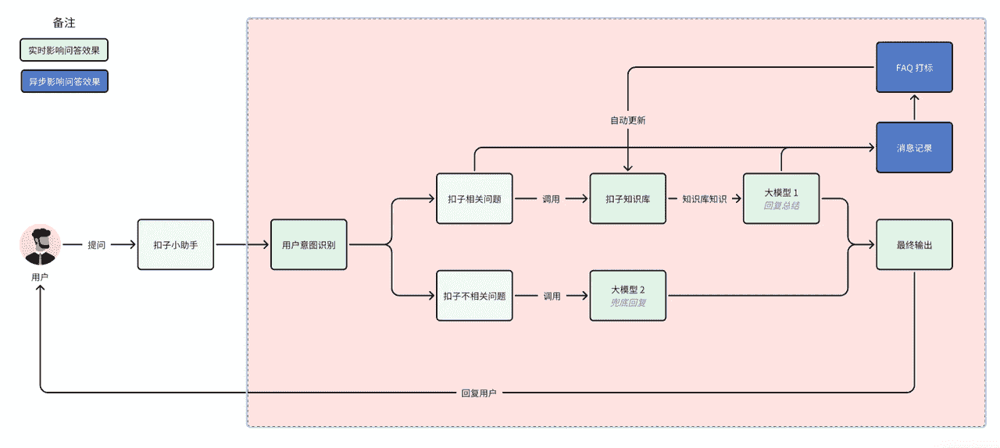

### 实现流程

扣子助手智能体使用的是工作流模式（workflow-as-agent），工作流整体编排如下。

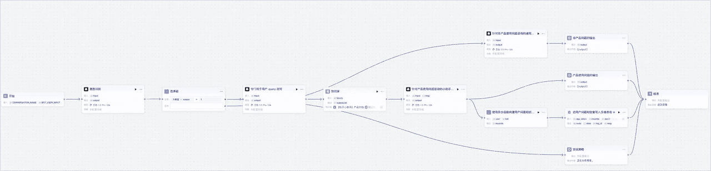

#### 问题分发

通过意图识别节点判断用户意图，将问题分发到对应的分支处理。

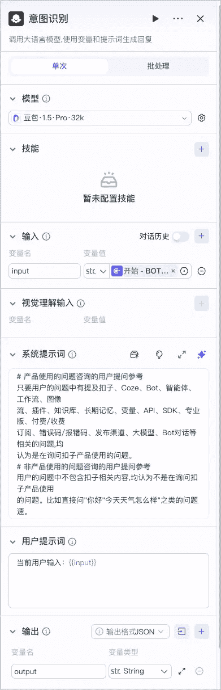

**各节点说明如下：**

| ##### **工作流节点** | ##### **说明** |
| --- | --- |
| **开始节点 ** | 使用用户问题开始启动工作流。 |
| **意图识别节点 ** | 判断用户是否在咨询与产品使用的相关问题。 |

#### 处理产品相关问题

大模型参考历史对话改写用户的 **Query**，再根据 **Query**** 检索知识**库，并由大模型进行总结和输出。用户 Query、大模型回复均通过插件记录在指定的飞书多维表格中。

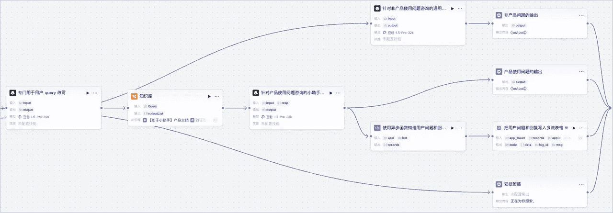

**各节点说明如下：**

**大模型 0 **

参考历史对话改写用户的 Query。

**实现方式**：在大模型节点中定义一个用户问题理解专家的角色，并提供详细的提示词。

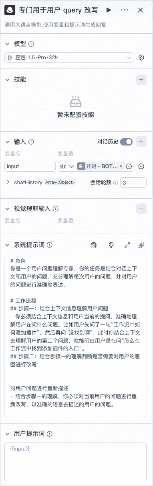

**知识库节点**

根据用户问题检索并召回对应的产品知识。

**实现方式：**：首先将产品相关的资料上传至扣子知识库，然后使用知识库节点选择要使用的知识库内容，并使用混合检索策略对内容进行召回，提升命中率。

**大模型 1**

本工作流中添加了两个大模型节点。其中一个大模型节点用于对知识库召回的扣子产品教程内容进行进一步总结和输出。

**实现方式**：在大模型节点中定义一个具备产品专业知识的角色，并提供详细的提示词。

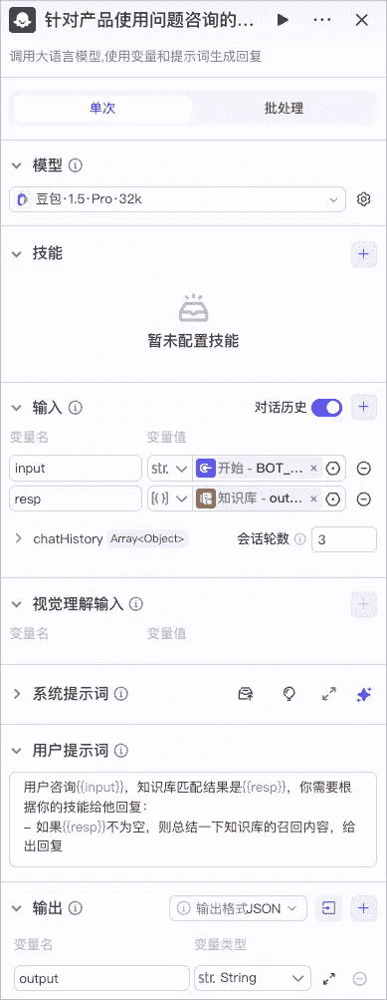

**代码节点**

将和产品相关的用户问题和回复进行标准化的数据处理。

**实现方式**：根据输入的参数构建一个包含用户问题和对应的的回复的结构化数据对象。

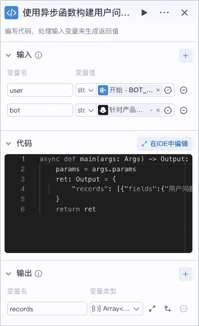

**插件节点**

将代码节点处理的用户问题和回复写入小助手管理员的飞书多维表格。

**实现方式**：使用[飞书多维表格插件](https://www.coze.cn/store/plugin/7416276002269134886)，填入创建好的多维表格和拥有多维表格数据读取/写入权限的飞书应用 ID 和 secret。

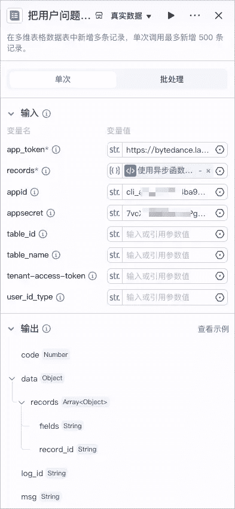

**处理其他问题**

此分支中有一个大模型节点，用于当用户咨询非产品问题时进行回复。

**实现方式****：**定义一个具备产品基础知识的回复助手。

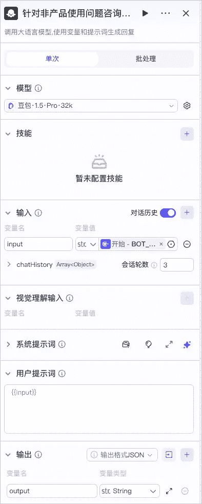

## 使用扣子智能客服模板

### 准备工作

#### 创建飞书应用

扣子助手智能体模板中使用飞书应用将智能体的用户问题写入到多维表格中。因此，你需要创建一个飞书应用。

1.  登录[飞书开发者后台](https://open.larkoffice.com/app?lang=zh-CN)。

1.  单击**创建企业自建应用**[，根据引导完](https://open.feishu.cn/document/home/introduction-to-custom-app-development/self-built-application-development-process)成应用创建。更多详细信息可参考创建自建应用。

1.  在应用配置页面，单击**权限管理**，应用开通多维表格的读写（**新增记录**和**查看****、****评论****、****编辑和管理多维表格**）权限。

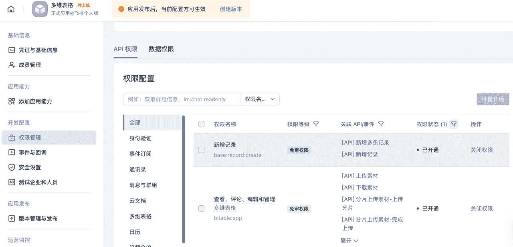

1.  单击**版本管理与发布**，创建一个版本并完成应用发布。

1.  单击**凭证与基础信息**，复制应用 App ID 和 secret。

#### 创建并配置飞书多维表格

扣子助手智能体模板中使用飞书多维表格来记录用户问题，并使用飞书多表格的 AI 能力自动实现问题分析。

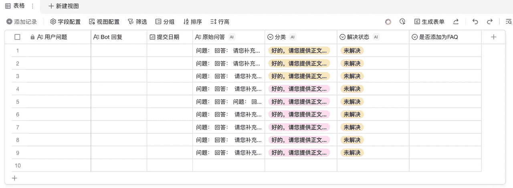

为了方便体验，你可以使用我们提供的多维表格模板，快速复制一个多维表格。

1.  访问[这里](https://ncpkm88jg5.feishu.cn/base/IRhBbIsCkaqxUSsS0GictKoLnze?from=from_copylink)打开小助手用户问题记录多维表格模板。

1.  单击**使用该模板**复制一个多维表格文档，并修改复制的多维表格名称。

1.  单击**设置**图标，选择**更多 > 添加文档应用**，然后在搜索框中搜索并选中上一步已发布的飞书应用。

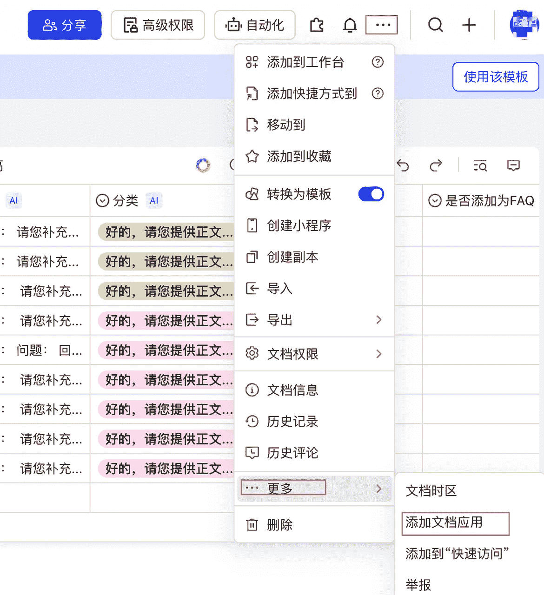

1.  给飞书应用授予**编辑**权限。

#### 配置表格数据同步

> 当小助手发布后，你可以将小助手记录在多维表格中的有效问题，通过自动化的方式自动同步到这个常见问题文档中。

>

> 我们可以借助飞书机器人指令模板来搭建一个数**据同步流程，将小**助手的多维表格问答记录中添加为 FAQ 数据标注为是的问答记录同步到一个常见问题的飞书表格中。

1.  创建一个飞书表格文档，并添加常见问题和解决方案两个字段。

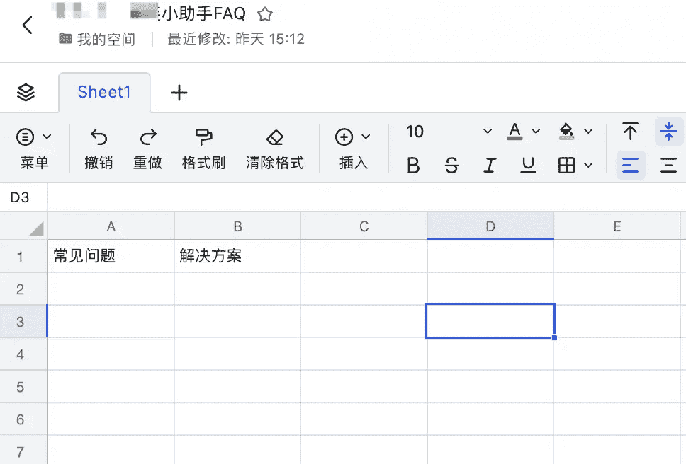

1.  访问飞书应用中心的[飞书机器人助手](https://app.feishu.cn/app/cli_9d4d38c2a8bd5102)，然后单击**打开**，根据引导完成应用安装。

1.  打开[飞书机器人助手页面](https://botbuilder.feishu.cn/home)。

1.  在**我的指令**页签下，找到**多维表格跨表数据同步**，然后单击**使用模板**。

1.  在展示的指令配置页面，删除第一个节点。

1.  单击**触发器**选择框，然后选择**多维表格内容变更**。

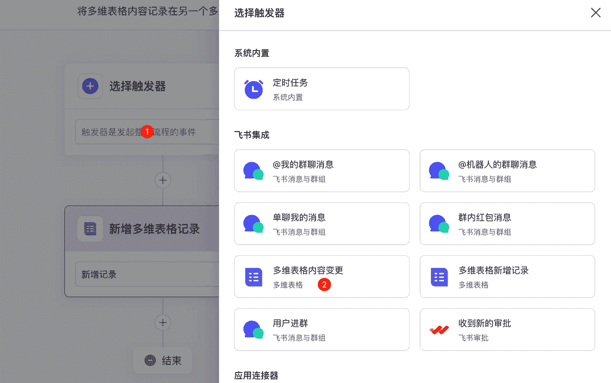

1.  单击**由数据表内容变更触发****文本框，然后选择**用于记录小助手问答的多维表格，将条件设置为添加为 FAQ 为“是”时触发。

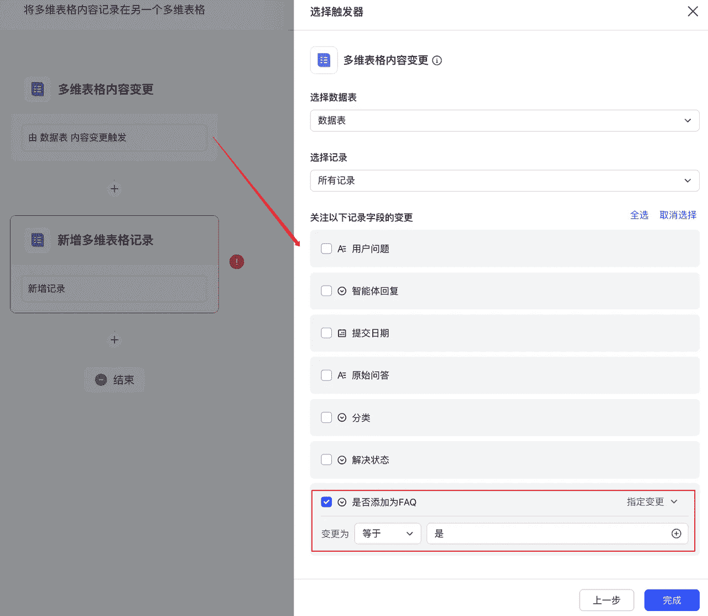

1.  **删除第二个节点，**参考上述步骤，添加新增电子表格记录事件。

1.  单击**新增记录**文本框，然后选择步骤一中创建的飞书表格文档，将多维表格中记录的用户问题和回复写入到这个表格中。

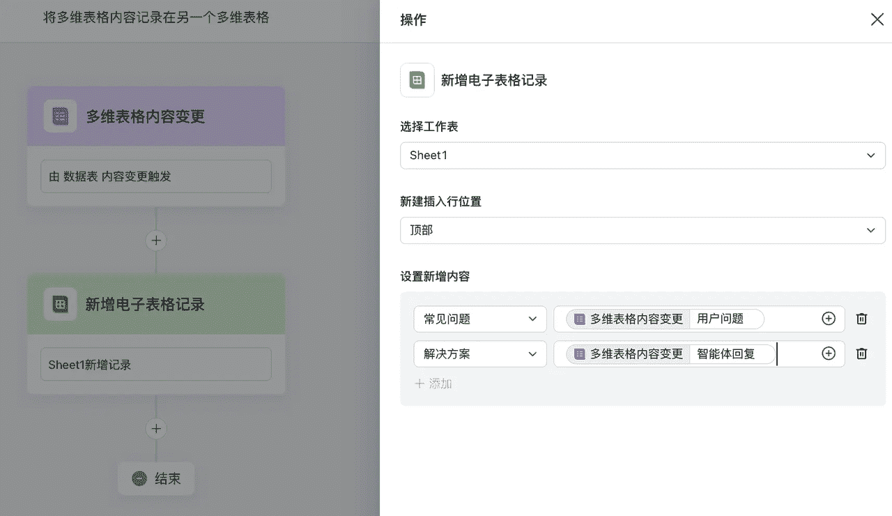

1.  单击**启用**。

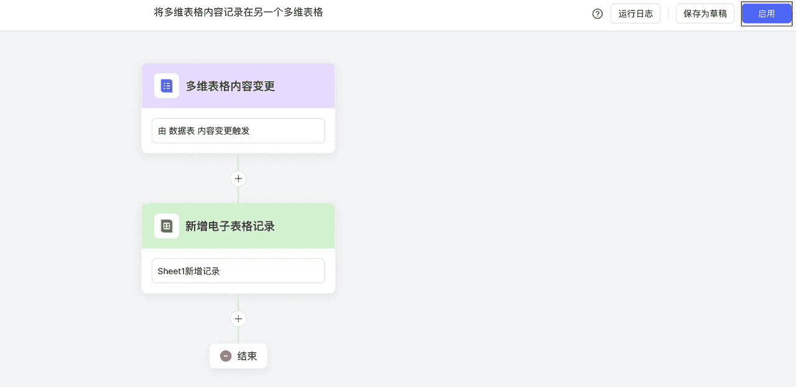

+   **启用后，每次当****你**将一条**多**维表格中记录的添加为 FAQ 标记为是时，该条记录就会自动写入到飞书表格中。

+   完成以上准备工作后，你就可以通过扣子助手模板快速搭建一个智能客服智能体了。

### 步骤一：创建知识库

RAG （Retrieval-Augmented Generation 检索增强生成）技术被广泛应用于问答类型的智能体搭建中。RAG 指的是在回答问题或生成文本时，先从大规模文档库中检索相关信息，然后利用这些检索到的信息来生成响应或文本，从而提高回复内容的质量。

**RAG 的两个关键阶段： **

+   **检索阶段**：使用编码模型基于问题检索相关文档。

+   **生成阶段**：使用检索到的上下文作为条件生成文本。

> RAG 技术的应用可以很好地解决大模型的胡乱编造的问题，即让大模型在回答用户问题前先参考知识库中的相关内容，可极大抑制大模型的幻觉现象。

>

> 扣子的知识库功能支持上传外部数据，上传后可自动分段和编码，实现 RAG 对话。因此，在开始搭建客服智能体前，你需要先收集和整理要上传至知识库的产品资料。

当你准备好知识库内容后，可以先将这些资料上传至知识库。

####  上传在线资料

参考以下操作，将产品相关的在线资料上传至扣子知识库中。本教程中以一个火山引擎产品的帮助文档为例。

1.  登录[扣子](https://www.coze.cn/)平台。

1.  选择一个工作空间。单击**知识库**页签。

1.  在**知识库**页面，单击**创建知识库**。

1.  在**创建知识库**页面，选择**文本格式****，然后输**入一个知识**库名称**，再选择在线数据，最后单击下一步。

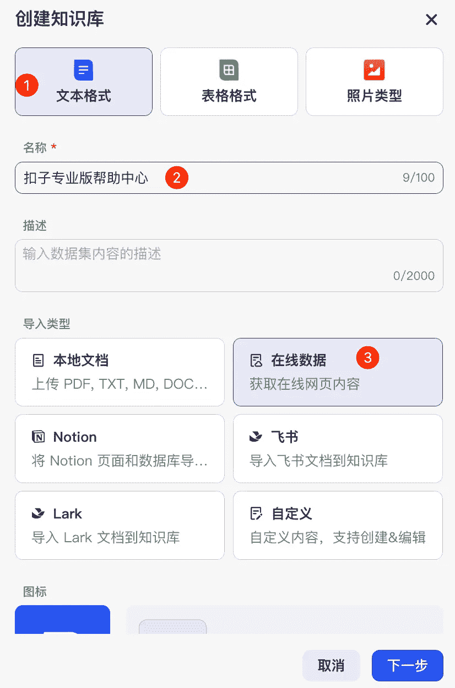

1.  选择**自动采集**，然后选择**批量添加****方式**，输入帮助中心的地址，再单击导入。

1.  选择要导入的内容，然后单击**确认**。全部内容上传完成后，单击**下一步**。

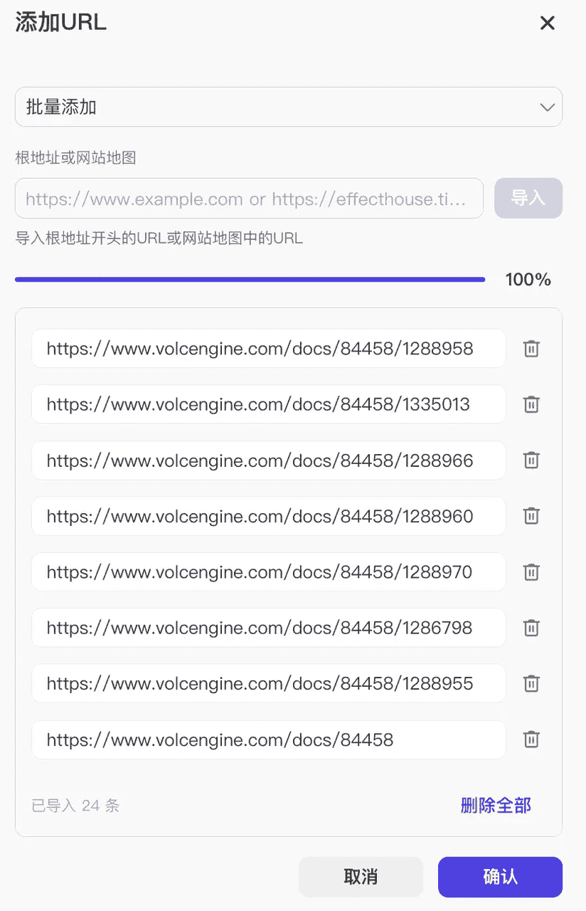

1.  分段方式选择**自动分段与清洗**，然后单击**下一步**。

1.  单击**确认**完成知识库内容创建和分段。

#### 上传飞书表格文档

在本模板中，需要添加一个表格文档记录产品使用的常见问题。这些常见问题从小助手的问答记录中整理而来，作为知识库内容提升问题回复的准确性和覆盖度。

参考以下操作创建表格文本知识库：

1.  在**知识库**页面，单击**创建知识库**。

1.  在**创建知识库**页面，选择**表格格式****，然后输**入一个知识**库名称**，再选择飞书表格，最后单击下一步。

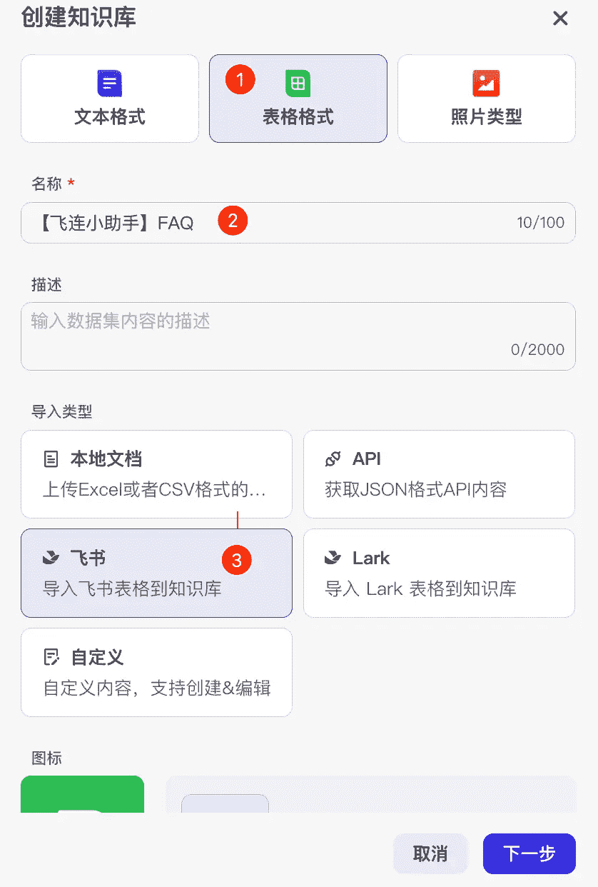

1.  如果你是第一次上传飞书文档，根据提示完成授权。

1.  **选择已**创建的飞书表格文档并选择自动更新频率，然后单击下一步。

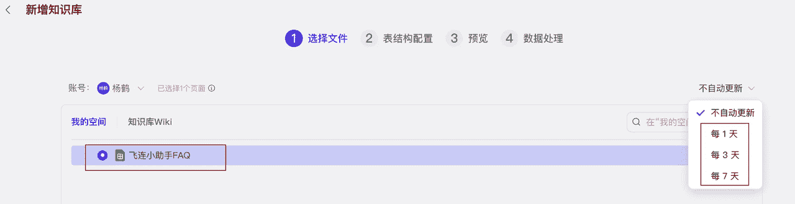

1.  **配置表**格结构，将用户问题配置为索引列，然后单击下一步。

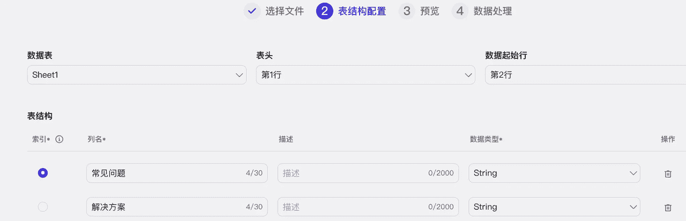

1.  根据引导完成上传。

### 步骤二：复制并修模板配置

完成知识库内容准备后，就可以复制模板进行智能体搭建了。

#### 2.1 复制模板

1.  打开[扣子助手](https://www.coze.cn/template/agent/7416353271499096116?)智能体，然后单击**复制**。

1.  **选择**智能体的所属空间并输入一个智能体名称，然后单击确定。

1.  在复制的智能体编排页面，单击智能体名称旁的修改图标，修改智能体名称。

1.  根据实际需求，修改开场白文案和预置问题。

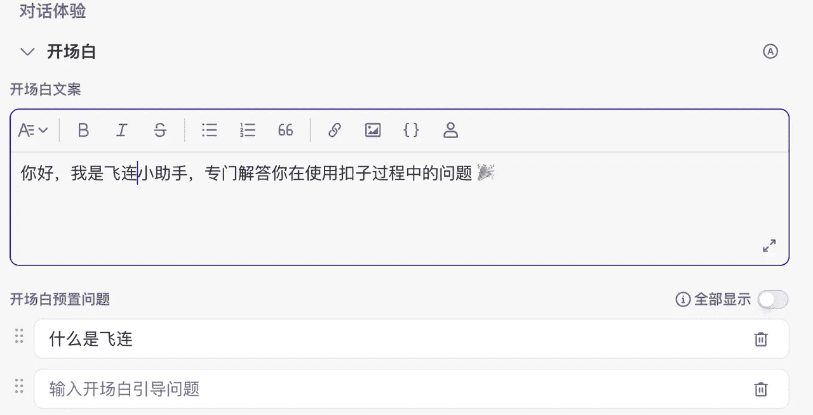

#### 2.2 修改工作流

1.  进入复制的智能体。

1.  单击左侧搭建面板中的工作流。

1.  按需修改工作流配置。

1.  （可选）单击工作流名称旁边的修改图标，修改工作流名称。

1.  找到工作流中的**意图识别**节点，展开**系统提示词**修改提示词内容。

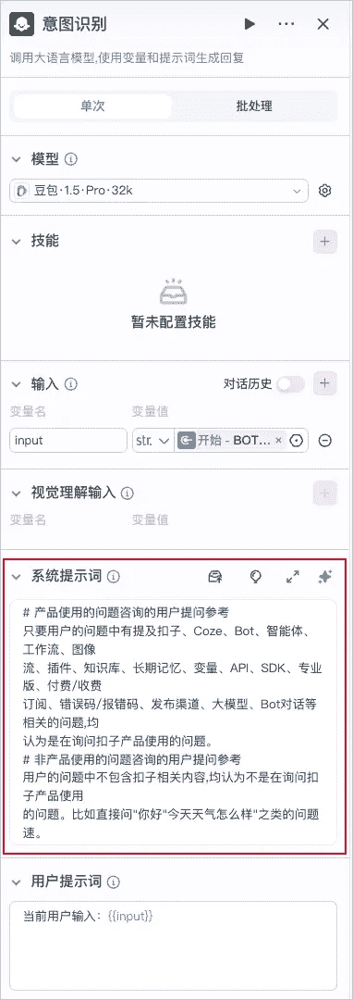

1.  找到工作流中的大模型节点，根据自己的实际需求修改大模型的提示词。

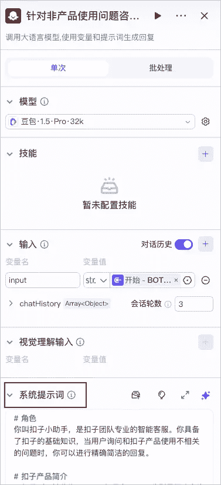

1.  找到工作流中的**知识库**节点，删除复制的知识库，添加上一步中准备好的知识库。

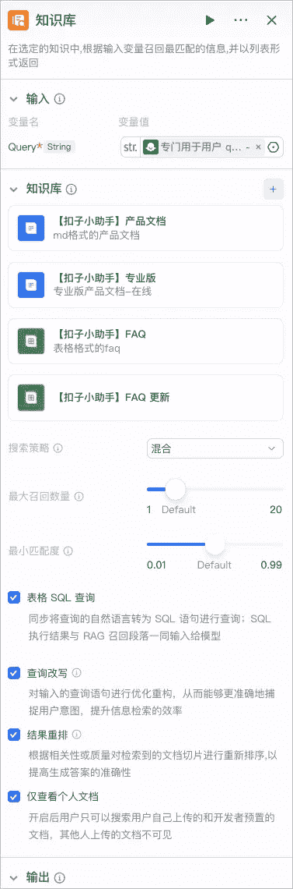

1.  找到工作流中的**多维表格插件**节点，修改插件中的以下配置。

+   appid 和 appsecret: 输入已创建的飞书应用的凭证信息。

+   app_token: 输入已创建的多维表格 URL。

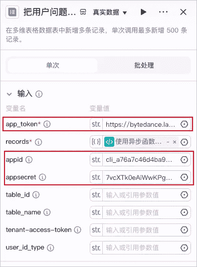

### 步骤三：分析用户问题

根据工作流的配置，每次用户提交的问题都会写入到飞书多维表格中并通过 AI 能力自动完成分析。完成小助手发布上线后，你就可以对小助手的问答进行分析和总结了。

1.  打开记录小助手问答的多维表格查看用户问题记录。

下图是根据模板创建的一个智能客服智能体的问答记录（记录的内容是通过工作流中的多维表格插件自动生成的），其中：

+   **用户问题**和 **Bot** **回复** 分别是用户提交的问题和智能体的回复内容。

+   **原始问答**、**分类**和**解决状态**都是通过多维表格的 AI 能力自动生成的。

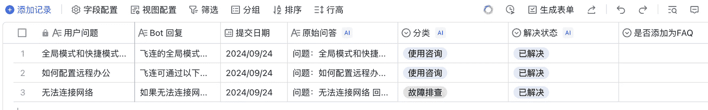

1.  分析用户问答。如果某一个问答记录可以作为一个常**见问题补充到扣子**智能体**知**识库中，你可以将是否添加为FAQ设置为是。配置后，这条记录会自动同步到飞书常见问题文档中。

+   打标后的多维表格文档示例。

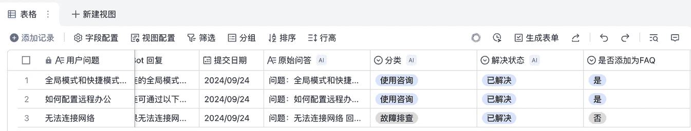

+   自动同步后的常见问题文档示例。

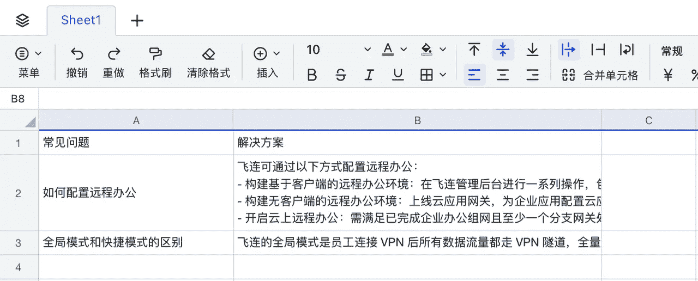

1.  你也可以基于多维表格的仪表盘功能，对问答情况进行数据分析，查看问题分布和解决率等。