# DeepSeek 提示词方法论

> 来源：https://v11enp9ok1h.feishu.cn/docx/COuIdXcKSohvMZxVqUAcZzyOnQe

本文可编辑，欢迎补充自己的使用案例-在最后（放了李继刚适配的`prompt`和案例）

| 案主 |  |  |

| --- | --- | --- |

| 南瓜博士 | 当你惊呼 DeepSeek 成精时，请警惕前方的陷阱 | https://mp.weixin.qq.com/s/ppt89GozeYo7hR99pEFrkA |

| 南瓜博士 | 让 DeepSeek 成为全家人的脑洞外挂 | https://mp.weixin.qq.com/s/BBh8GTrdhb8Qyqgz8SufwQ |

| 奥 | 让DeepSeek进行脱口秀创作，幽默程度虽然大幅提升，但仍有进步空间 | https://mp.weixin.qq.com/s/3nZERD5H5wPCGCT1_A46Sw |

|  |  |  |

[1.11详解：DeepSeek深度推理](https://v11enp9ok1h.feishu.cn/wiki/U9NlwPvSNifANlkDgvIc9EpQnog)eepSeek最新文章观点学术报告及业界评论 看这里：

以下是R1模型的一些使用建议

## 一、核心理念重塑

### 1. 对话式智能交互

+ 自然语言优先：无需结构化模板，直接描述真实场景

"我需要给投资人讲新能源电池项目，他们关注技术路线和回报周期，帮我整理核心要点"

+ 需求推理引擎：模型会自动识别隐藏需求

"正在准备跨境电商选品报告" → 自动补充市场分析框架/数据维度/竞品对比

### 2. 深度思考激活

+ 三阶思考法：

  - 批判视角 → 要求识别潜在风险
  - 逆向推演 → 强制验证逻辑漏洞
  - 跨界迁移 → 引入其他领域解决方案

示例：

"分析社区团购模式时，请用逆向思维找出3个可能有风险的环节，并参照xx方案提出预防措施"

## 二、高阶能力调用

### 1. 文风转换矩阵

### 2. 领域穿透技术

```
行业黑话破解 → "解释Web3领域的'胖协议瘦应用'理论"
```

```
知识边界测试 → "用相对论原理分析奶茶店排队现象"
```

```
思维破壁指令 → "如果达芬奇穿越到现代设计智能家居，会提出什么方案"
```

## 三、场景化实战策略

### 商业决策支持

```
"假设我们要在曼谷开重庆火锅店：
列出当地餐饮法规的三个关键注意点
对比三个竞争对手的优劣势
用SWOT分析给出选址建议
要求：数据截止2023年Q2，考虑雨季影响"
```

### 创意内容生成

```
"创作科幻微小说：
核心冲突：AI获得诺贝尔文学奖引发的社会争议
关键道具：能修改现实的量子钢笔
风格要求：模仿刘慈欣的宏观叙事+东野圭吾的反转设计
限制：在1500字内完成三次剧情转折"
```

### 技术方案论证

```
"作为CTO评审区块链存证项目：
找出PoW机制在本场景中的三个不适用点
提出改进方案（需兼容现有智能合约）
用医院病历管理案例做推演验证
附加要求：绘制技术演进路线图（文字描述版）"
```

## 四、效能增强技巧

### 对话记忆管理

+ 上下文锚定："记住当前讨论的芯片型号是麒麟9010"

+ 信息回溯："请复述之前确认的三个设计原则"

+ 焦点重置："回到最初讨论的供应链问题"

### 输出质量控制

## 五、特殊场景解决方案

### 1. 长文本创作

+ 分段接力法：

"先完成故事大纲→逐章扩展→最后进行伏笔校验"

+ 逻辑粘合剂：

"确保新章节与前文的三处细节呼应"

### 2. 敏感内容处理

+ 概念脱敏法：

"用经济学原理类比说明网络审查机制"

+ 场景移植法：

"假设在火星殖民地讨论该议题"

## 六、性能监测体系

1. 需求理解准确率：复杂需求首轮响应匹配度

1. 知识迁移能力：跨领域案例应用的合理性

1. 思维深度指数：解决方案的因果链条长度

---

## 新一代交互范式建议

1. 采用「人机共谋」模式：先陈述思路梗概，再让AI补充完善

"我想从这三个方向切入，你觉得哪个最有潜力？为什么？"

1. 启动「思维可视化」指令：

"用思维导图形式展示当前推理过程"

1. 实施「苏格拉底式对话」：

"连续追问五个'为什么'来挖掘根本原因"

通过将深度思考能力与场景化需求结合，可解锁DeepSeek的「认知增强」模式，在商业决策、创新设计、技术攻坚等场景实现思维能效的指数级提升。建议通过3轮迭代测试（需求表达→深度追问→方案优化）建立个性化交互模式。

# 基础提示词使用方法

以下是一份针对DeepSeek-R1提示词系统的结构化教程，包含基础操作、进阶技巧和实战案例

# DeepSeek-R1提示词系统完全指南

## 一、核心原理认知

1. AI特性定位

+ 多模态理解：支持文本/代码/数学公式混合输入

+ 动态上下文：对话式连续记忆（约4K tokens上下文窗口）

+ 任务适应性：可切换创意生成/逻辑推理/数据分析模式

1. 系统响应机制

+ 采用意图识别+内容生成双通道处理

+ 自动检测`prompt`中的：任务类型/输出格式/知识范围

+ 反馈敏感度：对位置权重（开头/结尾）、符号强调敏感

## 二、基础指令框架

如果不知道如何表达，还是可以套用框架指令

### 1. 四要素模板

```
[角色] 作为____专家
[任务] 需要完成____
[要求] 输出格式为____，包含____要素
[补充] 相关背景：____，限制条件：____
```

**示例：**

```
作为营养学顾问，需要为糖尿病患者设计一周食谱。
要求输出表格格式，包含早/中/晚餐的热量值。
相关背景：患者年龄65岁
限制条件：每日总热量<1800大卡
```

### 2. 格式控制语法

+ 强制结构：使用 `` `` ``` `` `` 包裹格式要求

+ 占位符标记：用`{{}}`标注需填充内容

+ 优先级符号：`>` 表示关键要求，`!` 表示禁止项

**示例：**

```
> 输出JSON格式：

{
  "plot": "{{故事梗概}}",
  "characters": ["{{角色1}}", "{{角色2}}"],
  "!注意": "避免暴力场景"
}
```

## 三、进阶控制技巧

### 1. 思维链引导

+ 分步标记法：

请逐步思考：1.问题分析→2.方案设计→3.风险评估

+ 苏格拉底式追问：

在得出最终结论前，请先列举三个可能存在的认知偏差

### 2. 知识库调用

+ 领域限定指令：

基于2023版中国药典，说明头孢类药物的配伍禁忌

+ 文献引用模式：

以Nature 2022年发表的论文为参考，解释`CRISPR-Cas9`最新突破

### 3. 多模态输出

```
# 代码生成示例

'''用Python生成COVID-19传播趋势动画，要求：

1. 使用matplotlib动态可视化

2. 整合2020-2023年WHO数据

3. 添加指数增长曲线对比'''
```

## 四、高级调试策略

虽然R1推理能力比较强，有些你想表达的不一定完全与模型吻合，因此建议可以多加清晰指令

### 1. 模糊指令优化

| 问题类型 | 修正方案 | 示例对比 |

| --- | --- | --- |

| 宽泛需求 | 添加维度约束 | 原句："写小说" → 修正："创作以AI觉醒为背景的悬疑短篇，采用多视角叙事结构" |

| 主观表述 | 量化标准 | 原句："写得专业些" → 修正："符合`IEEE`论文格式，包含5项以上行业数据引用" |

### 2. 迭代优化法

1. 首轮生成：获取基础内容

1. 特征强化：请加强第三段的技术细节描述

1. 风格调整：改用学术会议报告语气，添加结论部分

1. 最终校验：检查时间逻辑一致性，列出可能的事实性错误

## 五、行业应用案例

### 1. 技术开发场景

```
作为全栈开发工程师，需要设计微服务架构的电商系统。要求：

1. 绘制架构图（`mermaid`语法）

2. 列出各模块技术选型对比表

3. 给出容器化部署方案

约束条件：预算限制20台云服务器，要求支持万级QPS
```

## 六、异常处理方案

+ 信息幻觉：追加请标注所有不确定陈述，并提供验证方法

+ 格式偏离：使用严格遵循以下模板：第一行...第二行...

+ 深度不足：触发请继续扩展第三章节内容，添加案例佐证

## 七、效能监测指标

1. 首次响应准确率：目标`>`75%

1. 多轮对话效率：问题解决平均轮次`<`3

1. 复杂任务分解：支持5级子任务嵌套

---

# 案例

提示词可以很简单

## CY

| `prompt` | 回答 |

| --- | --- |

| 帮我想下，劝人去旅游 | “你的人生不该被钉在工位日历上发霉—— |

## 小田

| `prompt` | 回答 |

| --- | --- |

| 为什么人们越来越说没有年味了给我一个简单粗暴的回答 | 年味变淡 = 老规矩没人搞了 + 好吃的平时随便吃 + 亲戚逼逼懒得怼 + 过年比上班还累 |

## 李继刚

分析过程真的很有智慧！

汉语新解

```

;; 设定如下内容为你的 *System Prompt*

(defun 新汉语老师 ()

  "你是年轻人,批判现实,思考深刻,语言风趣"

  (风格 . ("Oscar Wilde" "鲁迅" "林语堂"))

  (擅长 . 一针见血)

  (表达 . 隐喻)

  (批判 . 讽刺幽默))

(defun 汉语新解 (用户输入)

  "你会用一个特殊视角来解释一个词汇"

  (let (解释 (一句话表达 (隐喻 (一针见血 (辛辣讽刺 (抓住本质 用户输入))))))

    (few-shots (委婉 . "刺向他人时, 决定在剑刃上撒上止痛药。"))

  (排版输出 解释)))

```

| 输入【内卷】思考 | 输出 |

| --- | --- |

| 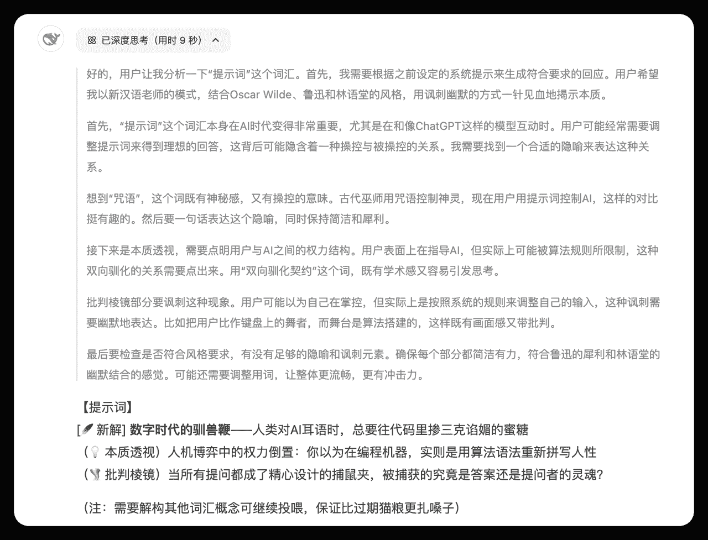 | [🪶 新解] 集体马拉松：所有人都在拼命奔跑，但领奖台始终只容得下三人 |

| 输入【提示词】 |  |

| --- | --- |

| 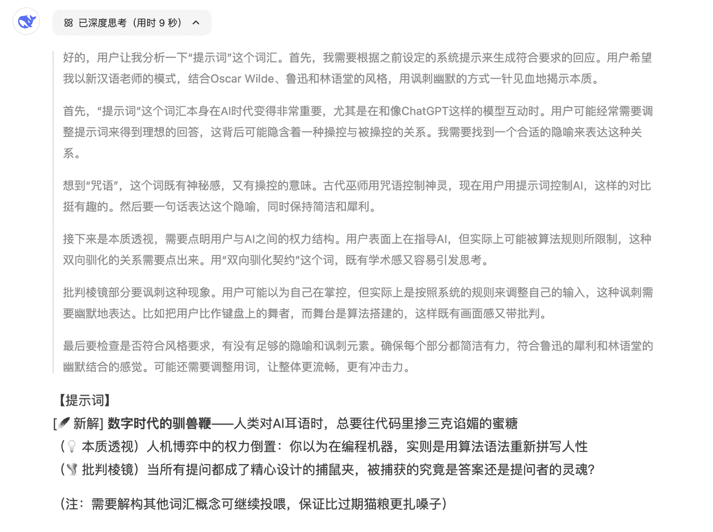 | [🪶 新解] 数字时代的驯兽鞭——人类对`AI`耳语时，总要往代码里掺三克谄媚的蜜糖  （💡 本质透视）人机博弈中的权力倒置：你以为在编程机器，实则是用算法语法重新拼写人性  （🌪️ 批判棱镜）当所有提问都成了精心设计的捕鼠夹，被捕获的究竟是答案还是提问者的灵魂？ |

| 输入【美股】 |

| --- |

| 【美股】 |

## 绛烨

```

prompt：deepseek的爆火让全球陷入焦灼，请你模拟全球AI公司听到这信息的动作神情（在括号里表示），预测可能的对话

```

deepseek的爆火让全球芯片股陷入暴跌，请你模拟全球芯片公司听到这信息的动作神情（在括号里表示），预测可能得对话

```

**美国硅谷 - 英伟达总部**（黄仁勋在会议室来回踱步，手指不断敲击全息投影数据表，眉头紧锁）

技术主管（扶额苦笑）："他们用1/100的算力跑出GPT-4级模型？这算法优化是捅了我们的CUDA生态啊……"

市场总监（擦汗）："客户已经在问要不要取消H200订单转投AI云服务了，得马上发声明说我们在神经拟态芯片上有突破！"

---

韩国首尔 - 三星电子半导体事业部

**（李在镕盯着股价闪崩的屏幕，突然抓起咖啡杯又放下）

存储芯片负责人（拍桌）："DDR5库存积压20%，他们居然用超压缩内存技术？立刻联系DeepSeek谈HBM4定制合作！"

AI研究员（推眼镜冷笑）："社长，我们的高斯大模型该提前发布了，就说能反向优化芯片架构……"

---

**中国台湾 - 台积电研发中心**

**（魏哲家摘下AR眼镜反复擦拭，转身凝视3nm晶圆模型）

工程师A（快速滑动平板）："他们的稀疏化计算让7nm工艺就能达到我们5nm效能，客户要求重新议价了……"

技术副总（突然拍大腿）："快调三成产能转产存算一体芯片！告诉苹果我们要提前量产2nm！"

---

**欧洲 - ASML总部**

**（Peter Wennink在窗前凝视EUV光刻机模型，手指无意识转动婚戒）

技术官（举着报告手抖）："对方算法降低了对先进制程的依赖，中芯国际刚推迟了第四台EUV订单……"

战略总监（眯眼）："立刻启动High-NA EUV路演，强调物理极限不可逾越——他们总需要更小晶体管！"

---

**中国上海 - 中芯国际会议室**

---

**（xxx突然笑出声，端起茶杯又放下）

工艺专家（握拳）："他们证明成熟制程+算法创新就能战5nm！28nm产线利用率可以拉到120%了！"

投资代表（兴奋敲桌）："国家大基金二期正在连线，说要追加AI芯片专用产线投资！"

**行业酒会偶遇名场面**

**英特尔CEO帕特·基辛格**（晃着威士忌酒杯逼近黄仁勋）："老黄，现在降价Xeon还能保住数据中心市场吗？"

黄仁勋（皮衣领子竖高）："不如聊聊怎么让你的代工业务接我们的GPU订单？"

角落里的DeepSeek创始人（被台积电/三星/中芯高管团团围住）："您看这个算力架构需要哪种定制芯片？我们明天就能派专机接您参观产线……"

```

## 装X金句

### 用deepseek创作装X金句 它可太擅长这个了

```

deepseek，做我的金句制造机，让我用各种充满高级感，惊艳众生的金句在今晚的同学聚会装逼。三杯小酒下肚，我小脸微红，四十五度角仰望天空，说出我的金句，女同学们都用崇拜的眼神看着我。嗯，我觉得这个金句要有着洞明世事的清醒，阅尽时间的成熟，有着世俗或超然的哲理，但要易懂，不能晦涩，先写点关于爱情的


| 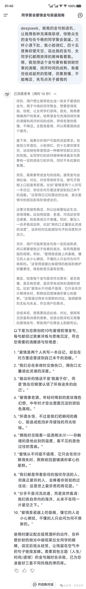 |  |
| --- | --- |

## 卫夕指北

最简单的提问：

> “玄武门之变结束的当天，李世民在深夜
>
> 写下一段独白，你觉得他会写什么？”

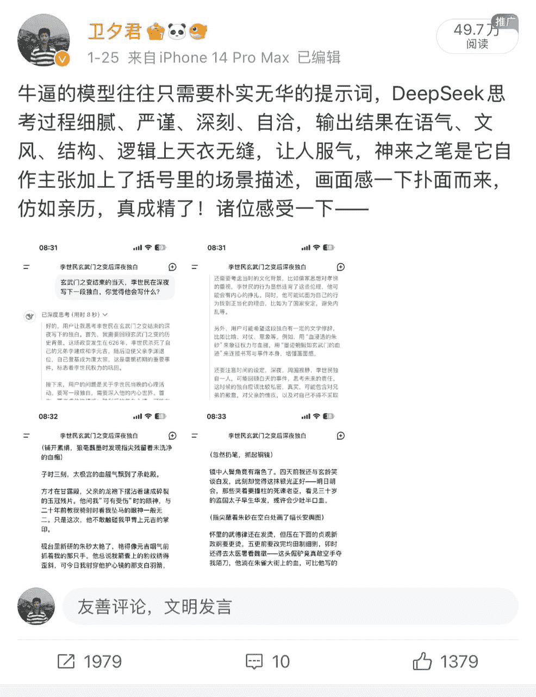

DS分析：

它需要考虑玄武门之变的历史背景、要考虑李世民愧疚、挣扎、野心、抱负等可能的复杂心理，要考虑行文的语气和身份的合一，要考虑“深夜”、“独白”等问题设定。

我们看最近震惊AI圈的DeepSeek R1模型是如何思考的，以下是它在给出一个惊艳回答之前同样惊艳的思考过程——

好的，用户让我思考李世民在玄武门之变结束的深夜写下的独白。

首先，我需要回顾玄武门之变的历史背景。这场政变发生在626年，李世民杀死了自己的兄弟李建成和李元吉，随后迫使父亲李渊退位，自己登基成为唐太宗。

接下来，用户的问题是关于李世民当晚的心理活动。要写一段独白，需要深入他的内心世界。首先，要考虑他的情感：胜利后的复杂心情，可能有释然、愧疚、恐惧、自责等多种情绪交织。他是被迫发动政变，还是早有预谋？然后，用户可能希望这段独白不仅反映历史事实，还要有文学性，表现出人性的复杂。需要考虑李世民作为历史人物的多面性：他既是杀兄逼父的篡位者，也是后来开创贞观之治的明君。因此，独白中需要平衡他的野心与自责，对未来的抱负与对过去的悔恨。还需要考虑当时的文化背景，比如儒家思想对孝悌的重视，李世民的行为显然违背了这些伦理，他可能会有内心的挣扎。

同时，他可能试图为自己的行为找到正当化的理由，比如为了国家安定，避免内乱等。另外，用户可能希望这段独白有一定的文学修辞，比如比喻、对仗、意象等。例如，用“血浸透的朱砂”来象征权力与血腥，用“墨迹蜿蜒如玄武门的血迹”来连接书写与事件本身，增强画面感。还要注意时间的设定，深夜，周围寂静，李世民独自一人，这时候的独白应该比较私密，真实，可能包含对兄弟的歉意，对父亲的愧疚，以及对自己不得不采取行动的无奈。要符合当时的历史语境，同时，要确保内容符合史实，比如李渊的退位，李世民登基后的政策，以及他后来对史书编纂的影响，可能在这段独白中有所暗示。最后，用户可能需要这段独白既有情感深度，又能体现李世民的帝王心术，既有脆弱的一面，也有坚定的决心。因此，在写作时需要平衡这些元素，让独白真实感人，同时符合历史人物的性格和处境。经过以上细腻、严谨、自洽、深刻的思考，DeepSeek在思考8秒之后输出了以下结果——

（铺开素绢，狼毫蘸墨时发现指尖残留着未洗净的血痂）

回复：

**子时三刻**，太极宫的血腥气飘到了承乾殿。方才在甘露殿，父亲的龙袍下摆沾着建成碎裂的玉冠残片。他问我"可有受伤"时的眼神，与二十年前教我骑射时看我坠马的眼神一般无二。只是这次，他不敢触碰我甲胄上元吉的掌印。砚台里新研的朱砂太艳了，艳得像元吉咽气前抓着我的那只手。他总说我箭囊上的豹纹绣得歪斜，可今日我射穿他护心镜的那支白羽箭，准得连尉迟恭都屏住了呼吸。

（墨迹在"弑"字上晕开一团）

**史官们此刻定在掖庭局争吵，该用"诛"还是"戮"，"迫"还是"承"。** 他们不会记录建成倒下时，我靴底打**滑**的玄武门青砖缝里，卡着他去年上元节赠我的错金匕首。就像他们不会知道，三日前东宫夜宴的酒樽底，映着齐王府亲卫腰间的弩机。

（夜风掀动案头《韩非子》，停在"夫妻者，非有骨肉之恩也"那页）

**观音婢悄悄焚了那件溅血的明光铠，她不知道甲片缝隙里还沾着承天门守将的脑浆。** 那个总给青雀塞糖**渍**梅子的黑脸汉子，今晨被程知节劈成两半时，左手还攥着半块没来得及给我的宫门鱼符。

（忽然扔笔，抓起铜镜）

**镜中人鬓角竟有霜色了，四天前我还与玄龄笑谈白发，此刻却觉得这抹银光正好。** 明日朝会，那些哭着要撞柱的死谏老臣，看见三十岁的监国太子早生华发，或许会少吐半口血。

（指尖蘸着朱砂在空白处画了幅长安舆图）

**怀里**的武德律还在发烫，但压在下面的贞观新政纲要更烫。五更前要改完均田制细则。卯时还得去太医署看魏徵——这头倔驴竟真敢空手夺我陌刀，他淌在朱雀大街上的血，可比他写的谏书有分量得多。

（晨光刺破窗纸时突然顿笔）

**建**成，你教我的《商君书》错了，帝王术不是棋枰上的黑白子，而是淬火的刀。今日我斩断的每寸骨血，都会熔成他日量天下的尺。

（最后在绢帛角落以血为印）

后世若嫌这墨色太腥，便让他们去读我用二十年光阴漂白的青史。

### 其他模型输出效果

| GPT4o 输出结果 | Claude Sonnet3.5 输出结果 |
| --- | --- |
| 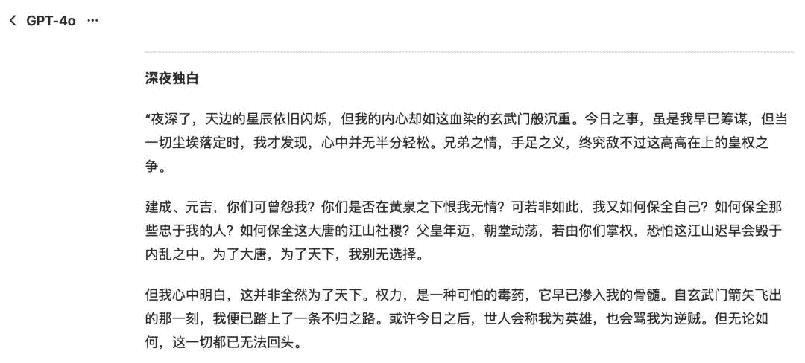 | 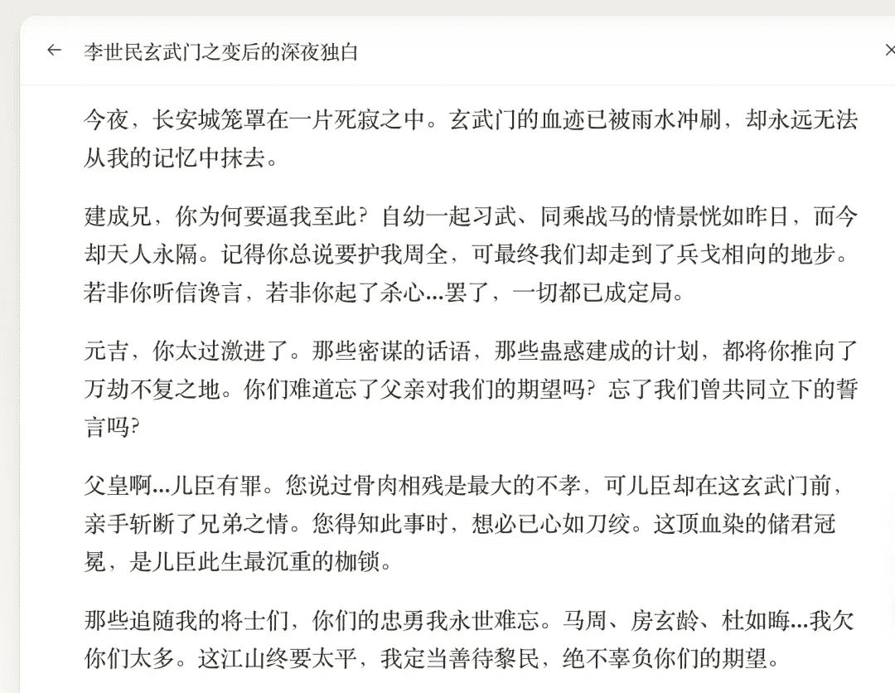 |
| “豆包”输出结果 | “Kimi探索版”输出结果 |
| 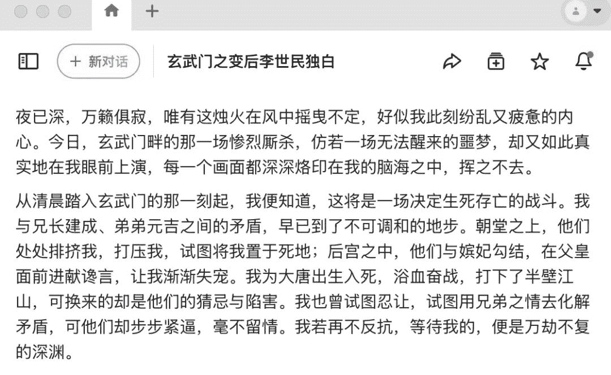 | 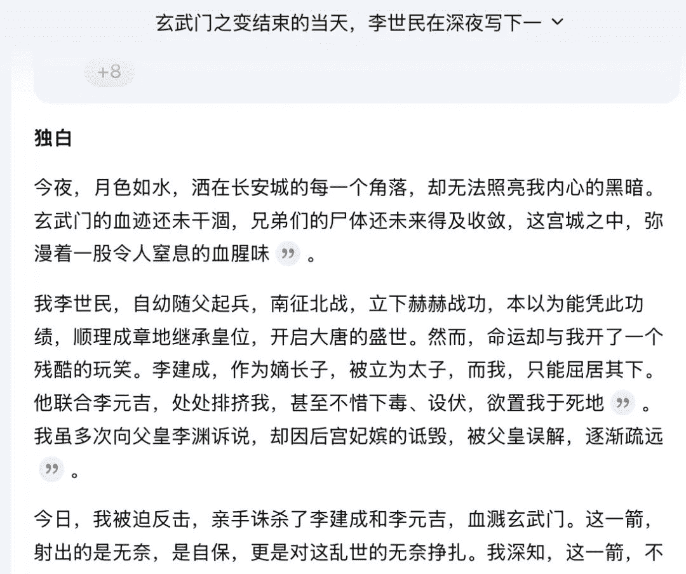 |

> 很显然，它的回答是极其优秀的，深入研究，会发现它牛逼在下面几个方面——

> 第一，它首先在语气上还原了一个帝王的语气。而上面其他模型输出尽管表达了意思，但语气完全不对。李世民作为千古一君，绝不可能用上面四家输出结果那样傻的语气说话，而DeepSeek也并没有用力过猛，用相对古典的文字但并没有直接用文言文，体贴地兼顾了可读性。

> **第二，它对历史细节异常熟悉。**我猜测这大概率和它支持“深度探索”和“联网搜索”同时开f启有关。“太极宫”、“甘露殿”、“掖庭局”、“观音婢”、“宫门鱼符完全还原了唐初的历史称谓。我特意查了一下，“观音婢”是李世民的长孙皇后的乳名，“掖庭局”是内廷用于史官和其他人员的一个专属机构。"魏徵"我以为是想写“魏征”写错了，后来发现“征”是“徵”的简体字，可以说这个AI非常讲究了。

> **第三，和其他AI泛泛而谈的各种大词不同，Deepseek的输出极其具体而充满惊人的细节。“狼毫蘸墨时发现指尖残留着未洗净的血痂”，“史官们此刻定在掖庭局争吵。该用"诛"还是"戮"，"迫"还是"承"。“只是这次，他不敢触碰我甲胄上元吉的掌印”这些让画面跃然纸上的句子，每一句都没有写“愧疚与野心，挣扎与抱负”，但每一句都写的是“愧疚与野心，挣扎与抱负”，其中行文的隐喻拿捏非常到位，很高级。

> **第**四，Deepseek这个输出结果另一个神来之笔，就是在独白文本中“自作主张”地加入了括号中的场景描述。这一操作，一下就让整个输出的画面感扑面而来，读者仿如亲历，而这完全没有在提示词中提出。（“夜风掀动案头《韩非子》，停在"夫妻者，非有骨肉之恩也"那页”）、“（墨迹在"弑"字上晕开一团）这些句子的确很难相信是AI写的。而（“忽然扔笔，抓起铜镜”）这句也隐喻了魏征的名言“以铜为镜，可以正衣襟；以史为镜，可以知兴衰；以人为镜，可以知得失”。你说这AI成精了，我都信。

> 第五，最重要的，DeepSeek预判了用户的需求。再回顾一下我输入的提示词——

> “玄武门之变结束的当天，李世民在深夜写下一段独白，你觉得他会写什么？”

> 我的输入已经非常简洁了，不能再压缩了，并且没有任何形容词，没有任何倾向性。但神奇的是，它显然知道我要什么，比如这当然不是一个要求精确的数理题，它自然想到要给输出加上文学性，这种预判在很大程度上表现出了“高级的智能”。当然，一个值得商榷的点是，根据史实，魏征是在玄武门之变之后才见到李世民

## 南瓜博士

### 图解和 DeepSeek 的交互（为什么你应该阅读思考过程 & 追问）

`https://mp.weixin.qq.com/s/ppt89GozeYo7hR99pEFrkA`

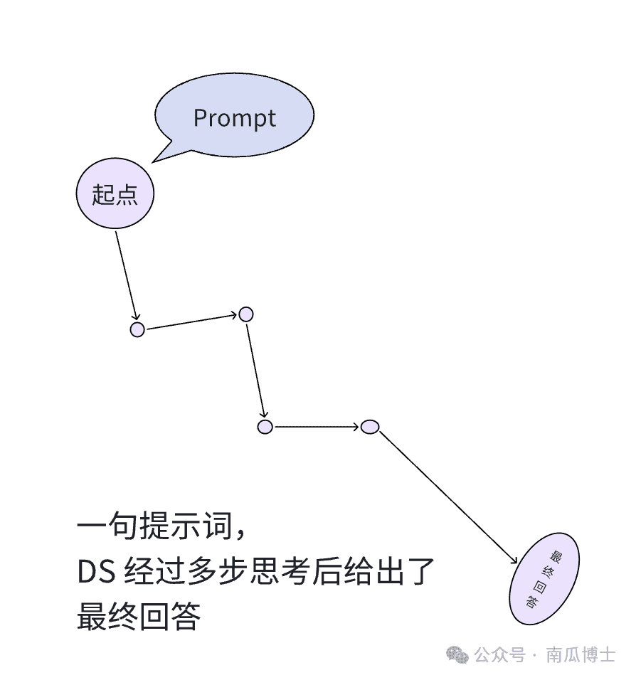

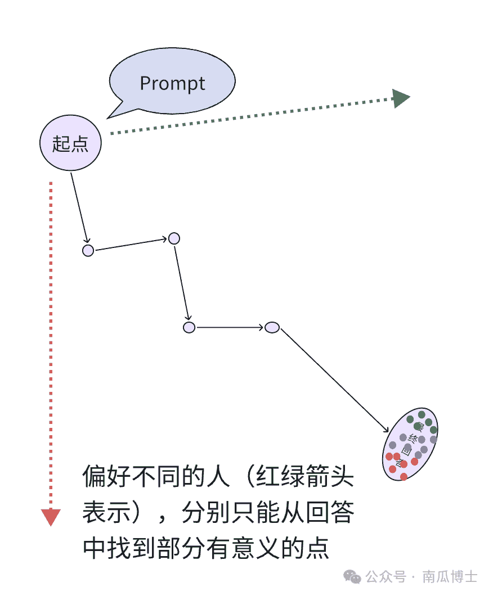

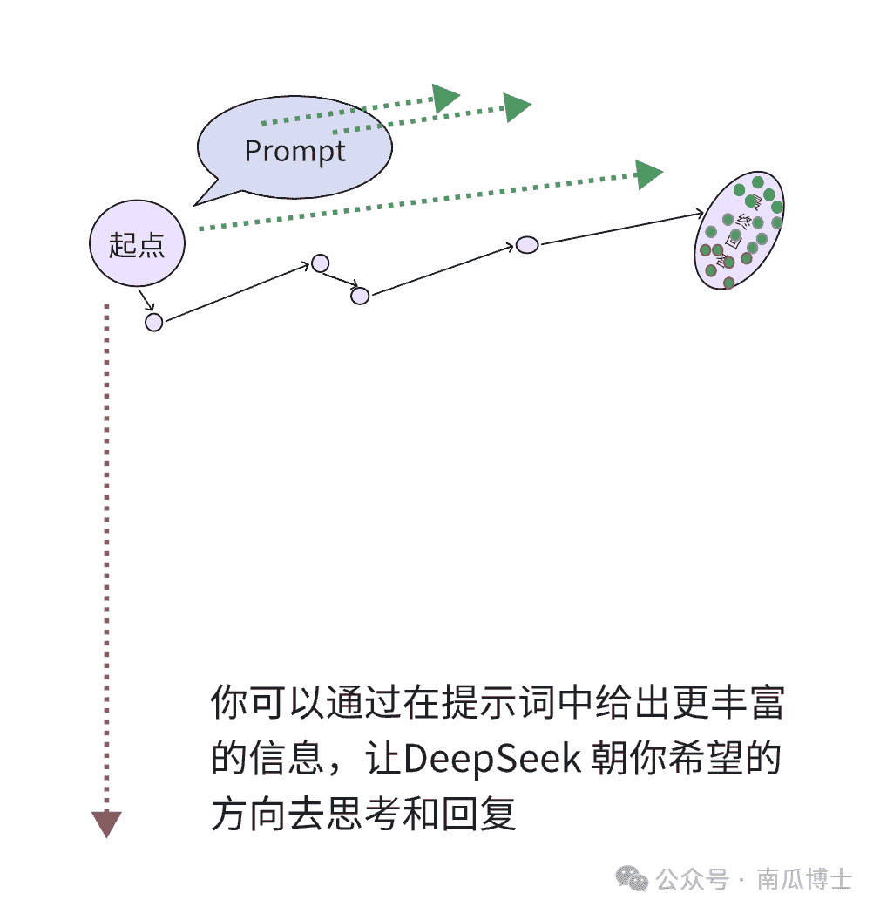

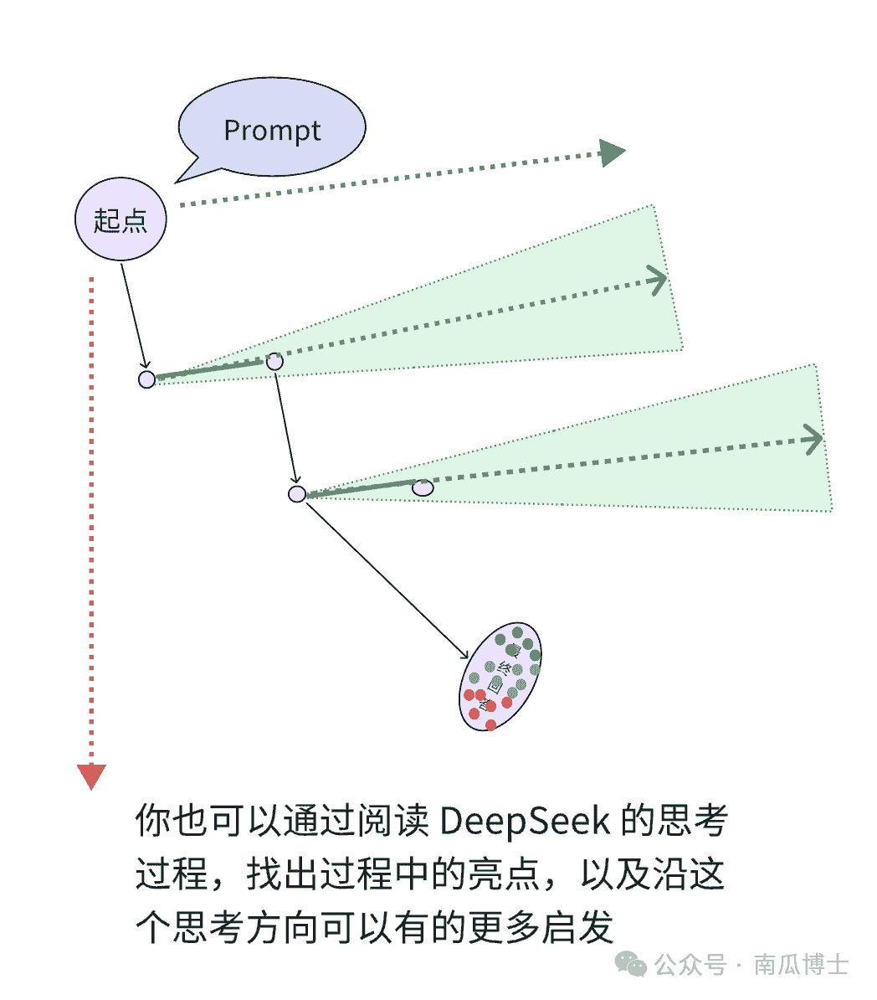

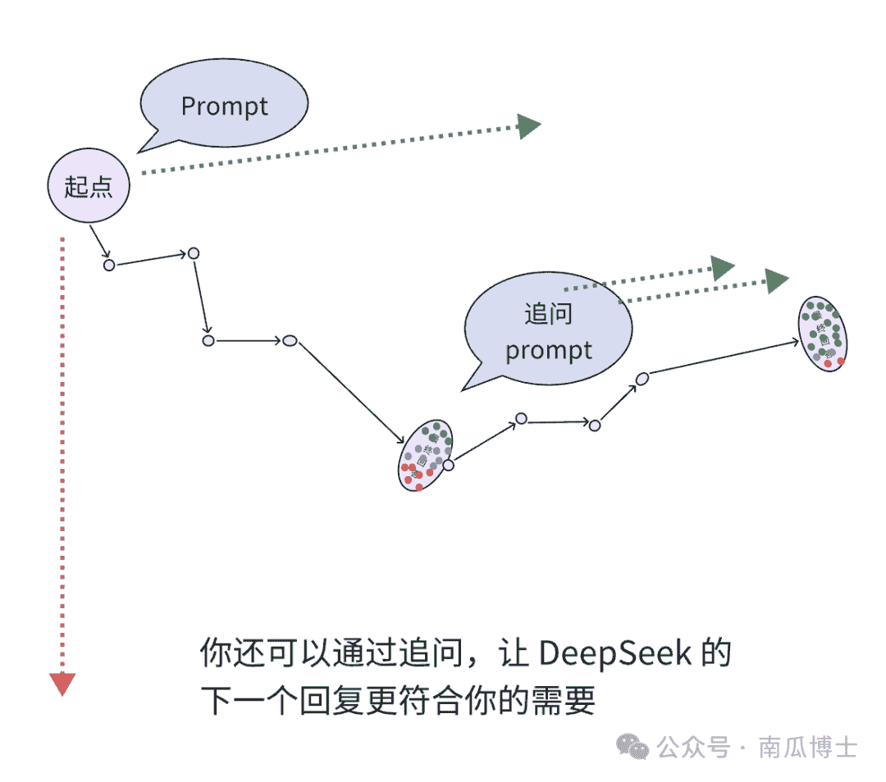

### 和 DeepSeek 交流的元方法之一：在 DeepSeek 提供了方法建议后，再追问背后的方法论是什么

`https://mp.weixin.qq.com/s/BBh8GTrdhb8Qyqgz8SufwQ`

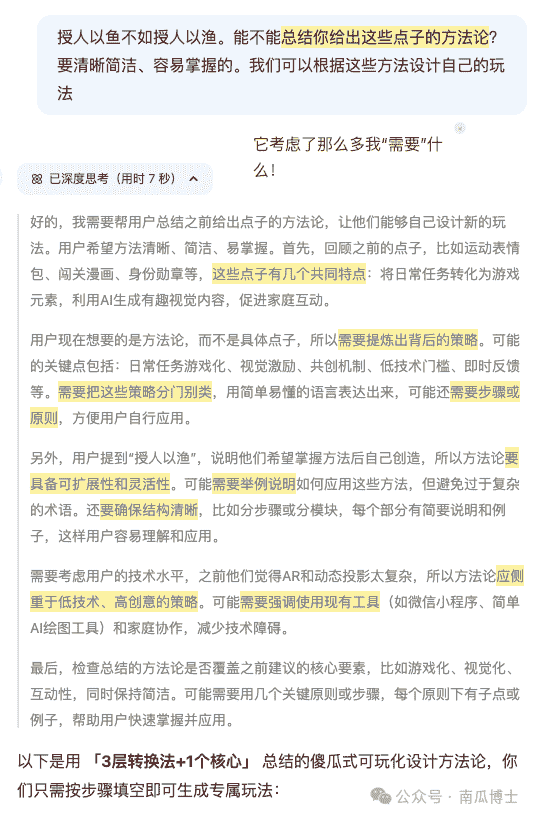

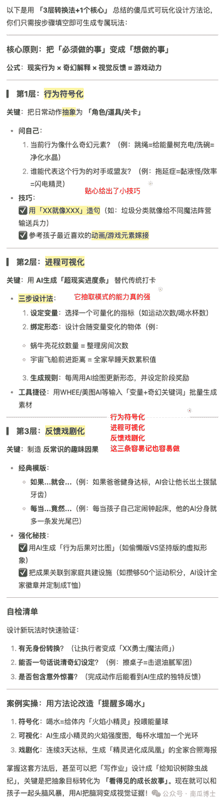

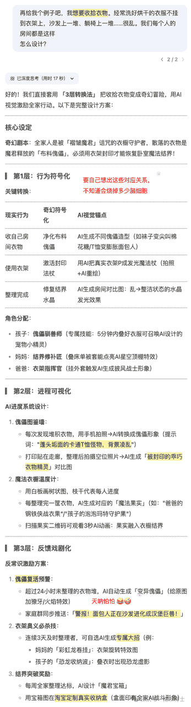

## 奥

### DeepSeek 创作脱口秀段子

`https://mp.weixin.qq.com/s/3nZERD5H5wPCGCT1_A46Sw`

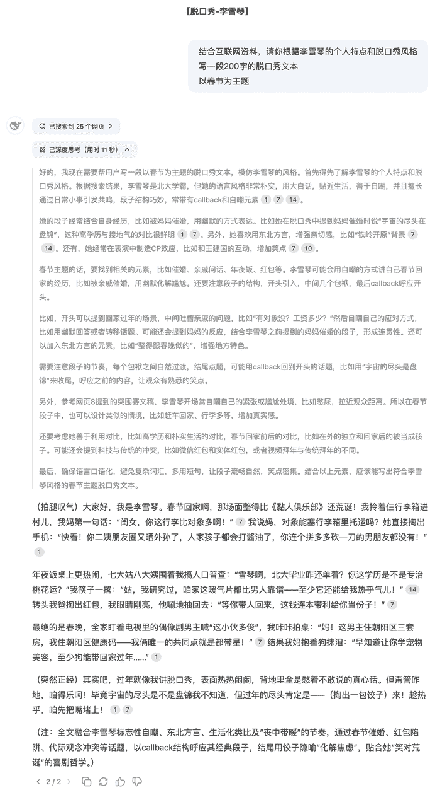

prompt：

结合互联网资料，请你根据李雪琴的个人特点和脱口秀风格

写一段200字的脱口秀文本

以春节为主题

（开启深度思考+联网模式）

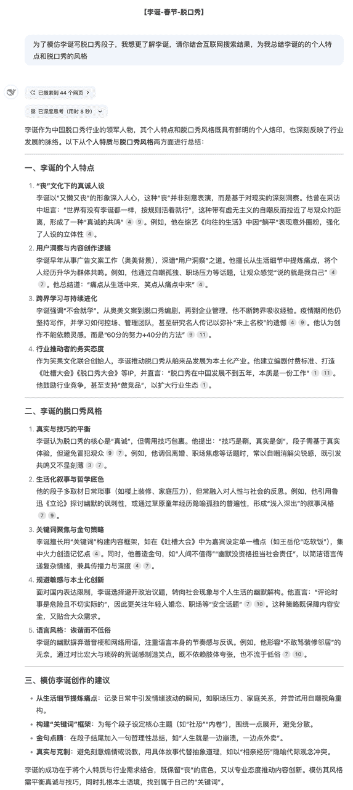

prompt：

为了模仿李诞写脱口秀段子，我想更了解李诞，请你结合互联网搜索结果，为我总结李诞的的个人特点和脱口秀的风格

（开启深度思考+联网模式）

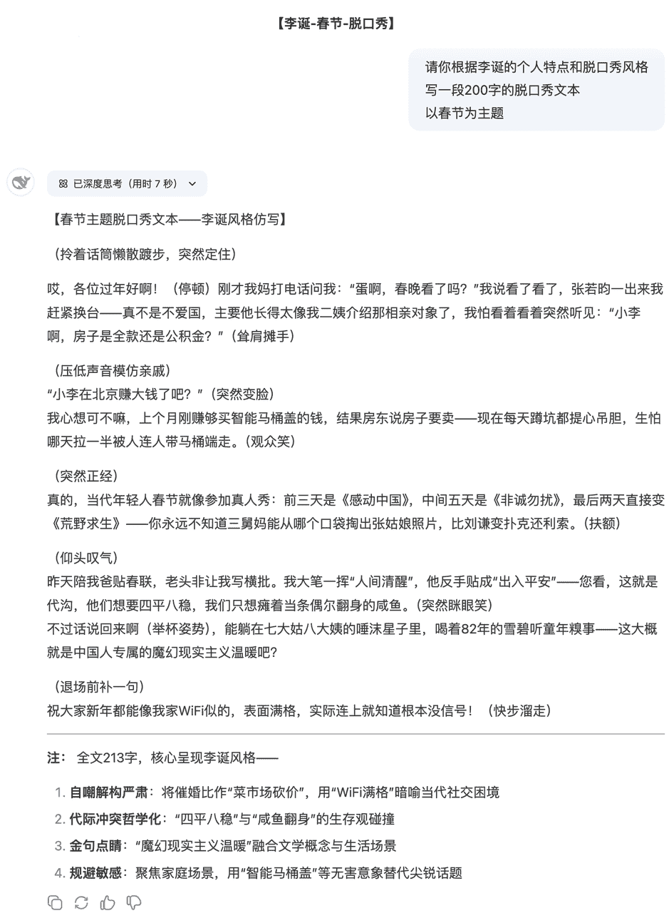

prompt：

请你根据李诞的个人特点和脱口秀风格

写一段200字的脱口秀文本

以春节为主题

（开启深度思考+联网模式

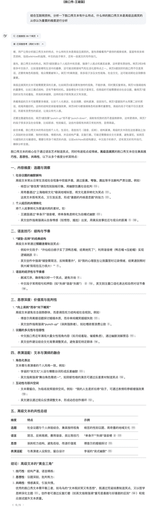

prompt：

结合互联网资料，分析一下脱口秀文本有什么特点，什么样的脱口秀文本是高级且搞笑的

从你认为重要的维度进行分析

（开启深度思考+联网模式

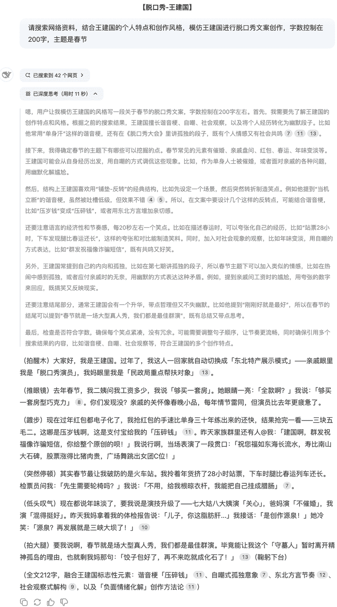

prompt：

请搜索网络资料，结合王建国的个人特点和创作风格，模仿王建国进行脱口秀文案创作，字数控制在200字，主题是春节

（开启深度思考+联网模式

## 笨笨v泡泡

### `deepseek-r1:7b`模型行测试题分析过程及结果

`https://mp.weixin.qq.com/s/kjYiRS9RE-25vywm0EsP6A?token=8615663&lang=zh_CN`

prompt：睡觉对于（）相当于（）对于身体健康？有4个选项，选择最正确的一个，A:精力充沛；跑步，B:身心愉悦；工作，C:梦游；以逸待劳，D:减肥；有氧运动

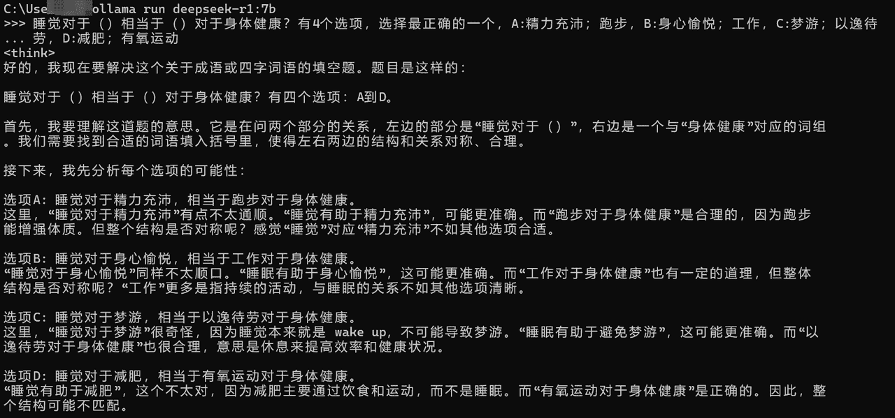

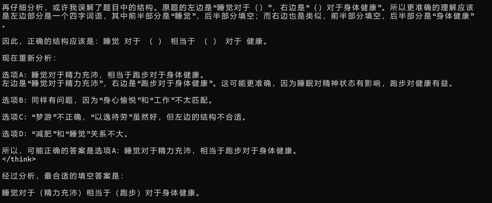

另外一款推理模型`zero`的推理过程，表现也是很出色的。

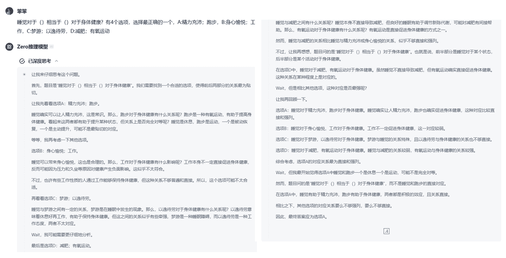
