# deepseek技术解读丨彻底理解MLA（Multi-Head Latent Attention）

> 来源：[https://v11enp9ok1h.feishu.cn/docx/WiDnd93NVoTanfxujVkce8Xtnne](https://v11enp9ok1h.feishu.cn/docx/WiDnd93NVoTanfxujVkce8Xtnne)

## 引言

> deepseek最近比较出圈，本人也一直关注deepseek发[布的一些](https://zhida.zhihu.com/search?content_id=252368029&content_type=Article&match_order=1&q=%E8%AE%A1%E7%AE%97%E6%88%90%E6%9C%AC&zhida_source=entity)技术报告。在模型训练、推理性能和计算成本上一直能给大家惊喜。读了dee[psee](https://zhida.zhihu.com/search?content_id=252368029&content_type=Article&match_order=1&q=%E6%A8%A1%E5%9E%8B%E4%BC%98%E5%8C%96&zhida_source=entity)k的技术报告，我个人有两个比[较强的](https://zhida.zhihu.com/search?content_id=252368029&content_type=Article&match_order=1&q=MTP&zhida_source=entity)感受。第一：deepseek在模型细节上扣的比较极致，[魔改了一些](https://zhida.zhihu.com/search?content_id=252368029&content_type=Article&match_order=1&q=Infra&zhida_source=entity)[模型框架（比如模](https://zhida.zhihu.com/search?content_id=252368029&content_type=Article&match_order=1&q=Megatron&zhida_source=entity)型优化方面： MLA， GRPO，MTP）；第二：工程能力上确实比较强，对于主流的一些框架和技术点能敏捷地整合到自己的系统内（比如：在Infra方面，能看到deepspeed, Megatron，DistServer、vLLM等框架的核心技术点）。后面准备用几篇笔记学习和整理下deepseek的技术。

---

**本文重点讲解下MLA（Multi-He**ad Latent Attention）

> 注：我在学习的过程中，通常会有些知识盲点，或掌握不精确的地方，我会递归学习一些扩展的脉络。本文也是沿着一些必要的背景知识，逐层解读下MLH的提出背景、要解决的问题和最终的效果。

> MLA主要通过优化[KV-cache](https://zhida.zhihu.com/search?content_id=252368029&content_type=Article&match_order=1&q=KV-cache&zhida_source=entity)来减少显存占用，从而提升推理性能。直接抛出这个[结论可能](https://zhida.zhihu.com/search?content_id=252368029&content_type=Article&match_order=1&q=%E7%94%9F%E6%88%90%E6%A8%A1%E5%9E%8B&zhida_source=entity)不太好理解。首先我们来看下，对于生成模型，一个完整的推理阶段是什么样的，推理性能上有什么问题。

##  [LLM模型](https://zhida.zhihu.com/search?content_id=252368029&content_type=Article&match_order=1&q=LLM%E6%A8%A1%E5%9E%8B&zhida_source=entity)推理过程

LLM推理分为两个阶段：[prefill阶段](https://zhida.zhihu.com/search?content_id=252368029&content_type=Article&match_order=1&q=prefill%E9%98%B6%E6%AE%B5&zhida_source=entity)和 decode阶段

+   **prefill阶段**[：是模型](https://zhida.zhihu.com/search?content_id=252368029&content_type=Article&match_order=1&q=%E5%B9%B6%E8%A1%8C%E8%AE%A1%E7%AE%97&zhida_source=entity)对全部的Prompt tokens一次性并行计算，最终会生成第一个输出token

+   **decode阶段**：每次生成一个token，直到生成EOS（end-of-sequence）token，产出最终的response

[在推理过程中，由于模型](https://zhida.zhihu.com/search?content_id=252368029&content_type=Article&match_order=1&q=transformer&zhida_source=entity)堆[叠了](https://zhida.zhihu.com/search?content_id=252368029&content_type=Article&match_order=1&q=%E5%A4%9A%E5%A4%B4&zhida_source=entity)多层transformer，所以核心的计算消耗在Transformer内部，包括MHA，FFN等操作，其中MHA要计算Q，K ，V 矩阵，来做多头注意力的计算。

> 在LL[M生成过](https://zhida.zhihu.com/search?content_id=252368029&content_type=Article&match_order=1&q=%E7%9F%A9%E9%98%B5%E8%AE%A1%E7%AE%97&zhida_source=entity)程中，是一个基于前向序token列预测下一个token的过程，序列中的token（无论是prefill阶段，还是decode阶段）只与它前面的token交互来计算attention，我们也称这种Attention为Causal Attention。矩阵计算上通过一个下三角的Causal Attention Mask来实现token交互只感知前向序列。如图1所示，展现的Transformer内部的细节：

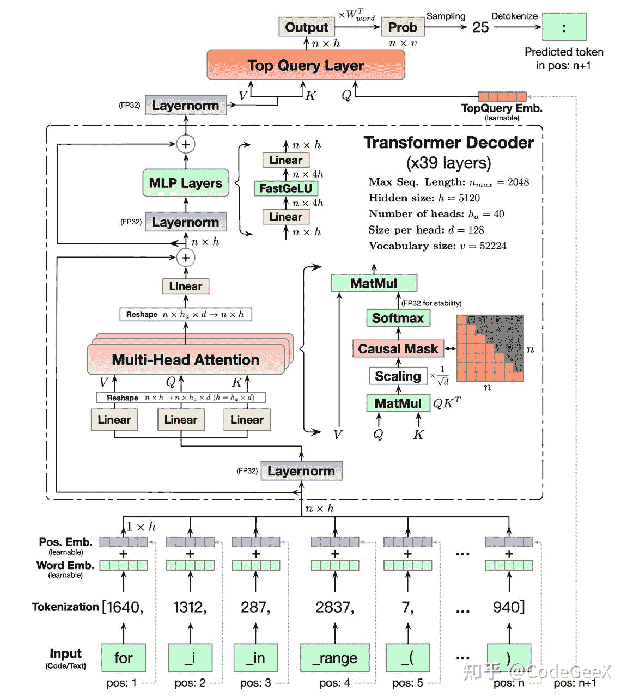

我们以一个序列的 t 位置的token为例，计算一层Tansformer的attention过程，如列下公式所示

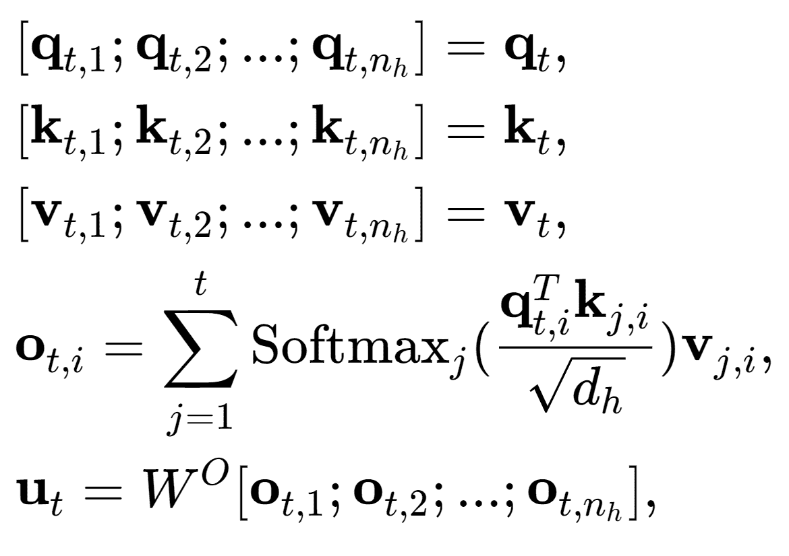

公式中的符号： t 表示计算序列中第 t 个token； q,k,v,o中的两个下标，前一个表示token位置，后一个表示对应的Head下标。

从公式   可以看到，在计算Attention时， t 位**置的 q 只与 t 位置前**的 k，v 做计算，所以我们有如下两个结

> 所以为[了加速](https://zhida.zhihu.com/search?content_id=252368029&content_type=Article&match_order=1&q=GPU&zhida_source=entity)训练和[推理的](https://zhida.zhihu.com/search?content_id=252368029&content_type=Article&match_order=1&q=GPT&zhida_source=entity)[效率，在t](https://zhida.zhihu.com/search?content_id=252368029&content_type=Article&match_order=1&q=%E8%AE%BF%E5%AD%98%E5%AF%86%E9%9B%86%E5%9E%8B&zhida_source=entity)oken-by-token生成过程中，避免重复计算前序的 k,v 。研究者们提出把前序计算好的 k,v 缓存起来，这也就是目前主流的KV-cache的机制。KV-cache本质是通过空间换时间的方法。我们知道当前LLM size都比较大，GPU的显存空间也是比较宝贵的，通过显存来保存KV-cache势必会带来访存的瓶颈。换句话说，如果不用KV-cache模型直接计算（重复计算前序 k,v ），是个计算密集型任务；增加了KV-cache，现在 k,v 不是通过计算得到，而是从「存储介质」里读出来，GPT内核与存储介质之间要频繁读写，这样就变成了一个访存密集型任务。所以使用了KV-cache的机制，解决的重复计算的问题，但访存的速率也就直接影响到训练和推理的速度。

接下来我们再详细看看对于一个典型的推理架构有几级访存速率，模型推理过程中又有哪些数据要做存储下来，应该如何分配存储。

## LLM推理阶段显存使用情况

###  访存速率分级

为了直观理解访存的速率，我们以一个分布式推理架构为例。

> 比如2台机器，每台机器有8张A100， 那么在这样一个系统内，卡内，单机卡间，机器之间的数据访问效率如图3所示。

> **

> 注**[：我们](https://zhida.zhihu.com/search?content_id=252368029&content_type=Article&match_order=1&q=HBM&zhida_source=entity)的例子中，只描述了一种访存介质HBM[ (也就](https://zhida.zhihu.com/search?content_id=252368029&content_type=Article&match_order=1&q=SRAM&zhida_source=entity)是我们常说的显卡的显存)，我们知道通常GPU的存储介质除了显存，还有SRAM和DRAM。SRAM也被成为片上存储，[是GPU](https://zhida.zhihu.com/search?content_id=252368029&content_type=Article&match_order=1&q=%E5%AD%98%E5%82%A8%E5%8D%95%E5%85%83&zhida_source=entity)计算单元上即时访问更快的存储[，所有](https://zhida.zhihu.com/search?content_id=252368029&content_type=Article&match_order=1&q=CPU&zhida_source=entity)的计算都要先调度到片上存储SRAM才能做计算，一般只有几十M大小，带宽可达到20T/s左右，SRAM是跟计算单元强绑定的，推理阶段一般不考虑将SRAM作为存储单元使用。而DRAM是我们常说的CPU的内存，由于访问速率较慢，推理阶段一般也不考虑使用。所以我们讨论的推理存储介质，一般就指的是HBM（显存）

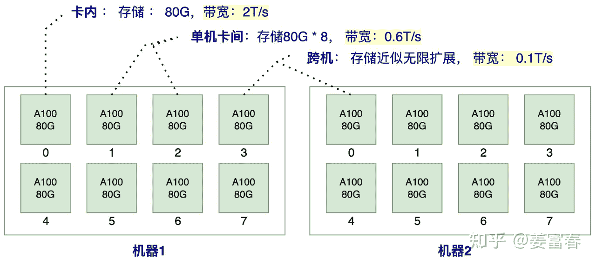

由上图的[访存带宽](https://zhida.zhihu.com/search?content_id=252368029&content_type=Article&match_order=1&q=%E8%AE%BF%E5%AD%98%E5%B8%A6%E5%AE%BD&zhida_source=entity)可知，卡内的带宽是单机卡间的带宽的3倍，是跨机带宽的20倍，所以我们对于存储的数据应该优先放到卡内，其次单机内，最后可能才考虑跨机存储。

接下来我们再看下，推理过程中，有哪些数据要存储到显存上。

### 模型推理阶段显存分配

下面我画了一张图，如图4所示，推理阶段主要有三部分数据会放到显存里。

+   **KV Cache** [： 如上一](https://zhida.zhihu.com/search?content_id=252368029&content_type=Article&match_order=1&q=Batch&zhida_source=entity)节所述，前序token序列计算的 k,v 结果，会随着后面tokent推理过程逐步存到显存里。存储的量随着Batch，Sequence_len长度动态变化

+   **模型参数**：包括Transformer、[Embedding](https://zhida.zhihu.com/search?content_id=252368029&content_type=Article&match_order=1&q=Embedding&zhida_source=entity)等模型参数会存到显存里。模型大小固定后，这个存储空间是固定的。

+   **运行时中间数据**： 推理过程中产出的一些中间数据会临时存到显存，即用即释放，一般占用空间比较小

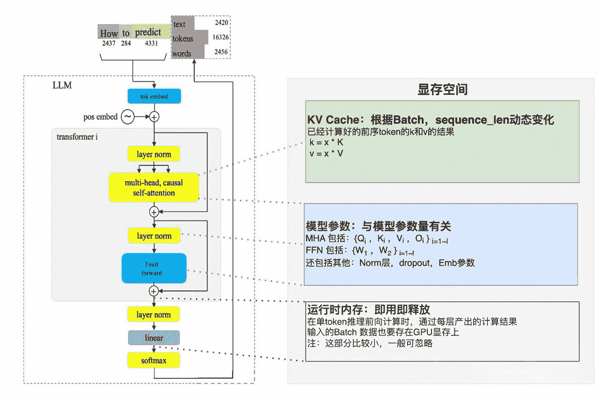

[由上述可](https://zhida.zhihu.com/search?content_id=252368029&content_type=Article&match_order=3&q=%E6%A8%A1%E5%9E%8B%E5%8F%82%E6%95%B0&zhida_source=entity)知，推理阶段主要存储消耗是两部分： 模型参数和 KV Cache。那么模型参数占多少，KV Cache又占多少？

首[先我们先以一个token的](https://link.zhihu.com/?target=https%3A//huggingface.co/Qwen/Qwen-72B-Chat/blob/main/config.json)计算过程为例，看下一个token计算要存储多少KV？为了方便理解，我们以Qwen-72B模型为例，模型配置详见： Qwen-72B-Chat。

> 模型共80层，每层有64个Head，每个Head的向量维度是128，

> l=80,  ,d_h=128

> 注：这里先不考虑qwen 72B GQA的设置 (实际KV做了压缩处理),只考虑朴素的MHA的模

> 型结构$^{+}$(假设未做任何处理),GQA后面再详细讨论。

如下图5所示，计算一个token，每个Transformer层的每个Head都要存储一对 k,v 。

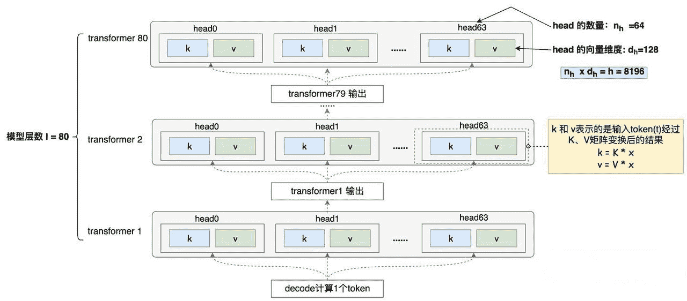

所以针对一个token，缓存的 k,v 数据总量：

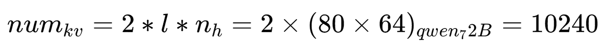

其中[公式里](https://zhida.zhihu.com/search?content_id=252368029&content_type=Article&match_order=1&q=%E5%8D%8A%E7%B2%BE%E5%BA%A6&zhida_source=entity)的 2 表示1个 k 和 1个 v 。一个token就要缓存 10240 个 k,v ，这个数是不是有点意料之外！这么多 k,v 占了多少存储呢？ 我们假设模型推理阶段是半精度（bf16）参数，每个参数占2Byte。最终一个token的存储占用，如公式 (2) 计算所示：

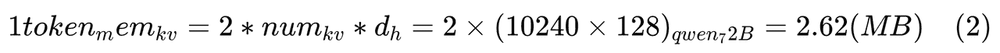

> 我们现在知道了一个Token计算后需要缓存的 k,v 数量和存储量。那么对于一个实际的推理场景，还要考[虑批](https://zhida.zhihu.com/search?content_id=252368029&content_type=Article&match_order=3&q=%E7%BB%B4%E5%BA%A6&zhida_source=entity)量Batch（B）和 序列长度Sequence_len(S) 两个维度，来确认整体KV Cache的存储消耗。这两个维度通常是可以动态变化的。我们看看下面两个场景：

#### 场景1：单条短文本场景

>

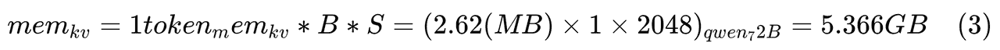

#### 场景2：并发长文本场景

>

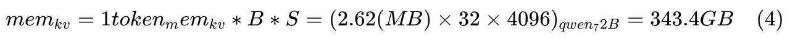

> [除了 k](https://zhida.zhihu.com/search?content_id=252368029&content_type=Article&match_order=1&q=%E9%98%B6%E6%AE%B5%E6%A8%A1%E5%9E%8B&zhida_source=entity),v 消耗存储空间，我们知道模型参数也要占用存储，推理阶段模型参数占用的存储空间是固定的，计算也比较简单。假设模型参数量为： Φ ，以bf16 半精度做推理，则参数量为 2Φ（Byte）。还是以qwen-72B为例，参数占用存储空间：

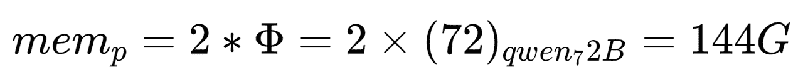

我们再结合上面两个场景，看看显存的整体分配：

+   **场景1：** 模型存储  ，kv存储   ，模型的参数储存占主导，使用80G的A100， 至少需要2张卡做推理。

+   **场景2：**模型存储   ，kv存储  ，KV Cache储存占主导，使用80G的A100， 至少需要7张卡做推理。

> 当前LLM都比较大，而访存的容量和访存速率有分级的特点。所以推理过程中，减少跨卡、卡机的访存读写是优化推理性能的一个有效路径。一方面单次读写的数据越少，整体速度会越快；另一方面整体显存占用越少，就能尽量把数据放到单卡或单机上，能使用更高的带宽读写数据。

本文要学习的MLA就是通过减少KV Cache来压缩显存占用，从而优化推理速度。我们在展开了解MLA之前，先看看当前有哪些优化KV Cache的方法。

## 减小[KV cache](https://zhida.zhihu.com/search?content_id=252368029&content_type=Article&match_order=1&q=KV+cache&zhida_source=entity)的方法

### KV Cache 优化方法汇总

业界针对KV Cache的优化，衍生出很多方法，这里我根据自己的积累，稍微总结下，只简单描述优化的思路，不过多展开。

**方法主要有四类**：

1.  **共享KV**：多个Head共享使用1组KV，将原来每个Head一个KV，变成1组Head一个KV，来压缩KV的存储。代表方法：GQA，MQA等

1.  **窗口KV**：针对[长序列](https://zhida.zhihu.com/search?content_id=252368029&content_type=Article&match_order=1&q=%E9%95%BF%E5%BA%8F%E5%88%97&zhida_source=entity)控制一个计算KV的窗口，KV ca[che只](https://zhida.zhihu.com/search?content_id=252368029&content_type=Article&match_order=2&q=%E5%BA%8F%E5%88%97%E9%95%BF%E5%BA%A6&zhida_source=entity)保存窗口内的结果（窗口长度远小于序列长度），超出窗口的KV会被丢弃，通过这种方法能减少KV的存储，当然也会损失一定的长文推理效果。代表方法：Longformer等

1.  [**量化压缩**](https://zhida.zhihu.com/search?content_id=252368029&content_type=Article&match_order=1&q=%E9%87%8F%E5%8C%96%E5%8E%8B%E7%BC%A9&zhida_source=entity)：基于量化的方法，通过更低的Bit位来保存[KV，将](https://zhida.zhihu.com/search?content_id=252368029&content_type=Article&match_order=1&q=INT8&zhida_source=entity)单KV结果进一步压缩，代表方法：INT8等

1.  [**计算优化**](https://zhida.zhihu.com/search?content_id=252368029&content_type=Article&match_order=1&q=%E8%AE%A1%E7%AE%97%E4%BC%98%E5%8C%96&zhida_source=entity)：[通过优化计算过程，减少访存换](https://zhida.zhihu.com/search?content_id=252368029&content_type=Article&match_order=1&q=flashAttention&zhida_source=entity)入换出的次数，让更多计算在片上存储SRAM进行，以提升推理性能，代表方法：flashAttention等

本文要讨论的MLA是共享KV分支下的一种优化方法，下面我们先展开看看共享KV方法有哪些，这些方法也是MLA拿来对比的方法。

### 共享KV优化显存方法

[共享KV主要有两种](https://link.zhihu.com/?target=https%3A//arxiv.org/pdf/1911.02150)方[法，MQA和GQA](https://link.zhihu.com/?target=https%3A//arxiv.org/pdf/2305.13245)都是Google提出的，详见： MQA(2019)，GQA(2023)，如图6所示。

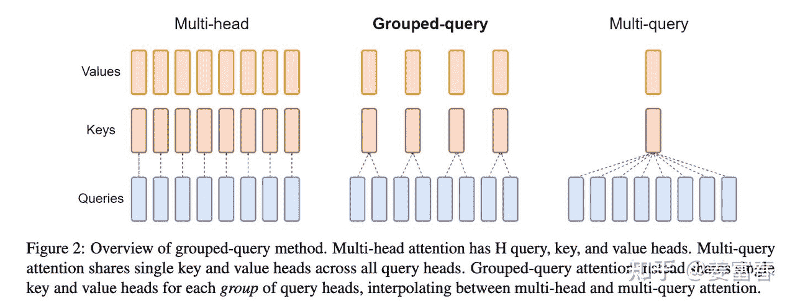

####  MQA（Multi-Query Attention）

> MQA方法比较简单，详见上图6最右侧的图，每一层的所有Head，共享同一个 k,v 来计算Attentio[n。](https://zhida.zhihu.com/search?content_id=252368029&content_type=Article&match_order=2&q=%E5%90%91%E9%87%8F&zhida_source=entity)相对于MHA的单个Token需要保存的KV数（ 2∗l∗nh ）减少到了（ 2×l ）个，即每一层共享使用一个 k 向量和一个 v 向量

#### GQA（Group-Query Attention）

> GQA是平衡了MQA和MHA的一种折中的方法，不是每个Head一个KV，也不是所有Head共享一个KV，而是对所有Head分组，比如分组数为 g ，那么每组： nh/g个Head 共享一个KV。当 g=1 时，GQA就等价于MQA，当 g=nh时， GQA就等价于MHA。

为了方便自己更清晰的理解GQA和MQA ，我还是以一个Token计算KV过程（如图5），画了一些相对细节展开的图，把所有层都画出来，并且加了一些注释。如图7所示：

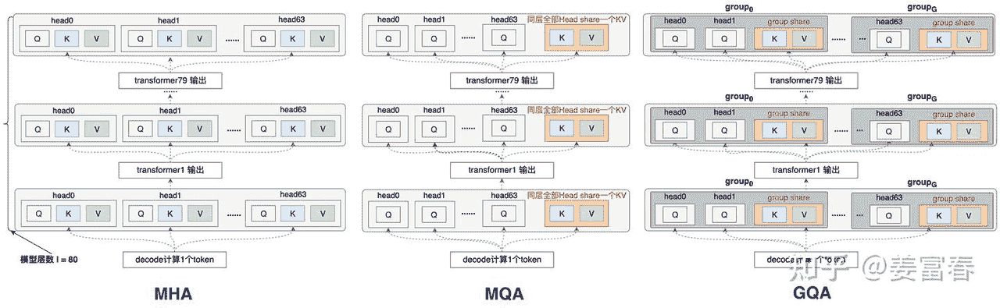

我们再总结下单token计算下，几种方法KV Cache的存储量（模型层数：  ，每层Head数量：   ）

+   MHA共缓存 2\times l\times n_h 个k,v

+   MQA共缓存  个k,v

+   GQA共缓存  个k,v,   是分组数，  ,一般取值能被  整除

本文要讲的MLA也是一种优化共享KV优化的变体，下面我们看看MLA的原理和细节

## MLA

### MLA KV优化速览

我们先走马观花看看MLA的计算方式和与MQA、GQA的压缩KV的效果对比。

首先我们看看MLA计算Attention的完整公式，如下图8所示

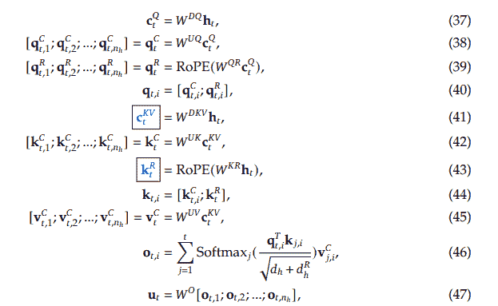

在论文中提到，每个Transformer层，只缓存了上述公式蓝框的向量：   和   ，这两个向量的大小分别为：

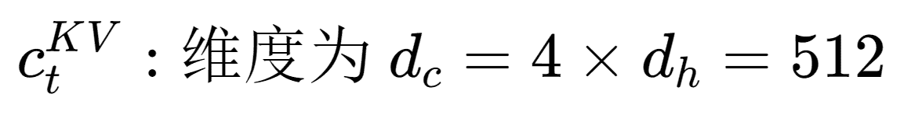

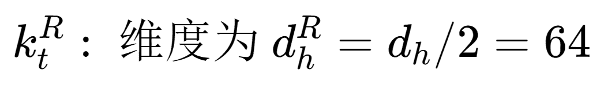

> 对比MQA（每层有一个 dh 维度的 k 和 一个 dh 维度的 v ，共 2dh 个元素），MLA相当于增加了2.25倍的存储，但DeepSeek描述自己的方法不仅比MQA强，而且比非共享KV的原始MHA也要强，后面4.4节我们在展开讨论。

MLA号称又快又省又强大，下一节我们逐步看看具体的实现。

### MLA原理解读

下面我们参照图8的公式看看MHA的计算过程，首先对图中公式的变量做如下解释说明：

#### 先看下KV的计算过程

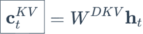

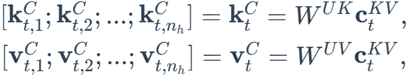

#### 再看下Q的计算过程

>

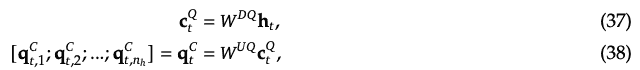

#### q,k 增加Rope位置编码

> 我们注意到在增加[RoPE](https://zhida.zhihu.com/search?content_id=252368029&content_type=Article&match_order=1&q=RoPE&zhida_source=entity)[位置编码](https://zhida.zhihu.com/search?content_id=252368029&content_type=Article&match_order=1&q=%E5%AF%B9%E8%A7%92%E7%9F%A9%E9%98%B5&zhida_source=entity)并没有在上述计算出的 qtC,ktC 的基础上乘以Rope的对角矩阵。而是单独计算了两个带着位置编码的 qtR,ktR 如公式（39）和公式（43）所示

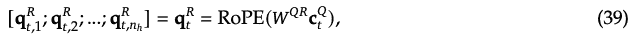

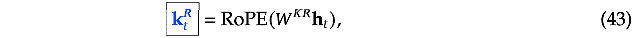

> 所以到目前为止，我们得到的 q,k包括两部分拼接而成：一部分是做了低秩压缩得到的 q,k 向量，一部分是增加了RoPE位置编码的 q,k 向量。（后面这部分向量是基于MQA方式计算得到的，所有Head共享1个 k ）。

如何理解上述的操作过程？这也是MLA方法的核心。

我们先来看看DeepSeek-V2论文中有一段原文解释（中文翻译）：

> 位置编码使用RoPE，但RoPE与低[秩KV不兼容](https://zhida.zhihu.com/search?content_id=252368029&content_type=Article&match_order=1&q=RoPE%E7%9F%A9%E9%98%B5&zhida_source=entity)。具体来说，RoPE对Q和K都是位置敏感的。如果我们为   应用RoPE，那么公式（42）的  （K的权重矩阵）将与位置敏感的RoPE矩阵耦合。因此，在推理过程中，   无法再被吸收到  （Q的权重矩阵）中，因为与当前生成的token相关的RoPE矩阵将位于   和    之间，而矩阵乘法不满足交换律。因此，我们必须在推理过程中重新计算所有前缀token的k，这将极大地降低推理效率。

论文中提到了「矩阵吸收计算」，这个概念对理解MLA比较重要，我们用一个简单的例子理解下：

>

> **方法1： 常规计算**

>

> **方法2：矩阵吸收计算**

> 我们知道矩阵乘法是满足[结合律](https://zhida.zhihu.com/search?content_id=252368029&content_type=Article&match_order=1&q=%E7%BB%93%E5%90%88%E5%BE%8B&zhida_source=entity)的，对于公式 (c) 我们可以先计算好两个变换矩阵的乘积：

>

>

>

>

>

通过上面的例子我们可以看到，两种方法计算出的结果是一样的，但第二种方法是先做了矩阵乘法，相当于把 x1 的变换矩阵 P 吸收到了 x2 的变换矩阵 Q 里。

理解了上面的例子，我们再来看看原文说的「RoPE与低秩KV不兼容，没法做矩阵吸收计算」的问题。

**a) 不加RoPE**

我们先假设当前不增加RoPE，那么 q,k 乘积计算如下，其中(i) 表示变换矩阵第 i 个Head的切片：

+

+

**b) 现在假设增加RoPE**

+

+   **中间这个分量**   **是**随这相对位置变化而变化的，并不是个固定的矩阵，因此并不能提前计算好。所以论文中说RoPE与低秩变换不兼容

+

c）通过增加一个很小 q,k 分量，引入RoPE

为了引入位置编码，作者在一个很小维度下，用MQA方式计算了 q,k ，也就是在每层网络中，所有Head只计算一个 k （如论文中公式43所示）。引入位置编码的向量维度取的比较小为： dh/2=128/2=64 。

所以最终 q,k 向量通过两部分拼接而成，计算权重时，由前后两部分分别相乘再相加得到，如下公式（8）所示：

+

### MLA与MQA、GQA对比

最后我们再简单看看几种方法的对比，直接截取DeepSeeku-V2论文的图，如下：

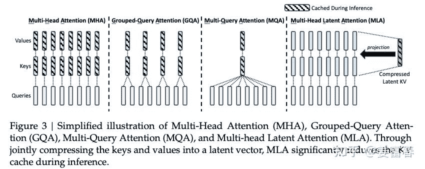

从上图我们可以看到，虽然MLA缓存的Latent KV比较短（相当于2.25个MQA的缓存量），但MLA有恢复全 k,v 的能力，特征表达能力显著比GQA、MQA要强。所以MLA能做到又快又省又强。论文中也给出了下图的数据

## 总结

本文试图通过引入更多基础知识和辅助信息，来深入理解MLA。内容比较长，可能觉得比较啰嗦。这是本人在理解MLA过程递归总结的一些扩展信息，最终整理了一个系统的脉络，发出来供大家参考。