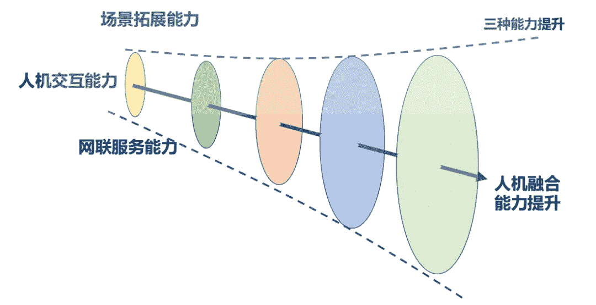
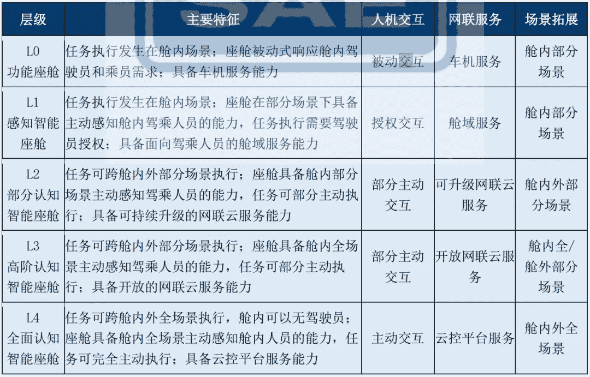
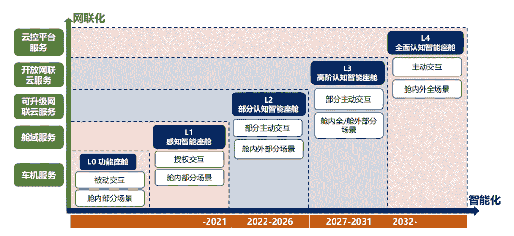
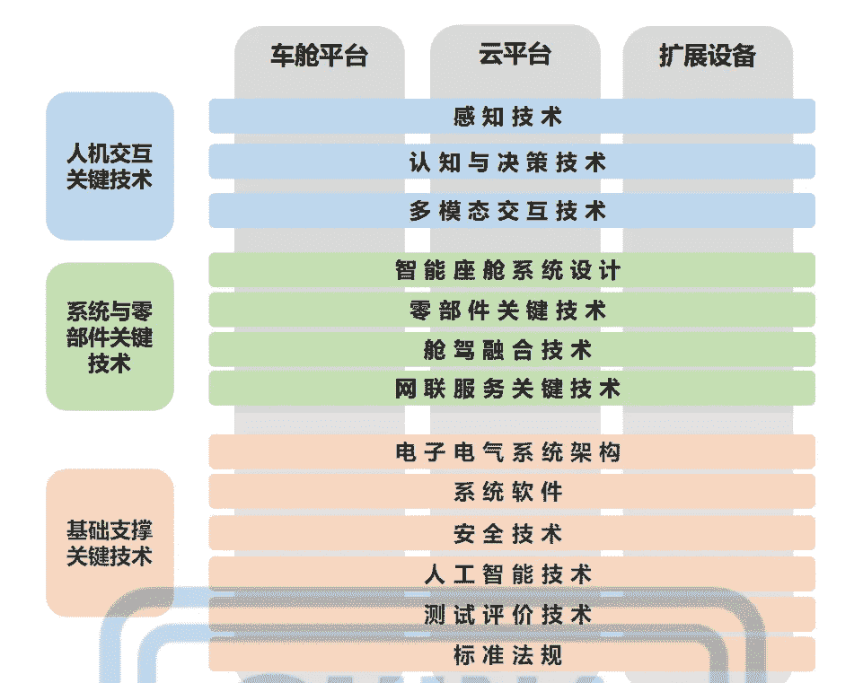

# 01.汽车智能座舱分级及解读

> 来源：[https://v11enp9ok1h.feishu.cn/docx/KplqdIPYXoM4WBx7sKUcJie1ntf](https://v11enp9ok1h.feishu.cn/docx/KplqdIPYXoM4WBx7sKUcJie1ntf)

# 01.整体思路

白皮书以技术引领和应用规范为目标，从人-机-环融合的角度对智能座舱进行定义分级。智能座舱的核心是更好的服务驾乘人员，对智能座舱各个等级所应具备服务驾乘人员的能力进行划分：明确每个级别座舱的人机交互能力、场景拓展能力、网联服务能力。

**（1）人机交互能力**：座舱对舱内人员的感知从被动到主动，座舱任务的执行从授权执行到主动执行；

**（2）网联服务能力**：从车机服务，到车舱服务、可升级网联云服务，再到开放网联云服务，最终实现云控平台服务的连接；

**（3）场景拓展能力**：由舱内部分场景到舱内全场景，由舱外部分场景到舱外全场景。确定从“功能座舱”到“全面认知智能座舱”的五个智能座舱级别，该表格所描述的仅为每个级别应具备的最低能力。

人机交互能力代表着智能座舱感知、理解并做出相应决策服务驾乘人员的能力，网联服务能力代表着智能座舱为驾乘人员提供丰富功能和服务的能力，场景拓展能力代表着智能座舱服务驾乘人员边界的拓展能力（从驾驶员到驾乘人员，从舱内到舱内外）。人机交互、网联服务和场景拓展三种能力相互支撑，共同促进智能座舱整体服务驾乘人员能力的提升。

# 02.智能座舱定义与分级

## 2.1 汽车智能座舱定义

汽车智能座舱是指搭载先进的软硬件系统，具备人机交互、网联服务、场景拓展的人-机-环融合能力，为驾乘人员提供安全、智能、高效、愉悦等综合体验的移动空间。

---

## 2.2 汽车智能座舱分级

智能座舱包括人机交互、网联服务、场景拓展三个技术维度，其分级也对应地按照人机交互、网联服务和场景拓展三个技术维度区分。表1描述了汽车智能座舱分级。在人机交互维度，按照座舱任务的执行过程表述为感知主体和执行主体，等级越高表示智能座舱任务主动交互能力越强；在网联服务维度，按照座舱任务的服务内容分为从舱域服务到社会级服务的四个等级，不同等级表示智能座舱任务服务内容的不断丰富；在场景拓展维度，按照座舱任务的执行范围分为舱内场景和舱外场景，不同等级表示智能座舱任务执行场景的不断拓展。

## 2.3 典型示例

### L0：功能座舱

**表述**：任务执行发生在舱内场景；座舱被动式响应舱内驾驶员和乘员需求；具备车机服务能力。

**典型示例**：驾乘人员可以在车内使用导航、音乐、电话等功能。

### L1：感知智能座舱

**表述：**任务执行发生在舱内场景；座舱在部分场景下具备主动感知舱内驾乘人员的能力，任务执行需要驾驶员授权；具备面向驾乘人员的舱域服务能力。

**典型示例：**座舱感知到舱内温度偏高，根据舱域服务主动向驾驶员询问是否需要打开周围的空调出风口，并将温度降低，获得驾驶员授权后，调整空调温度和风量。

### L2：部分认知智能座舱

**表述：**任务可跨舱内外部分场景执行；座舱具备舱内部分场景主动感知驾乘人员的能力，任务可部分主动执行；具备可持续升级的网联云服务能力。

**典型示例：**座舱可以识别不同驾驶员，主动推荐驾驶员当前时段（如：上下班）常用功能（空调、音乐）。根据驾驶员到达时间，到家后选择打开家里的智能家居产品，如: 空调、热水等。

### L3：高阶认知智能座舱

**表述：**任务可跨舱内外部分场景执行；座舱具备舱内全场景主动感知驾乘人员的能力，任务可部分主动执行；具备开放的网联云服务能力。

**典型示例：**座舱感知到某位乘客行为状态参数有异常，初步诊断为紧急情况，需要去医院就诊，座舱立刻通过开放网联云服务平台主动联系就近的医院就诊，同时座舱主动联系乘客家属或紧急联系人。

### L4：全面认知智能座舱

**表述：**任务可跨舱内外全场景执行，舱内可以无驾驶员；座舱具备舱内全场景主动感知舱内人员的能力，任务可完全主动执行；具备云控平台服务能力。

**典型示例：**在自动驾驶车辆行驶过程中，座舱感知到某位乘员行为状态参数有异常，根据云控平台服务快速诊断为某急性疾病，座舱立刻通过云控平台主动联系就近的医院急诊，并找到最优路线，尽快到达医院，并联系安排医护人员楼下等待。

## 2.4 蓝图

根据智能座舱的人机交互、网联服务、场景拓展发展趋势，智能座舱分阶段发展里程碑如下：

> **第一阶段**：L2 级部分认知智能座舱实现大规模市场化普及，智能座舱具备在舱内外部分场景下的座舱主动感知、座舱部分主动执行的能力，普遍实现可持续升级的云服务能力。同时，L3 级高阶认知智能座舱开始市场导入，预计将在2025 年左右实现。

> **第二阶段**：L3 级高阶认知智能座舱实现大规模市场化普及，智能座舱具备舱内全场景舱外部分场景下的座舱主动感知、座舱主动执行的能力；同时融入开放网联云服务，实现相关互联互通，拥有丰富的在线资源，初步实现智能座舱虚拟空间和物理空间融合发展。该级别会出现更多面向驾乘人员个性化情感化需求的舱内外场景。同时，全面认知智能座舱（L4）开始市场导入，预计将在 2030年左右实现。

> **第三阶段**：L4 级全面认知智能座舱逐步实现大规模市场化发展，智能座舱具备舱内舱外全场景下的座舱主动感知、座舱主动执行的能力；与自动驾驶系统实现感知、决策、规划、控制全面融合；同时进一步融入车路云一体化云控平台，及其他元宇宙相关的技术平台，最终形成可为驾乘人员提供安全、智能、高效、愉悦等综合体验的“第三空间”，预计将在 2035 年以后实现。

# 03.智能座舱技术架构

智能座舱涉及汽车、人机交互、信息通信、人工智能等多领域技术和多学科交叉，其技术架构较为复杂，可划分为“三横三纵”式技术架构。“三横”是指智能座舱主要涉及的人机交互技术、系统与零部件关键技术和基础支撑关键技术，“三纵”是指支撑智能座舱发展的车舱平台、云平台和扩展设备，如图2所示。

图3中，云平台指除了车舱平台本身以外，还包括能够支撑智能座舱发展的网联服务条件，比如：开放网联云服务、云控平台、元宇宙座舱技术等。扩展设备指除了车舱平台本身以外，还包括能够支撑智能座舱发展的人机融合与场景拓展条件。比如：智能手机、智能手表、智能家居、以及未来可能应用于智能座舱任务中的其他可设备（AR，VR，可穿戴脑机接口）等。