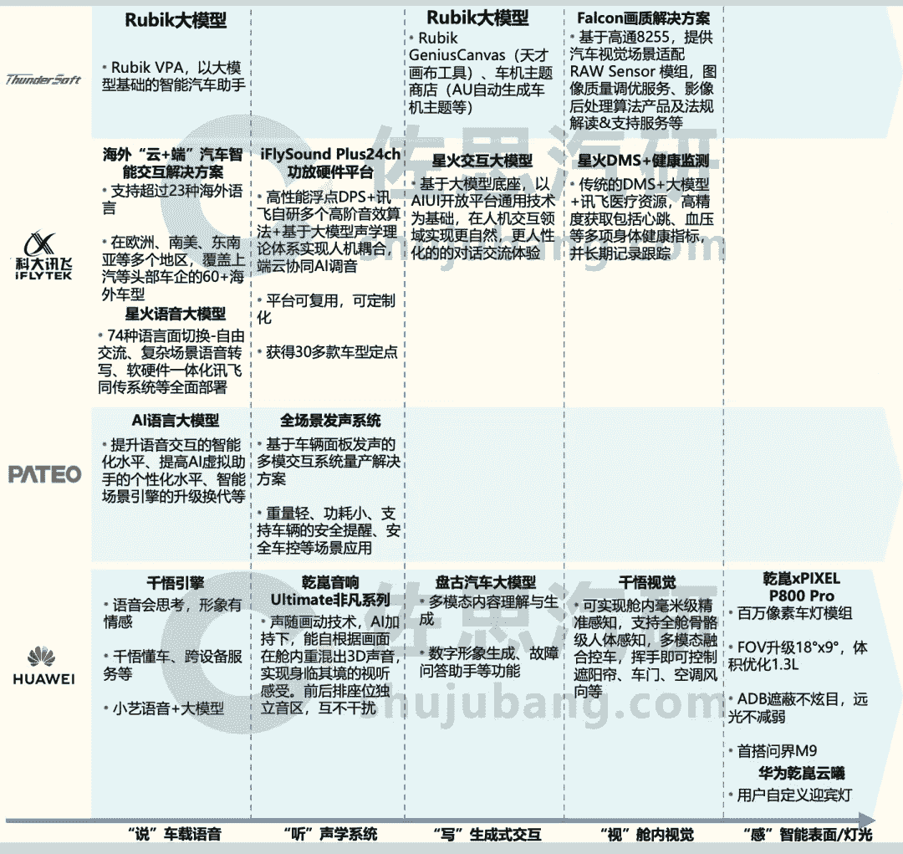
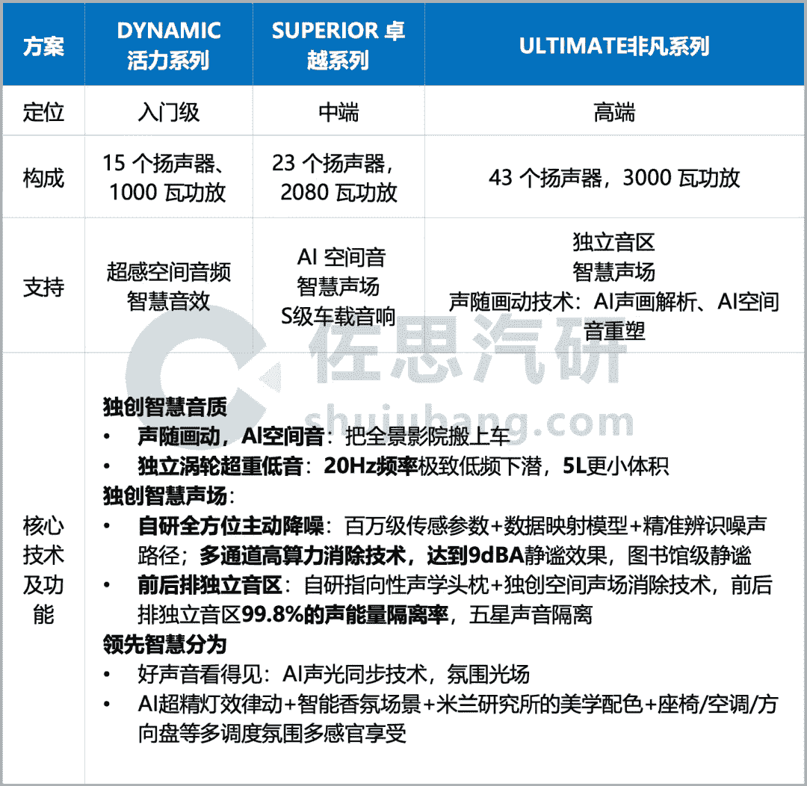
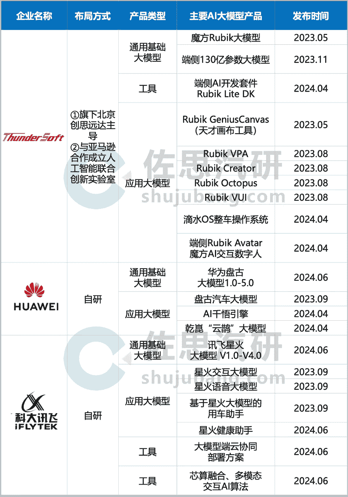
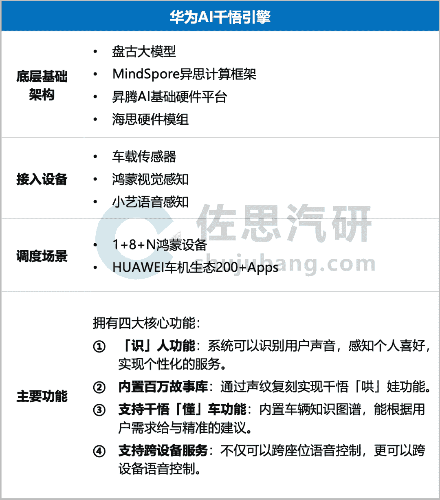
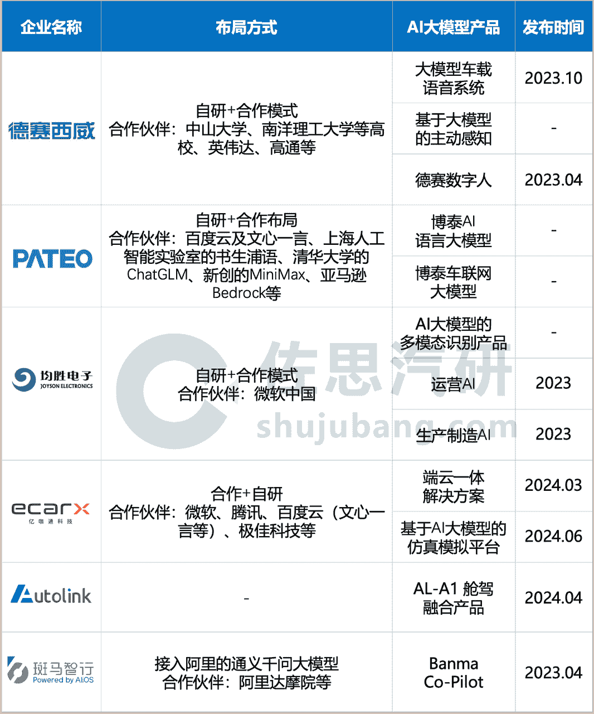

# 03.Tier1座舱业务研究

> 来源：[https://v11enp9ok1h.feishu.cn/docx/W0TSdL6LmoaDL3xbH9lcY05Vnjg](https://v11enp9ok1h.feishu.cn/docx/W0TSdL6LmoaDL3xbH9lcY05Vnjg)

国内 13 家智能座舱Tier1：德赛西威、中科创达、华阳集团、科大讯飞、博泰车联网、均胜电子、华为、亿咖通、东软集团、远峰科技、车联天下、北斗智联、斑马智行等。

**7 大座舱业务板块**

+   座舱人机交互系统：“说” 语音、“看” 视觉、“听”  声学、“写”  生成式AI，“感” 智能表面/智能灯光等

+   座舱域控计算平台：”算“ 计算，舱内AI、舱行泊一体、中央跨域计算等

+   座舱软件系统：从座舱OS向整车OS演进，SOA架构和应用原子化、导航电子地图等

+   座舱AI大模型：通用基础大模型（千亿+参数）、车端应用大模型（十亿+参数）、大模型工具

+   座舱车载显示系统：2.5K/4K超清屏、AR-HUD显示屏、光场显示屏（裸眼AR+3D）、电子外后视镜等

+   座舱通信系统：TBOX、C-V2X、智能车载天线等

+   座舱网联系统：网联服务、OTA、智能诊断等

研判智能座舱形态演进和产品发展趋势：对各大Tier1 智能座舱业务板块新产品、新技术、新趋势进行汇总分析。

> **座**舱人机交互系统：“说” 语音、“看” 视觉、“听”  声学、“写”  生成式AI、“感” 智能表面/氛围灯

围绕着 “说” 语音、“看” 视觉、“听”  声学、“写”  生成式AI、“感” 智能表面/氛围灯等终端用户需求，座舱Tier1供应商正不断推出人机交互新产品。

“听”——3D、沉浸式音效等高阶音效算法不断上车

024年4月，华为发布最新品牌“乾崑”，包含新一代鸿蒙座舱HarmonySpace，其具备智慧车机、智慧音响、智慧显示三大性能特点。

其中智慧音响方面， 华为发布全新的乾崑音响，开创智慧音响新赛道，包含入门到高端的三套不同定位的音响，分别是：DYNAMIC 活力系列、SUPERIOR 卓越系列和ULTIMATE 非凡系列。其最豪华的ULTIMATE 非凡系列，首创声随画动技术，采用AI声画解析技术和AI空间音技术，能根据画面在舱内重混出3D声音，实现身临其境的视听感受。新升级的智慧声场体验，实现前后排座位独立音区，前排K歌，后排观影互不干扰。

华阳集团数字声学系统解决方案支持包括8~24通道、平面环绕声、3D环绕声、头枕音响、AVAS、RNC、ANC、ASE以及OTA等功能与配置，且已配套多家一线自主品牌车企的量产车型。同时，华阳声学团队聚焦声学技术与智能座舱的深度融合，持续创新，进一步推动了沉浸式标准布局复刻、独立音区、音源修复及一系列高阶音效算法等技术在车载环境中的应用。

2023年，华阳集团支持3D沉浸式环绕音效的产品已量产，并新推双DSP智能声学产品平台，已获多个客户项目定点。

“写”——生成式AI 正在快速上车

**在汽车领域，中科创达基于Rubik大模型的Rubik GeniusCanvas（天才画布工具）、车机主题商店**（AU自动生成车机主题等）、LLM AI Assistant（大模型智能助手）三个应用方向的方案进展较快，已经基本成熟。

+   Rubik GeniusCanvas，该产品基于中科创达智能编码大模型Rubik Studio和强大的汽车HMI设计软件与3D引擎Kanzi打造，能够为设计师提供从概念创作、3D元素设计、特效代码生成以及场景搭建制作等方面的超强智能辅助。

+   设计师只需要一些简单的语言对话，Rubik GeniusCanvas便可按照要求进行图像设计与模型构建等，极大提升了汽车座舱HMI的设计效率与质量。

+   在Rubik GeniusCanvas辅助下，概念创作周期可缩短70%，从原来的3-4周缩短至1周左右；3D元素设计周期可缩短85%，从原来的4-6周缩短至3天左右。

**“听“看”——舱内视觉（DMS+OMS+CMS）、电子后**视镜等与智能座舱融合，实现智能交互能力”

2024年1月，中科创达正式推出了其最新研发成果——智能汽车画质解决方案 Falcon，基于域控芯片提供车载视觉画质产品一站式交付方案。其1.0基于Qualcomm 8255，提供汽车视觉场景适配RAW Sensor 模组，图像质量调优服务、影像后处理算法产品、图像质量测试服务，以及法规解读&支持服务，显著提升智能汽车舱内人机交互领域感知体验。依靠平台画像框架所提供的强大的图像画质优化能力，支持多路RAW Sensor的ISP图像画质优化，支持AWB，AEC，ISP（BlackLevel，LSC，BPC，ABF，Demosaic，CC，Gamma，CST，NR，ASF）等基础图像画质优化模块，也支持BayerGTM，BayerLTM，LDC，CAC，ANR等芯片特有的图像画质优化模块。目前适配与赋能了AVM、CMS、DVR、DMS、OMS、Carlog等汽车视觉产品场景。

座舱AI大模型产品部署：两种布局模式

面对AI掀起的新一轮产业革命及市场对智能化和个性化日益增长的需求，座舱Tier1结合自身技术实力，主动求新求变，积极布局AI大模型市场。从布局方式来看，主要有两大方向。

布局模式一：自研为主，通用基础大模型和行业应用大模型均有所布局

方向一：企业首先自研布局通用基础大模型，在依据此搭建行业应用大模型。这部分企业首先具备较强的底层软件研发实力，其次，公司除了汽车行业还涉猎多个行业领域，典型代表企业如华为、中科创达、科大讯飞等，他们均推出基础大模型，再根据行业推出基于AI大模型的相关应用产品。

2023年华为发布了通用基础大模型盘古，并基于此打造多个行业应用产品，最新版本为5.0产品，实现了全系列、多模态、强思维等全面升级。

座舱应用层面，2024年4月，华为发布最新AI千悟引擎，该引擎以华为盘古大模型、MindSpore异思计算框架和昇腾AI基础硬件平台等技术为基础打造。新一代千悟引擎不仅是一个简单的交互工具，更是一个能够深度理解用户需求、提供个性化服务的智慧伙伴。帮助语音识人，可通过用户声纹识别每个乘员的位置，感知并记录个人喜好，实现个性化的服务。千悟懂车，全量车辆知识图谱，精准解决用户问题。除此，千悟引擎还能跨设备服务，帮助车机直接导航到手机发来的位置，真正做到服务一步到位。

2024年6月27日，科大讯飞发布通用基础大模型讯飞星火大模型V4.0，本次升级后，讯飞星火全面对标ChatGPT-4 Turbo，能实现多语种对话，提升复杂环境下的语音识别能力，为智能座舱带来更广阔的应用前景。

同时，科大讯飞基于V4.0对星火汽车智能座舱全新升级，智能座舱中可以实现全双工交互，实现多语种多方言的免切换交流，多情感多模态的拟人交互，而且能够多模态感知，知道身体健康程度，是否疲劳、血压过高、心跳过快；然后还可以贯穿内外信源，在车上完成真正的任务。

布局模式二，合作为主，主要布局行业应用大模型

方向二：主要通过合作+自研的模式，主要是传统座舱Tier1，具备多种座舱类型产品供应实力。他们通常不自研基础大模型，主要通过采用开源基础大模型打造汽车座舱等行业应用的大模型产品。典型代表企业有东软集团、德赛西威、均胜电子、博泰车联网、车联天下、亿咖通等。

博泰正在积极和通用大模型头部厂家建立战略合作，同时与垂类应用开发商和服务商建立连接，构建基于大模型的生态圈，通过整合大模型的能力为主机厂提供定制化的服务，打造主机厂需要的个性化大模型产品。

此外，博泰还在积极构筑基于大模型的行业知识库、新一代场景引擎，以及多个基于大模型的智能应用场景，并且和多家主机厂积极探讨新一代智能座舱交互体验的POC。