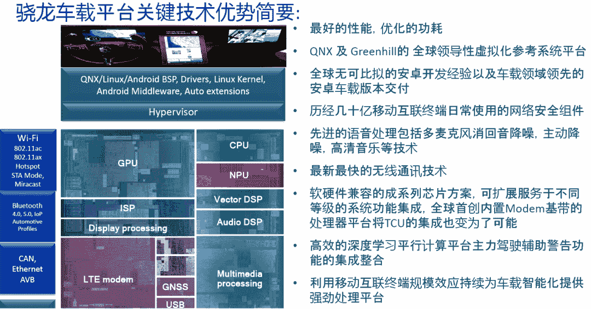
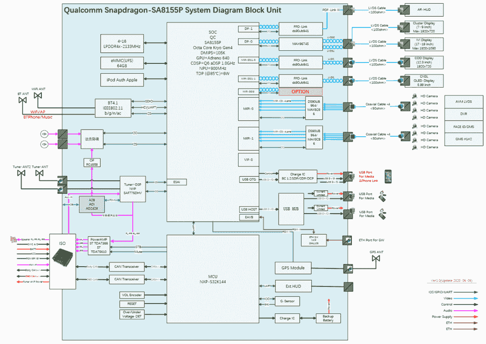
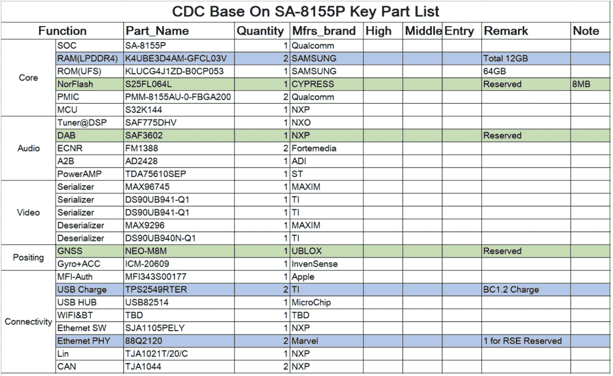
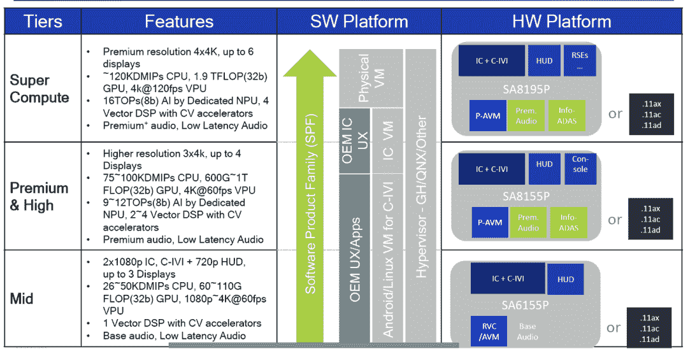
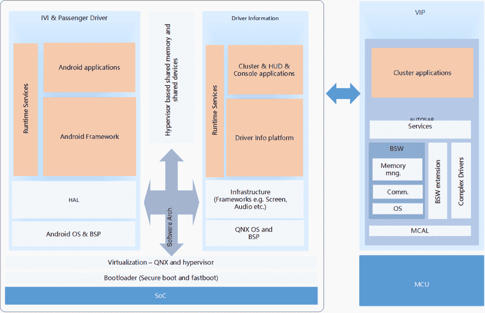

# 高通SA8155P 座舱域控制器参考设计

> 来源：[https://v11enp9ok1h.feishu.cn/docx/LwxDd6B73oGRAlxEEjCczUO4n83](https://v11enp9ok1h.feishu.cn/docx/LwxDd6B73oGRAlxEEjCczUO4n83)

## 系统框图概要：

**系统框图概要：**

**系统主要器件List：**

**系统主SOC选型说明：**

**系统软件架构：**

座舱系统包含三部分，具体如下：

MCU运行AUTOSAR系统，用于CAN/LIN唤醒/通讯/电源管理等

SoC运行QNX Hypervisor，包含两个操作系统，其中QNX运行对实时性和安全性要求高的功能，比如仪表/HUD

Android系统运行娱乐域相关的功能，比如导航/音乐等应用

