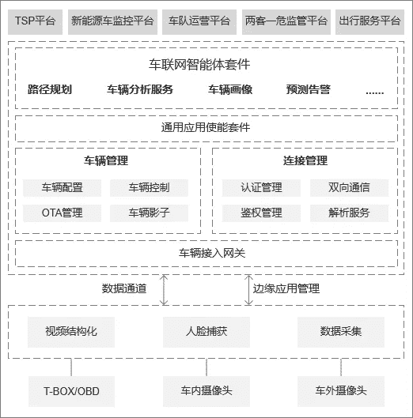

# 智能座舱车云结合产品设计与OTA升级

> 来源：[https://v11enp9ok1h.feishu.cn/docx/NJ3wdHrNSoQse1xMKbbcEF5Mnyd](https://v11enp9ok1h.feishu.cn/docx/NJ3wdHrNSoQse1xMKbbcEF5Mnyd)

对于智能座舱而言，车与云交互尤为重要。一方面，部分场景需要与云连接供更加优质丰富的内容服务；另一方面，部分场景也要通过OTA来进行升级与更新，确保系统的稳定性与可靠性。

# 一、云端服务

在实际应用中，云端会为车辆提供各类服务。因为服务场景及供应商等的不同，这些服务大都独立且分散，因此所对应的架构也有所不同。接下来我们主要探讨与人机交互相关的服务。

**在智能座舱中，经典的人机交互如手势识别、语音识别、行为动作识别、表情识别、疲劳识**别、拍照等大都以离线的方式在本地运行，与云端互联的主要目标是提供基于内容的服务。例如，当识别到疲劳驾驶后，除了报警、开窗、香氛等本地疲劳缓解策略外，还有可能通过云端推送一些音乐、广播、呼叫等服务；当识别到驾驶员开心或其他表情后其音乐歌单也会随之更改，进行更加个性化的音乐推送。

因此，杀手级应用智能车云逐步取代了本地应用，成为各个车厂追逐的热点。为了实现以上功能，一个典型的华为车云联网框架：车辆及座舱的感知结果通过数据通道入网。在云端主要包含车辆管理及连接管理两大模块。在车辆管理中，可以实现车辆配置（针对场景）、车辆控制、OTA管理及影子模式来进行数据采集与挖掘。

在连接管理中，可以实现车辆认证管理、双向通信监控及管理等。在这两大管理的基础上，可以积累大量的车内外数据，从而在车联网智能体套件中实现加高层的应用，如规划、分析、告警、画像等，进而为其他平台提供基础数据与应用层面的支撑。

目前来说，车联网云服务逐步朝着公有、私有两大方向发展。例如，以特斯拉、蔚来为代表的私有云为相应的车主及车辆提供云端及线下服务；以华为、百度等为代表的公有云供应商提供标准及个性化的车联网云服务。

华为智能车联网云服务包含了OTA、数字钥匙以及连接服务。特别是连接服务中，除了基础的可靠性及并发能力上的保证外，还支持多种协议接入、协议插件化、客户灵活定制协议解析规则。百度阿波罗（Apolo）智能车云在业务层面有更多服务，如用户洞察、广告投放、线索筛选、智能场景推荐、驾驶行为分析、售后等。

然而，随着移动互联网的发展，部分OEM认识到数据的价值以及隐私保护等问题，要求将车辆、感知及服务数据存储在自己的私有云中，其他计算、业务及场景相关的内容可在公有云中完成，于是开始采用公有云的私有化部署或混合云方案。

目前，部分公有云供应商也开始接受这种部署的方式。综上在设计开发车云结合相关功能时，可以选择在私有云或本地服务器中实现部分功能开发与调试。在最终量产后，需要考虑云端服务的稳定性、安全性（如通过ASPICE认证）以及可靠性。如果自身私有云无法达到以上要求，则可以考虑选择公有云或混合云进行。

# 二、OTA升级服务

**OT****A，****即空中下载技术(0ver-the-Air Technology，O**TA)是通过网络从远程服务器下载新的软件更新包对自身系统进行升级，包含固件升级和应用升级，从而满足终端厂商的应用管理需求和运营商对入网终端的管理要求。

OTA可以理解为一种远程无线升级技术。具体来说，OTA升级可以分为三个阶段：即生成更新包、传输更新包、安装更新，整个阶段通过网络通信连接，最终实现终端内存储数据的更新，进而改善终端的功能和服务的技术。OTA技术最早应用在PC上，后来广泛应用在移动手机行业，近几年才开始在汽车行业里广泛应用。

OTA可以让汽车即便在已经离厂并且服役中的状态下，能透过互联网从远程进行系统升级，以达到功能更新或是漏洞补救的目的，从而让车企可以进行车辆的远程诊断、大数据等应用，快速修复系统故障，并增加新的功能等。

OTA对于智能座舱尤为重要，这是因为各类算法在出厂前虽然做了充足的测试，但依然不能确保可以涵盖所有的场景，在这种情况下，通过OTA来发现问题并升级算法模型，可以更好地提升整体座舱场景的使用体感。另外，OTA还可以对部分场景实现千人千面，提供更好的个性化服务。

汽车OTA升级分为固件在线升级（Firmware-Over-The-Air，FOTA）和软件在线升级（Sofware-0ver-The-Air，SOTA）两类，前者是一个完整的系统性更新，后者是迭代更新的升级。具体来说，FOTA指的是给一个车辆设备、ECU闪存等下载一个完整的固件镜像，或者修补现有固件、更新闪存，是一个完整的软件安装文件（镜像）下载的过程。SOTA指的是通过无线网络或移动网络将文件从云端服务器下载到车辆上。

SOTA 一般作为一个“增量”，整车企业仅发送需要更改的部分，在减少下载数量和时间的同时，降低了成本和失败的可能性。软件增量文件和对应于车辆的安全凭据被称为“更新包”，更新包中可能包含多个增量文件和多个ECU的补丁。

综上所述，SOTA对整车的要求较低，由于其影响范围有限，且大多是娱乐系统，一般一个稍微高级点的ECU接一个4G网卡就可以实现简单的应用升级。但FOTA的实现（一般需要进行固件更新的都是高阶复杂的ECU）往往涉及整车重要的控制器，包括车身、动力和自动驾驶系统对整车要求较高。

待升级的软件包一般由设备软件供应商提供，给到OTA服务营运方。软件包包括要更新的内容，全量还是分量，一个车型，一个批次，还是一个特定群体等，这些包被放在OTA云端服务器上开始交互。车端通过4G/5G网络与云端进行安全连接，并且将全新的、待更新的固件安全地传输到车辆的车载智能终端（T-BOX）。而之后的升级过程，主要由OTA升级管理程序（OTA Manager）和升级代理程序（Update Agent）完成:

（1）OTA Manager是整个更新的核心，它负责连接车辆与OTA云平台的管理程序，管理车辆所有ECU的更新过程，它控制着将固件更新分发到ECU，并告知 ECU 何时执行更新。OTA升级任务下发到车辆后，升级管理程序OTAManager也必须判断车辆条件是否符合。对于不符合条件的车辆，升级管理程序必须中止升级任务并上报给云平台对符合条件的车辆安全升级完成后，也要上报云端。

OTA 升级还需要能够灵活定义升级的具体范围、升级时机、升级内容提示事项以及失败后给用户的失败处理提示，以提升大规模升级中的运营效率和运营体验。

另外，它实现了端云的安全通信，包括协议通信链接管理、升级指令接收和升级状态发送、升级包下载、升级包解密、差分包重构、对升级包进行合法性验证，还包括密钥证书管理服务、数据加密服务、数字签名服务等功能。

（2）Update Agent是为了兼容不同的车内通信网络和通信协议（CAN、以太网），以及不同OEM间各品牌车型的接口差异而进行封装适配的部分。应对不同安全等级的域控制器（动力系统域、车身系统域、智能座舱域、自动驾驶域）的多个ECU，不同ECU有不同版本的软件。升级先后次序，依赖关系也各不相同。升级代理提供了统一接口，由OTA厂商负责实现接口，完成接口和业务逻辑的适配。

OTA直接影响到用户的使用体验，是一个集技术与运营的复杂工程，需要考虑各方面因素。

最后需要强调的是，OTA虽然是间歇性的，但也是长期性的。要确保这项工作能够安全、稳定、高效运行，OTA云平台至少要包含升级模型管理、升级包管理、升级任务、升级策略以及升级日志功能。

例如，升级模型管理中包含了配套关系和升级顺序控制，对于升级任务在设备侧的准确完整执行非常重要提升；级包管理中需要提供常见的升级包制作处理相关工具，如文件压缩合并、文件签名、加密处理、差分生成等；升级任务中要有相应的模块进行升级任务创建、下发、监控、状态维护等整组活动的管理；升级策略中要有用于描述任务特征和目标设备升级行为的配置，如在整车升级中，升级策略包括静默升级、常规升级和紧急升级的分类，也包括了升级包下载前，是否需要通知用户下载确认的配置；升级日志包括云平台的日志、车端与云平台通信产生的日志和车端升级程序搜集上来的日志，用于升级失败后的分析和支撑升级运维运营管理。

若有收获，就点个赞吧