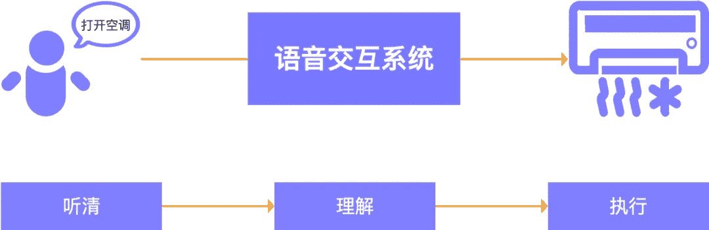
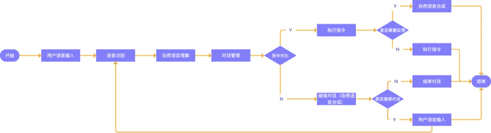
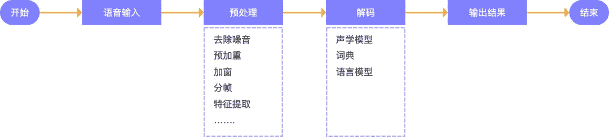
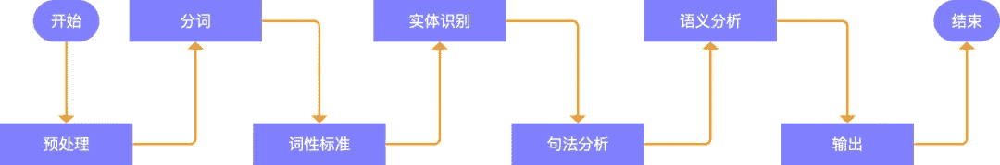
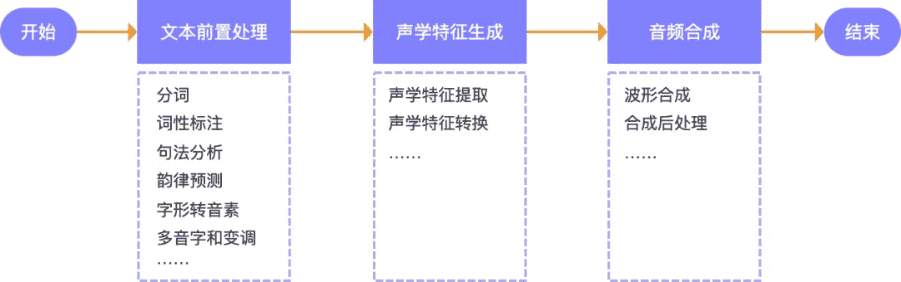
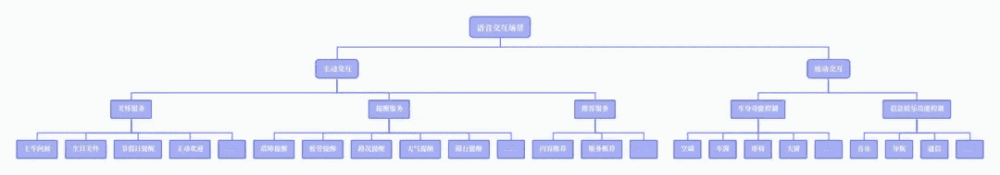
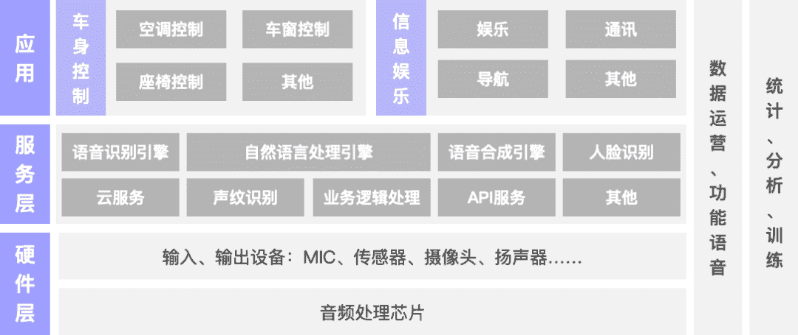

# 语音交互系统

> 来源：[https://v11enp9ok1h.feishu.cn/docx/MTtedwD02oNnhSxzlvecKm8onMh](https://v11enp9ok1h.feishu.cn/docx/MTtedwD02oNnhSxzlvecKm8onMh)

## 一.什么是语音交互

语音交互：语音是方式，交互的对象是任何的智能设备，顾名思义，即通过语音的方式完成人与机的交互。

在现今的各种智能化场景中，语音交互已成为一种非常关键的人机交互方式。从用户的角度来看，语音交互的核心价值主要体现在释放用户的双手，使得人与机之间的交互变的更高效便捷。

然而，从用户发出语音指令到实现与智能设备的交互，其过程并不像其名词描述的那么简单，要实现通过语音来完成人机交互，要解决解决三个关键问题，如何让机器听清用户的语音内容？如何机器理解用户的意图？如何让机器执行用户的意图？，解决这些问题的的过程是复杂的，其背后涉及到多个复杂的技术环节，如语音识别、自然语言理解、对话管理、自然语言生成、语音合成等。

## 二.语音交互的底层技术

### (一).语音识别

在语音交互系统中，用户的语音信号需要经过多个处理阶段才能得出正确的结果，而语音识别是实现语音交互的第一步，其在语音交互系统中负责对用户的语音信号进行前置处理，通过对用户语音信息的预处理、解码等关键任务，最终得到语音信号对应的文本内容，从而实现机器听清的用户的语音内容。

**1.语音输入：**用户通过麦克风输入内容语音，例如：打开空调

**2.预处理：**预处理是语音识别过程中的一个基础性步骤，它的意义在于对录音文件进行分帧、去除噪音、语音增强、加窗等预处理，提取出有效的声音特征，用于后续的语音内容分析处理。

+   **去除噪音：**由于用户环境因素影响，MIC设备录制的声音，除了人声，可能还会包各种噪音，那么为了语音识别的准确性，在识别前就需要先处理掉原始音频中的噪音部分。 去除噪音的实现过程大体可以理解为：首先提取原始音频中声音的频率、时域、能量等特征，通过对这些特征的对比分析区分原始音频中的人声和其他声音，然后通过滤波、降噪算法（基于频域的傅里叶变换、小波变换，或者基于时域的信号平滑法）等手段，实现去除噪声的目标。

+   **预加重：**在语音输入的过程中，由于环境和距离等影响因素，MIC录制声音可能会出现高频衰减和低频增益等失真现象，这将会影响后续语音识别的结果。  例如：用户的语音内容为“apple”，由于高频信号被衰减掉，录制的声音中可能只留下了“p”和“l”的较强信号，这将导致语音识别系统误认为说的是“pl”而不是“apple”。  针对这种现象，预加重通过加强高频成分的能量和减少低频成分的能量，让不同频率的音频信号能够在信号处理过程中均衡化，从而提高语音识别的准确性。

为了更形象的理解“预加重”，可以将其类比于在图像中的“锐化”，使得边缘更为清晰。

+   **分帧：**原始语音信号是一个连续的波形，是一种时间和频率上都变化较快的信号，在语音识别的过程中，如直接对连续且长的语音进行计算处理，会增加计算的难度降低识别的准确性。因此，为了提高语言识别结果的准备性，需要将连续且长的语音信号分为若干个固定长度的帧，分帧后每帧内的信号的频谱变化就会较为缓慢、稳定。

例如：以“打开空调”为例，假设录制的语音时长为2秒，采样率为16000Hz，那么原始语音信号就是一个长度为32000的一维向量，如果直接对这个声音信息进行语音识别，计算量会非常大，而且由于语音信号的频率和幅度变化非常快，很难进行有效的特征提取。

+   **特征提取：**完成去噪、预加重、分帧等前端处理后的语音信号，不能直接用于识别，还需要将其变换到频域，然后利用线性预测倒谱系数(LPCC)和 Mel 倒谱系数(MFCC)等方法，从语音信号中提取用来描述语音信号的各种特征，以便识别模型能够更好地对其进行分析和区分，这些特征包括：帧能量、音调（调子、语气等）、基音频率、音周期、共振峰、谐波结构、声道特性等。

为了更加形象的理解“特征提取”，可以将其类比为制作抖音电影解说短视频，在制作的过程中，你需要从完整的电影中筛选出最精彩、最有代表性的片段，需要对整部电影进行剪辑，然后把这些片段组成一部短视频，以便于快速地展现电影的精华和主题。

+   **其他：**原始音频的预处理，除了去除噪音、预加重、分帧，还有加窗、语音信号能量归一化、频率滤波、动态特征等，具体可以参考专业资料。

**3.解码：**在完成原始音频信号的预处理与特征提取之后，需要将提取到的特征输入语音识别模型中通过声学模型、词典、语音模型的协同计算来得到最终的识别结果。

+   **声学模型：**声学模型负责对语音信号进行特征提取和处理，生成一系列特征向量，然后使用这些特征向量来计算每个可能的音素的得分，并根据得分选出最可能的音素序列。

+   **词典：**在生活中，我们有认识的字的时候，可能会通过网络搜索或查字典的方式去寻找答案。在语音识别系统中，也有需要一个词典，用于识别音素对应的汉字（词）或者单词。语音识别系统中的词典包括了一系列的词语和它们对应的音素序列，这些音素序列反映了词语在语音信号中的语音学特征和发音方式，通过将语音信号的实际发音与词典中存储的发音进行匹配，语音识别系统可以推算出说话人所说的词语。

+   **语言模型：**在通过声学模型与词典，得到一组候选词语或句子的情况下，最后需要通过语言模型得到符合用户表达内容的结果。语音模型的作用就是通过统计文本中词与词之间的关系和概率，预测一个词语或句子出现的概率大小，从而对识别出的多个文本候选结果进行打分、排序和筛选，最终，得分最高的结果就是系统认为最符合用户表达内容的结果。

举个例子，如果用户说的是“我想要一杯咖啡”，在语音识别的过程中，可能会产生如下多个候选句子： 我向要一杯咖啡 我想要一辈咖啡 我想要一杯可菲 我向要一杯咖啡色菲 语言模型通过预测每个识别候选结果的概率大小，就可以计算出每个候选结果的得分，从而筛选出最符合用户表达内容的最终结果，“我想要一杯咖啡”。

+   **4.输出结果：**指最终输出识别结果，即转换后的文本或指令等形式的结果。

### (二)自然语言处理

**1.自然语言理解**

在完成用于语音内容的识别之后，要让设备能顺利执行用户的意图，还需要自然语言处理（NLP）算法模型对计算机可识别的文本进行分析和处理，以理解用户语言的含义和意图，并根据需要进行相应的回答或操作，一般情况下，NLP算法模型对文本的处理过程包括 包括词法分析、句法分析、语义分析等多个环节。

+   预处理：为了降低文本处理的复杂度，提高算法的精度和效率，文本本输入自然语言理解模型前，需要先进行预处理，如去掉句子中的特殊字符、停用词、将所有字母变成小写等。

例如：停用词是指一些在自然语言中使用比较频繁但实际上并不具有实际含义，对于句子的语义理解贡献较小的一些词语，比如一些代词、介词、连词等等（如“的”、“和”、“就”、“在”、“用”等），这些停用词虽然常常出现在文本中，但是对于计算机理解句子的真实含义并没有太大帮助，只会增加文本处理的复杂度，降低算法的精度和效率。

+   分词：自然语言理解模型，在理解在自然语言文本时，不是整句直接分析的，而时通过对自然语言文本的每个组成部分（如单词、短语等）的含义进行深入的分析和理解，进而确定整个文本的含义。 因此，在对文本进行预处理之后，需要对文本进行分词操作，将文本按照一定的规则切分成一个个词语，它的目的是将文本转化为计算机可以处理的离散的词语序列。 举个例子：以“导航去宝安机场”为例，通过分词，可以得到以下词语序列：导航 / 去 / 宝安机场。

+   词性标注：对每个词语进行词性标注，即确定每个词语在句子中的词性，通过对每个词语进行词性标注，可以确定词在句子中的语法角色和含义，从而更准确地进行语义分析、句法分析等任务。常见的词性包括名词、动词、形容词、副词、介词、连词、代词、数词、量词、助词、叹词等。  举个例子：以”导航去宝安机场“为例，”导航”：名词、“去”：动词，“宝安”：名词，“机场”：名词，通过这样的词性标注，可以分析出“导航”为主语，“去”为动词，表示导航的动作，“宝安”、“机场”由于都是名词，可以确定它们是导航的目的地。

+   实体识别：指从文本中识别特定实体，例如如人名、地名、组织机构名等，通过实体识别，计算机可以更准确地理解文本中的内容。举个例子：以”导航去宝安机场“为例，实体识别可以识别出“宝安机场”是一个地名实体，通过这一步得到的结果，计算机可以更好地理解用户的意图。

+   句法分析：对句子的语法结构进行分析，确定句子中各个词语之间的关系，其意义在于理清句子中的语法结构和词语关系以便于计算机进一步理解语音交互中的用户意图。 举个例子：以“导航去宝安机场”为例，句法分析可以将这个句子分析为“导航 去 宝安机场”，从中获取到“导航”是动作， “去”是一个方向，“宝安机场”是具体的地点信息，这些信息对于计算机进行后续处理是非常重要的。

+   语义分析：在完成预处理、分词、词性标注、实体识别、句法分析等前置任务之后，接下来就需要进行最后的语义分析，例如：情感分析、主体提取、语义联想、语义角色标注、槽位信息等，其主要意义是更全面地理解用户输入的意图，帮助计算机能够更好地理解用户输入的内容，从而根据用户意图执行相应的操作。 举个例子：以“导航去宝安机场”为例，经过语义分析后，计算机可以清晰地理解用户的意图，即需要进行导航操作，并且目的地是宝安机场。

+   结果输出：将经过预处理、分词、词性标注、实体识别、句法分析、语义分析处理后的结果，按结构输出给自然语言处理中的对话管理模块，进行进一步处理。 举个例子：以“导航去宝安机场”为例，自然语言理解最终输出的结果为“动作-导航，目的地-宝安机场，起点-当前位置。”

**2.对话管理**

在自然语言理解对语音识别的文本进行分析处理之后，需要对话管理系统进行意图识别，确定用户想要做什么，并且根据所处的对话状态进行状态跟踪，决定下一步需要执行的操作或回复用户的方式，这个过程包括根据用户输入的信息选择相应的策略、控制多轮对话流程、解决歧义等。对话管理系统是基于一个预先定义好的对话模型工作，对话模型中定义了对话流程、对话状态、对话策略等，在对话管理过程中，系统会使用这个对话模型来处理用户的请求。

+   意图识别：在通过自然语言理解对文本的分析处理，得到用户意图的关键词之后，对话管理系统负责将用户意图的关键词与预设的意图库（或指令库）进行对比来确定用户的意图，并进一步决定下一步的操作。 举个例子：以“打开空调”为例，语音助手接收到语音信号后，会先进行语音识别，将语音信号转化为文本，然后，自然语言理解系统会对转化后的文本进行解析，提取其中的关键词和语义信息，比如“打开空调”，理解用户的意图，接下来，对话管理系统会根据用户的意图进行响应。

+   对话状态跟踪：指的是记录和维护整个对话过程中的各个状态信息，以便在后续的对话中进行参考、分析和处理，状态信息包括上下文、用户意图、技能选择等等。

举个例子：当用户询问“今天下雨吗？”，对话管理系统可以通过状态跟踪，结合当前的用户意图和上下文信息，快速准确地回答用户问题。

**3.自然语言生成**

在语音交互系统中，当对话管理系统确定要继续与用户对话或反馈执行结果的时候，此时需要自然语言生成模块根据对话管理系统的指令，从相关的知识库或语料库中提取信息，以及根据语境和上下文信息，将结构化数据转化为自然、逻辑连贯的文本，以人类语言回答用户的问题、提供建议或执行任务，其生成自然语言的过程一般包括：句法分析、语义分析、语法分析、信息抽取、输出文本等步骤。

举个例子，当用户询问“明天的天气如何？”时，自然语言生成模块可能会根据当前的时间和位置信息，生成类似于“明天的天气为晴天，最高气温27℃，最低气温18℃”的文本回复内容。

### (三).语音合成

在通过语音识别、自然语言理解、对话管理、自然语言生成对用户的语音信息进行分析处理之后，最后想要机器开口与人交流，则需要语音合成系统将自然语言文本转化为语音并通过输出设备输出给用户。

语音合成系统既是语音交互的终点也是起点，是语音交互系统的的重要底层技术之一,它基于语言模型、声学模型、音频处理等技术，通过文本前置处理、声学特征生成和音频合成等关键步骤，将自然语言文本合成为高质量、自然流畅的人类语音。

**1.文本前置处理：**在计算机获得一段文本之后，要让计算机像人类一样开口讲这段文本讲出来，首先需要让机器知道文本中字、词如何发音和文本要表达的意思与文本里蕴含的情绪。因此，在语音合成系统中，第一个关键任务对文本的前置处理，具体包括：分词、词性标注、句法分析、韵律预测、字形转音素、对音字与变调分析等。 举个例子： 举个例子，比如输入一段文本：“明天下雨，出门记得带伞。”在文本前置处理的过程中，可能需要经过分词、音素标注和添加天气标签的处理，变成：“明天/t 下雨/v ，出门/v 记得/v 带/v 伞/n ，天气/t 标签/rainy。”

**2.声学特征生成：**要想让机器像人类一样将自然语言文本内容有韵律、顿挫、情感地说出来，就需要让机器知道自然语言文本中每个音素的声学特征，包括基频、时长、频谱形态等，这些声学特征是语音信号的特征，用于描述和控制语音信号的音色、音高、节奏等方面。 因此，在完成文本预处理后，要将自然语言文本内容合成为最近人类表达的语音内容，就需要先将自然语言文本转换成发音单元（音素），然后利用特定的算法将音素序列转化为对应的声学特征。

**3.音频合成：**这一步是将前面处理好的声学特征和文本信息进行结合，最终合成音频文件，作为语音合成系统的输出。具体来说，关键任务包括：波形合成、合成后处理等。

**小结：**以上我从产品的视角，基于课程内容、专业资料结合自身的理解，梳理的我对语音交互系统底层关键技术的理解，目的不在于学习语言交互相关的具体技术知识，而是知其大概原理。如存在歧义，欢迎交流，并建议参考相关的专业书籍与资料。

## 三.智能座舱的语音交互

### (一).语音交互对智能座舱的意义

在传统的汽车座舱内，存在着大量的传统机械和电子设备，驾乘人员在执行驾驶任务或使用汽车功能时，需要不断地操作各种控制器和按钮，以控制车辆的速度、方向、功能等，这些操作可能同时占用驾乘人员的双手、手眼、双脚，不仅繁琐和复杂，还容易导致驾驶疲劳和注意力不集中，从而增加驾驶安全的风险。

因此，为了提高汽车驾驶的安全性和舒适性，语音交互系统被应用在汽车智能座舱中。语音交互系统通过语音交互的方式来代替部分驾驶操作，从而可以让驾乘人员的双手、手眼、双脚更多地用于安全驾驶和应急操作。例如，驾乘人员可以使用语音指令来操控空调、导航系统、音乐播放器等，而不需要手动操作控制面板，减少了驾驶员的分心和疲劳，在一定程度上提高了驾驶安全性和方便性。

**从消费者的角度来看，**语音交互系统不仅可以通过被动的接收用户的指令，帮用户高效地完成人与车交互，而且可以为通过主动式的交互为用户带来更智能化、情感化的人车交互体验。在当前“人机共驾”阶段，语音交互是座舱内最直接、最人性化、最完全的交互方式。

**从厂商的角度来看，**由于语音交互系统具备较大个性化、自定义空间，厂商可以基于结合品牌定位与用户需求，为用户打造具有差异化特征语言交互系统，在品牌差异化发展中发挥着重要的作用。另外，基于用户的个性化需求，在基础语音服务的基础上衍生除很多付费服务场景，例如，在samrt精灵1号上，付费的语音助手形象，付费的音助手装扮。

### (二).智能座舱语音交互场景

基于用户、场景、需求，以语音交互系统为起点，我们可以将智能座舱语音交互的场景抽象的分为主动交互场景和被动交互场景。

**1.被动交互场景：**当我们在讨论“人机交互”时，大部分情况讨论的是“被动式交互”，它的实现逻辑很简单，即由人给机器发号施令，机器执行并输出结果反馈给人。如，传统的被动式语音交互，是由用户主动向机器输入语音指令，然后由机器对用户的音指令进行分析、处里并执行，以实现特定的功能，其能为用户提供的最大价值仅仅是“君子动口不动手”。

在人与车的交互场景中，被动式的语音交互，仅能实现的是“不动手”地去实现车身功能、信息娱乐的功能的控制。这种被动式的交互，在某些情况下还是会分散用户的注意力，从而造成安全隐患，例如：用户在发起语言指令的时候，视线和注意力可能会从驾驶任务上转移。

**2.主动交互场景：**不同于被动式交互，主动式交互以机器为起点，机器可以自己主动地输入信息，主动输出执行结果或建议给用户。

在人与车的交互场景中，语音交互系统可以与其他模态交互融合，基于人、车状态和内外部环境，通过传感器、摄像头等设备主动输入信息进行决策判断，为用户提供主动的服务，例如：主动关怀服务、提醒服务、推荐服务等，主动式的语音交互，在一步提高人车交互效率的同时，还可以为用户提供更加智能化、情感化的人交互体验。

### (三).智能座舱语音交互系统基础框架

智能座舱的语音交互系统是一个高度复杂的综合系统，它不仅需要精密的硬件与软件协同配合，同时需要专业的运营管理来保障其可靠性和稳定性。总的来看，整个系统可以分为硬件层、服务层、应用层和运营管理平台四个组成部分。

**1.硬件层：**在语音交互系统中，硬件层是智能座舱语音交互系统的物理基础，关键的硬件设备包括输入/输出设备和音频处理芯片，其中输入/输出设备负责采集用户的语音指令和反馈信息，主要包括：麦克风阵列、扬声器、摄像头、传感器、灯光等，芯片部分主要负责音频信号的处理与分析，主要包括数字信号处理器(DSP)、音频解码器、音频放大器等。

**2.服务层：**服务层是智能座舱语音交互系统的核心，它承担着语音、图像等信息的处理和解析，并提供必要反馈和响应的重要任务。主要包括自然语言处理(NLP)引擎、语音识别引擎、语音合成引擎、声纹识别、云端服务、API服务、业务逻辑处理服务等模块。

**3.应用层：**应用层是指基于服务层提供的核心能力与用户的实际需求相结合，为用户提供的具体应用程序，以帮助用户通过语音交互实现具体的功能控制。例如，车身控制模块中的空调控制、座椅控制、车窗控制等应用，以及信息娱乐模块中娱乐、通讯、导航等应用。

**4.运营管理平台：**用户在使用语音交互系统的过程中，会产生大量的用户行为数据与音频、文本、图像数据，运营管理平台通过对这些数据的统计分析，为语音交互系统与各种AI模型的持续优化提供数据支持。从业务角度分类，运营管理平台主要分为两大核心模块：用户数据统计分析和模型数据运营。

**用户数据统计分析模块，**可以对实车用户使用语音交互系统的行为数据进行统计和分析，从而生成不同维度、不同粒度的分析报表。这些报表可以帮助我们深入了解用户使用习惯和偏好，及时发现并解决系统存在的问题，为语音交互系统的优化提供数据依据。

**模型数据运营模块，**可以通过对用户在使用语音交互系统过程中产生的大量音频、文本、图像数据的定期回收与采集、标注，生产出各个AI模型需要的数据，为模型训练提供数据支持。