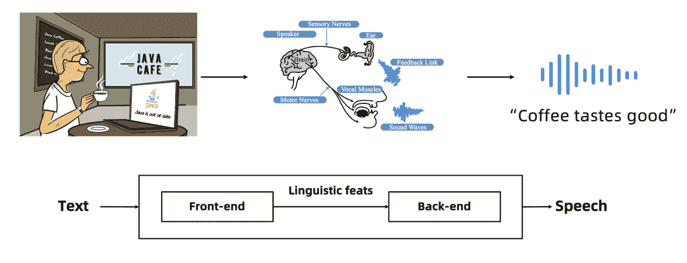
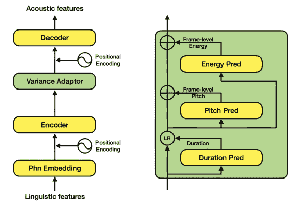
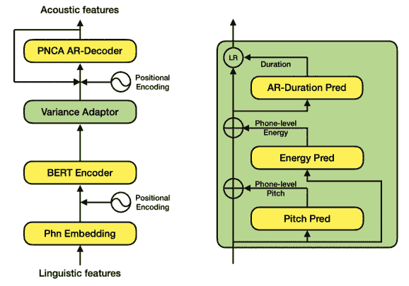
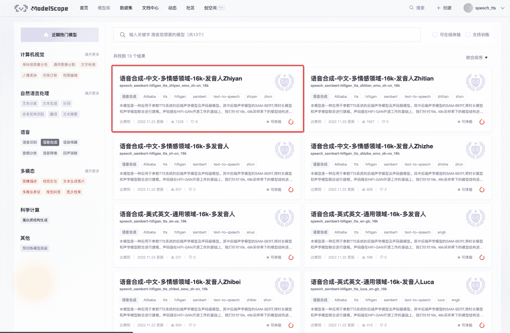
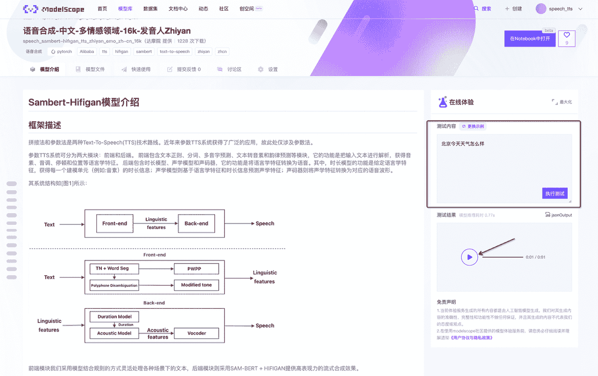
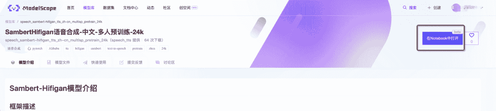
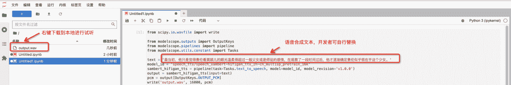
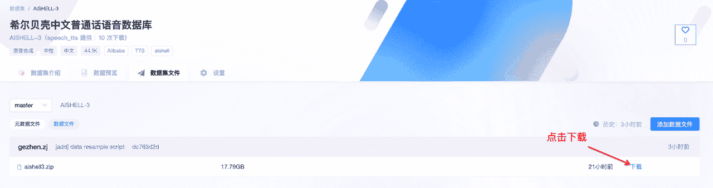

# `Sambert`语音合成模型训练教程

来源：https://v11enp9ok1h.feishu.cn/docx/LPb4dtjAGoPjskxj5qPcDFyHnfb

本文将介绍`Sambert`语音合成模型，包括其模型结构，如何在`ModelScope`上体验模型效果，以及如何使用开源代码训练`Sambert`模型。

## 什么是语音合成



语音合成技术目前被广泛应用在各种领域，例如智能设备语音助手、音视频媒体创作、辅助阅读等，具体到我们的日常使用场景，手机、可穿戴设备、智能音箱、电话客服、有声电子书、各种各样的短视频配音等等，语音合成技术的身影随处可见。

## Sambert模型设计

在语音合成领域，类似`FastSpeech`的`Parallel`模型是目前的主流，它针对基频（`pitch`）、能量（`energy`）和时长（`duration`）三种韵律表征分别建模。但是，该类模型普遍存在一些效果和性能上的问题，例如，独立建模时长、基频、能量，忽视了其内在联系；完全非自回归的网络结构，无法满足工业级实时合成需求；帧级别基频和能量预测不稳定。优点：

1. 建立时长与基频、能量的依赖关系，并使用自回归结构的时长预测模块，提升预测韵律的自然度和多样性

1. `Decoder`使用`PNCA`自回归结构，降低带宽要求，支持CPU实时合成

1. 音素级别建模基频、能量，提高容错率

1. 以`预训练BERT`语言模型为编码器，在小规模数据上效果更好





## 如何体验模型效果

### 在线体验

我们在`ModelScope`上线的语音合成模型均提供了在线体验功能，点击进入模型主页，在页面右侧可以输入想要合成的文本，点击“执行测试”，模型会加载并进行推理，推理完成后，下方的“测试结果”会出现合成的音频，点击它就可以播放音频啦。





### Notebook体验

对于有一定经验的开发者，还可以通过在线`Notebook`体验模型效果，点击模型主页右上角的“在`Notebook`中打开”



将模型主页的示例代码粘贴到`Notebook`代码块中，这里我们以中文多发音人预训练模型为例，将text替换成想要合成的文本，运行代码块，随后即可在左侧文件栏中获得合成的语音文件，文件可下载到本地进行试听。

```
from scipy.io.wavfile import write

from modelscope.outputs import OutputKeys
from modelscope.pipelines import pipeline
from modelscope.utils.constant import Tasks

# 在此处编辑您想要合成的文本
text = '待合成文本'
model_id = 'speech_tts/speech_sambert-hifigan_tts_zh-cn_multisp_pretrain_16k'
sambert_hifigan_tts = pipeline(task=Tasks.text_to_speech, model=model_id, model_revision='v1.0.0')
output = sambert_hifigan_tts(input=text)
pcm = output[OutputKeys.OUTPUT_PCM]
write('output.wav', 16000, pcm)
```



## 如何训练一个定制语音合成模型

首先在开始训练前，我们需要完成环境搭建和数据准备两个操作。

### 环境搭建

获取`KAN-TTS`源码， 后续操作默认在代码库根目录下执行

```
git clone https://github.com/alibaba-damo-academy/KAN-TTS.git
cd KAN-TTS
```

我们推荐使用[`Anaconda`](https://www.anaconda.com/products/distribution#Downloads)来搭建`Python`虚拟环境，使用以下命令创建(目前只兼容Linux x86系统)：

```
# 防止使用`pip`安装时出现网络问题，建议切换国内`pip`源
pip config set global.index-url https://pypi.tuna.tsinghua.edu.cn/simple

# 创建虚拟环境
conda env create -f environment.yaml

# 激活虚拟环境
conda activate maas
```

### 数据准备

目前`KAN-TTS`支持两种类型的数据格式：`阿里标准格式`和`通用格式`

其中`阿里标准格式`数据如下:

```
# 阿里标准格式数据
.
├── interval
│   ├── 500001.interval
│   ├── 500002.interval
│   ├── 500003.interval
│   ├── ...
│   └── 600010.interval
├── prosody
│   └── prosody.txt
└── wav
    ├── 500001.wav
    ├── 500002.wav
    ├── ...
    └── 600010.wav
```

`通用格式`数据如下：

```
# 通用格式数据
.
├── prosody
│   └── prosody.txt
└── wav
    ├── 1.wav
    ├── 2.wav
    ├── ...
    └── 9000.wav
```

`wav`文件夹下存放了音频文件，`prosody`文件夹下的`.txt`文件对应的是音频文件的文本标注，`interval`文件夹下存放的是音素级别的时间戳标注，通常情况下`通用格式`数据不会携带时间戳标注，这是两种格式的区别。

如果您的数据不满足上述两种格式要求，请联系我们获取数据标注服务。

快速开始：你可以从`ModelScope`下载经过`阿里标准格式`处理的`AISHELL-3`开源语音合成数据集，用来进行后续操作。



```
# 解压数据
unzip aishell3.zip
```

解压后得到如下结构文件夹:

```
./
├── SSB0005
│   ├── interval
│   ├── prosody
│   └── wav
├── SSB0009
│   ├── interval
│   ├── prosody
│   └── wav
├── SSB0011
│   ├── interval
│   ├── prosody
│   └── wav
├── SSB0012
│   ├── interval
│   ├── prosody
│   └── wav
├── SSB0016
│   ├── interval
│   ├── prosody
│   └── wav
├── SSB0018
......
```

`AISHELL-3`包含两百多个发音人录音，每个发音人数据量在20～30分钟不等，这里我们选择其中的一个发音人进行数据处理，以`SSB0009`为例(开发者也可自行选择其他发音人)，训练一个16k采样率的语音合成模型。

由于原始音频采样率为44k，我们先对音频做重采样，这里需要用到该数据集的元数据仓库脚本

```
# 拉取元数据仓库，并做重采样处理
git clone https://www.modelscope.cn/datasets/speech_tts/AISHELL-3.git
./AISHELL-3/aishell_resample.sh aishell3 aishell3_16k 16000
```

下面我们选择适合数据采样率的配置文件进行特征提取操作，这里我们以16k采样率为例`kantts/configs/audio_config_16k.yaml`

运行以下命令来进行特征提取，其中`--speaker`代表该数据集对应发音人的名称，用户可以随意命名。

```
# 特征提取
python kantts/preprocess/data_process.py --voice_input_dir aishell3_16k/SSB0009 --voice_output_dir training_stage/SSB0009_feats --audio_config kantts/configs/audio_config_16k.yaml --speaker SSB0009
```

根据数据集规模，特征提取需要运行一段时间，提取完毕后你会在`training_stage/SSB0009_feats`目录下得到如下结构的文件：

```
# 基于阿里标准格式数据所提取出的特征目录
├── am_train.lst
├── am_valid.lst
├── audio_config.yaml
├── badlist.txt
├── data_process_stdout.log
├── duration
├── energy
├── f0
├── frame_energy
├── frame_f0
├── frame_uv
├── mel
├── raw_duration
├── raw_metafile.txt
├── Script.xml
├── train.lst
├── valid.lst
└── wav
```

至此数据准备工作就算完成了。

### 拉取预训练模型

`ModelScope`[中文多人语音合成模型](https://modelscope.cn/models/speech_tts/speech_sambert-hifigan_tts_zh-cn_multisp_pretrain_16k/summary)是通义实验室语音实验室在100小时精标多人数据集上训练产出的预训练模型，我们以此为`basemodel`做后续微调。

使用`git`命令拉取模型，在拉取前，首先你需要安装`git-lfs`，具体的安装教程见`Git Large File Storage`，安装完成后执行以下命令

```
# 克隆预训练模型
git clone -b pretrain http://www.modelscope.cn/speech_tts/speech_sambert-hifigan_tts_zh-cn_multisp_pretrain_16k.git
```

在`basemodel_16k`目录下即为我们需要的`checkpoints`.

### 微调声学模型

`KAN-TTS`的训练脚本是配置驱动的，我们使用预训练模型的`sambert/config.yaml`作为训练配置文件。

此外根据在数据准备阶段对数据集做的命名，我们还需要修改配置文件中的`speaker_list`配置项：

```
# 将`speaker_list`其中一个发音人替换为`aishell3`发音人
linguistic_unit: 
  cleaners: english_cleaners
  lfeat_type_list: sy,tone,syllable_flag,word_segment,emo_category,speaker_category
  speaker_list: SSB0009,F74,FBYN,FRXL,M7,xiaoyu
```

以及`train_max_steps`配置项，我们希望在`basemodel` 980k的基础上，继续微调120k

```
# 将`train_max_steps`改为1100100
...
train_max_steps: 1100100
...
```

完成上述必要的配置项修改后，我们就可以使用以下命令训练声学模型了：

```
# 训练声学模型
CUDA_VISIBLE_DEVICES=0 python kantts/bin/train_sambert.py --model_config speech_sambert-hifigan_tts_zh-cn_multisp_pretrain_16k/basemodel_16k/sambert/config.yaml --resume_path speech_sambert-hifigan_tts_zh-cn_multisp_pretrain_16k/basemodel_16k/sambert/ckpt/checkpoint_980000.pth --root_dir training_stage/SSB0009_feats --stage_dir training_stage/SSB0009_sambert_ckpt
```

根据你的显卡数量和性能不同，此处`sambert`训练会需要5～10个小时，训练完成后模型输出目录如下：

```
# 声学模型输出目录
./SSB0009_sambert_ckpt
├── ckpt/
├── checkpoint_1100000.pth   <----- this is the latest checkpoint
├── checkpoint_1020000.pth
├── checkpoint_1040000.pth
|....
├── config.yaml
├── log/
└── stdout.log
```

### 微调声码器

与声学模型类似，声码器的训练脚本也是配置驱动的，你可以使用预训练模型目录下的`hifigan/config.yaml`作为训练配置文件，另外声学模型和声码器的微调并没有依赖关系，两者可以同时进行。 我们希望在`basemodel` 2000k steps的基础上再微调100k steps, 但不保留state，修改`hifigan/config.yaml`配置项`train_max_steps`

```
# 将`train_max_steps`改为100100
...
train_max_steps: 100100
...
```

运行以下命令进行训练：

```
# 训练声码器
CUDA_VISIBLE_DEVICES=0 python kantts/bin/train_hifigan.py --model_config speech_sambert-hifigan_tts_zh-cn_multisp_pretrain_16k/basemodel_16k/hifigan/config.yaml --resume_path speech_sambert-hifigan_tts_zh-cn_multisp_pretrain_16k/basemodel_16k/hifigan/ckpt/checkpoint_2000000.pth --root_dir training_stage/SSB0009_feats --stage_dir training_stage/SSB0009_hifigan_ckpt
```

声码器需要的微调时间较长，根据GPU型号不同在12～20小时不等。 训练完成后，声码器模型输出目录如下：

```
# 声码器模型输出目录
.
├── ckpt/
│   ├── checkpoint_20000.pth
│   ├── checkpoint_40000.pth
│   ├── ...
│   └── checkpoint_100000.pth      <---- this is the latest checkpoint
├── config.yaml
├── log/
└── stdout.log
```

### 体验微调模型效果

在声学模型和声码器微调完毕后，我们就可以使用产出的模型文件来合成语音了，在此之前需要做一些准备工作。

将我们想要合成的文本写入一个文件`test.txt`，每句话按行分隔，如下所示

```
徐玠诡谲多智，善揣摩，知道徐知询不可辅佐，掌握着他的短处以归附徐知诰。
许乐夫生于山东省临朐县杨善镇大辛庄，毕业于抗大一分校。
宣统元年（1909年），顺德绅士冯国材在香山大黄圃成立安洲农务分会，管辖东海十六沙，冯国材任总理。
学生们大多住在校区宿舍，通过参加不同的体育文化俱乐部及社交活动，形成一个友谊长存的社会圈。
学校的“三节一会”（艺术节、社团节、科技节、运动会）是显示青春才华的盛大活动。
雪是先天自闭症患者，不懂与人沟通，却拥有灵敏听觉，而且对复杂动作过目不忘。
勋章通过一柱状螺孔和螺钉附着在衣物上。
雅恩雷根斯堡足球俱乐部（）是一家位于德国雷根斯堡的足球俱乐部，处于德国足球丙级联赛。
亚历山大·格罗滕迪克于1957年证明了一个深远的推广，现在叫做格罗滕迪克–黎曼–罗赫定理。
```

运行以下命令进行合成：


# 运行合成语音

```
CUDA_VISIBLE_DEVICES=0 python kantts/bin/text_to_wav.py --txt test.txt --output_dir res/SSB0009_syn --res_zip speech_sambert-hifigan_tts_zh-cn_multisp_pretrain_16k/resource.zip --am_ckpt training_stage/SSB0009_sambert_ckpt/ckpt/checkpoint_1100000.pth --voc_ckpt training_stage/SSB0009_hifigan_ckpt/ckpt/checkpoint_2100000.pth --speaker SSB0009
```

完成后在`res/SSB0009_syn/res_wavs`文件夹下就可以获得合成结果

```
│   ├── 8_0_dur.txt
│   ├── 8_0_energy.txt
│   ├── 8_0_f0.txt
│   ├── 8_0_mel.npy
│   ├── 8_1_dur.txt
│   ├── 8_1_energy.txt
│   ├── 8_1_f0.txt
│   └── 8_1_mel.npy
├── res_wavs
│   ├── 0.wav
│   ├── 1.wav
│   ├── 2.wav
│   ├── 3.wav
│   ├── 4.wav
│   ├── 5.wav
│   ├── 6.wav
│   ├── 7.wav
│   └── 8.wav
├── stdout.log
└── symbols.lst
```

## 合成样音
