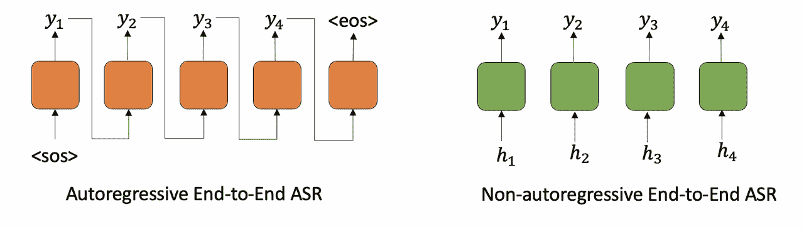
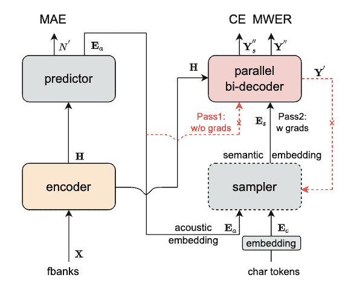
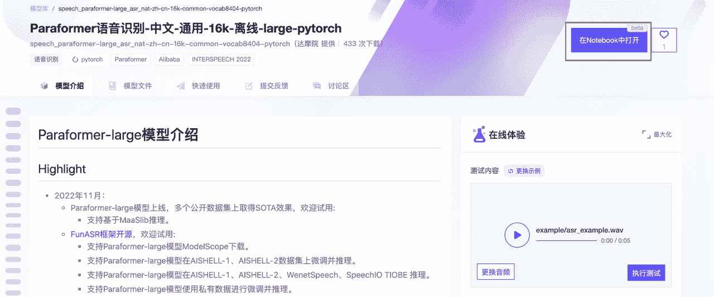
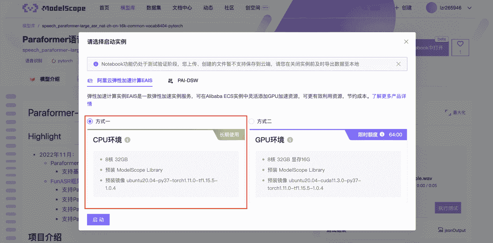
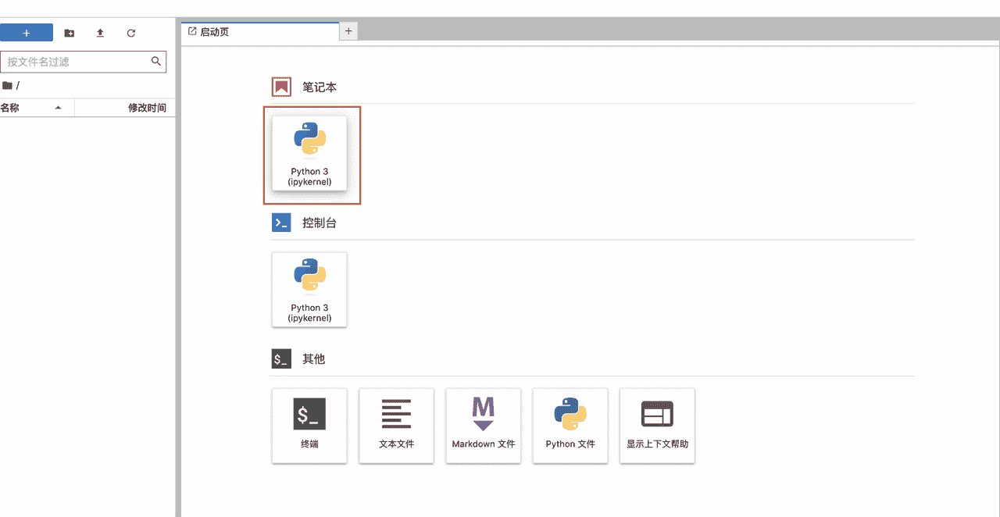
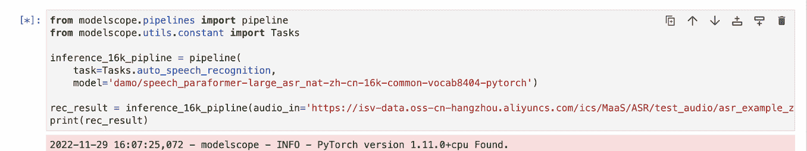

# Paraformer模型

> 来源：https://v11enp9ok1h.feishu.cn/docx/RbZOdxZRooNAVExYLBpc3tV8nKd

> 本文将介绍非自回归模型`Paraformer`，包括语音识别模型简介，`Paraformer`模型介绍，`Paraformer-large`模型在`ModelScope`上如何使用，以及`Paraformer-large`模型在各大语音识别任务上的表现，

## 什么是语音识别模型

过去十几年的技术突破，使得语音识别已经从研究走向了实用化，解锁了很多应用场景，例如语音输入法、智能客服、语音车载导航、智能会议纪要等。

> 当前语音识别基础框架已经从最初复杂的混合语音识别系统，进入了高效便捷的端到端语音识别系统。其中代表性的模型是`Transformer`。`Transformer`是一种自回归端到端模型，需要逐个生成目标文字，计算并行度比较低，没法高效结合`GPU`进行推理。针对 `Transformer` 模型自回归生成文字的低并行计算效率的问题，学术界提出了非自回归模型（`Non-autoregressive model`）来并行地输出目标文字（如图1所示）。根据生成目标文字时的迭代轮数，非自回归模型分为：多轮迭代式与单轮非自回归模型。



非自回归端到端语音识别系统相比于以`Transformer`为代表的自回归端到端语音识别模型具有更好的推理效率，但是识别效果上也有一定的差距。通义实验室语音团队提出新一代的基于`Paraformer`的非自回归端到端语音识别系统，识别效果对齐自回归端到端语音识别，显著提升推理效率。

## Paraformer非自回归端到端语音识别模型

近期，我们在`ModelScope`上开放了阿里业务大数据训练的语音识别模型，涉及不同的模型结构（`UniASR`，`Paraformer`），不同的模型大小（`small`，`large`），不同的语种（中文，英文，中英自由说，日语，俄语，印尼语等）。以`Paraformer`为例，我们将介绍其原理，以及如何体验和训练自己的`Paraformer`模型。

### Paraformer基础原理



`Paraformer`模型结构如上图所示，由 `Encoder`、`Predictor`、`Sampler`、`Decoder` 与 `Loss function` 五部分组成。

> `Encoder`可以采用不同的网络结构，例如`self-attention`，`conformer`，`SAN-M`等。`Predictor` 为两层`FFN`，预测目标文字个数以及抽取目标文字对应的声学向量。`Sampler` 为无可学习参数模块，依据输入的声学向量和目标向量，生产含有语义的特征向量。`Decoder` 结构与自回归模型类似，为双向建模（自回归为单向建模）。`Loss function` 部分，除了交叉熵（`CE`）与 `MWER` 区分性优化目标，还包括了 `Predictor` 优化目标 `MAE`。

> 其核心点主要有：

+   `Predictor` 模块：基于 Continuous integrate-and-fire (`CIF`) 的 预测器（`Predictor`）来抽取目标文字对应的声学特征向量，可以更加准确的预测语音中目标文字个数。

+   `Sampler`：通过采样，将声学特征向量与目标文字向量变换成含有语义信息的特征向量，配合双向的 `Decoder` 来增强模型对于上下文的建模能力。

+   基于负样本采样的 `MWER` 训练准则。

更详细的细节见：

+   论文： [Paraformer: Fast and Accurate Parallel Transformer for Non-autoregressive End-to-End Speech Recognition](https://arxiv.org/abs/2206.08317)

+   论文解读： [Paraformer: 高识别率、高计算效率的单轮非自回归端到端语音识别模型](https://mp.weixin.qq.com/s/xQ87isj5_wxWiQs4qUXtVw)

---

### ModelScope开源工业级Paraformer

#### 大模型

开源的`Paraformer-large`模型相对论文中的学术`Paraformer`模型采用了更深更大的模型结构。`Paraformer-large`模型的`Encoder`有50层，包括`memory equipped self-attention`（`SAN-M`）和`feed-forward networks`（`FFN`）。`Decoder`有16层，包括`SAN-M`，`FFN`和`multi-head attention`（`MHA`）。

#### 大数据

相对于公开论文中在单独封闭数据集（`AISHELL-1`、`AISHELL-2`等）上进行的效果验证，我们使用了更大数据量的工业数据上对模型进行训练，利用数万小时16K通用数据，包括半远场、输入法、音视频、直播、会议等领域。并在微调实验中，使用`AISHELL-1`、`AISHELL-2`单独数据集对模型进行`finetune`。

#### 高效率

在开源`Paraformer-large`模型中，我们使用了6倍下采样的低帧率建模方案，窗长为70ms，窗移为60ms，从而相比于10ms的窗移，可以将计算量降低接近6倍，支持大模型的高效推理。

#### 高性能

`Paraformer-large`模型在主流的中文语音识别任务中的识别准确率均远超于公开发表论文中的结果，同时具备工业落地的能力，在工业大数据上取得了与阿里云公有云上文件转写服务相当的效果。

### Paraformer的效果

我们提出的`Paraformer`模型在一系列语音识别任务上进行了实验，以验证其性能优越性，其中包括学术数据集`AISHELL-1`、`AISHELL-2`、`WenetSpeech`，以及第三方评测`SpeechIO TIOBE`白盒测试集。

### 公开数据集

#### AISHELL-1

#### AISHELL-2

#### Wenetspeech

上述三表分别展现了`Paraformer-large`模型在`AISHELL-1`、`AISHELL-2`和`WenetSpeech`测试集上的效果，其表现远远超于目前公开发表论文中的结果，远好于单独封闭数据集上的模型。从测试结果可以看到，大数据对于语音识别系统性能的重要性。

### SpeechIO TIOBE

+   `Decode config w/o LM`:

+   `Decode without LM`

+   `Beam size: 1`

+   `Decode config w/ LM:`

+   `Decode with Transformer-LM`

+   `Beam size: 10`

+   `LM weight: 0.15`

## 如何快速体验模型效果

### 在线体验

> 从`ModelScope`官网进入[模型主页](https://www.modelscope.cn/models/damo/speech_paraformer-large_asr_nat-zh-cn-16k-common-vocab8404-pytorch/summary)，在页面右侧，可以在“在线体验”栏内看到我们预先准备好的示例音频，点击播放按钮可以试听，点击“执行测试”按钮，推理完成后会在下方“测试结果”栏中显示识别结果。如果您想要测试自己的音频，可点击“更换音频”按钮，选择上传或录制一段音频，完成后点击执行测试，识别内容将会在测试结果栏中显示。

### 在Notebook中开发

> 对于有开发需求的使用者，特别推荐您使用`Notebook`进行离线处理。先登录`ModelScope`账号，点击模型页面右上角的“在`Notebook`中打开”按钮出现对话框，首次使用会提示您关联阿里云账号，按提示操作即可。



关联账号后可进入选择启动实例界面，选择计算资源，建立实例，此处我们推荐使用`CPU`环境，当前可以免费使用。



待实例创建完成后进入`Notebook`开发环境选择新建`Notebook`脚本。



将下方的`api`调用示例代码粘贴到`Notebook`代码块中并运行，识别结束后显示最终识别结果。



`api`调用方式可参考如下范例：

```
from modelscope.pipelines import pipeline
from modelscope.utils.constant import Tasks

inference_16k_pipline = pipeline(
    task=Tasks.auto_speech_recognition,
    model='damo/speech_paraformer-large_asr_nat-zh-cn-16k-common-vocab8404-pytorch'
)

rec_result = inference_16k_pipline(audio_in='https://modelscope.oss-cn-beijing.aliyuncs.com/test/audios/asr_example_zh.wav')
print(rec_result)
```

如果输入音频为`pcm`格式，调用`api`时需要传入音频采样率参数`audio_fs`，例如：

```
rec_result = inference_16k_pipline(audio_in='https://modelscope.oss-cn-beijing.aliyuncs.com/test/audios/asr_example_zh.pcm', audio_fs=16000)
```

## 如何训练自己的Paraformer模型？

本文介绍的`Paraformer`是基于大数据训练的通用领域的识别模型，开发者可以基于此模型进一步利用本项目对应的`Github`代码仓库进一步进行模型的领域定制化。

### 如何基于开源模型训练自有模型

#### 基于Github的模型训练和推理

+   环境搭建

+   安装`FunASR`

```
# Clone the repo:
git clone https://github.com/alibaba/FunASR.git

# Install Conda:
wget https://repo.continuum.io/miniconda/Miniconda3-latest-Linux-x86_64.sh
sh Miniconda3-latest-Linux-x86_64.sh
conda create -n funasr python=3.7
conda activate funasr

# Install Pytorch (version >= 1.7.0):
conda install pytorch==1.7.0 torchvision==0.8.0 torchaudio==0.7.0 cudatoolkit=9.2 -c pytorch  # For more versions, please see https://pytorch.org/get-started/locally/

# Install other packages:
pip install --editable ./
```

安装`ModelScope`

```
pip install "modelscope[audio]" -f https://modelscope.oss-cn-beijing.aliyuncs.com/releases/repo.html
```

##### 模型微调训练

> 接下来我们以`FunASR`框架的`egs_modelscope/common`为例，介绍如何使用小规模自有语料在`Paraformer-large`模型上进行领域定制化训练，并体验产出的模型效果。

###### 数据准备

目前`FunASR`支持数据格式如下：

```
tree ./example_data/
./example_data/
├── dev
│   ├── text
│   └── wav.scp
├── test
│   ├── text
│   └── wav.scp
└── train
    ├── text
    └── wav.scp

3 directories, 6 files
```

`text`文件中存放音频标注，`wav.scp`文件中存放`wav`音频绝对路径，样例如下：

```
cat text
BAC009S0002W0122 而 对 楼市 成交 抑制 作用 最 大 的 限 购
BAC009S0002W0123 也 成为 地方 政府 的 眼中 钉

cat wav.scp
BAC009S0002W0122 /mnt/data/wav/train/S0002/BAC009S0002W0122.wav
BAC009S0002W0123 /mnt/data/wav/train/S0002/BAC009S0002W0123.wav
```

`特征提取`

```
cd egs_modelscope/common

# compute fbank features
utils/compute_fbank.sh --cmd "utils/run.pl" --nj 32 --speed_perturb "1.0" \
        example_data/train ${exp_dir}/exp/make_fbank/train ${fbankdir}/train
utils/fix_data_feat.sh ${fbankdir}/train

# apply low_frame_rate and cmvn
utils/apply_lfr_and_cmvn.sh --cmd "utils/run.pl" --nj 32 --lfr True --lfr-m 7 --lfr-n 6 \
        ${fbankdir}/train am.mvn ${exp_dir}/exp/make_fbank/train ${feat_train_dir}

# Text Tokenize
# 我爱reading->我 爱 read@@ ing
utils/text_tokenize.sh --cmd "utils/run.pl" --nj 32 ${fbankdir}/train seg_dict ${feat_train_dir}/log ${feat_train_dir}

# Dictionary Preparation
awk -v v=,vocab_size '{print $0v}' ${feat_train_dir}/text_shape > ${feat_train_dir}/text_shape.char
cp ${feat_train_dir}/speech_shape ${feat_train_dir}/text_shape ${feat_train_dir}/text_shape.char asr_stats_fbank_zh_char/train

# dev集参照如上train集对音频进行特征提取
```

###### 下载模型

> `Paraformer-large`模型是通义实验室语音实验室提供的基于大数据训练的通用领域识别模型，我们以此为`basemodel`做后续微调。设定模型名称后，执行命令完成模型下载。

```
modelname="speech_paraformer-large_asr_nat-zh-cn-16k-common-vocab8404-pytorch"
python modelscope_utils/download_model.py --model_name $modelname
```

###### 模型训练

完成数据处理及模型下载后，可对`conf/train_asr_paraformer_sanm_50e_16d_2048_512_lfr6.yaml`配置进行修改，如学习率（`lr`）、最大训练epoch数（`max_epoch`）等，完成后我们就可以使用以下命令对模型进行微调：

```
python asr_train_paraformer.py \
  --train_data_path_and_name_and_type ${feat_train_dir}/feats.scp,speech,kaldi_ark \
  --train_data_path_and_name_and_type ${feat_train_dir}/text,text,text \
  --valid_data_path_and_name_and_type ${feat_dev_dir}/feats.sc,speech,kaldi_ark \
  --valid_data_path_and_name_and_type ${feat_dev_dir}/text,text,text \
  --output_dir exp/model_dir \
  --init_param base_model.pth \
  --config finetune_config.yaml
```

##### 模型效果体验

在模型微调完毕后，我们可以使用产出的模型来识别语音了，执行如下命令，对音频进行解码推理：


```
cp finetuned_model.pth exp_dir/finetune_model_name.modelscope
cp -r ${HOME}/.cache/modelscope/hub/damo/pretrained_model_name/* exp_dir/

python -m funasr.bin.modelscope_infer \
  --local_model_path exp_dir \
  --wav_list example_data/dev/wav.scp \
  --output_file logdir/text
```

### 一站式体验

您也可以选择配置`modelscope_common_finetune.sh`脚本中的数据路径及参数配置，完成后一键执行进行模型的微调及推理，具体如下：

```
# 配置modelscope_common_finetune.sh中参数
# dataset：  数据路径，结构如example_data所示，dev/test可不配置，若无dev数据处理过程中可自动抽取训练集中1000句音频作为dev集
# tag：  结果保存路径后缀

# 配置修改完成后，执行命令启动模型微调训练及推理: 
sh modelscope_common_finetune.sh
```

除此之外，我们提供了AISHELL-1、AISHELL-2、WenetSpeech、SpeechIO的微调及推理脚本，如上配置好数据路径后即可执行启动训练。

### 结合NNLM模型效果体验

Paraformer-large模型可结合NNLM语言模型进行推理，在`inference`的sh脚本中配置`use_lm=true`即可使用NNLM解码。接下来我们以SpeechIO测试集为例，展示如何结合语言模型解码：

```
cd egs_modelscope/speechio/paraformer

# 配置paraformer_large_infer.sh中参数
# ori_data:       # 测试数据路径
# data_dir:       # 数据处理路径
# exp_dir:        # 结果保存路径
# test_sets:      # 测试集名称
# use_lm=true     # 是否使用LM
# beam_size=10    # 设置beam_size
# lm_weight=0.15  # 设置lm_weight

# 测试集目录结构树，必须有trans.txt和wav.scp
tree SPEECHIO_ASR_ZH00001
SPEECHIO_ASR_ZH00001
├── metadata.tsv
├── trans.txt
├── wav
│   ├── e5oipIfM49I__20190201_CCTV_10.wav
│   └── e5oipIfM49I__20190201_CCTV_1.wav
│   └── ...
└── wav.scp


# 配置修改完成后，执行命令启动模型推理: 
sh paraformer_large_infer.sh
```

### 基于MaaSlib的模型训练和推理

正在对接中，敬请期待。
