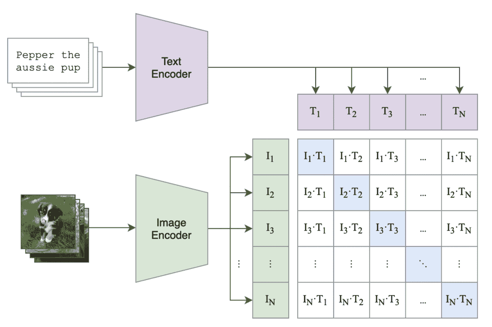
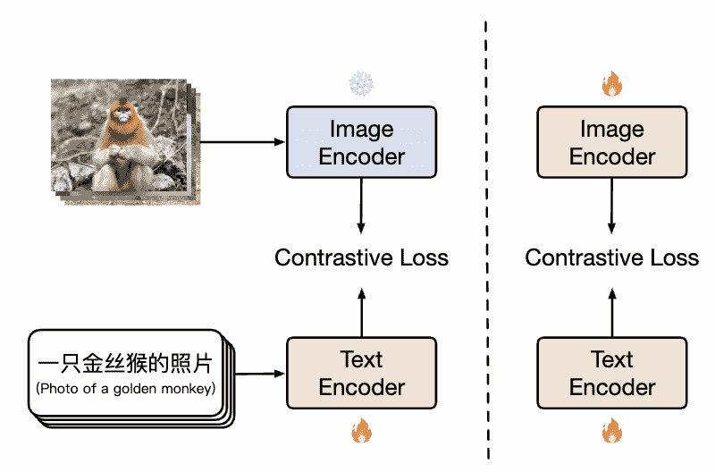
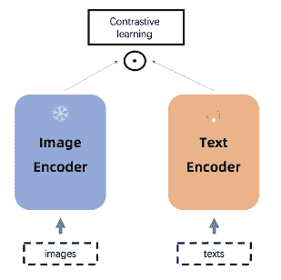
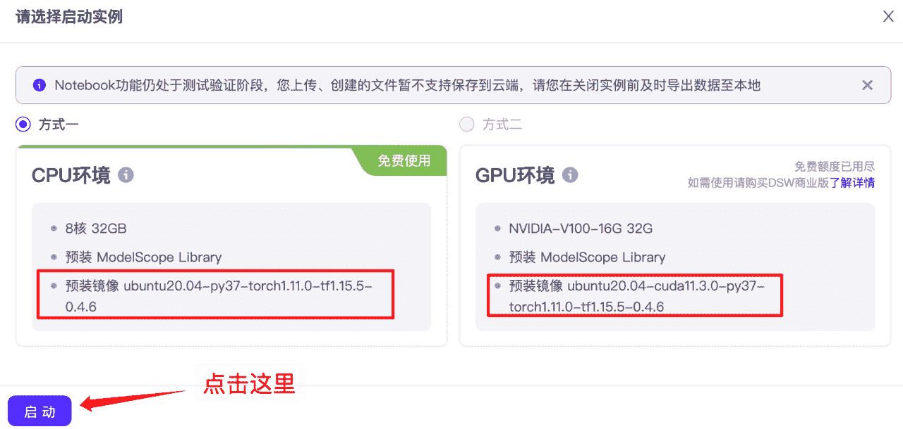
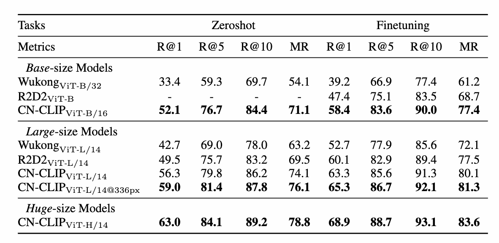
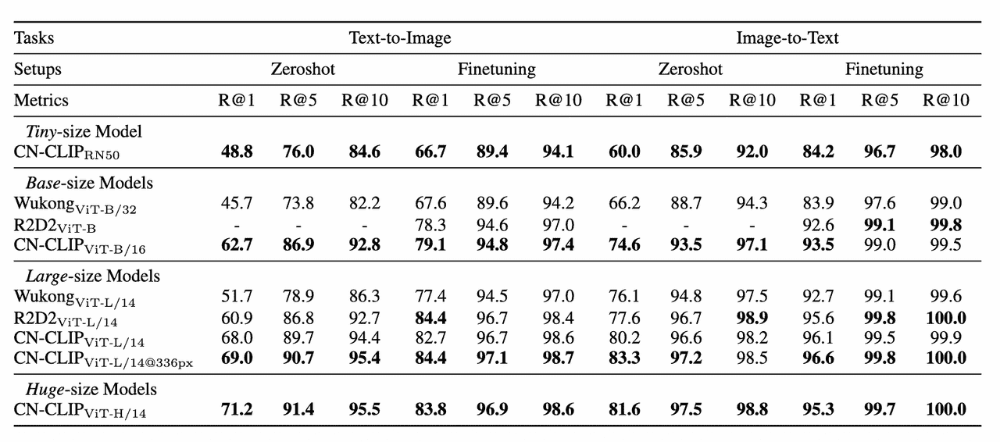
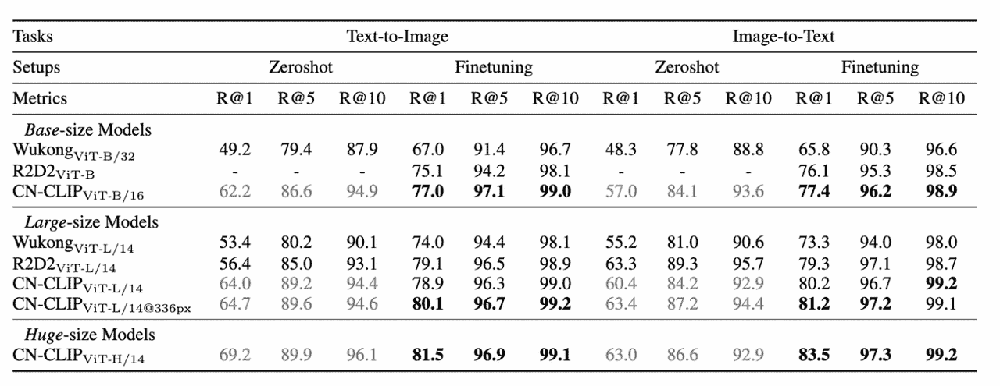
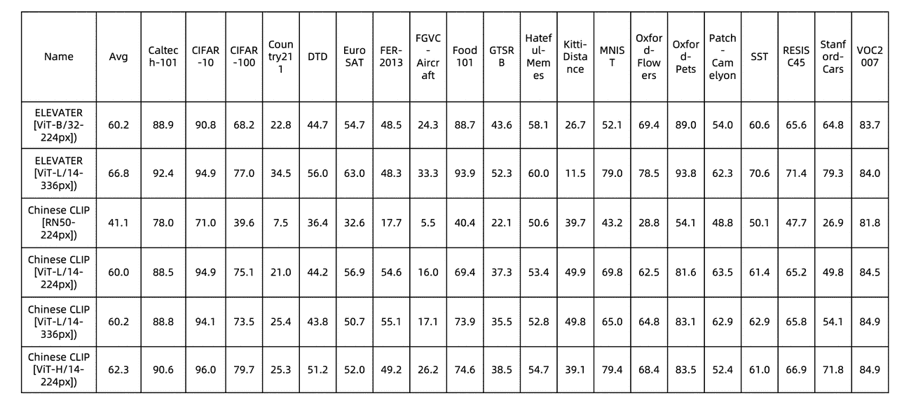
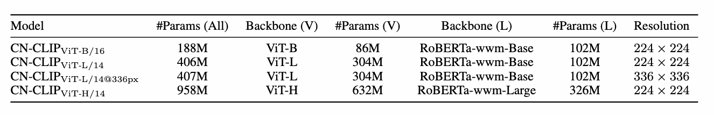

# CLIP

> 来源：[https://v11enp9ok1h.feishu.cn/docx/BwgHdhIFaoj7iNx25TgcyKDDnRg](https://v11enp9ok1h.feishu.cn/docx/BwgHdhIFaoj7iNx25TgcyKDDnRg)

## CLIP模型是什么？它能做什么？

---

CLIP[1]全名Contrastive Language-Image Pretraining，在2021年由OpenAI提出，其核心理念为图文对比学习预训练。与传统的视觉模型不同，CLIP的预训练数据并非标注的图像数据，而是从网络上大量采集的弱监督图文对数据，即我们常说的图片和caption。CLIP收集了4亿规模的图文对数据，旨在通过预训练建模图像与文本的联系。相比传统复杂的交互式的多模态预训练，CLIP的模型极为简单，即我们常说的双塔模型，分别包括图像塔和文本塔。图像塔负责提取图像表征，一般为Vision Transformer，即常说的ViT，文本塔则负责提取文本特征，使用经典Transformer架构。双塔各自提取表征后，batch内部两两互相计算图文表征的内积，如图所示：



原始的CLIP模型基于英文图文语料，不能用于中文的图文表征提取场景。本项目以英文CLIP视觉侧参数和中文Roberta参数，作为模型初始化值。基于大规模原生中文图文数据，通过如下图所示的二阶段预训练策略（一阶段仅训练文本侧，二阶段同时训练），实现了CLIP模型的中文化版本。



模型使用对比学习常用的InfoNCE loss进行训练，本质上即拉近正例及推远负例的距离，实现向量空间内图像与自然语言的联系。经此训练，CLIP模型具备多模态理解能力，其图像文本关联能力能应用于跨模态检索任务，以及开放域的零样本图像分类。同时，CLIP的图像塔具备强大的图像表征能力，能够广泛应用于图像生成、物体检测、分割、甚至视频领域的下游任务等。

## 为什么要推出中文CLIP？

---

推出中文CLIP的原因，在于CLIP模式证明了大规模弱监督图文数据以及大模型就能构建出强大的多模态基础模型及视觉基础模型。然而，基于英语数据训练的CLIP并不足以满足跨语言的复杂场景，尤其当面对博大精深的汉语的时候。今天谈论CLIP我们往往都在谈论其视觉表征能力，而忽略其文本塔的作用。但值得注意的是，不同语言的文本数据的图像数据均大不相同，不仅仅是语言本身的不同，更多的是不同语言的数据所包含的信息对客观现实和主观思想的反映等都大不相同。尽管当前市面上有诸如mCLIP[2]的多语言CLIP模型，但它仍不足以满足对中文的理解，甚至不足以满足对中文世界的图像的理解。例子如下(具体图片大家可以点击链接查看)：

面对`"过年喜庆对联"`这个搜索query，mCLIP返回的是圣诞相关的事物。

又或者`"周杰伦打篮球"`，返回的结果也是错误的。

不得不说，中文自然语言处理太难了，而中文视觉理解也太难了！我们需要一个中文的CLIP，扮演中文领域的多模态和视觉基础模型，实现对中文领域多模态和视觉相关应用的“赋能”。

## 中文CLIP是如何实现的？

---

2022年，通义实验室推出了中文CLIP，其方法基本与官方CLIP保持一致，保证了其易用性的同时，还实现了对大规模中文领域图文数据的学习。具体而言，我们首先收集了大规模的中文图文对数据，其中绝大部分来自于公开数据集，其中包括LAION-5B[3]，Wukong[4]，以及英文经典公开数据集如Visual Genome[5]和Microsoft COCO[6]的翻译版本，翻译来自于阿里NLP。因此，本工作保证优秀效果的同时，还保证了高可复现性，方便后续研究人员复现我们的实验效果。

而在预训练方法上，相比于经典的对比学习预训练，我们采用了两阶段对比学习预训练，方法如图所示：



首先我们对图像塔和文本塔使用已有的预训练模型初始化，可大幅节约预训练成本加速收敛的同时，还能实现更好的效果。图像塔为ResNet50或不同规模的ViT，使用对应的CLIP的模型权重进行初始化。在第一阶段中，如左图所示，我们首先冻结图像塔的参数，通过对比学习预训练让文本塔的表征在向量空间中距离接近于已经训练好的CLIP图像塔模型的表征，此方法在谷歌工作LiT[7]及华为工作Wukong均得到有效验证。而在第二阶段，我们解除参数的冻结，让所有参数均参与训练，目标是让CLIP模型学习中文领域的图像和文本数据，学习中文领域的图像和自然语言知识。我们在消融实验中，也证明了两阶段训练方法相比于一阶段的有效性，同时也讨论了模型初始化对模型效果的影响。

目前，中文CLIP已经发布在通义实验室模型平台`ModelScope`。下文将具体介绍如何在`ModelScope`上使用此模型，实现多种类型的应用。

## 怎么用起来？

我们的中文CLIP模型提供了非常简单易用的接口。在配置好环境之后，只要通过简单的几行代码，就能够完成一个基本的图文特征提取和图文匹配计算的流程，下面我们给出详细的方法：

### 3.1 配置环境

#### 3.1.1 使用ModelScope的notebook

在我们的模型页面点击右上角的"在Notebook中打开"，根据自己当前的额度，可选使用CPU或者GPU实例，如下图：

step 1: 点击打开Notebook


step 2: 选择实例类型



ModelScope的notebook（类似`python`的notebook）已经预装了相关的环境，所以启动后可以直接使用。step 2中红框部分为环境信息：`ubuntu20.04-py37-torch1.11.0-tf1.15.5-1.6.0`，分别为操作系统、cuda版本(GPU环境)、`python`版本、PyTorch版本、TensorFlow版本和ModelScope版本。请注意CLIP运行所需的ModelScope环境版本需要高于`0.3.7`，如果发现上图红框中显示的ModelScope版本低于这一版本，在"启动"按钮旁边会有一个"更新镜像并启动"的按钮，请点击它，如下图：


#### 3.1.2 自己动手配置

使用`ModelScope`进行推断和开发，需要配置好`ModelScope`的相关运行环境。`ModelScope`的环境管理主要是依赖基础的深度学习框架：`Pytorch`和`TensorFlow`/`Pytorch`；同时`ModelScope`集成了各个模态的模型，所以依赖相对比较复杂，因此建议使用`Conda`进行环境管理，新建一个`python`环境。详细文档见这里。

建好环境并安装基础深度学习环境后，在`shell`终端中安装多模态相关依赖库，如下所示：

```shell
pip install "modelscope[multi-modal]" -f https://modelscope.oss-cn-beijing.aliyuncs.com/releases/repo.html
# ms升级命令
# pip install --upgrade "modelscope[multi-modal]" -f https://modelscope.oss-cn-beijing.aliyuncs.com/releases/repo.html
```

在`shell`终端中进行一个简单的安装验证（会下载模型并展示进度条，默认下载路径`~/.cache/modelscope/`）：

```shell
python -c "from modelscope.pipelines import pipeline;from modelscope.utils.constant import Tasks;from modelscope.preprocessors.image import load_image;print(pipeline(task=Tasks.multi_modal_embedding).forward({'img': load_image('https://yangan2.oss-cn-beijing.aliyuncs.com/pokemon.jpeg'), 'text': '皮卡丘'}))"
```

看到有向量输出，则安装正常

### 3.2 预测图文表征 & 计算相似度

如上文所述，CLIP模型通过双塔模型的结构，来为图文计算特征向量。得到的图文特征向量，通过简单的向量内积运算，就能够计算出图文相似度。`ModelScope`中CLIP模型的推断方式主要是通过`Pipeline`进行的，仅需几行代码，就可以简单的调用CLIP模型的推理能力。下面我们分别给出提取图文表征，并进一步实现一个文本query匹配多张图片、和一张图片匹配多个候选文本的代码示例

在`python`环境中，首先，我们进行必要的`import`操作

```python
import torch
from modelscope.utils.constant import Tasks
from modelscope.pipelines import pipeline
from modelscope.preprocessors.image import load_image
```

之后，我们构建多模态表征的`ModelScope` pipeline，并载入中文CLIP模型参数（以`base`规模为例）

```python
pipeline = pipeline(task=Tasks.multi_modal_embedding,
    model='damo/multi-modal_clip-vit-base-patch16_zh') # 载入base规模CLIP模型
```

目前，我们在ModelScope上发布了4个规模的中文CLIP模型：`base`规模（`ViT-B-16`）、`large`规模（`ViT-L-14`）、`large`规模-336分辨率（`ViT-L-14@336px`）以及`huge`规模（`ViT-H-14`）。用户可以通过指定上面代码中的`model`参数来载入需要的规模，分别对应为：

+ `base`规模：`damo/multi-modal_clip-vit-base-patch16_zh`
+ `large`规模：`damo/multi-modal_clip-vit-large-patch14_zh`
+ `large`规模-336分辨率：`damo/multi-modal_clip-vit-large-patch14_336_zh`
+ `huge`规模：`damo/multi-modal_clip-vit-huge-patch14_zh`

关于这4个模型规模的更详细介绍，请参见附录。

对于一个文本query匹配多张图片，我们使用"过年喜庆对联"这个query，以及下面四张候选图片（图片文件名我们并不会用到）。其中只有过年对联这张图片真正和query相关，其他三张都是不匹配的图片，过年喜庆和对联两张图片作为高难度负例，检验模型的效果


```python
load_image('https://yangan2.oss-cn-beijing.aliyuncs.com/过年对联.jpeg') # 支持示例图片url/本地图片路径 返回PIL.Image
load_image('https://yangan2.oss-cn-beijing.aliyuncs.com/圣诞装饰.png')
load_image('https://yangan2.oss-cn-beijing.aliyuncs.com/过年喜庆.jpeg')
load_image('https://yangan2.oss-cn-beijing.aliyuncs.com/对联.jpeg')
```

```python
# 准备文本query和多张候选图片
input_text = "过年喜庆对联"
input_imgs = []

# 提取图片特征，支持一张图片(`PIL.Image`)或多张图片(`List[PIL.Image]`)输入，输出归一化特征向量
img_embedding = pipeline.forward({'img': input_imgs})['img_embedding'] # 2D Tensor, [图片数, 特征维度]

# 提取文本特征，支持一条文本(`str`)或多条文本(`List[str]`)输入，输出归一化特征向量
text_embedding = pipeline.forward({'text': input_text})['text_embedding'] # 2D Tensor, [文本数, 特征维度]

# 计算图文相似度
with torch.no_grad():
    # 计算内积得到logit，考虑模型`temperature`（0.01）
    logits_per_text = (text_embedding / pipeline.model.temperature) @ img_embedding.t()
    # 根据logit计算概率分布
    probs = logits_per_text.softmax(dim=-1).cpu().numpy()

# 打印结果
print("图文相似概率分布:", probs.tolist()) 
# 图文相似概率分布: [[0.71826171875, 5.364418029785156e-07, 0.28125, 0.0006151199340820312]]
```

可以看到，模型为和文本最为相关的过年对联图片，给出了远高于其他三张图片的相似度概率，两张高难度的负例图并没有能够误导模型，这样我们就完成了一个文本query匹配图片的流程。上述代码执行中，调用`pipeline.forward()`方法后，我们也分别拿到了图片和文本的归一化特征向量（代码中的`img_embedding`和`text_embedding`），可以进一步用于其他的下游任务。

我们另外给出一个一张图片匹配多个候选文本的例子，使用下面这张示例图片，输入"杰尼龟"、"妙蛙种子"、"小火龙"、"皮卡丘"四条候选文本


```python
input_img = load_image('https://yangan2.oss-cn-beijing.aliyuncs.com/pokemon.jpeg') # 支持皮卡丘示例图片路径/本地图片 返回PIL.Image
```


```
input_texts = ["杰尼龟", "妙蛙种子", "小火龙", "皮卡丘"]

img_embedding = pipeline.forward({'img': input_img})['img_embedding'] # 2D Tensor, [图片数, 特征维度]
text_embedding = pipeline.forward({'text': input_texts})['text_embedding'] # 2D Tensor, [文本数, 特征维度]

# 计算图文相似度
with torch.no_grad():
    logits_per_image = (img_embedding / pipeline.model.temperature) @ text_embedding.t()
    probs = logits_per_image.softmax(dim=-1).cpu().numpy()

print("图文相似概率分布:", probs)
# 图文相似概率分布: [[1.182e-03 5.023e-02 5.760e-04 9.482e-01]]
```

模型同样给出了正确的预测，"皮卡丘"这条文本获得了最高的图文相似度

## 3.3 模型finetune

目前[ModelScope](https://tianchi.aliyun.com/muge)除了支持中文CLIP的推理功能之外，也支持利用下游图文对数据集，对CLIP参数进行单卡/多卡finetune。这里我们以已经在ModelScope集成的MUGE图文检索数据集为例，展示如何准备一个训练脚本，对中文CLIP进行finetune。

### 3.3.1 新建脚本 & 必要的import

例如我们新建一个训练脚本`clip_train_entry.py`，其中先完成必要的`import`操作：

```
# -*- coding: utf-8 -*-
import os

import json
import shutil

from modelscope.metainfo import Metrics, Trainers
# 指标和训练器的Python类
from modelscope.msdatasets import MsDataset
# ModelScope集成数据集的Python类
from modelscope.trainers import build_trainer
# 构建训练器的方法
from modelscope.utils.constant import ModelFile
```

### 3.3.2 准备训练超参

在刚刚的训练脚本`clip_train_entry.py`中，我们接下来加入以下代码，定义一个`python dict`，用来指定finetune使用的模型规模、学习率、训练轮数等超参。具体超参的定义格式和含义如下：

```
finetune_cfg = \
    {
        # 指定训练使用pytorch，无需修改
        'framework': 'pytorch', 
        # 训练多模态表征任务（中文CLIP所支持的任务），无需修改
        'task': 'multi-modal-embedding', 
        # pipeline为多模态表征，无需修改
        'pipeline': {'type': 'multi-modal-embedding'}, 
        # 使用的模型规模（以base为例），参见3.2和附录
        'pretrained_model': {'model_name': \
            'damo/multi-modal_clip-vit-base-patch16_zh'}, 
        # 图片和文本在数据集的字段名，这里以MUGE为例
        'dataset': {'column_map': {'img': 'image', 'text': 'query'}}, 
        # 模型和训练日志存储目录，最终ckpt将存放于$work_dir/output/目录
        'train': {'work_dir': './workspace/ckpts/clip', 
                # 多卡训练请解除下面这行注释，单卡保留
                # 'launcher': 'pytorch',
                # 训练轮数
                'max_epochs': 1,
                # 使用混合精度训练，无需修改
                'use_fp16': True,
                # 训练单卡batch size，根据显存实际情况决定
                'dataloader': {'batch_size_per_gpu': 180,
                                # 训练DataLoader使用进程数，0代表直接主进程读取数据
                                'workers_per_gpu': 16,
                                # 是否shuffle，无需修改
                                'shuffle': True,
                                # 丢弃每轮不够整batch的末尾数据，无需修改
                                'drop_last': True},
                # 指定学习率warmup的过程占总步数的比例
                'lr_scheduler': {'warmup_proportion': 0.1},
                # 使用学习率scheduler（cosine scheduler），无需修改
                'lr_scheduler_hook': {'type': 'LrSchedulerHook', 'by_epoch': False},
                # 优化器类型
                'optimizer': {'type': 'AdamW'},
                # 指定峰值学习率（warmup到峰值后最终decay到0）
                'optimizer_hparams': {'lr': 2.5e-05, 
                                        # 指定weight_decay，无需修改
                                        'weight_decay': 0.001, 
                                        # adam的超参，一般无需修改
                                        'beta1': 0.9, 
                                        'beta2': 0.999,
                                        'eps': 1e-08},
                # 混合精度训练相关超参，一般无需修改
                'optimizer_hook': {'type': 'TorchAMPOptimizerHook',
                                    'cumulative_iters': 1,
                                    'loss_keys': 'loss'},
                # 多卡训练时，是否通过gpu通信，在global batch上计算对比学习loss，单卡不起作用
                'loss_cfg': {'aggregate': True},
                # 每隔多少步保存一组验证指标最优的参数
                'hooks': [{'type': 'BestCkptSaverHook',
                            # 中文CLIP finetune使用in-batch 文到图检索Recall@1
                            #（注意和全局文到图检索Recall@1指标不同，仅在batch内部计算Recall）
                            'metric_key': 'inbatch_t2i_recall_at_1',
                            'by_epoch': False,
                            'interval': 200},
                            {'type': 'TextLoggerHook', 'interval': 1},
                            {'type': 'IterTimerHook'},
                            # 评测间隔，可按照步数和轮数间隔指定
                            {'type': 'EvaluationHook', 'by_epoch': False, 'interval': 200},
                            {'type': 'EvaluationHook', 'by_epoch': True, 'interval': 1},
                            {'type': 'ClipClampLogitScaleHook'}]},
        # 验证时，计算in-batch 文到图检索Recall@1使用的batch size
        'evaluation': {'dataloader': {'batch_size_per_gpu': 128,
                                    # 验证数据DataLoader使用进程数，0代表直接主进程读取数据
                                    'workers_per_gpu': 16,
                                    'shuffle': False,
                                    'drop_last': True},
                    # 中文CLIP finetune使用in-batch 文到图检索Recall@1，无需修改
                    'metrics': [{'type': 'inbatch_recall'}]},
        'preprocessor': []}
```

### 3.3.3 执行训练任务

在训练脚本`clip_train_entry.py`中，我们最后加入以下代码，初始化输出目录、获取集成的MUGE数据集、同时构建训练器

```
if __name__ == "__main__":
    # 初始化输出目录，请和上面dict使用相同路径
    WORKSPACE = './workspace/ckpts/clip'
    os.makedirs(WORKSPACE, exist_ok=True)
    config_file = os.path.join(WORKSPACE, ModelFile.CONFIGURATION)
    with open(config_file, 'w') as writer:
        json.dump(finetune_cfg, writer) # 保存训练超参

    # 指定预训练使用的CLIP规模，请和上面dict的'pretrained_model'保持一致
    pretrained_model = 'damo/multi-modal_clip-vit-base-patch16_zh'
    args = dict(
        model=pretrained_model,
        work_dir=WORKSPACE,
        # 获取集成的MUGE数据集，脚本第一次执行时自动下载
        train_dataset=MsDataset.load(
            'muge', namespace='modelscope', split='train'),
        eval_dataset=MsDataset.load(
            'muge', namespace='modelscope', split='validation'),
        # CLIP验证时使用的指标，无需修改
        metrics=[Metrics.inbatch_recall],
        # 传入3.3.1定义的dict
        cfg_file=config_file)
    # 构建训练器
    trainer = build_trainer(
        name=Trainers.clip_multi_modal_embedding, default_args=args)
    # 启动训练
    trainer.train()
```

准备好训练脚本`clip_train_entry.py`后，我们用以下命令启动训练：

单卡训练任务：

```
export CUDA_VISIBLE_DEVICES=0;python3 clip_train_entry.py
```

多卡训练任务（请在3.3.1中解除`launcher`的注释）：

```
# CUDA_VISIBLE_DEVICES和WORLD_SIZE根据实际情况而定
export CUDA_VISIBLE_DEVICES=0,1,2,3,4,5,6,7;
export WORLD_SIZE=8;
# 同台机器跑多组请替换不同的端口
export port=9932;
python -m torch.distributed.launch --nproc_per_node=$WORLD_SIZE --nnodes=1 --node_rank=0 --master_port=9932 --use_env clip_train_entry.py
```

训练过程中，将打印如下的log，显示学习率、训练loss、显存占用、预估完成时间等监控信息

```
INFO:modelscope:epoch [1][2/1390]       lr: 1.799e-07, eta: 2:35:20, iter_time: 0.499, data_load_time: 0.047, memory: 29279, loss: 1.1768, logit_scale: 4.6052, global_batch_size: 180.0000
```

### 3.3.4 训练指标 & 获取finetune ckpt

训练过程中，根据预设的验证步数/轮数间隔，将在验证集进行评测，并给出验证指标。中文CLIP finetune时，使用验证集in-batch文到图检索`Recall@1`作为评测指标。


```
2022-10-31 12:36:06,344 - modelscope - INFO - epoch(eval) [1][238]      memory: 30721, inbatch_t2i_recall_at_1: 0.8284, loss: 1.0088, logit_scale: 4.6046, global_batch_size: 180.0000
```

注意此指标和中文 `CLIP` `modelcard` 中，列出的全局文到图检索 `Recall@1` 指标不同，仅在一个 `batch` 内部进行召回和计算 `Recall`，和全局指标并不是直接可比的。如果要计算全局文到图检索 `Recall@1` 指标，需要在全量验证集图片中，为每个文本 `query` 计算并召回最相关的图片出来。

在训练结束后，在预先指定的输出路径下，会找到一个 `output` 文件夹，其中的 `pytorch_model.bin` 文件即使 `finetune` 好的 `ckpt`。

## 3.4 关键配置介绍

### 3.4.1 模型构建相关配置

目前我们每个规模的 `CLIP` 模型，都有对应的配置 `json` 文件。由于 `CLIP` 模型由双塔构成，所以视觉侧和文本侧各有一个 `json` 配置文件，分别命名为 `vision_model_config.json` 和 `text_model_config.json`。这两个文件会在执行加载模型代码的时候，随着模型参数一起下载好（参见 3.2 部分 `构建pipeline & 载入模型` 代码）。这两个 `json` 配置文件，指定了模型适配分辨率、层数、隐层维度等基本结构超参。下面我们以 `base` 规模 `CLIP` 模型为例，介绍 `json` 配置中具体的超参配置项。关于现有各个 `CLIP` 模型规模的细节，请参见附录部分。

模型结构配置文件，默认应位于 `~/.cache/modelscope/hub/damo/multi-modal_clip-vit-base-patch16_zh/` 文件夹。如果此目录不存在，请执行以下 `python` 命令，获取实际的模型下载文件夹：

```
from modelscope.hub.snapshot_download import snapshot_download
print(snapshot_download('damo/multi-modal_clip-vit-base-patch16_zh')) # 将打印实际的模型下载文件夹
```

对于视觉侧，配置文件为该文件夹下 `vision_model_config.json` 文件，其 `json` 格式如下

```
{
    "embed_dim": 512, # 输出的向量特征维度
    "image_resolution": 224, # 适配图片分辨率，输入的原始图片会被 ModelScope 自动缩放到这一分辨率
    "vision_layers": 12, # 视觉侧 Transformer 模型层数
    "vision_width": 768, # 视觉侧 Transformer 隐层维度
    "vision_patch_size": 16 # 视觉 Transformer 切图片 patch 的大小
}
```

对于文本侧，打开该文件夹下 `text_model_config.json` 文件，其 `json` 格式如下

```
{
    "vocab_size": 21128, # 词表大小
    "text_attention_probs_dropout_prob": 0.1, # 注意力值的神经元丢弃概率，沿袭自 BERT，仅用于 finetune
    "text_hidden_act": "gelu", # 激活函数类型
    "text_hidden_dropout_prob": 0.1, # 神经元丢弃概率，沿袭自 BERT，仅用于 finetune
    "text_hidden_size": 768, # 文本侧隐层维度
    "text_initializer_range": 0.02, # 文本侧初始化分布 range，沿袭自 BERT
    "text_intermediate_size": 3072, # 文本侧全连接层中间维度
    "text_max_position_embeddings": 512, # 文本侧位置编码最大长度
    "text_num_attention_heads": 12, # 文本侧注意力头数
    "text_num_hidden_layers": 12, # 文本侧模型层数
    "text_type_vocab_size": 2  # 文本侧 type 编码类型数，沿袭自 BERT
}
```

## 3.5 核心代码介绍

对于中文 `CLIP` 模型来说，核心代码是如何构建模型，文本侧的分词器我们沿用中文 `BERT` 分词代码；`ModelScope` 在封装中文 `CLIP` 模型代码的基础上，完成 `Pipeline` 构建以及 `finetune` 和推理的支持。接下来会重点介绍 `CLIP` 模型实现相关的核心代码（位于 `ModelScope` 代码库 `modelscope/models/multi_modal/clip/` 路径下）。关于 `ModelScope` 框架侧的代码，可以重点参考 `ModelScope` 自身的文档中心。

### 3.5.1 文本 `Tokenizer`

如上，我们直接复用了中文 `BERT` 分词器代码，词表文件 `vocab.txt` 与模型参数一起在构建模型时下载（见 3.2），分词器实现代码请参见 `modelscope/models/multi_modal/clip/bert_tokenizer.py`，下面给出分词基本过程。此过程已经集成在 `ModelScope` 内部 `pipeline` 中，用户提取文本特征时无需执行这些代码，直接按照 3.2 的代码，直接输入原始文本即可。这里只是展示出内部工作原理：

```
from modelscope.models.multi_modal.clip.bert_tokenizer import FullTokenizer
from modelscope.hub.snapshot_download import snapshot_download
# 构建分词器
model_dir = snapshot_download('damo/multi-modal_clip-vit-base-patch16_zh')
vocab_file = f'{model_dir}/vocab.txt'
tokenizer = FullTokenizer(vocab_file=vocab_file)
# 进行分词
text = "过年喜庆对联"
context_length = 52 # 文本序列最大长度，设定为52，即除CLS与SEP之外最多50字
tokens = tokenizer.convert_tokens_to_ids(
                    tokenizer.tokenize(text)
           )[:context_length - 2]
tokens = [tokenizer.vocab['[CLS]']] + tokens + [tokenizer.vocab['[SEP]']]
print(tokens) # 按字切分并添加CLS和SEP符号，[101, 6814, 2399, 1599, 2412, 2190, 5468, 102]
```

### 3.5.2 图片侧预处理

以下代码（参见 `modelscope/preprocessors/multi_modal.py`）对输入的 `PIL.Image` 类型图片进行预处理，转化为 `torch.Tensor`。我们这里处理的方式和英文 `CLIP` 标准做法一致。此过程已经集成在 `ModelScope` 内部 `pipeline` 中，用户提取文本特征时无需执行这些代码，直接按照 3.2 的代码，用图片文件路径或者图片 `url`，读入原始图片即可。这里只是展示出内部工作原理：

`image_input = load_image('https://yangan2.oss-cn-beijing.aliyuncs.com/pokemon.jpeg')`

```
from PIL import Image
from torchvision.transforms import Compose, Normalize, Resize, ToTensor
from modelscope.preprocessors.image import load_image

# 图片转成 RGB
def _convert_to_rgb(image):
    return image.convert('RGB')

# 预处理算子构建函数
def image_transform(image_size=224):
    transform = Compose([
        _convert_to_rgb,
        Resize((image_size, image_size)),
        ToTensor(),
        Normalize((0.48145466, 0.4578275, 0.40821073),
                  (0.26862954, 0.26130258, 0.27577711)),
    ])
    return transform
image_resolution = 224 # 分辨率，实际执行时从 3.4.1 提到的视觉侧配置接收
img_preprocess = image_transform(image_resolution) # 输入分辨率，返回一个预处理算子
image_tensor = img_preprocess(image_input) # torch Tensor
```

### 3.5.3 `CLIP` 模型实现代码

主要实现代码请参见 [`modelscope/models/multi_modal/clip/mod.py`](https://arxiv.org/abs/2010.11929)。在 `CLIP` 模型视觉侧，采用经典的视觉 `Transformer` 模型结构实现，自上而下主要包含以下类定义的结构模块：

+ `VisualTransformer`：视觉 Transformer 模型的最上层模块，接收 3.4.1 中提到的视觉侧各项结构配置，完成图像输入多层 Transformer 前的 `embedding` 编码、多层 Transformer 计算以及最后的投影变换
+ `Transformer`：一个简单的 Transformer 实现模块，负责执行 `VisualTransformer` 中主体的多层 Transformer 计算部分
+ `ResidualAttentionBlock`：实现一层 Transformer 运算的模块，Transformer 中将多个 `ResidualAttentionBlock` 堆叠在一起
+ `QuickGELU`：视觉 Transformer 使用的激活函数

在 `CLIP` 文本侧，我们直接沿用经典的 `BERT` 代码，定义 `BERT` 结构模块：

+ `BertConfig`（`configuration_bert.py`）：`BERT` 相关配置项，接收 3.4.1 中提到的文本侧各项结构配置
+ `BertModel`（`modeling_bert.py`）：经典的 `BERT` 模型实现代码

基于视觉侧和文本侧的模型定义，`model.py` 中的 `CLIP` 类封装双塔的模型实现，作为中文 `CLIP` 模型的模型定义模块。在 `CLIP` 类定义之上，再封装上读取预训练参数、输出向量的归一化和向 `ModelScope pipeline` 发送结果等操作，就得到了 `ModelScope` 调用 `CLIP` 模型的最上层类 `CLIPForMultiModalEmbedding`。实际 `finetune` 和推理时，用户输入的图片和文本先通过 `modelscope/preprocessors/multi_modal.py` 中定义的 `CLIPPreprocessor`，完成 3.5.1 和 3.5.2 的操作，得到 `Tensor` 格式图文输入数据，最后在 `CLIPForMultiModalEmbedding` 完成特征计算和结果返回。

## 效果展示

---

中文 `CLIP` 在一系列多模态和视觉下游任务上进行了实验，以验证其有效性，其中包括电商领域的图像检索 `MUGE` 数据集（https://tianchi.aliyun.com/muge），通用领域跨模态检索 `Flickr30K-CN` 和 `COCO-CN` 数据集，以及 20 个视觉数据集的零样本图像分类（https://computer-vision-in-the-wild.github.io/eccv-2022/）。

检索任务上，中文 `CLIP` 在 3 个数据集的零样本场景和 `finetune` 场景上均取得显著超出此前 `SOTA` 模型的效果，如下表所示：







实验主要采用 `Recall@K` 作为评估指标，其中具体包括 `R@1`，`R@5`，`R@10` 以及 `Mean Recall`。上述结果反映，方法简单的 `CN-CLIP` 经过充分训练后，可表现优于同等规模的 `SOTA` 模型，并且随着规模的增大以及图像分辨率的提升，模型的效果可以进一步提升。

此外，我们还检验了中文 `CLIP` 的零样本图像分类的能力。由于当前中文领域缺乏权威的图像分类数据集，我们选择了近期微软提出的 `Computer Vision in the Wild` 中的图像分类系列，其中包括 20 个分类数据集，绝大多数均为经典的英文图像分类数据集，包括 `Caltech-101`、`CIFAR-10`、`CIFAR-100`、`Country211`、`DTD`、`EuroSAT`、`Food-101`、`FGVC-Aircraft`、`GTSRB`、`Hateful-Memes`、`Kitti-Distance`、`Oxford-Flowers-102`、`Oxford-Pets`、`Patch-Camelyon`、`RESISC-45`、`Stanford-Cars`、`VOC-2007`。我们使用中文 `CLIP` 参加了以该比赛为核心展开的 `ECCV 2022` workshop：`Workshop on Computer Vision in the Wild`，详见链接。我们将 20 个数据的标签以及用于零样本分类的 `prompt` 均通过人工翻译成中文，然后使用中文 `CLIP` 进行分类。



其中中文 `CLIP` 随着规模的扩大，在平均分上能够超越官方提供的基线模型，并且在多个数据集上，`Huge` 规模模型优于 `Large` 规模的 `baseline`。由于许多数据集领域与中文数据无关，如汽车品类分类、英文文本分类、飞机品牌与型号分类、食物分类等，中文 `CLIP` 在许多数据集不占优势，但在如 `CIFAR-10`、`CIFAR-100` 和 `VOC-2007` 这类通用事物分类上，中文 `CLIP` 均有较为明显的优势。`RN50` 规模近期也将发布。

## 总结

本文介绍了通义实验室近期提出的中文 `CLIP`，包括其实现方法及实验结果，并重点介绍了中文 `CLIP` 在 `ModelScope` 上的使用方法，目前已有多个版本开源。用户可在 `ModelScope` 平台实现基于中文 `CLIP` 的图文特征提取，从而应用于跨模态检索和零样本分类等。

# 附录：中文 CLIP 各规模模型结构信息


