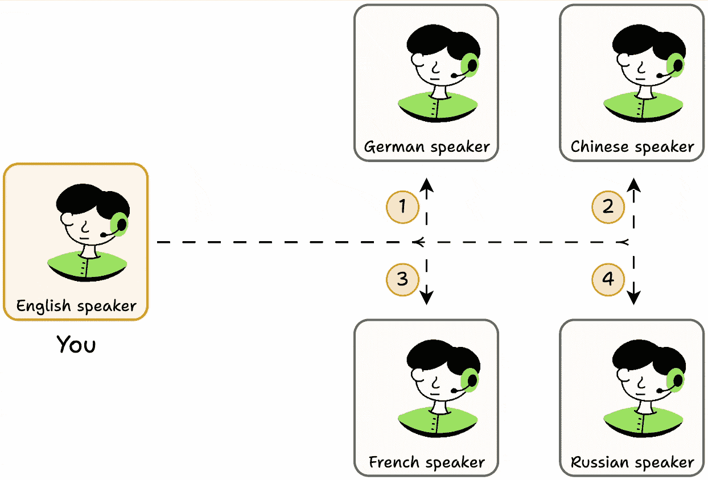
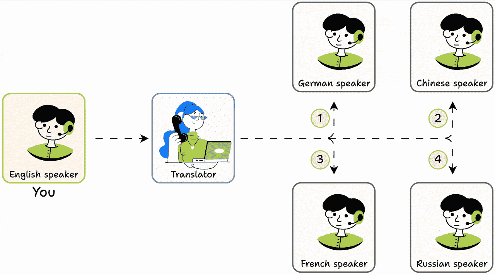

# MCP 蓝图：背景、基础、架构和实际用途（上篇）

> 来源：[https://v11enp9ok1h.feishu.cn/docx/K5fLddjdmobBYaxL87pcLcrQnWd](https://v11enp9ok1h.feishu.cn/docx/K5fLddjdmobBYaxL87pcLcrQnWd)

假设你只会英语。要从一个只会英语的人那里获取信息：

+   法语，你必须学法语。

+   德语，你必须学德语。

+   等等。

在这种情况下，学习 5 种语言对你来说都是一场噩梦！但是，如果添加一个能够理解所有语言的翻译器会怎样？

+   你和翻译交谈。

+   它推断出您想要的信息。

+   它会选择与之交谈的人。

+   它会给你一个回应。

这很简单，不是吗？

> 翻译器就像一个 MCP！

它让您（代理）通过单一界面与其他人（工具或其他功能）交谈。

形式化地说，虽然法学硕士拥有令人印象深刻的知识和推理能力，使他们能够执行许多复杂的任务，但他们的知识仅限于最初的训练数据。

>

如果他们需要访问实时信息，他们必须自己使用外部工具和资源，这告诉我们，如果我们每次都需要可靠的输入，工具调用对于 LLM 来说是多么重要。

>

MCP 充当 AI 系统与功能（工具等）的通用连接器，类似于 USB-C 如何标准化电子设备之间的连接。