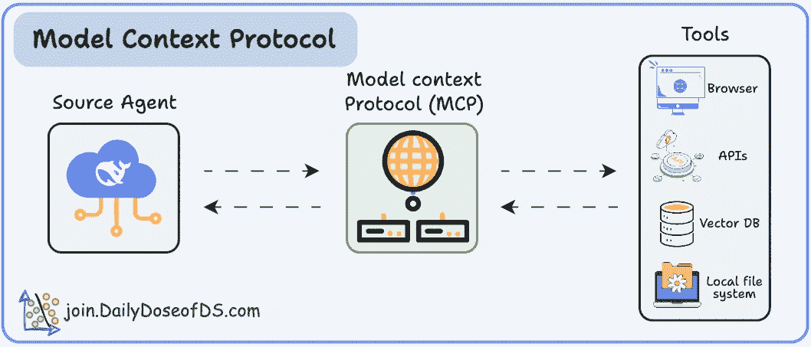
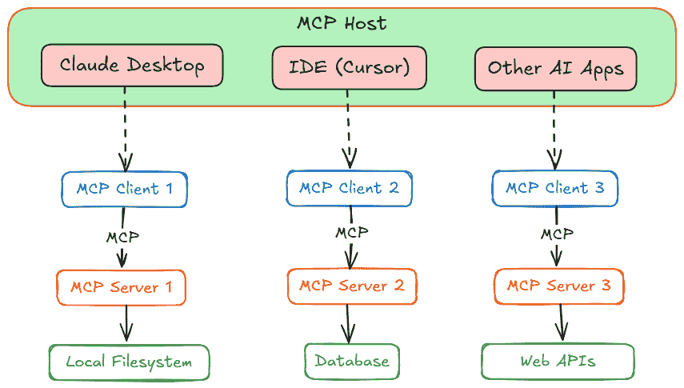

# MCP 蓝图：背景、基础、架构和实际用途（B部分）

> 来源：[https://v11enp9ok1h.feishu.cn/docx/O3UKdio6doJzQzxsGWKcPuVXnPg](https://v11enp9ok1h.feishu.cn/docx/O3UKdio6doJzQzxsGWKcPuVXnPg)

## 回顾 A 部分

在深入探讨之前，让我们先简单回顾一下 MCP 速成课程第 1 部分所涵盖的内容。

在第一部分中，我们为理解模型上下文协议 (MCP) 奠定了基础。我们首先探索了 LLM 中上下文管理的演变，从早期的静态提示和检索增强生成等技术，到如今函数调用和基于代理的编排等更结构化的方法。



然后，我们介绍了 MCP 背后的核心动机：解决 M×N 集成问题，其中每个新工具和模型配对以前都需要自定义粘合代码。

最后，我们解开了 MCP 架构，明确了主机（AI 应用程序）、客户端（协议处理程序）和服务器（工具提供者）的角色，并解释了它们如何通过标准化、模块化的系统进行交互。



## MCP 中的功能

MCP 服务器可以向客户端公开一个或多个功能。

功能本质上是服务器提供的特性或功能。MCP 标准目前定义了四大类功能：

1.  工具→AI（主机/客户端）可以调用的可执行操作或功能（通常具有副作用或外部 API 调用）。

1.  资源→AI（主机/客户端）可以查询信息的只读数据源（无副作用，仅检索）。

1.  提示→服务器可以提供的预定义提示模板或工作流。

1.  采样 → 服务器可以通过该机制请求 AI（客户端/主机）执行 LLM 操作，通常用于实现更高级的多步骤交互。此功能支持诸如自我反思和迭代推理等功能。本课程的后续部分将更深入地探讨采样。

让我们详细分析一下：

### 工具（操作）

顾名思义，工具就是代表 AI 模型执行某些操作的函数。这些操作通常能够产生影响，或者需要进行超出 AI 自身能力的计算。

重要的是，工具通常由 AI 模型的选择触发，这意味着 LLM（通过主机）在确定需要该功能时决定调用该工具。

由于工具可以改变事物或调用外部服务，因此它们通常需要接受安全检查（系统可能要求用户批准工具调用，特别是如果它是诸如发送电子邮件或执行代码之类的敏感操作）。

假设我们有一个简单的天气工具。在 MCP 服务器的代码中，它可能如下所示：

```
@mcp.tool()
def get_weather(location: str) -&gt; dict:
    &quot;&quot;&quot;Get the current weather for a specified location.&quot;&quot;&quot;
    # (In a real implementation, call an external weather service)
    return {
        &quot;temperature&quot;: 72,
        &quot;conditions&quot;: &quot;Sunny&quot;,
        &quot;humidity&quot;: 45
    }
```

这个 Python 函数已在 中注册@mcp.tool()，可以由 AI 通过 MCP 调用。

当AItools/call以名称"get_weather"和{"location": "San Francisco"}作为参数调用时，服务器将执行get_weather("San Francisco")并返回字典结果。

客户端将获取 JSON 结果并将其提供给 AI。请注意，该工具返回的是结构化数据（温度、条件），然后 AI 可以使用或口头表达（生成响应）这些信息。

由于工具可以执行文件 I/O 或网络调用等操作，因此 MCP 实现通常要求用户允许工具调用。


例如，Claude 的客户端可能会在第一次使用时弹出“AI 想要使用‘get_weather’工具，请允许/否？”的提示，以避免滥用。这确保了人类仍然能够掌控强大的操作。

工具类似于经典函数调用中的“函数”，但在 MCP 下，它们在更灵活、更动态的环境中使用。

它们由模型控制（模型决定何时使用它们），但在执行时得到开发人员/治理部门的批准。

### 资源

资源为 AI 模型提供只读数据。

这些就像数据库或知识库，人工智能可以查询以获取信息，但不能修改。

与工具不同，资源通常不涉及大量计算或副作用，因为它们通常只是信息查找。

另一个关键区别是，资源通常在宿主应用程序的控制下访问（而不是由模型自发访问）。实际上，这可能意味着宿主知道何时为模型获取特定的上下文。

例如，如果用户说“使用公司手册来回答我的问题”，主机可能会调用资源来检索相关手册部分并将其提供给模型。

资源可以包括本地文件的内容、知识库或文档的片段、数据库查询结果（只读）或任何静态数据（如配置信息）。

基本上涵盖了人工智能可能需要了解的任何背景信息。人工智能研究助理可以拥有像“ArXiv 论文数据库”这样的资源，它可以在需要时检索摘要或参考文献。

一个简单的资源可以是读取文件的函数：