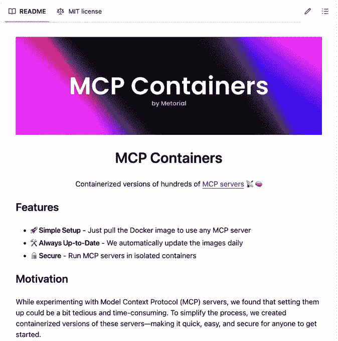

# MCP 蓝图：MCP 中的测试、安全和沙盒（B 部分）

> 来源：[https://v11enp9ok1h.feishu.cn/docx/XEB0dU80Do3BVbx0GiccTGMpn2c](https://v11enp9ok1h.feishu.cn/docx/XEB0dU80Do3BVbx0GiccTGMpn2c)

## A 部分回顾

在本章由两部分组成的第一部分中，我们从功能性转向安全性，为测试和保护 MCP 系统奠定了基础。

我们推出了 MCP Inspector，它作为一个实时调试界面，可以可视化、重放和检查服务器行为。它是开发、故障排除和实时验证服务器行为的必备工具。

然后，我们深入研究了 MCP 的安全状况，检查了主要风险和漏洞：

+   通过工具中毒进行快速注入。

+   服务器模拟和工具名称冲突。

+   地毯拉式信任违规行为。

+   功能过度暴露，尤其是通过文件系统工具。

为了缓解这些问题，我们引入了 MCP Roots，它允许您定义服务器的文件访问边界并使用 FastMCP 实现它们，同时还附加了服务器初始化逻辑和客户端集成。

如果您还没有学习第六部分，我们强烈建议您先阅读一下。您可以在下面阅读：

## B 部分内容

在第二部分中，我们将重点介绍如何使用 Docker 对 MCP 服务器进行容器化和沙盒化，以确保即使服务器受到威胁或收到不安全的输入，损害也能得到限制。

我们将介绍：

+   如何从头开始容器化 FastMCP 服务器。

+   逐步编写安全的 Dockerfile。

+   运行具有强化设置的容器，例如只读卷、无网络访问、内存上限和放弃的 Linux 功能。

+   将这些沙盒容器集成到您的本地工具和 IDE 中：

+   克劳德桌面

+   游标 IDE

+   自定义 FastMCP 客户端

+   如何将这些沙盒服务器连接到 MCP Inspector 以便在安全运行时进行实时调试。

读完本章后，您将了解如何：

+   包含潜在危险的执行流程。

+   在不受信任的环境中自信地共享和运行服务器。

+   将细粒度的资源控制应用于您的 AI 工具链。

让我们开始吧。

## 使用 Docker 对 MCP 服务器进行沙盒化

直接在您的机器上运行 MCP 服务器（及其工具）意味着这些工具执行的任何代码（甚至是可能不受信任的第三方代码）都可以访问您的本地环境。

这带来了安全性和稳定性问题：服务器可能会修改文件、消耗过多的资源或与系统环境发生冲突。

基于 Docker 的沙盒通过将整个服务器封装在隔离的容器环境中来解决这些问题。

服务器容器化的主要好处包括：

+   安全隔离：服务器代码及其工具在受限的环境中运行，对系统的访问权限受到限制。Docker 容器默认拥有自己的文件系统、进程空间和网络，因此即使 LLM 导向的工具试图执行危险操作，也会被限制在容器内。

+   依赖项和环境一致性：您可以将所有必需的库和依赖项烘焙到容器镜像中。这避免了“在我的机器上工作”的问题，并确保 MCP 服务器拥有所需的精确运行时。由于服务器使用自己的环境，因此不会与您系统上的其他 Python 包冲突。

+   可重复部署：Docker 镜像可以进行版本控制，并部署到任何位置（本地计算机、云虚拟机等），且行为完全相同。这对于 MCP 服务器尤其有用，因为您可能在开发期间在本地运行这些服务器，之后再将其部署到远程主机。使用 Docker，这种迁移可以无缝进行。

+   资源限制控制：Docker 允许限制 CPU、内存、网络甚至设备访问。您可以限制 CPU/RAM 来运行容器，以防止滥用；如果服务器不需要写入文件，则可以使用只读文件系统。这些措施进一步限制了服务器的功能。

总而言之，通过 Docker 对 MCP 服务器进行沙盒化意味着整个 MCP 服务器（及其所有工具）在一个隔离的容器中运行。这种方法通常简单、健壮，并且符合开发的最佳实践。

事实上，还有一个存储库，其中单个存储库中有 450 多个 MCP 服务器的容器化版本！

+   无需手动设置 - 只需拉取图像即可。

+   与脚本不同，可以在隔离容器中安全运行。

+   每日自动更新。

这使得使用 MCP 服务器和代理成为最简单、最安全的方式。

---

接下来，根据您的操作系统下载并在系统上设置 Docker，请查看下面链接的官方指南：

## 构建 Docker 沙盒服务器

让我们逐步设置一个简单的示例服务器，然后为其创建一个 Docker 镜像。

### 服务器代码

为了演示，我们将使用一个包含单个工具的极简服务器。实际情况下，您的服务器可能会更复杂，但本示例在涵盖集成的同时保持了其简洁性，您可以根据需要轻松将其扩展到复杂的用例。

---

附注：

您可以使用以下链接下载用于 SSE 服务器的 Docker 沙盒的主要代码库。请参阅open-me.ipynbNotebook 获取详细的设置说明。

