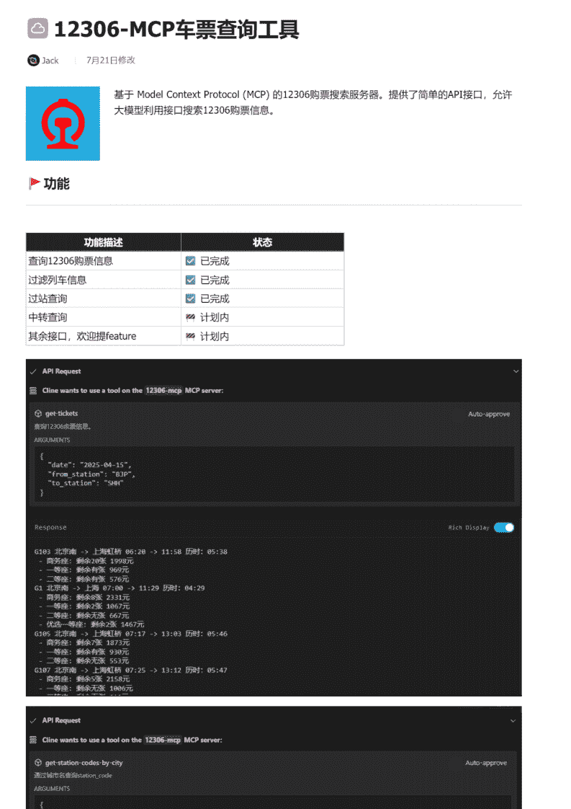
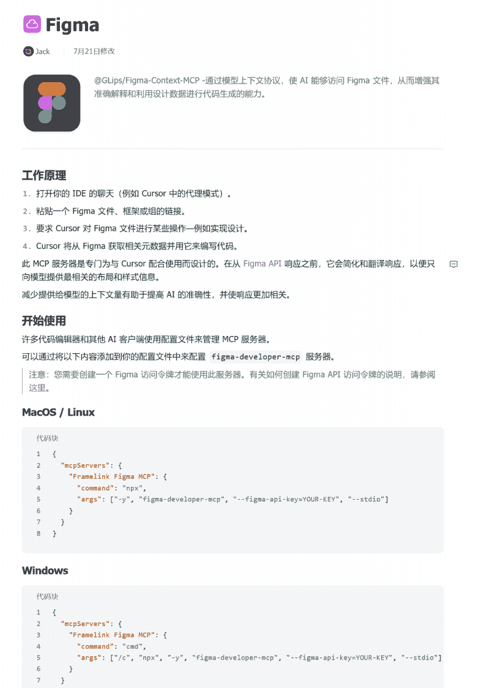
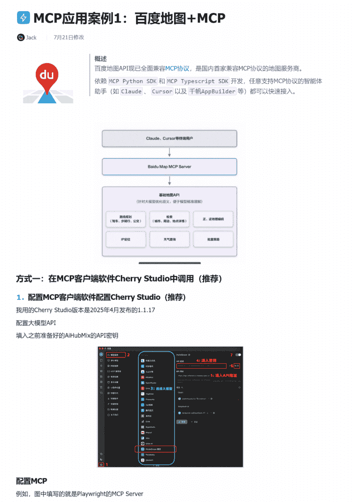
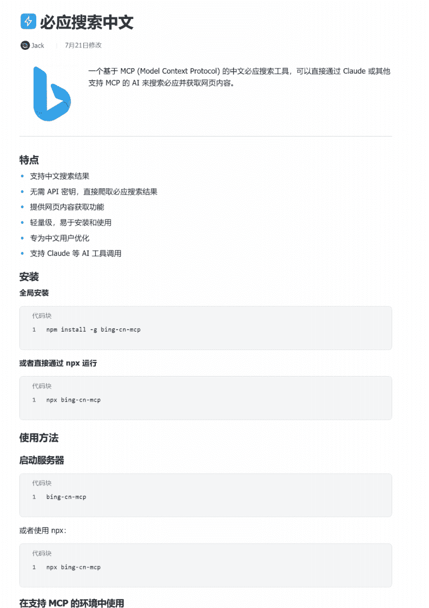
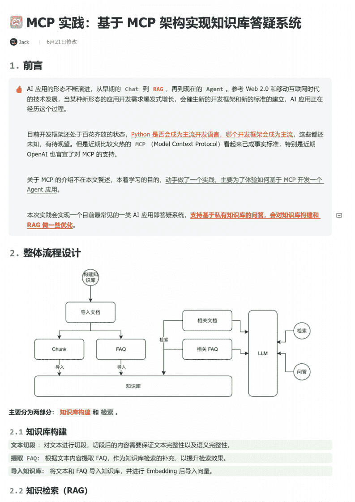
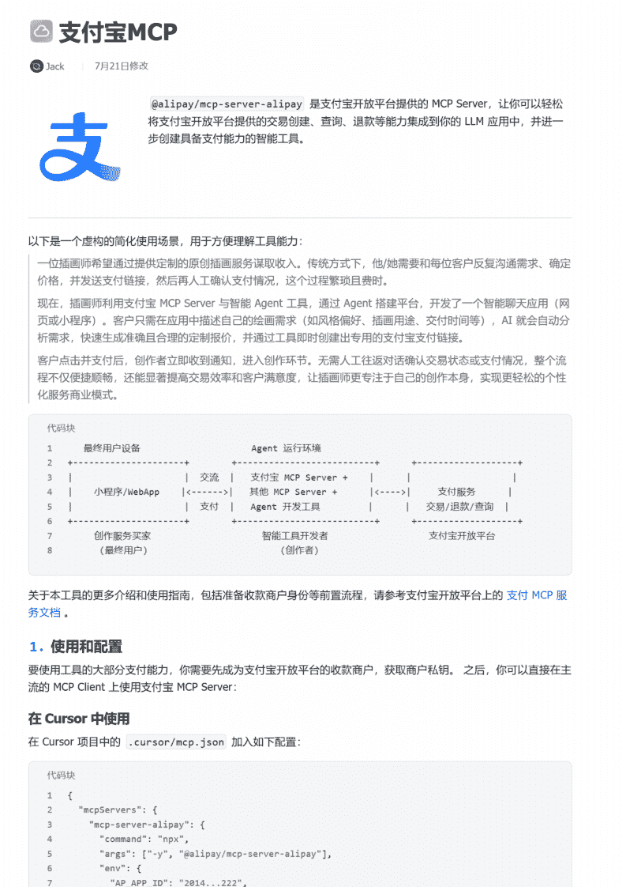

# mcp

> 来源：[https://v11enp9ok1h.feishu.cn/docx/A6WNdEgBLot1oFx1VlBcSJV8nJe](https://v11enp9ok1h.feishu.cn/docx/A6WNdEgBLot1oFx1VlBcSJV8nJe)

[12306-MCP车票查询工具.pdf](https://internal-api-drive-stream.feishu.cn/space/api/box/stream/download/all/HwQRbN62joRr8VxSmptcrnFdnTg)

[Figma.pdf](https://internal-api-drive-stream.feishu.cn/space/api/box/stream/download/all/IDLRbYKLooadRYxWVe5ck1sincg)

[百度地图+MCP.pdf](https://internal-api-drive-stream.feishu.cn/space/api/box/stream/download/all/Tfbtbx9wSo2tBMxLAVxcxLxcn5f)

[必应搜索中文.pdf](https://internal-api-drive-stream.feishu.cn/space/api/box/stream/download/all/DyxTb5uh6o0UNIxQR3vcZmYynsn)

[基于 MCP 架构实现知识库答疑系统.pdf](https://internal-api-drive-stream.feishu.cn/space/api/box/stream/download/all/VNHXbETPSojBNGxeJ5vcgUjEnEh)

[支付宝MCP.pdf](https://internal-api-drive-stream.feishu.cn/space/api/box/stream/download/all/DvKBbyEycoHRdSxJd5LcRjuvn1f)

# 基础入门

| [Model Context Protocol](https://v11enp9ok1h.feishu.cn/wiki/YNehwpakXi9u5tkJOZicK9Cynkg) | [MCP Server的五种主流架构](https://v11enp9ok1h.feishu.cn/wiki/HUgpwisbai1xq3kH55pcZ6UXnyg) |
| --- | --- |
| [MCP 协议亲和性的技术解析](https://v11enp9ok1h.feishu.cn/wiki/D0RCwZszviFNgkk6VIgcxPj7npb) | [MCP 实践案例](https://v11enp9ok1h.feishu.cn/wiki/SV75wswpziUUvMkwZxrc7qeRnle) |

# MCP实战案例

| [Figma](https://v11enp9ok1h.feishu.cn/wiki/N3P1w68pViNLCHklnJvcF4PgnHc) | [12306-MCP车票查询工具](https://v11enp9ok1h.feishu.cn/wiki/DHEKwjc9cimPUXkl26GcwofAn7g) |
| --- | --- |
| [支付宝MCP](https://v11enp9ok1h.feishu.cn/wiki/ASp0wh30UigAoTkSvXbc56t9nOV) | [高德地图 MCP](https://v11enp9ok1h.feishu.cn/wiki/DdfjwgwOAi0syLkpZgQcXQeTneh) |
| [智谱联网搜索](https://v11enp9ok1h.feishu.cn/wiki/Jm1FwWxsBiyrYukurYkcWoikndg) | [微信读书](https://v11enp9ok1h.feishu.cn/wiki/XDdcw3TDjimEIUkZLZ2cHmiUnQg) |
| [MCP是大模型的 USB x.0 接口](https://v11enp9ok1h.feishu.cn/wiki/RAIYw0eRki3Cs0kFq4gcO44YnGh) | [AbletonMCP：实现Claude和Ableton交互制作音乐](https://v11enp9ok1h.feishu.cn/wiki/Qgqzw21kDiSE1dkrdMBcn0S4nad) |
| [10分钟搞定高德地图MCP！](https://v11enp9ok1h.feishu.cn/wiki/AdBRw9vxNi4N13ktuAKcfFkdnOf) | [开发 Flomo MCP，高效记笔记](https://v11enp9ok1h.feishu.cn/wiki/LoNew8ytZiUfA7kVaNpcN6qqnsg) |

# MCP教程

| [AI + 高德MCP：10分钟搞定一份旅行攻略！并进行实时路线导航 ](https://v11enp9ok1h.feishu.cn/wiki/A8VMwmfAGiOWfqk34m6c8ukgnJf) | [终极 MCP 手册：从基础到高级 LLM 集成（附代码）](https://v11enp9ok1h.feishu.cn/wiki/XJaAwL66didcKkk0rMVceNAbnbe) |
| --- | --- |
| [MCP 实践：基于 MCP 架构实现知识库答疑系统](https://v11enp9ok1h.feishu.cn/wiki/R5omwIDrHiXCI4ksO3DcSEQgnBh) | [华为云AI原生应用运行平台+MCP产品组合方案](https://v11enp9ok1h.feishu.cn/wiki/NUqZwkQqciydPxkXFZfcDJvCnkd) |
| [本地数据助手! 用MCP+魔搭API-Inference 搭建](https://v11enp9ok1h.feishu.cn/wiki/SiLbwddfDiMo25knBO6cMaSdnuE) | [小红书自动发布助手！用本地Cherry-Studio客户端搭建](https://v11enp9ok1h.feishu.cn/wiki/I2OPwEKqAiSBBlkjeVqcTntqnrg) |
| [MCP应用案例1：百度地图+MCP](https://v11enp9ok1h.feishu.cn/wiki/AoHSwgjcCiKj1Zkmimwc74FXncc) | [MCPYahoo Finance 股票数据工具](https://v11enp9ok1h.feishu.cn/wiki/HgICwWb59iTNask3Jduck3PBnXe) |
| [MCP Flomo笔记助手](https://v11enp9ok1h.feishu.cn/wiki/TUVXwyQfli5wutk4DAecpHOWn5b) | [必应搜索中文](https://v11enp9ok1h.feishu.cn/wiki/RiMawBwgtimiCwkBEbScnZBsnmd) |