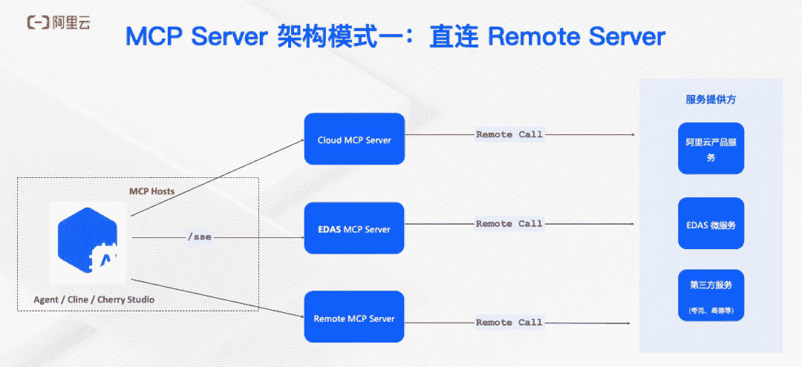
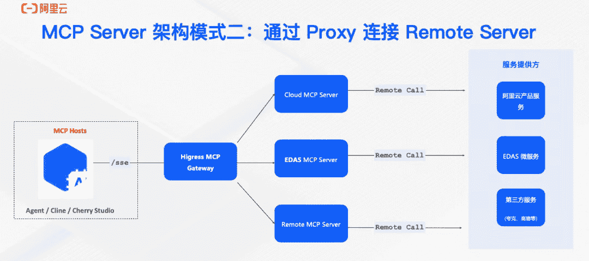
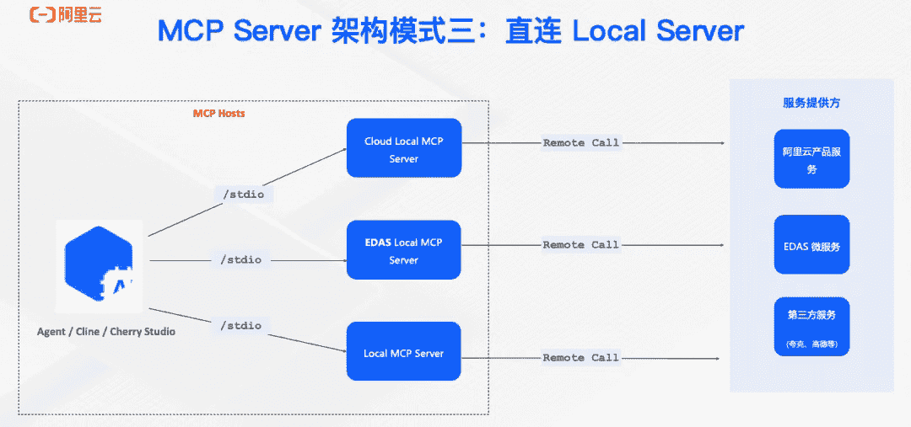
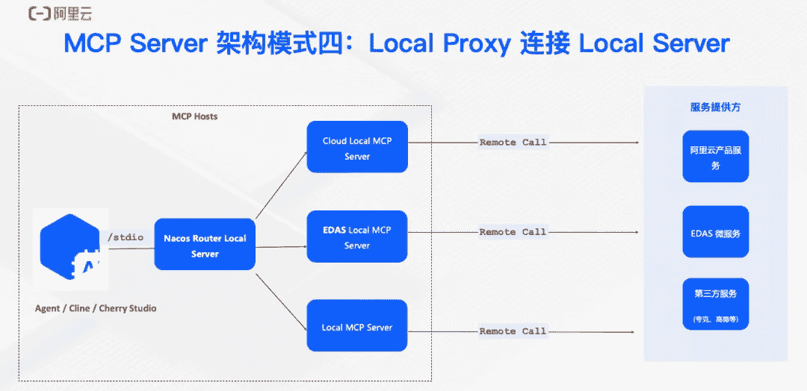
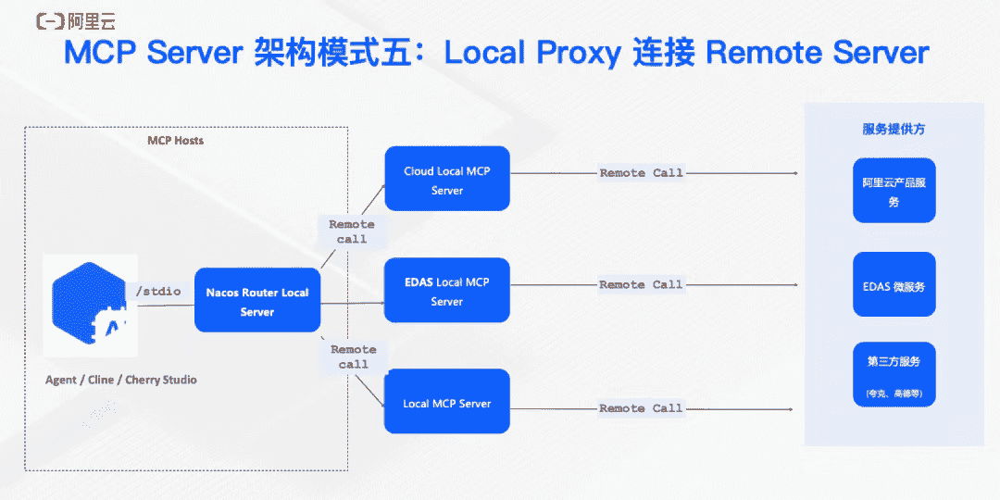
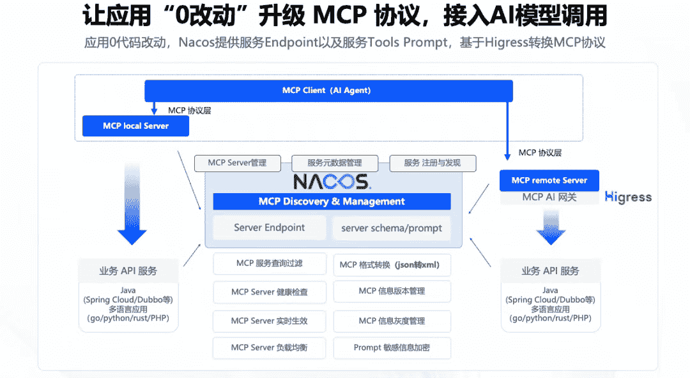
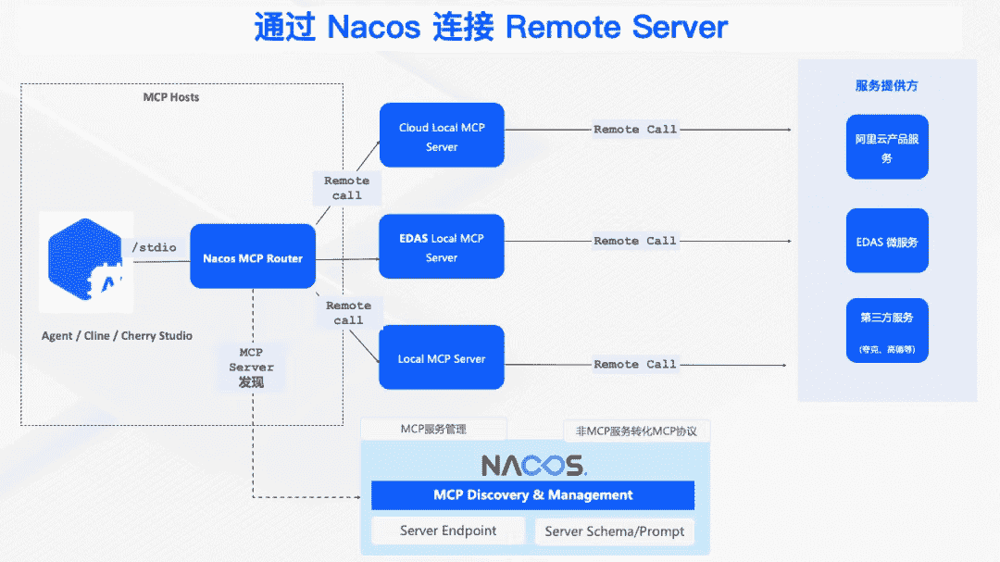

# MCP Server的五种主流架构

> 来源：[https://v11enp9ok1h.feishu.cn/docx/C9gzdJM7UoyWcZxH8yYcelpVnoh](https://v11enp9ok1h.feishu.cn/docx/C9gzdJM7UoyWcZxH8yYcelpVnoh)

## 五种MCP架构模式详解

架构一：MCP Client直连Remote Server (SSE)



这种架构就像你直接打电话给专家咨询问题 —— MCP Client通过SSE方式直接连接到远程MCP Server，全程保持HTTP长连接。

**优点？**

+   没有中间层，部署维护成本低；

+   实时性好，模型的流式输出体验一流；

+   集中化管理，监控和运维不费劲；

**缺点？**

+   网络一卡，体验就崩了；

+   所有数据都得传到云端，敏感信息有顾虑；

+   安全风险较高，服务端点直接暴露；

**适合谁？ **如果你是做SaaS应用、轻量级客户端或公共云服务，对安全要求不那么高，这种架构就挺合适的。

---

**架构二：MCP Client通过Proxy连**接Remote Server (SSE)



**这种架构就像有个翻译**在中间帮**你沟通 —— MCP C**lient先连接到Proxy Server，再由Proxy转接到Remote Server。

**优点？**

+   安全性更高，代理层可以做各种防护；

+   支持智能路由和负载均衡，流量调度更灵活；

+   可以聚合多个后端服务，一个接口通吃；

**缺点？**

+   架构复杂了，维护成本自然上升；

+   多一层代理可能增加延迟，体验稍差；

+   代理层可能成为新的故障点；

**适合谁？ **多租户环境、企业网关集成、需要调用多种模型的场景，这种架构就很给力。

---

**架构三：MCP Client直连**Local Server (STDIO)



这种架构就像你家里有个私人助理 —— MCP Client通过STDIO方式直接连接本地MCP Server，进程间直接通信。

**优点？**

+   数据安全性拉满！敏感数据不出本地；

+   几乎零网络延迟，响应速度飞快；

+   完全离线环境也能用，不依赖外网；

**缺点？**

+   本地计算资源得够强，不然跑不动；

+   每个环境都要单独部署维护，运维成本高；

+   模型和服务更新很麻烦，得一个个环境去更新；

**适合谁？ **金融核心系统、医疗数据分析、工业现场系统等对数据安全和隐私有高要求的场景。

---

**架构四：MCP Client通过Local Proxy连接**Local Server (STDIO)



**这种架构就像你有个私人**秘书帮你协调多个本地专家 —— MCP Client先连接到Local Proxy，再由Proxy连接到Local Server。

**优点？**

+   服务抽象做得好，客户端不用关心实现细节；

+   支持本地多实例部署，自动故障转移；

+   可以实现不同业务线或部门的资源隔离；

**缺点？**

+   本地环境更复杂了，维护难度加大；

+   本地代理需要额外的计算资源；

+   多层架构让问题定位和调试变得更困难；

**适合谁？** 大型企业内部平台、高可用要求场景、需要统一管理本地AI资源的场景。

---

**架**构五：MCP Client通过Local Proxy连接Remote Server (STDIO+SSE)



这种架构就像你有个超级助手，既能处理本地事务又能帮你对接外部专家 —— MCP Client通过STDIO连接Local Proxy，Local Proxy再通过SSE连接Remote Server。

**优点？**

+   混合云战略的最佳选择，本地云端资源随意切换；

+   企业从本地向云端迁移的平滑过渡方案；

+   客户端体验一致，不用关心服务在哪里；

**缺点？**

+   架构最复杂，维护和排障难度最大；

+   需要确保本地和云端服务的一致性；

+   性能受网络状况影响，可能有波动；

**适合谁？ **实施混合云战略的大型企业、需要弹性扩展的业务、多区域部署的全球企业。

---

### Nacos如何赋能MCP架构

> 在企业级MCP部署中，MCP Server 的自动发现与选择及其 Server 的动态安装能力比较高效的解决了各个架构中遇到的场景。在 Nacos 3.0 之前的版本，主要围绕着分布式应用的服务注册发现以及配置管理，提供了三大核心能力：

1. **服务发现与注册****：**支持服务的自动注册和发现，实现服务的动态扩缩容；

2. **配置管理****：**支持配置的动态更新和推送，无需重启应用；

3. **服务治理****：**提供服务路由、负载均衡、流量控制等治理能力；

这些能力与MCP架构的需求高度契合，特别是在多MCP服务器的场景下。



### Nacos MCP Router：连接 MCP 与 Nacos 的桥梁

Nacos MCP Router (https://github.com/nacos-group/nacos-mcp-router) 是一个基于MCP协议的服务器，它与Nacos深度集成，提供了三个核心功能：

1.  **MCP服务器搜索****：**根据任务描述和关键词搜索合适的 MCP 服务器，重点解决 MCP 工具过多时解决大模型选择工具的效率的问题。

1.  **MCP服务器添加****：**支持添加stdio和SSE两种协议的 MCP 服务器，配合 Nacos Server 的管理能力，重点解决软件供应链安全的问题。

1.  **工具代理调用****：**代理 LLM 对目标 MCP 服务器工具的调用，通过一个本地代理的方式解决 Local Server 与 Remote Server 调用的灵活切换问题。

**通过以上的几个能力，**我们搭建了一种混合 MCP Server 架构的模式，可以实现MCP服务的统一管理和智能路由，大大简化提升工具选择时的性能与企业级 MCP 部署的复杂度。



### Nacos与MCP的实战集成

下面通过一个实际案例，展示如何使用Nacos和Nacos MCP Router构建企业级MCP服务。

部署 Nacos MCP Router

在有 NodeJS 的开发环境中，我们可以通过以下命令手动部署Nacos MCP Router（不过这一步不是必须的）。

```
$ pnpm i nacos-mcp-router@latest
```

**配置MCP客户端**

然后，在MCP客户端配置中添加nacos-mcp-router：

```
{
  &quot;mcpServers&quot;: {
    &quot;nacos-mcp-router&quot;: {
      &quot;command&quot;: &quot;npx&quot;,
      &quot;args&quot;: [
        &quot;nacos-mcp-router@latest&quot;
      ],
      &quot;env&quot;: {
        &quot;NACOS_ADDR&quot;: &quot;127.0.0.1:8848&quot;,
        &quot;NACOS_USERNAME&quot;: &quot;nacos&quot;,
        &quot;NACOS_PASSWORD&quot;: &quot;your_password&quot;
      }
    }
  }
}
```

**使用MCP服务**

现在，我们可以通过**nacos-mcp-**router使用各种MCP服务（注：以下步骤为 MCP Client 与 Nacos Router 自动交互时的核心方法，并不是程序员在开发过程中需要硬编码的实现）：

1.  搜索MCP服务器：

```
search_mcp_server(task_description=&quot;生成一张猫的图片&quot;, 
                  key_words=&quot;图像生成&quot;)
```

1.  添加MCP服务器：

```
add_mcp_server(mcp_server_name=&quot;image-generator&quot;)
```

1.  使用MCP服务器工具：

```
use_tool(mcp_server_name=&quot;image-generator&quot;,     
         mcp_tool_name=&quot;generate_image&quot;, 
         params={&quot;prompt&quot;: &quot;一只橙色的猫&quot;})
```

---

## 线上 MCP 架构选型指南

MCP 社区还在飞速的发展之中，在生产场景的能力上的诸多核心功能还暂时未形成统一的标准，基于目前的能力，我们在选择适合企业的MCP架构进行落地时，我们需要考虑以下关键因素：

1.  **数据安全与隐私**

+   高敏感数据：优先考虑本地部署架构（架构三、架构四）；

+   一般业务数据：可考虑云端或混合架构（架构一、架构二、架构五）；

1.  **性能与延迟要求**

+   低延迟关键应用：优先考虑本地部署架构；

+   一般性能要求：云端架构通常足够；

1.  **可扩展性需求**

+   需要快速弹性扩展：优先考虑云端架构；

+   可预测的稳定负载：本地部署可能更经济；

基于这些因素，不同行业可能的选择可能的参考如下：

+   **金融行业****：**架构四（本地代理+本地服务器）最为适合，满足严格的数据安全要求；

+   **互联网行业****：**架构二（代理+远程服务器）支持快速弹性扩展，适合高并发场景；

+   **制造业****：**架构五（混合模式）平衡了本地实时控制和云端智能分析的需求；

+   **政府部门****：**架构三（直连本地服务器）提供最高级别的数据安全和隐私保护。

、