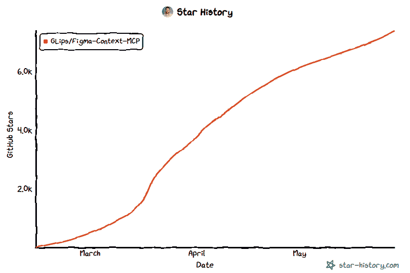

# Figma

> 来源：[https://v11enp9ok1h.feishu.cn/docx/Xj9udsPyNozZNaxQpBRcF3jPnIc](https://v11enp9ok1h.feishu.cn/docx/Xj9udsPyNozZNaxQpBRcF3jPnIc)


@GLips/Figma-Context-MCP -通过模型上下文协议，使 AI 能够访问 Figma 文件，从而增强其准确解释和利用设计数据进行代码生成的能力。

---

## 工作原理

1.  打开你的 IDE 的聊天（例如 Cursor 中的代理模式）。

1.  粘贴一个 Figma 文件、框架或组的链接。

1.  要求 Cursor 对 Figma 文件进行某些操作—例如实现设计。

1.  Cursor 将从 Figma 获取相关元数据并用它来编写代码。

[此 MCP 服务器](https://www.figma.com/developers/api)是专门为与 Cursor 配合使用而设计的。在从 Figma API 响应之前，它会简化和翻译响应，以便只向模型提供最相关的布局和样式信息。

减少提供给模型的上下文量有助于提高 AI 的准确性，并使响应更加相关。

## 开始使用

许多代码编辑器和其他 AI 客户端使用配置文件来管理 MCP 服务器。

可以通过将以下内容添加到你的配置文件中来配置 figma-developer-mcp 服务器。

> 注[意：](https://help.figma.com/hc/en-us/articles/8085703771159-Manage-personal-access-tokens)您需要创建一个 Figma 访问令牌才能使用此服务器。有关如何创建 Figma API 访问令牌的说明，请参阅这里。

### MacOS / Linux

```
{
  &quot;mcpServers&quot;: {
    &quot;Framelink Figma MCP&quot;: {
      &quot;command&quot;: &quot;npx&quot;,
      &quot;args&quot;: [&quot;-y&quot;, &quot;figma-developer-mcp&quot;, &quot;--figma-api-key=YOUR-KEY&quot;, &quot;--stdio&quot;]
    }
  }
}
```

### Windows

```
{
  &quot;mcpServers&quot;: {
    &quot;Framelink Figma MCP&quot;: {
      &quot;command&quot;: &quot;cmd&quot;,
      &quot;args&quot;: [&quot;/c&quot;, &quot;npx&quot;, &quot;-y&quot;, &quot;figma-developer-mcp&quot;, &quot;--figma-api-key=YOUR-KEY&quot;, &quot;--stdio&quot;]
    }
  }
}
```

如果您需要更多关于如何配置 Framelink [Figma MCP 服务](https://www.framelink.ai/docs/quickstart?utm_source=github&utm_medium=readme&utm_campaign=readme)器的信息，请参阅Framelink 文档。

## Star History



## 了解更多

[Framelink](https://framelink.ai/?utm_source=github&utm_medium=readme&utm_campaign=readme) Figma MCP 服务器简单但功能强大。通过访问Framelink网站了解更多内容，以充分利用它。