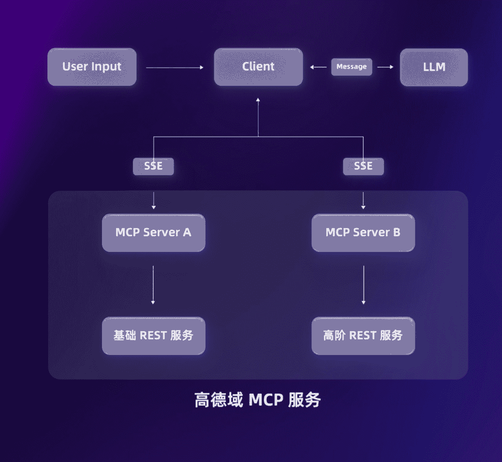

# 高德地图 MCP

> 来源：[https://v11enp9ok1h.feishu.cn/docx/QbzddK82OoOWejxXK92ceFYFnpe](https://v11enp9ok1h.feishu.cn/docx/QbzddK82OoOWejxXK92ceFYFnpe)

@amap/amap-maps -高德地图是一个支持任何MCP协议客户端的服务器，允许用户轻松利用高德地图MCP服务器获取各种基于位置的服务。

---

## 产品介绍

为实现 LBS 服务与 LLM 更好的交互，高德地图 MCP Server 现已覆盖12大核心服务接口，提供全场景覆盖的地图服务，包括地理编码、逆地理编码、IP 定位、天气查询、骑行路径规划、步行路径规划、驾车路径规划、公交路径规划、距离测量、关键词搜索、周边搜索、详情搜索等。

[为进一步提高开发者接](https://lbs.amap.com/api/mcp-server/gettingstarted)入效率与体验，高德地图开放平台为开发者提供了通用级 SSE 协议 MCP 服务解决方案。

## 高德地图开放平台通用级 SSE 协议 MCP 服务解决方案

#### 产品架构图

#### 什么是 SSE？

Server-Sent Events（SSE，服务器发送事件）是一种基于 HTTP 协议的技术，允许服务器向客户端单向、实时地推送数据。在 SSE 模式下，开发者可以在客户端通过创建一个 EventSource 对象与服务器建立持久连接，服务器则通过该连接持续发送数据流，而无需客户端反复发送请求。

#### 产品特点

+   使用简单：适用普通用户基于MCP（SSE）方式，不必部署本地服务，简单通过 URL 地址配置即可使用。

+   自动升级：我们会持续进行迭代更新，无须用户自己任何额外操作使用。

+   更易于大模型理解：我们对原始的JSON结果进行了语义化的转换，更易于大模型理解内容。

+   零运维成本：采用全托管云服务架构，用户无需关心服务器维护、资源扩容等底层运维问题。

+   协议兼容：支持SSE长连接，适配不同业务场景的技术需求。

前往 [快速接入](https://lbs.amap.com/api/mcp-server/gettingstarted) 文档，了解如何接入 MCP Server SSE 服务

## 能力介绍

#### 地理编码

将详细的结构化地址转换为经纬度坐标。

#### 逆地理编码

将一个高德经纬度坐标转换为行政区划地址信息。

#### IP 定位

IP 定位根据用户输入的 IP 地址，定位 IP 的所在位置。

#### 天气查询

根据城市名称或者标准adcode查询指定城市的天气。

#### 骑行路径规划

用于规划骑行通勤方案，规划时会考虑天桥、单行线、封路等情况。最大支持 500km 的骑行路线规划。

#### 步行路径规划

可以根据输入起点终点经纬度坐标，规划100km 以内的步行通勤方案，并且返回通勤方案的数据。

#### 驾车路径规划

根据用户起终点经纬度坐标规划以小客车、轿车通勤出行的方案，并且返回通勤方案的数据。

#### 公交路径规划

根据用户起终点经纬度坐标规划综合各类公共（火车、公交、地铁）交通方式的通勤方案，并且返回通勤方案的数据，跨城场景下必须传起点城市与终点城市。

#### 距离测量

测量两个经纬度坐标之间的距离。

#### 关键词搜索

根据用户传入关键词，搜索出相关的POI地点信息。

#### 周边搜索

根据用户传入关键词以及坐标location，搜索出radius半径范围的POI地点信息。

#### 详情搜索

查询关键词搜或者周边搜获取到的POI ID的详细信息。