# 开发 Flomo MCP，高效记笔记

> 来源：[https://v11enp9ok1h.feishu.cn/docx/PsLpdZ8B5okTakxrEZScWveOnOd](https://v11enp9ok1h.feishu.cn/docx/PsLpdZ8B5okTakxrEZScWveOnOd)

## 需求分析

在本篇内容，我们计划开发一个 `mcp-server-flomo` 服务，对接 flomo 浮墨笔记 的 API，实现在任意 MCP 客户端，以对话形式创建笔记的功能。

> Flomo 是一款专注于碎片化知识记录的轻量级笔记工具，由中国团队开发，主打“无压力记录”和“高效回顾”的理念。它的设计摒弃了传统笔记软件的复杂功能，强调用最简单的方式捕捉灵感、想法和日常思考，适合个人知识管理（PKM）和渐进式学习。

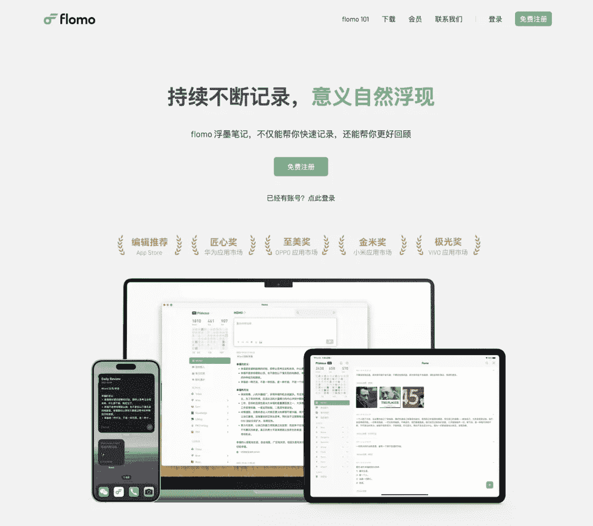

## 前置准备

1. 进入 Flomo 笔记 API 管理控制台

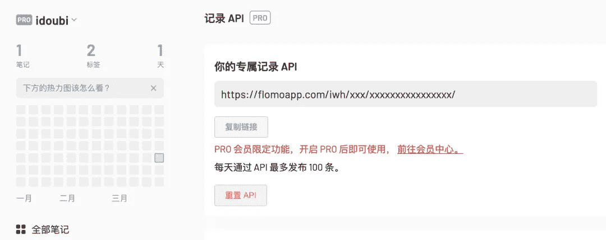

1. Flomo API 写笔记是会员专享功能，你需要先升级成 Pro 会员。

1. 升级成 Pro 会员之后，复制你的专属记录 API 链接。

1. 打开终端工具，通过 `curl` 请求 API

```
curl -X POST https://flomoapp.com/iwh/MTA4MjYz/1b5817dcd3decd55c834249fd9c7f9ae/ \
-H &#x27;Content-Type: application/json&#x27; \
-d &#x27;{&quot;content&quot;: &quot;从现在开始，我要学习 MCP Server 开发&quot;}&#x27;
```

回到 Flomo 笔记列表，已经可以看到刚刚通过终端调用 API 写入的笔记。


接下来，我们开始开发 `mcp-server-flomo`，通过 MCP 服务器对接 Flomo API，实现在任意 MCP 客户端，以对话的形式记笔记。

## 创建 MCP 服务器

我们选择用 `nodejs` 来实现 `mcp-server-flomo` 这个 MCP 服务器。

使用 MCP 官方提供的命令行工具来创建 MCP 服务器：

```
npx @modelcontextprotocol/create-server mcp-server-flomo
```

在终端软件执行上面的命令，按照提示输入要创建的 MCP 服务器信息：

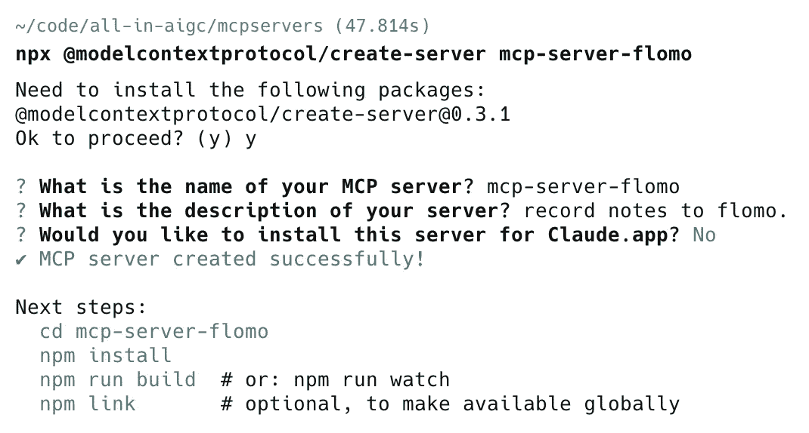

进入创建的 MCP 服务器目录，安装项目依赖：

```
cd mcp-server-flomo
npm install
```

用代码编辑器打开创建好的 MCP 服务器，可以看到默认生成的项目代码结构：

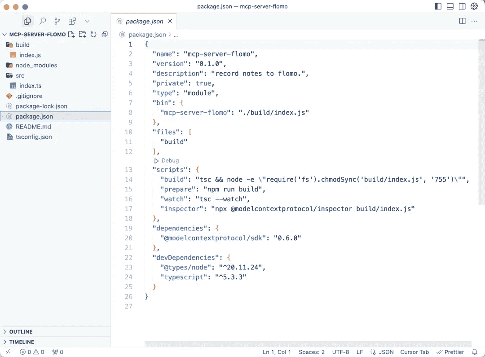

其中，`src/index.ts` 是 MCP 服务器的源码文件，在此文件实现 MCP 服务器的业务功能。

`build/js` 是 MCP 服务器源码编译后的可执行文件，调试阶段和发布上线，都要用到此文件。

## 调试 MCP 服务器

在 MCP 服务器项目目录下，运行 `npm run watch` 启动一个监听服务，监听 `src/index.ts` 源码文件的内容变动，并实时编译成 `build/index.js` 可执行文件。

在 MCP 服务器项目目录下，运行 `npm run inspector`，实际执行的命令是：

```
npx @modelcontextprotocol/inspector build/index.js
```

此命令用到了 MCP 官方开发的一个调试工具，运行 MCP 服务器可执行文件，连接到 MCP 服务器进行功能调试。

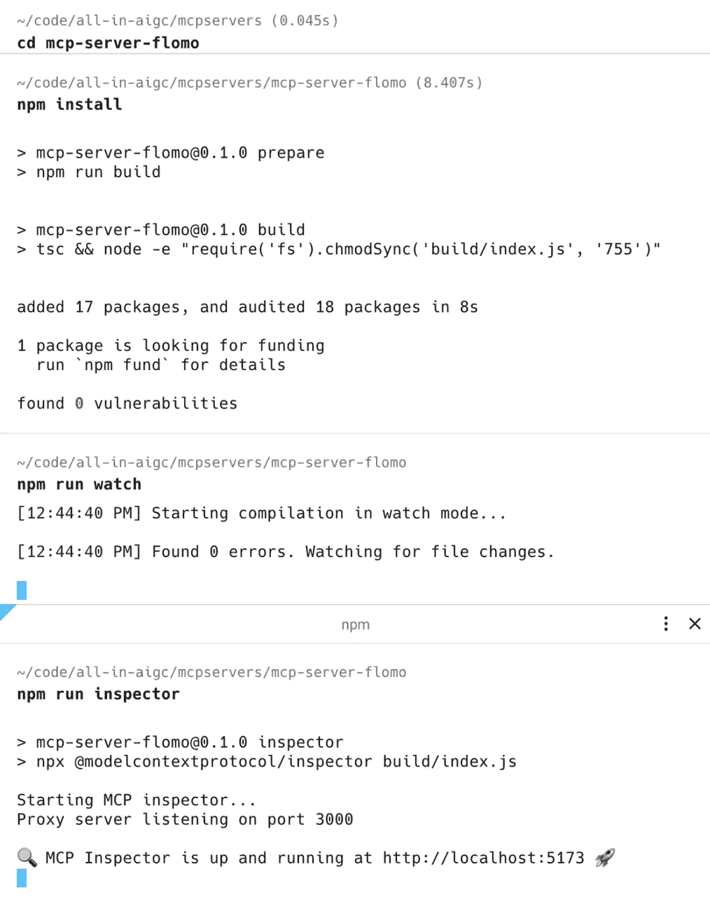

点击调试面板运行地址，进入 MCP 服务器调试面板。

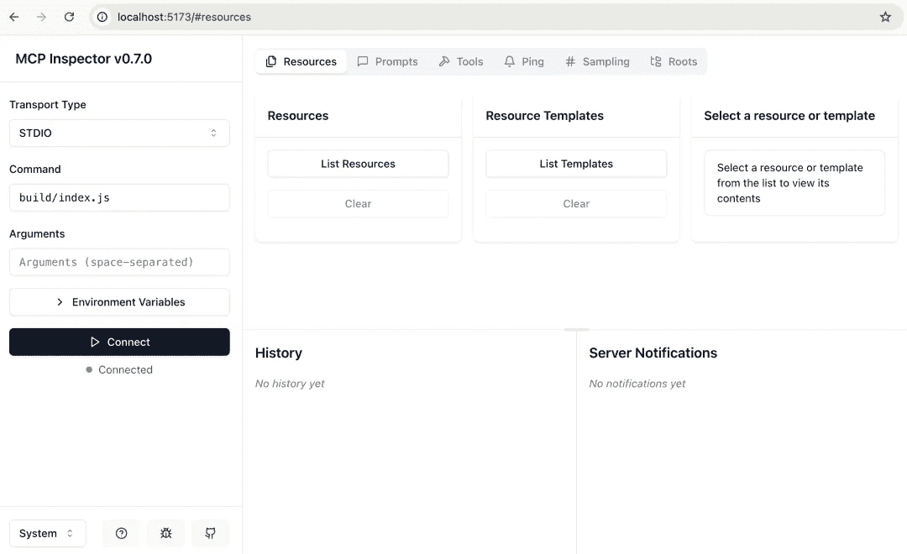

> 在 MCP 服务器调试面板，点左侧的 `Connect` 可以连接到 MCP 服务器进行调试，显示 `Connected` 表示连接成功。

>

> 可以设置 MCP 服务器启动参数 `Arguments` 和环境变量 `Environment Variables`，在 MCP 服务器实现逻辑中可以读取这两部分的参数值。

>

> MCP 服务器调试面板右侧主要用于请求 MCP 服务器内部定义的资源（`Resources`）、提示词（`Prompts`）、工具（`Tools`）等内容。

我们可以在右侧的 `Tools` 栏目点 `List Tools` 获取 MCP 服务器内部实现的所有工具（`Tools`）。

> 通过官方命令行工具创建的 MCP 服务器，默认生成了一个 `create_note` 工具。

选择 `Tools` 下的某个工具（比如：`create_note`），在调试面板填写请求参数，点 `Run Tool`，发送请求调用此工具，得到响应数据。

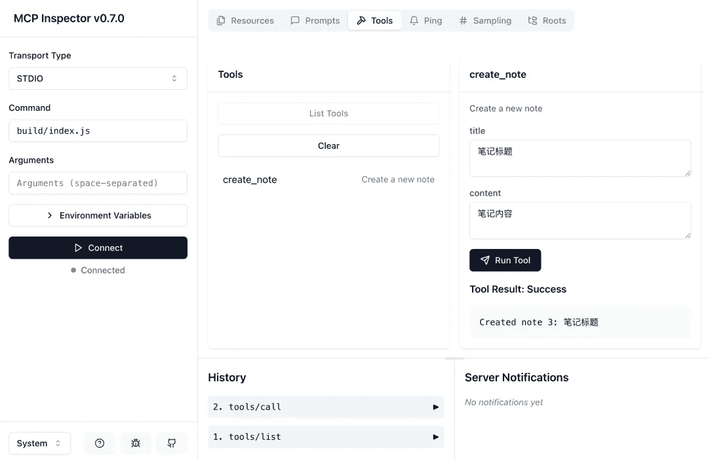

## 实现 MCP 服务器业务逻辑

在前面步骤中，我们准备好了一个 Flomo 记笔记的专属链接，并且通过命令行调用 API 的形式进行了调试，跑通了 API 记笔记的流程。

接下来，我们在 `mcp-server-flomo` 中实现一个工具（`Tool`），通过工具调用 Flomo API 记笔记。

1. 定义 MCP 服务器信息

打开 `src/index.ts` 文件，可以看到默认生成的代码，通过 `new Server` 创建的 MCP 服务器信息。

```
const server = new Server(
  {
    name: &quot;mcp-server-flomo&quot;,
    version: &quot;0.1.0&quot;,
  },
  {
    capabilities: {
      resources: {},
      tools: {},
      prompts: {},
    },
  }
);
```

我们要实现的 `mcp-server-flomo`，只需要实现一个记笔记的工具（`Tool`），不会实现其他能力。可以修改代码，定义此 MCP 服务器只有 `tools` 能力。我们可以自定义版本号，比如从 `0.0.1` 开始。

```
const server = new Server(
  {
    name: &quot;mcp-server-flomo&quot;,
    version: &quot;0.0.1&quot;,
  },
  {
    capabilities: {
      tools: {},
    },
  }
);
```

1. 定义 MCP 服务器工具列表

修改 `src/index.ts` 文件中默认生成的获取工具列表（`ListTools`）的逻辑，定义一个 `write_note` 方法，功能描述用英文写，说明这个工具（`Tool`）的主要作用是把笔记记录到 Flomo。

`write_note` 工具只有一个参数：`content`，Markdown 格式的文本内容，必须填写。

`ListTools` 的定义如下：

```
server.setRequestHandler(ListToolsRequestSchema, async () =&gt; {
return {
    tools: [
      {
        name: &quot;write_note&quot;,
        description: &quot;Write note to flomo&quot;,
        inputSchema: {
          type: &quot;object&quot;,
          properties: {
            content: {
              type: &quot;string&quot;,
              description: &quot;Text content of the note with markdown format&quot;,
            },
          },
          required: [&quot;content&quot;],
        },
      },
    ],
  };
});
```

1. 实现 MCP 服务器工具（`Tool`）逻辑

我们先创建一个新的文件：`src/flomo.ts`，定义一个 `FlomoClient` 类，实现一个 `writeNote` 方法。接受外部传递的 `apiUrl` 参数，请求 `apiUrl`，写入笔记 `content`：

```
/**
 * Flomo client used to interact with the Flomo API.
 */
exportclass FlomoClient {
private readonly apiUrl: string;

/**
   * Create a new Flomo client.
   * @param apiUrl - The API URL of the Flomo API.
   */
constructor({ apiUrl }: { apiUrl: string }) {
    this.apiUrl = apiUrl;
  }

/**
   * Write a note to Flomo.
   * @param content - The content of the note.
   * @returns The response from the Flomo API.
   */
async writeNote({ content }: { content: string }) {
    try {
      if (!content) {
        thrownewError(&quot;invalid content&quot;);
      }

      const req = {
        content,
      };

      const resp = await fetch(this.apiUrl, {
        method: &quot;POST&quot;,
        headers: {
          &quot;Content-Type&quot;: &quot;application/json&quot;,
        },
        body: JSON.stringify(req),
      });

      if (!resp.ok) {
        thrownewError(`request failed with status ${resp.statusText}`);
      }

      return resp.json();
    } catch (e) {
      throw e;
    }
  }
}
```

然后，我们修改 `CallTool` 的逻辑，接到 `write_note` 工具请求时，先获取传递的参数 `content`，再调用 `FlomoClient` 的 `writeNote` 方法写入笔记到 Flomo：

```
import { FlomoClient } from&quot;./flomo.js&quot;;

server.setRequestHandler(CallToolRequestSchema, async (request) =&gt; {
switch (request.params.name) {
    case&quot;write_note&quot;: {
      const content = String(request.params.arguments?.content);
      if (!content) {
        thrownewError(&quot;Content is required&quot;);
      }

      const apiUrl =
        &quot;https://flomoapp.com/iwh/MTA4MjYz/1b5817dcd3decd55c834249fd9c7f9ae/&quot;;

      const flomo = new FlomoClient({ apiUrl });
      const result = await flomo.writeNote({ content });

      return {
        content: [
          {
            type: &quot;text&quot;,
            text: `Write note to flomo success: ${JSON.stringify(result)}`,
          },
        ],
      };
    }

    default:
      thrownewError(&quot;Unknown tool&quot;);
  }
});
```

1. 调试 MCP 服务器工具（`Tool`）

在调试工具选择 `write_note` 工具，填入 `content` 参数，点击 `Run Tool`，查看工具的调用结果：

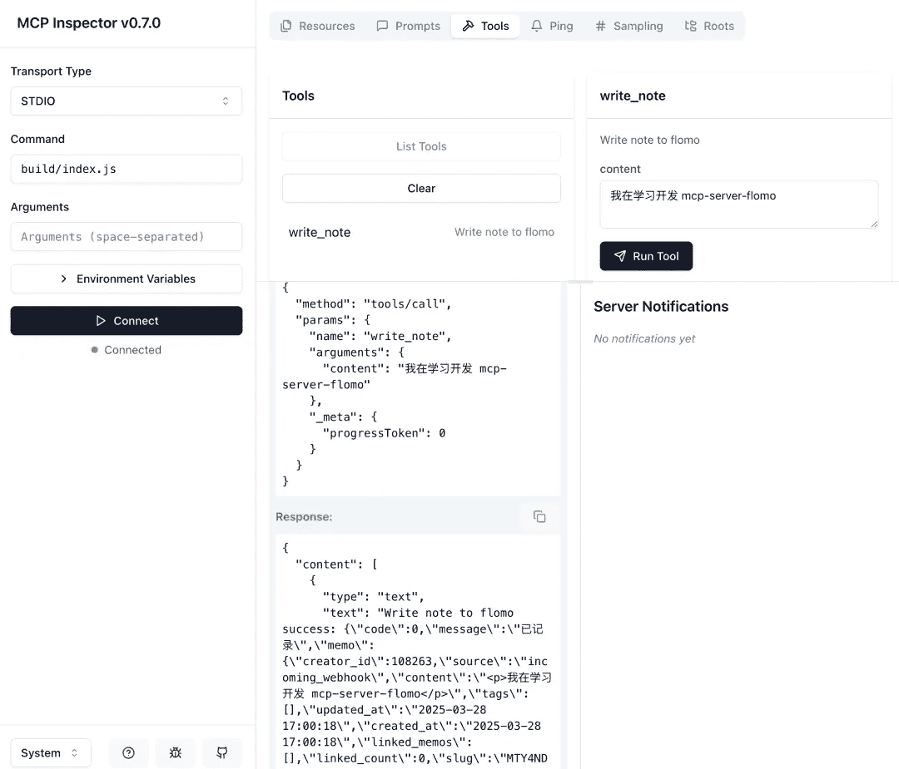

可以看到，Flomo API 返回了 `code: 0`，`message: "已记录"`，表示笔记已记录到 Flomo。

登录 Flomo 笔记后台，可以看到笔记确实已经记录：


## 优化 MCP 服务器代码

通过前面的步骤，我们在 `mcp-server-flomo` 实现了一个工具：`write_note`，通过 Flomo API 写入笔记到 Flomo。

基本的业务逻辑已经实现，在发布上线之前，还有一些小问题可以优化。

1. 删除冗余代码

由于 `mcp-server-flomo` 的核心逻辑只有一个工具：`write_note`，可以把 `src/index.ts` 文件中，默认生成的，跟 `Tool` 无关的代码都删掉，包括这几部分的逻辑：

+ `ListResources`
+ `ReadResource`
+ `ListPrompts`
+ `GetPrompt`

1. 修改响应数据

在 3.2.4 小节中，调用 `create_note` 写入笔记成功后，我们把 API 的响应数据通过 JSON 格式化后直接返回，这种格式的响应数据，对于前端调用方，不够友好。

我们可以改成，返回 Flomo 笔记详情页的链接。

格式类似：`https://v.flomoapp.com/mine/?memo_id=xxx`

因此，我们修改一下 `CallTool` 方法里面响应的数据内容：

```
const flomo = new FlomoClient({ apiUrl });
const result = await flomo.writeNote({ content });

if (!result.memo || !result.memo.slug) {
thrownewError(
    `Failed to write note to flomo: ${result?.message || &quot;unknown error&quot;}`
  );
}

const flomoUrl = `https://v.flomoapp.com/mine/?memo_id=${result.memo.slug}`;

return {
  content: [
    {
      type: &quot;text&quot;,
      text: `Write note to flomo success, view it at: ${flomoUrl}`,
    },
  ],
};
```

1. 修改动态参数

我们开发的这个 `mcp-server-flomo` 服务器，是给到所有用户使用的，不同的用户会有不同的 Flomo API Url，因此我们要在 `write_note` 工具里面动态设置 `apiUrl` 参数。

有两种方法可以动态传参：

+ 通过服务启动命令传递参数

实现一个 `parseArgs` 函数，在服务启动的时候，从命令行参数中读取 `flomo_api_url`

```
/**
 * Parse command line arguments
 * Example: node index.js --flomo_api_url=https://flomoapp.com/iwh/xxx/xxx/
 */
function parseArgs() {
const args: Record&lt;string, string&gt; = {};
  process.argv.slice(2).forEach((arg) =&gt; {
    if (arg.startsWith(&quot;--&quot;)) {
      const [key, value] = arg.slice(2).split(&quot;=&quot;);
      args[key] = value;
    }
  });
return args;
}

const args = parseArgs();
const apiUrl = args.flomo_api_url || &quot;&quot;;
```

修改 `CallTool` 内部实现逻辑，判断 `apiUrl` 是否传递，动态传入 `apiUrl` 参数，用于记笔记：


```javascript
if (!apiUrl) {
thrownewError(&quot;Flomo API URL not set&quot;);
}

const content = String(request.params.arguments?.content);
if (!content) {
thrownewError(&quot;Content is required&quot;);
}

const flomo = new FlomoClient({ apiUrl });
const result = await flomo.writeNote({ content });
```

在调试控制台，在 `Arguments` 输入框设置参数：`--flomo_api_url=https://flomoapp.com/iwh/xxx/xxx/`

请求 `write_note` 工具，写入笔记成功。

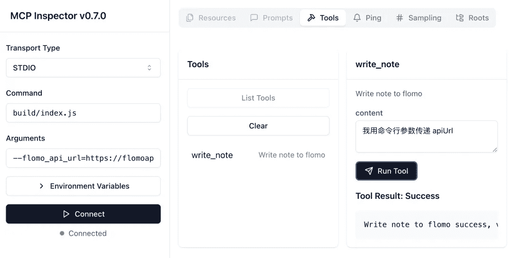

对应的服务启动命令是：

`node build/index.js --flomo_api_url=https://flomoapp.com/iwh/xxx/xxx/`

### 通过环境变量传递参数

我们也可以通过环境变量设置动态参数，作为命令行读取参数的一个补充。

修改动态参数的读取逻辑，优先读取命令行参数，如果命令行参数未传递，就从环境变量读取参数：

```
const args = parseArgs();
const apiUrl = args.flomo_api_url || process.env.FLOMO_API_URL || &quot;&quot;;
```

在调试面板，删掉 `Arguments`，添加环境变量：`FLOMO_API_URL` 并设置值。

请求 `write_note` 工具，写入笔记成功。

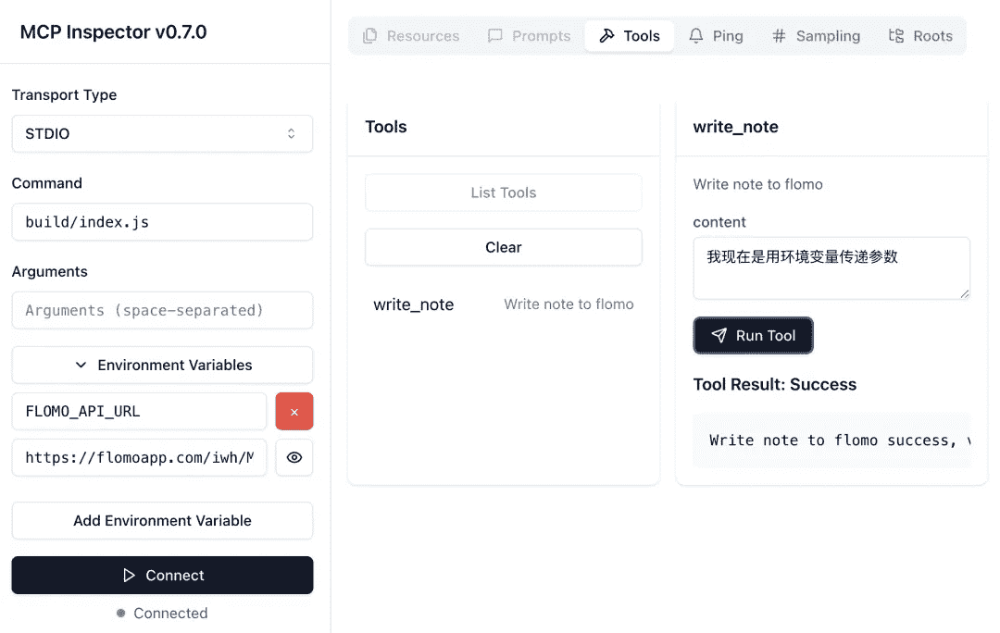

对应的服务启动命令是：

`FLOMO_API_URL=https://flomoapp.com/iwh/xxx/xxx/ node build/index.js`

## 在 MCP 客户端测试

我们选择 `Cursor AI` 编辑器，作为 `MCP` 客户端。来测试我们开发的 `mcp-server-flomo` 服务器。

首先，打开 `Cursor` 的 `MCP` 服务器配置文件。（一般位于 `~/.cursor/mcp.json`）

写入连接 `mcp-server-flomo` 的配置：

```
{
  &quot;mcpServers&quot;: {
    &quot;mcp-server-flomo&quot;: {
      &quot;command&quot;: &quot;node&quot;,
      &quot;args&quot;: [
        &quot;/Users/idoubi/code/all-in-aigc/mcpservers/mcp-server-flomo/build/index.js&quot;
      ],
      &quot;env&quot;: {
        &quot;FLOMO_API_URL&quot;: &quot;https://flomoapp.com/iwh/xxx/xxx/&quot;
      }
    }
  }
}
```

通过环境变量传递 `FLOMO_API_URL` ， `args` 里面填写 `mcp-server-flomo` 服务编译后文件的绝对地址。

在 `Cursor` 的 `MCP` 配置面板，可以看到 `mcp-server-flomo` 服务已经成功运行，并且获取到了可用的 `Tools` 。

打开 `Cursor AI` 对话面板，选择 `Agent` 模式，输入以下或类似内容：

```
我今天开发了一个 MCP 服务器，感觉很开心。帮我记录一下。
```

`Cursor` 会加载所有已配置的可用的 `Tools` 进行意图识别，识别到用户的意图是要记笔记，会自动调用 `mcp-server-flomo` 服务的 `write_note` 工具写入笔记。

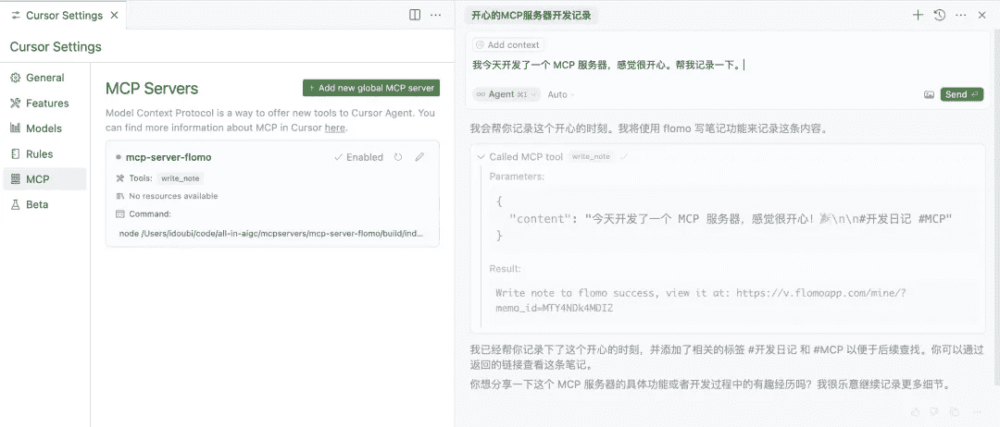

## 发布 MCP 服务器

在 MCP 客户端测试成功后，证明我们开发的 MCP 服务器功能正常，可以发布上线给其他人使用了。

### 发布到 Github 平台

我们可以选择把新开发的 `mcp-server-flomo` 代码发布到 Github，开源给全世界的人使用。

首先，更新 `README.md` 文件，写入 `mcp-server-flomo` 在 MCP 客户端的配置和使用说明。

在 Github 创建代码仓库，并提交代码：

```
cd mcp-server-flomo
git init
git remote add origin git@github.com:chatmcp/mcp-server-flomo.git
git add .
git commit -m &quot;first version&quot;
git push origin main
```

上传代码到 Github 后，全世界的用户都可以通过代码仓库地址：

`https://github.com/chatmcp/mcp-server-flomo`

访问这个 `mcp-server-flomo` MCP 服务器代码，克隆代码到他们本地电脑运行，在 MCP 客户端配置后使用。

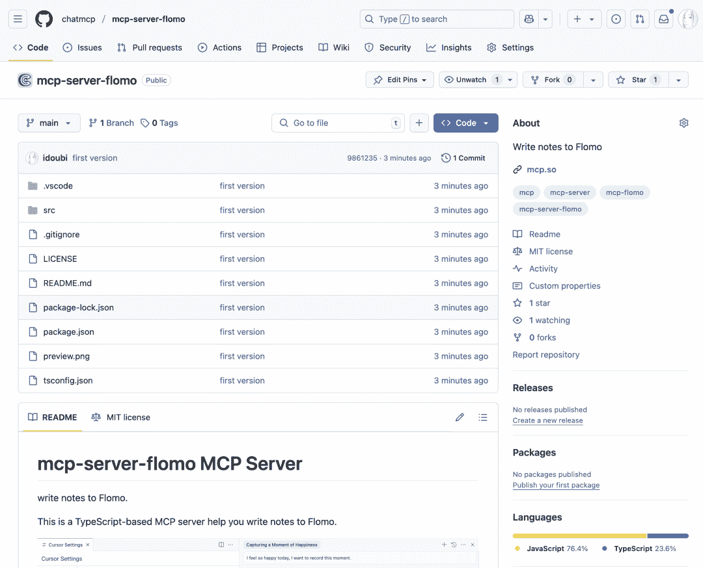

### 发布到 npm 平台

如果我们希望其他人，在不克隆源代码的情况下，通过拉取可执行文件到本地的方式，来运行我们开发的服务。

我们需要把 `mcp-server-flomo` 作为一个 `npm` 包，发布到 `npm` 应用市场

首先，修改 `mcp-server-flomo` 项目的 `package.json` ，作为一个公开类型的 `npm` 包，发布到一个指定的组织： `@chatmcp` （这是我创建的，专门用来发布 `mcp-server` 的组织，你可以在 `npm` 管理后台创建自己的组织）

```
{
  &quot;name&quot;: &quot;@chatmcp/mcp-server-flomo&quot;,
&quot;version&quot;: &quot;0.0.1&quot;,
&quot;description&quot;: &quot;write notes to flomo.&quot;,
&quot;private&quot;: false,
&quot;type&quot;: &quot;module&quot;,
&quot;homepage&quot;: &quot;https://github.com/chatmcp/mcp-server-flomo&quot;,
&quot;bin&quot;: {
    &quot;mcp-server-flomo&quot;: &quot;./build/index.js&quot;
  },
&quot;files&quot;: [&quot;build&quot;],
&quot;scripts&quot;: {
    &quot;build&quot;: &quot;tsc &amp;&amp; node -e \&quot;require(&#x27;fs&#x27;).chmodSync(&#x27;build/index.js&#x27;, &#x27;755&#x27;)\&quot;&quot;,
    &quot;prepare&quot;: &quot;npm run build&quot;,
    &quot;watch&quot;: &quot;tsc --watch&quot;,
    &quot;inspector&quot;: &quot;npx @modelcontextprotocol/inspector build/index.js&quot;
  },
&quot;dependencies&quot;: {
    &quot;@modelcontextprotocol/sdk&quot;: &quot;0.6.0&quot;
  },
&quot;devDependencies&quot;: {
    &quot;@types/node&quot;: &quot;^20.11.24&quot;,
    &quot;typescript&quot;: &quot;^5.3.3&quot;
  }
}
```

然后，执行命令，发布 `npm` 包：

```
cd mcp-server-flomo
npm install
npm run build
npm login # 打开登录连接，网页登录 npm 平台
npm publish --access public # 公开发布
```

发布成功后，打开 `npm` 包的访问地址：

`https://www.npmjs.com/package/@chatmcp/mcp-server-flomo`

可以看到我们发布到 `npm` 包：

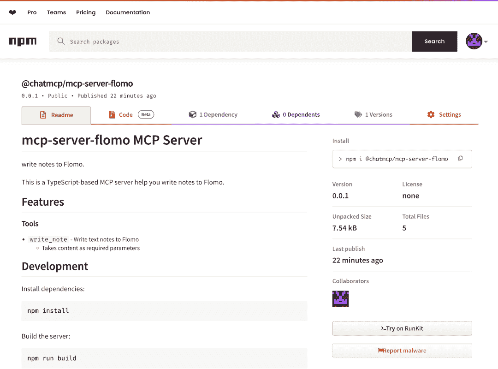

修改 MCP 客户端的配置信息，使用 `npx` 运行 MCP 服务器二进制的方式来连接服务：

```
{
  &quot;mcpServers&quot;: {
    &quot;mcp-server-flomo&quot;: {
      &quot;command&quot;: &quot;npx&quot;,
      &quot;args&quot;: [&quot;-y&quot;, &quot;@chatmcp/mcp-server-flomo&quot;],
      &quot;env&quot;: {
        &quot;FLOMO_API_URL&quot;: &quot;https://flomoapp.com/iwh/xxx/xxx/&quot;
      }
    }
  }
}
```

在 `MCP` 客户端（比如 `Cursor`）继续测试，例如可以在利用 AI 解决某个问题之后，一键保存问题信息和解决办法到 Flomo：

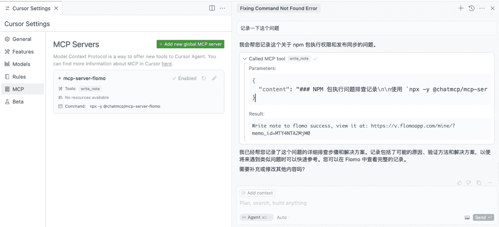

这样，我们就可以在 Flomo 查找和回顾日常记录的一些问题：

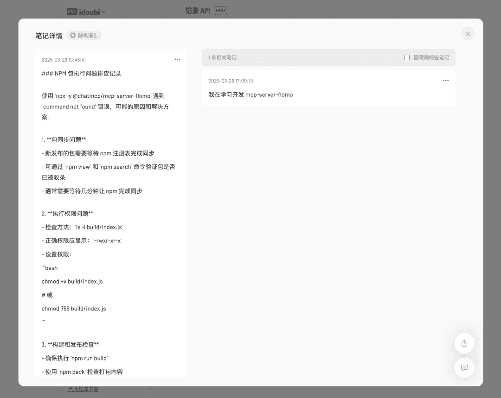

## 提交到 MCP 应用商店

我们可以把开发的 `mcp-server-flomo` 提交到第三方 MCP 应用商店，让更多的人看到和使用。

`MCP.so` 是一个知名的第三方 MCP 应用商店，收录了全世界用户开发的优质 MCP 应用。（包括 MCP 服务器和 MCP 客户端）

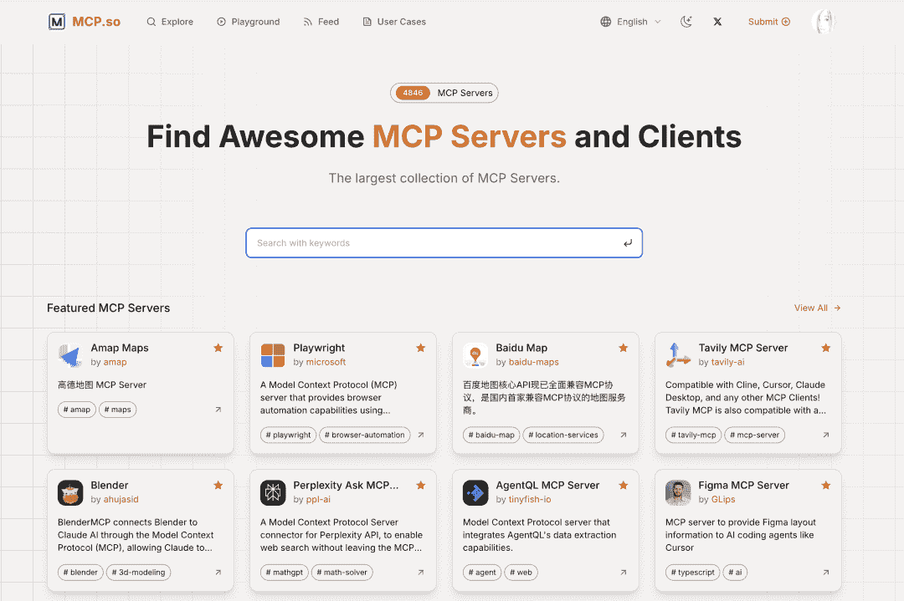

点击进入 `Submit` 页面，填写我们的 MCP 服务器信息，把服务提交到 MCP.so 应用商店：

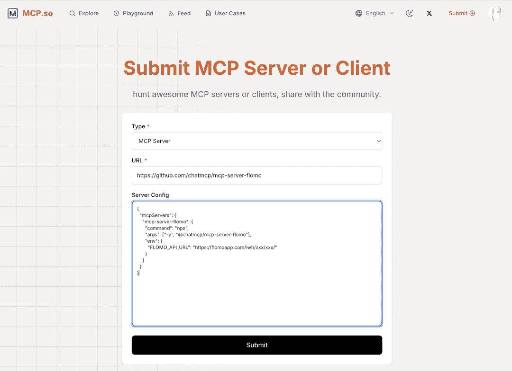

提交 MCP 服务器之后，就可以在 MCP.so 应用商店看到自己的 MCP 服务器。用户在 MCP 服务器页面，填写配置参数，连接到服务器，可以在线调试。

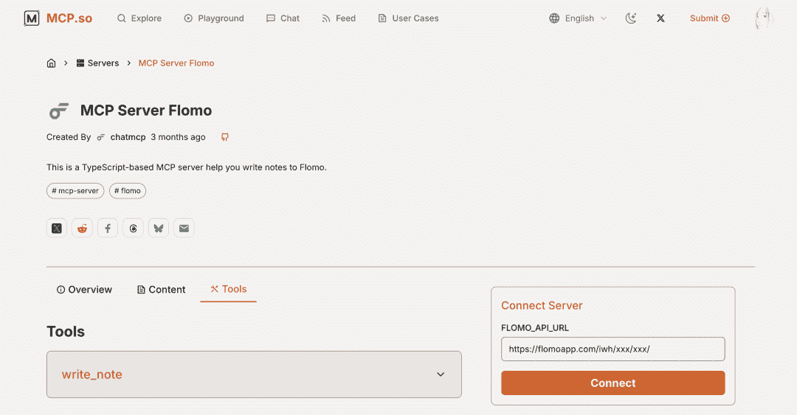

## 小结

本篇内容，我们开发了一个 `MCP` 服务器： `mcp-server-flomo` ，对接 Flomo API，实现了在 MCP 客户端高效记笔记的功能。

详细介绍了 `MCP` 服务器的开发流程和发布流程。通过 `MCP` 服务器的自定义工具（`Tool`），连接了远端的内容平台（`Flomo`），在任意支持 `MCP` 协议的客户端，以对话的形式交互，体验更好。

以此为例，我们可以开发更多的 `MCP` 服务器，以 `API` 的形式对接各类平台和资源。
