# 华为云AI原生应用运行平台+MCP产品组合方案

> 来源：[https://v11enp9ok1h.feishu.cn/docx/RY41depLlowCuNxFAEdcwp5anPb](https://v11enp9ok1h.feishu.cn/docx/RY41depLlowCuNxFAEdcwp5anPb)

> 本文将聚焦于AI Agent的快捷、高效落地，帮助企业和开发者释放智能生产力，实现“分钟级部署，秒上生产”。

### **方案架构**


## **AI Agent**

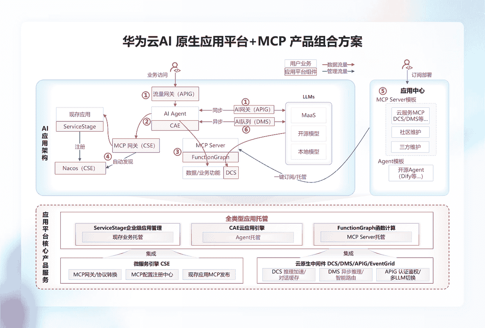

结合了自然语言理解、机器学习、知识图谱等能力，可广泛应用于客服对话、自动化流程、智能决策等场景，成为企业智能化转型的核心载体。

AI Agent在AI原生应用中核心价值有：

+   **任务自动化：**替代重复性人工操作，实现7×24小时无人值守服务（如智能客服、工单处理）。

+   **智能决策支持：**基于实时数据分析与模型推理，提供精准的业务建议（如供应链优化、风险预测）。

+   **跨系统协同：**通过集成模型、MCP、存量系统等打通企业架构，成为业务流转的“智能枢纽”。

+   **快速响应与迭代：**支持动态调整策略，适应业务需求变化，降低试错成本。

## **华为云**CAE**服务**—AI Agent**高效落地的**“**加速器**”

**一、全托管运行与极简部署**

+   **零运维负担：**华为云CAE提供从源码构建到镜像部署的一站式托管服务，支持通过软件包、镜像包实现“零改造”迁移上云，免除基础设施运维压力。或直接识别CodeArts、GitHub、GitCode、GitLab、Gitee和Bitbucket来源的代码，通过源码构建。帮助极大地简化应用上云流程。

+   **多语言与框架兼容：**支持Java、Tomcat、js、PHP、Docker、Python、C#等运行时环境。

+   **分钟级极速上线：**通过可视化控制台，开发者仅需上传镜像并配置资源规格，即可完成AI Agent的自动化部署与灰度发布，大幅缩短上线周期。

+   **依赖无缝集成：**支持与Postgres、Redis、SFS等数据组件无缝集成，实现Agent快速加载与推理加速。

**二、资源智能弹性与成本优化**

+   **动态扩缩容策略：**华为云CAE支持基于CPU/内存使用率等指标的阈值触发弹性伸缩。AI Agent的流量一般具有实时性，华为云CAE在流量洪峰时可以秒级扩容应对突发流量，在流量波谷及时缩容回收运行资源，可以提升整体AI Agent的资源利用率30%以上。

+   **混合资源管理策略：**华为云CAE还支持同时配置指标和时间段自动控制实例伸缩，确保应用在高流量时段的稳定运行，在低流量时段自动释放资源，降低成本，可以更灵活应对业务变化和高峰压力。比如在大促时间段，除了按照CPU/内存指标设置扩缩容策略外，提前按照大促时间预留资源，保证周期性流量的稳定高效处理。

+   **可观测与稳定性**

+   **一站式监控体系：**集成应用性能监控（APM）、日志自动采集（LTS）与指标收集（AOM）功能，实时追踪AI Agent的请求响应延迟、错误率等关键指标，支持快速定位性能瓶颈。

+   **安全防护：**华为云CAE预置DEW等安全组件，保护敏感数据暴露面。

## **手工部署**AI Agent vs CAE**部署**AI Agent

+   **资源管理：**用户如手工部署AI Agent，需要先准备预留AI Agent所需的服务器资源，并需定期更新操作系统等补丁。而CAE通过全托管Serverless架构，可以免除服务器维护工作，让开发者仅关注Agent的业务逻辑，无需关注维护底层资源，大大减少运维工作量。

+   **性能与成本的抉择：**AI应用的火爆往往在一夜之间，请求的规格波动大且难以预料，手工部署Agent需要在成本与性能间做出艰难的抉择；而CAE通过实时流量自动扩缩容实例，保障万级突发并发下的秒级响应，同时在流量波谷自动回收资源，避免限制资源的浪费，保障业务正常运行的同时优化资源成本。

+   **安全风险：**手工部署Agent，敏感数据存在本地，存在被窃取的风险；CAE内置端到端的安全防护，通过DEW服务托管敏感数据，可以为业务关键信息提供可靠安全性保障。

## **通过**CAE**快速部署**Dify AI Agent**实践**

**1.前置准备**

在华为云预先配置Dify应用依赖的网络、数据库、存储，创建对应的VPC、Postgres数据库、Redis缓存、SFS-Turbo存储等资源。

**2.创建CAE环境**

在华为云CAE服务创建新的环境用于部署Dify

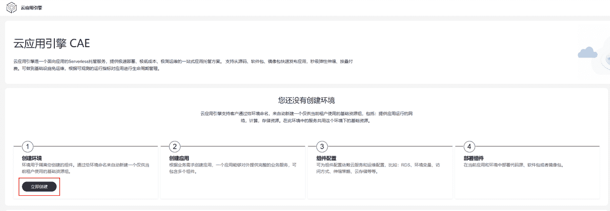

配置Dify所需的环境变量

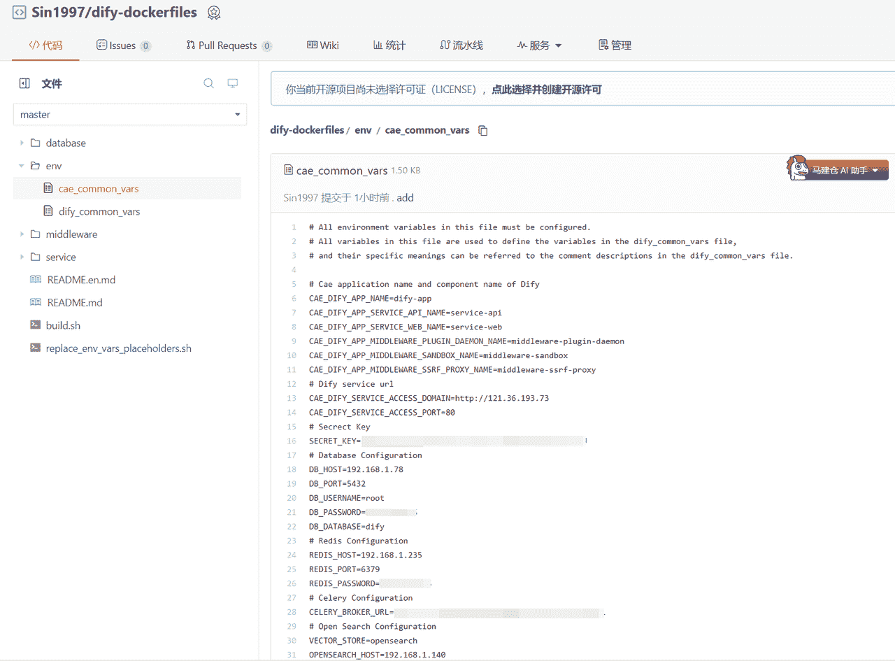

3.授权Dify对应的开源代码仓

将代码仓授权给CAE服务

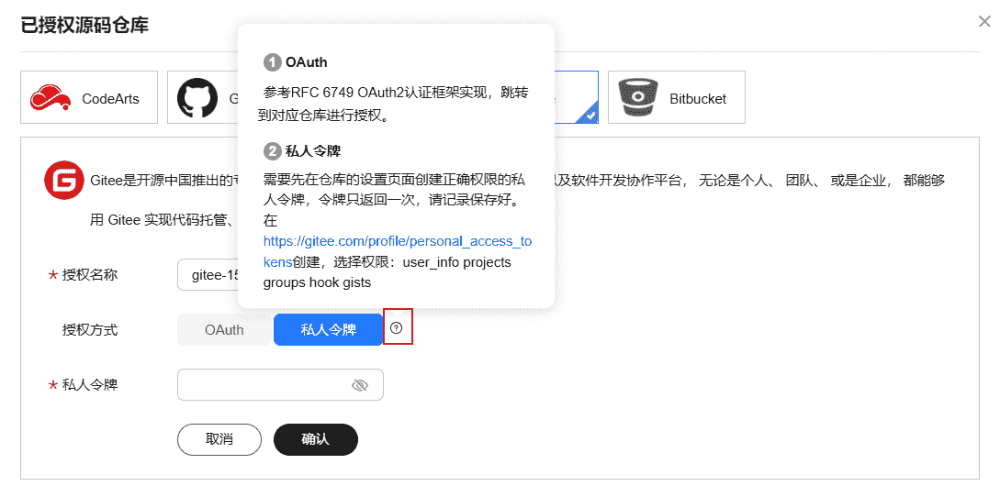

4.创建应用组件

从代码仓部署Dify所需的应用组件

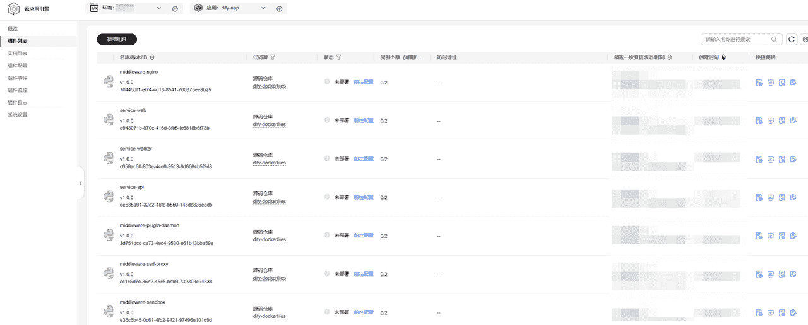

分别配置各组件的访问方式

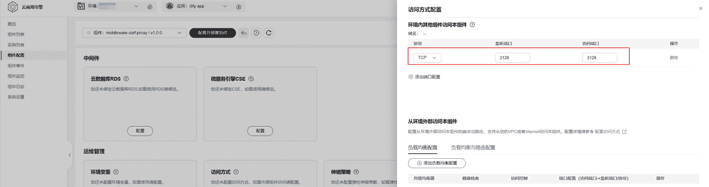

将组件与数据库、缓存、文件系统等关联。各组件间的配置关系如下图：

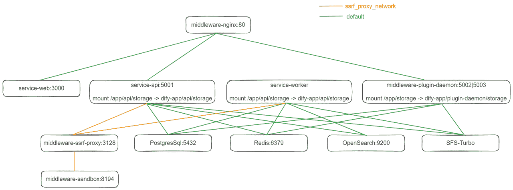

## 华为云云应用引擎CAE快速部署Dify

### **前置准备**

+   扫描下方二维码下载Terraform自动化部署模板：


进入华为云云应用引擎[CAE服务](https://console.huaweicloud.com/cae/?region=cn-east-3#/home)页面，在弹窗**授权给CAE**中点击**确定**，授权CAE委托到华为云账号（只需授权一次，已授权过则可忽略此步骤）

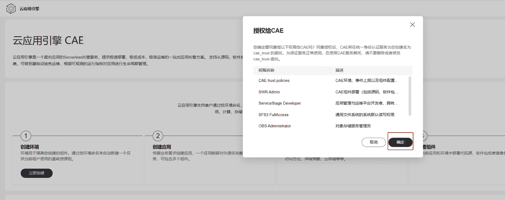

### 部署Dify资源

1.  登录到华为云，打开资源编**排服务**RFS_应用上云_云上自动化_华为云，点击RFS跳转到其控制台页面

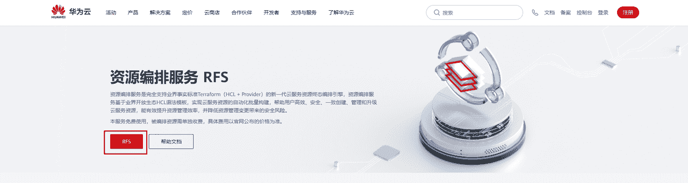

1.  跳转到**资源栈**，点击**立即创建资源栈**

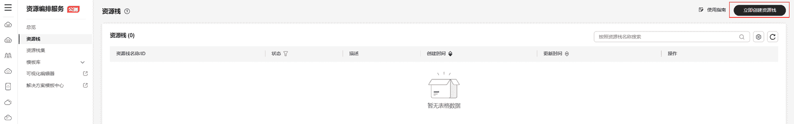

1.  进入**选择模板**页中，点击**添加文件**，将**前置准备**中下载的Terraform自动化部署模板上传，之后点击下一步

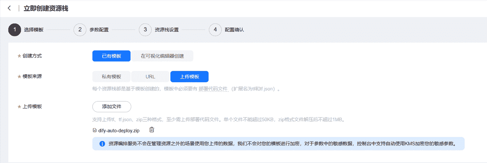

也可以直接使用存储在OBS桶中的模板链接

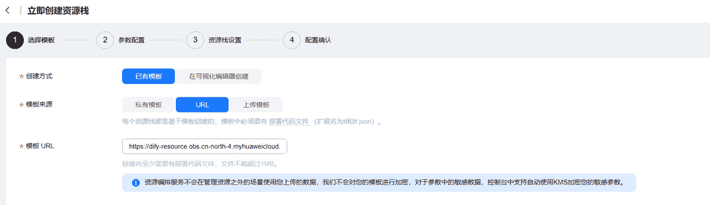

1.  进入**参数配置**页中，设置资源栈必要参数，填写如下参数后，点击下一步

+   resource_name_prefix - 资源名称前缀，命名规则{resource_name_prefix}-资源英文名称，例如：vpc名称为{resource_name_prefix}-vpc，其中OBS桶的命名为保证全局唯一，额外添加了时间戳后缀。取值范围：4-24个字符，支持小写字母、数字、-（中划线）。必须以小写字母开头。禁止以中划线（-）开头。默认为dify。

+   **ak **- 用户访问密钥AK，在我的凭证中创建，用于将Dify应用数据写入OBS桶中。具体获取方法可以参考在哪里可以获取AK和SK？_对象存储服务 OBS_华为云。

+   **sk **- 用户访问密钥SK，在我的凭证中创建，用于将Dify应用数据写入OBS桶中。具体获取方法可以参考在哪里可以获取AK和SK？_对象存储服务 OBS_华为云。

+   **pgsql_password **- PostgreSQL数据库的管理员密码，所设置的密码长度为8~32个字符，至少包含大写字母、小写字母、数字、特殊字符三种字符的组合，其中允许输入~!@#$%^*-_=+?,()&.|特殊字符。

+   **redis_password **- Redis数据库密码。取值范围：8-64个字符，密码至少必须包含大写字母、小写字母、并包含数字或特殊字符`~!@#$^&*()-_=+|{},<.>/?

+   **css_password **- CSS向量数据库的密码。取值范围：8-32个字符，密码至少必须包含大写字母、小写字母、并包含数字或特殊字符~!@#$%^&*()-_=+|[{}];:,<.>/? 。安全集群的密码会进行弱口令校验，建议设置安全性高的密码。

+   dify_secret_key - Dify用于对会话cookie进行签名并加密数据库中的敏感信息的密钥。您可以使用 openssl rand -base64 42 生成一个强密钥。

1.  在**资源栈设置**页面中，可以保持默认不进行任何配置，直接点击下一步

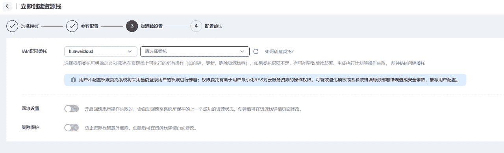

1.  在最后**配置确认****页面中，再检**查一遍配置的参数是否符合预期，之后点击创建执行计划

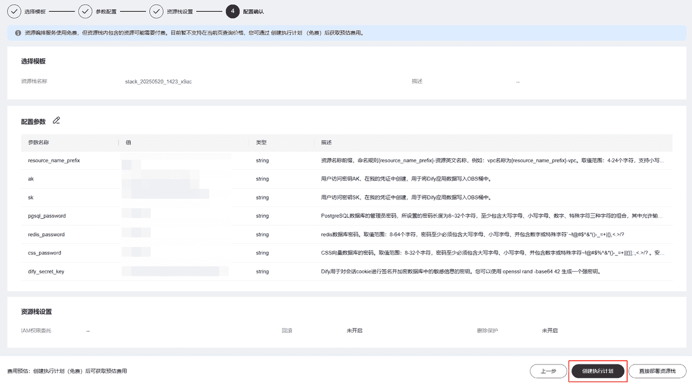

在跳出的弹窗中点击**确定**

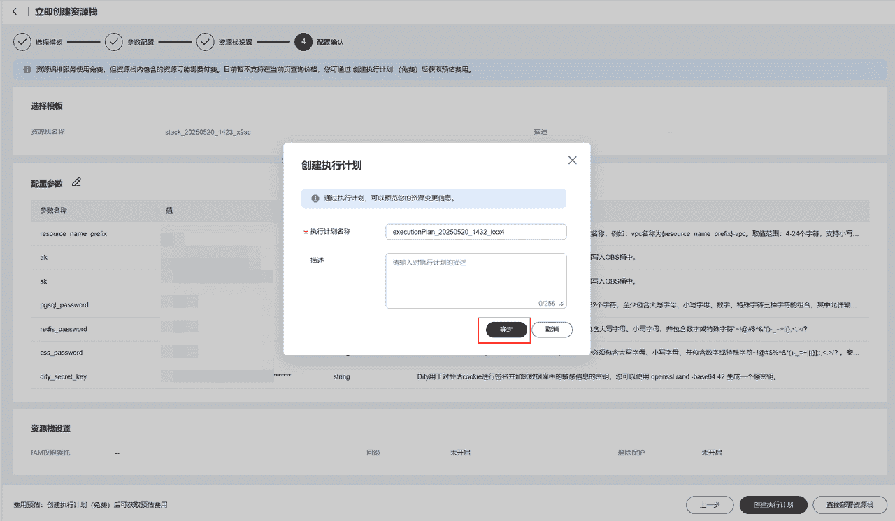

1.  等待**执行计划**状态变为**创建成功****，****待部署**后，点击**部署**

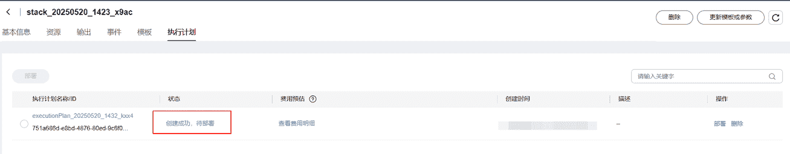

在这个界面可以点击费用预估以察看Dify应用依赖资源的费用（默认都按照按需付费创建相关资源）

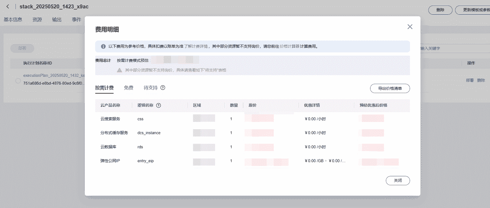

其中CAE和ELB的费用计算暂不支持，需要参照官方文档进行预估

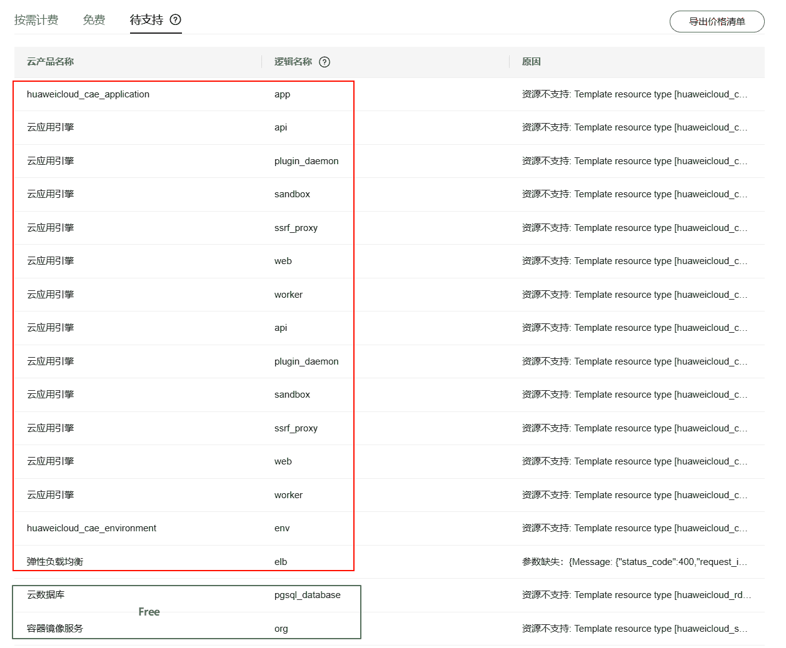

1.  之后等待资源栈部署成功（约需等待15分钟）。在创建过程中可能存在部分因素导致资源创建失败，**如账号余**额不足，资源配额不足，用户设置的密码不合规，账号权限不足等，可以通过查看生成失败的原因后进行相应处理。下图报错的原因是因为CAE服务默认只允许创建一个环境，而当前账号下已有一个正在运行的环境了，需要将此环境删除，或者申请扩大环境配额。

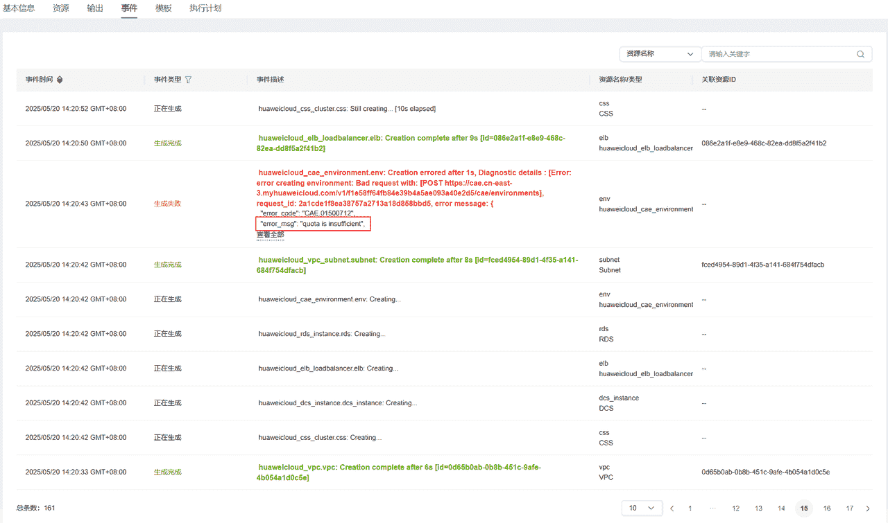

处理完毕后，点击右上角**的继续部**署，rfs会重试创建对应的资源

1.  在资源栈部署成功后，**执行计划**状态为**已执行部署**

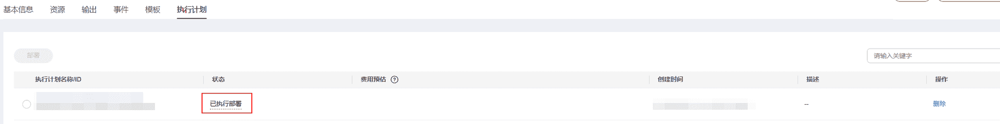

在**基本信息**中的状态则显示为**部署成功**

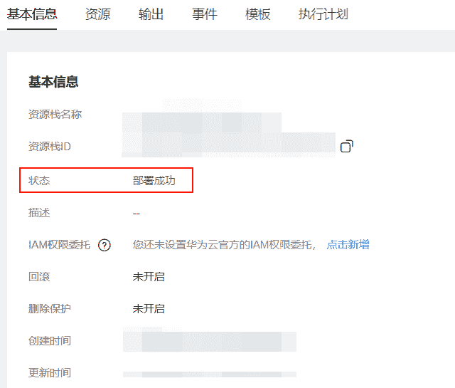

### 配置CAE环境

1.  进入云应用引擎CAE_应用托管服务_微服务应用托管_零代码改造上云-华为云的控制台界面

1.  点击**组件列表**，确认当前已创建了一个**环境**，一个**应用**和六个**组件**。

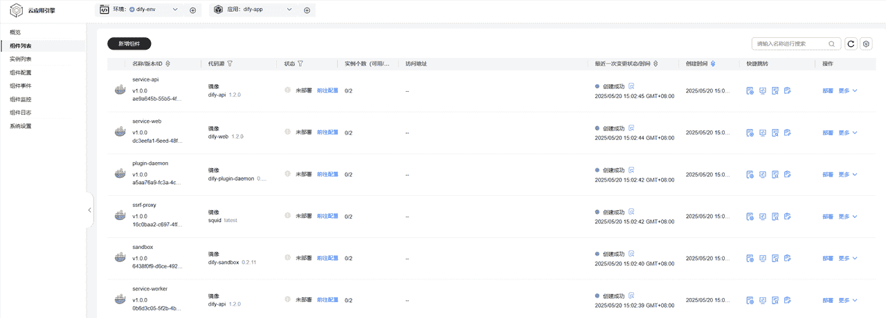

1.  点击**系统设置**，编辑**系统网络配置**，分别打开**CAE环境访问公网**和**公网访问CAE环境**开关（部分region上的CAE环境**在创建后已****默认****打开，可不**用重**复打开）**，在VPC访问  CAE环境点击添加配置，等待其配置完成

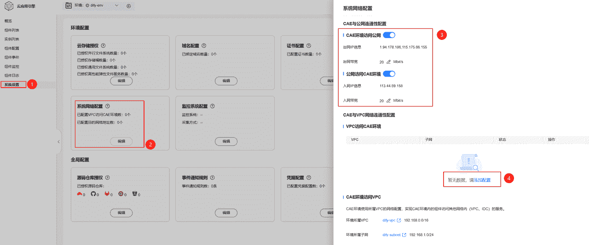

1.  回到**组件列表**页面，依次点击部署

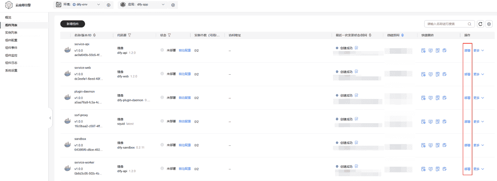

1.  等待组件全部进入**运行中**状态

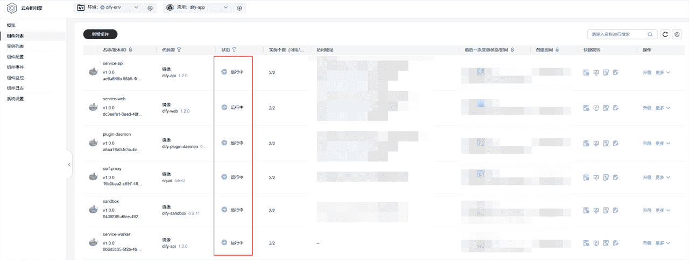

1.  **此时Dify应用已完成**部署，**可以点击**service-web组件的公网地址进入到Dify应用中

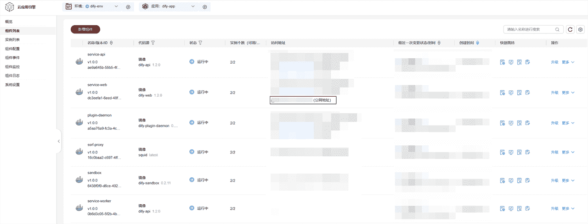

1.  首次进入Dify应用需要设置管理员账户

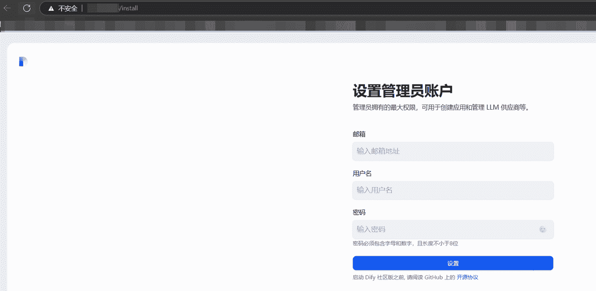

### 删除Dify资源

1.  切换到**组件列表**中，依次**停止**所有CAE组件，等待停止完成

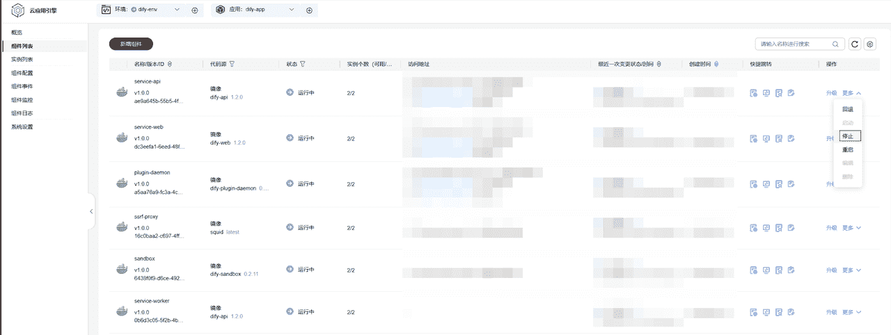

1.  删除掉其中的**service-api**，**service-web**，**plugin-daemon**组件，等待删除完成

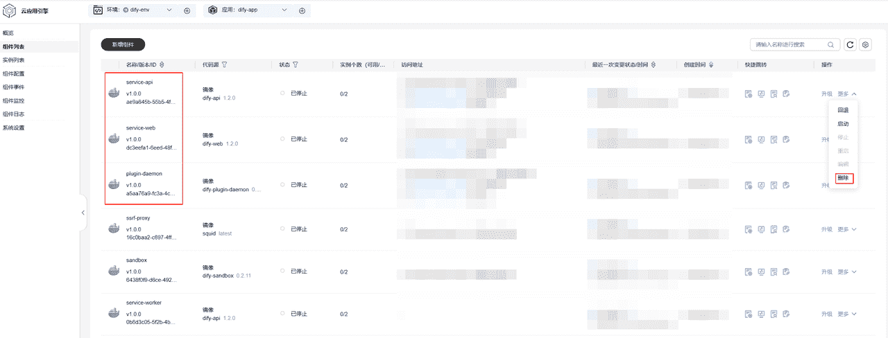

1.  进入到**系统设置**页面，编辑**系统网络配置**，删除**VPC访问CAE环境配置**，等待删除完成

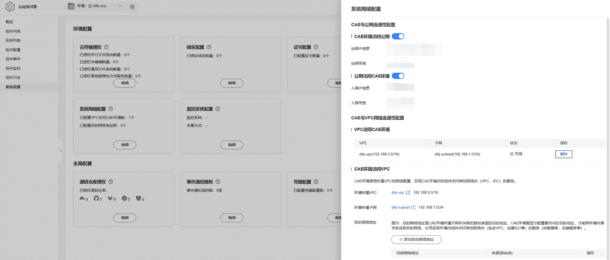

1.  回到资源编排服务RFS**_应用****上云_**云上自动化_华为云的控制台页面，进入资源栈页面，删除这个Dify应用对应的资源栈

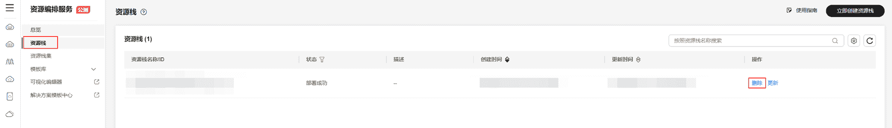

**删除方式**选择**删除资源**，点击确定

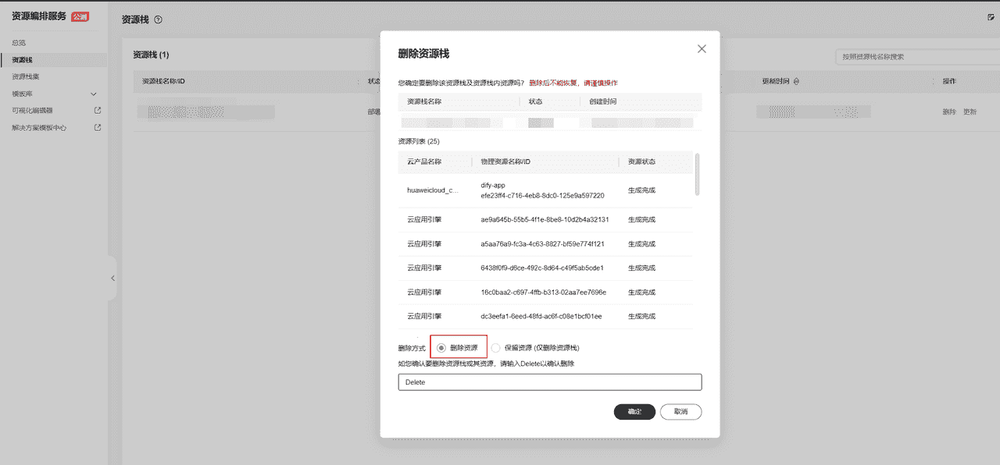

1.  等待资源栈删除完成即可

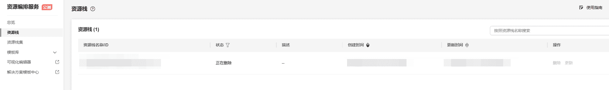

### **方案架构**

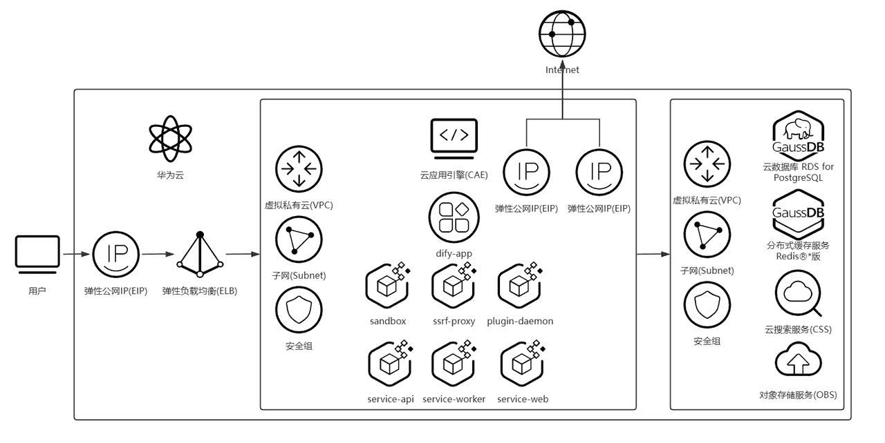

### **常见问题**

+   [如果设置](https://docs.dify.ai/zh-hans/getting-started/install-self-hosted/faq#id-4.-ru-he-zhong-zhi-guan-li-yuan-mi-ma)了管理员账号后忘记了账号密码，则可以参考Dify官方文档重置账号密码，即进入任意service-api组件的容器，执行如下命令

```
flask reset-password
```

进入容器的方法为点击**实例列表****，然后切**换到service-api组件，点击远程登陆

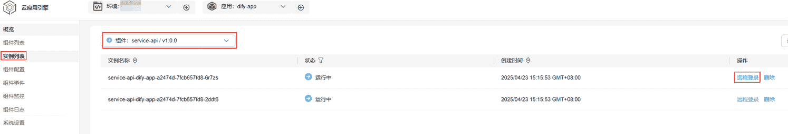

等待CloudShell服务连接到容器中，执行命令

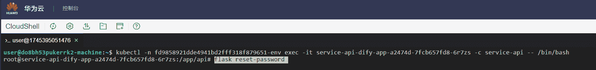

[D](https://github.com/langgenius/dify/blob/1.2.0/docker/.env.example)ify的邮件发送能力需要在组件的环境变量配置（参考https://github.com/langgenius/dify/blob/1.2.0/docker/.env.example）中添加邮箱相关环境变量，具体配置在service-api，service-worker，plugin-daemon组件中，并在配置完之后生效配置。其它环境变量也可参照此方法配置。

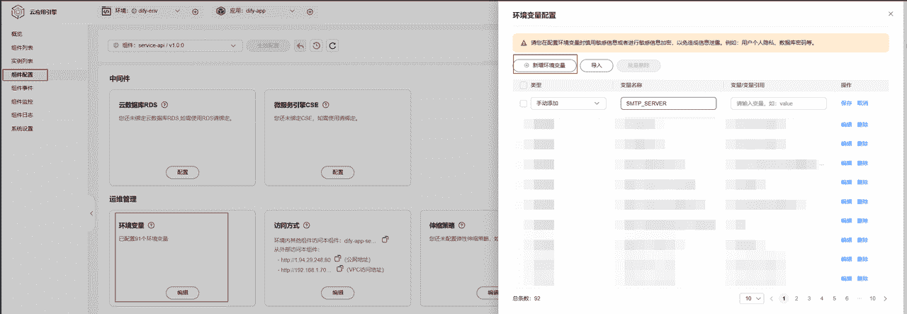

### **约束与限制**

+   该方[案部署前](https://account.huaweicloud.com/usercenter/?agencyId=&region=cn-north-4&locale=zh-cn#/userindex/allview)，需注册华为账号并开通华为云，完成实名认证，且账号不能处于欠费或冻结状态。如果计费模式选择“包年包月”，请确保账户余额充足以便部署资源的时候可以自动支付；或者在部署的过程进入费用中心，找到“待支付订单”并手动完成支付。

+   如果选用IAM委托权限部署资源，请确保使用的华为云账号有IAM的足够权限，建议使用华为主账号或admin用户组下的IAM子账户。