# 终极 MCP 手册：从基础到高级 LLM 集成（附代码）

> 来源：[https://v11enp9ok1h.feishu.cn/docx/IOUAdb4A2oe6AhxpvPYcm4nOn05](https://v11enp9ok1h.feishu.cn/docx/IOUAdb4A2oe6AhxpvPYcm4nOn05)

## 一、什么是 MCP

模型上下文协议（MCP）是一种标准化方法，用于组织、交付和处理大型语言模型（LLM）的上下文信息。它旨在帮助模型更好地理解和利用提示中提供给它们的信息。

MCP的关键组件包括：

1. 结构化格式：使用结构清晰的格式（比如XML）来组织不同类型的数据；
1. 信息层次结构：按重要性和相关性进行优先级排序，从而帮助模型确定哪些内容是重要的；
1. 元数据标记：提供有关上下文的其他信息，例如来源、可靠性或时间戳；
1. 处理指令：模型应如何处理、解释或使用特定信息的明确指导；

MCP 特别适用于：

+ 模型需要处理多种类型信息的复杂应用程序；
+ 需要对不同上下文元素进行特定处理的情况；
+ 通过减少上下文使用方式的歧义来提高模型性能；
+ 通过标准化向模型呈现上下文的方式，MCP 旨在使 AI 交互在不同用例和实施中更加可靠、一致和有效。

## 二、MCP 服务器的工作原理

通常，MCP架构有主机处理用户界面，MCP客户端路由请求，MCP 服务器（执行实际任务 — 充当作支柱），使LLM能够与实际系统交互。

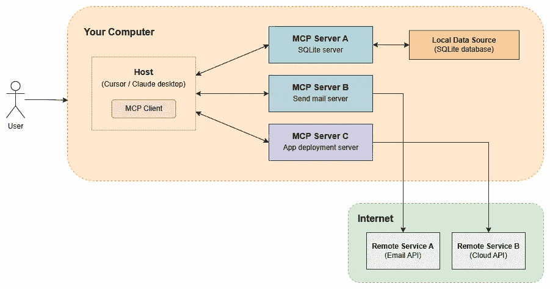

+ 用户输入：用户通过主机应用程序发出请求；
+ LLM 解释：LLM处理请求并确定是否有相应的MCP工具可用于满足该请求；
+ 客户端路由：如果配置了合适的工具，MCP 客户端会打包请求并使用 MCP 协议将其转发到 MCP 服务器。

按服务器执行任务：MCP服务器接收请求，然后，触发相应的动作（比如：查询本地资源（例如 SQLite 数据库），调用外部服务（例如，电子邮件 API、股票数据 API 或内部系统）），服务器处理来自工具的响应，并将结果发送回 MCP 客户端，MCP 客户端调用LLM 获取返回的结果，将其集成到自然语言响应中，然后通过主机应用程序将其发送回给用户。

## 三、MCP服务器核心功能

MCP服务器提供三个核心功能。

1、资源：存储和提供类似文件的数据

MCP资源充当只读数据源，为大型语言模型（LLM）提供结构化信息，类似于 REST API GET 请求。

LLM 可以按需访问这些资源：

```
@mcp.resource("greeting://{name}")
def get_greeting(name: str) -> str:
    """Get a personalized greeting"""
    return f"Hello, {name}!"
```

此示例在 `greeting://{name}` 处定义了一个资源，该资源在访问时返回一个简单的问候语字符串。

2、工具：LLM 执行的函数

MCP 工具允许 AI 执行特定任务，类似于 API POST 请求。这些函数可以执行计算、与数据库交互或调用外部 API，使 LLM 能够超越静态数据并采取有意义的操作。

```
@mcp.tool()
def add(a: int, b: int) -> int:
    """Add two numbers and return the result."""
    return a + b
```

该工具根据用户的体重和身高计算 BMI。

3、提示词：预定义的说明模板

MCP提示词是可重用的模板，可帮助 LLM 始终如一地执行结构化任务。这些模板指导模型对常见或复杂请求类型的响应。

```
@mcp.prompt()
def review_code(code: str) -> str:
    return f"Please review this code:\n\n{code}"
```

此提示可帮助 LLM 在要求执行代码审查时以结构化方式做出响应。

## 四、构建您的第一个 MCP 服务器

我们使用Python构建一个本地MCP服务器，该服务器连接SQLite 数据库来检索社区中排名靠前的聊天者。可以通过Cursor或Claude Desktop等工具进行LLM进行交互，而 MCP 服务器处理所有后端数据库操作。

### 4.1 安装 uv

我们使用`uv`来设置和管理我们的环境，这样可以简化处理依赖项、创建虚拟环境和运行脚本等任务。

安装`uv`命令可以参考：https://docs.astral.sh/uv/getting-started/installation/

### 4.2 安装依赖项

通过执行以下命令初始化 uv 项目。

```
uv init mcp_demo
cd mcp_demo
```

通过执行以下命令创建并激活虚拟环境。

```
uv venv
source .venv/bin/activate # for linux
.venv\Scripts\activate   # for windows
```

使用 `pip` 安装 mcp SDK，mcp 软件包包括 Server Framework 和可选的 CLI 实用程序，安装[cli]可以访问有用的命令行工具。

```
uv add mcp[cli]
```

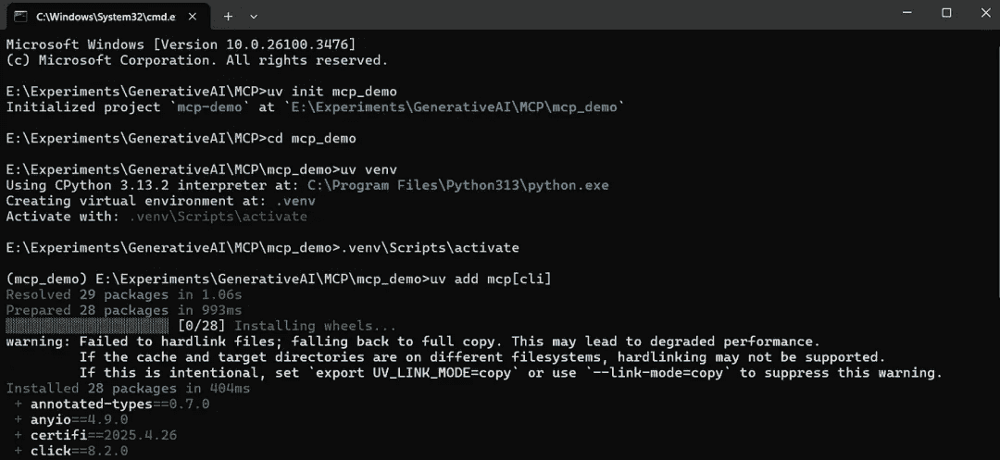

验证是否安装成功

```
mcp version
```

## Example1、创建您的第一个 MCP 服务器

首先创建一个将两个数字相加的简单计算器工具。

在 `mcp_demo` 目录中创建一个名为 `calculator.py` 的文件，并将以下代码插入其中：

```
from mcp.server.fastmcp import FastMCP  # Import FastMCP, the quickstart server base

mcp = FastMCP("Calculator Server")  # Initialize an MCP server instance with a descriptive name

@mcp.tool()  # Register a function as a callable tool for the model
def add(a: int, b: int) -> int:
    """Add two numbers and return the result."""
    return a + b
    
# Add a dynamic greeting resource
@mcp.resource("greeting://{name}")
def get_greeting(name: str) -> str:
    """Get a personalized greeting"""
    return f"Hello, {name}!"
    
if __name__ == "__main__":
    mcp.run(transport="stdio")  # Run the server, using standard input/output for communication
```

此脚本使用名为`add`的单个工具设置一个基本的 MCP 服务器。`@mcp.tool()`装饰器向 MCP 框架注册该函数，使其可供连接的 LLM 访问。

您可以使用以下命令测试 mcp 服务器。

```
mcp dev calculator.py
```

运行 MCP Inspector后，您可以在浏览器中访问 `http://127.0.0.1:6274` 的界面。Inspector 提供了一个用户友好的界面来查看可用的工具和资源，它还允许您使用内置 UI 控件直接与这些工具进行交互。

### 5.1 将 MCP 服务器与 Claude Desktop 集成

要将 MCP 服务器连接到 Claude，您需要安装 Claude for Desktop（下载地址：https://claude.ai/download）。

### 5.2 将 MCP 服务器添加到 Claude Desktop

安装 Claude Desktop 后，您可以使用以下命令添加 MCP 服务器：

```
mcp install calculator.py
```

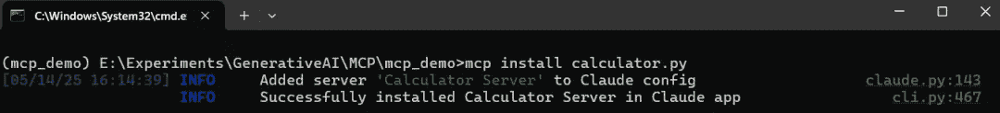

这样就把MCP 服务器注册到Claude了，就可以从桌面应用程序访问。

### 5.3 手动配置（替代方法）

如果希望手动配置，请单击 Claude Desktop -> File -> Settings -> Developer -> Edit Config 按钮打开 Claude 配置文件。

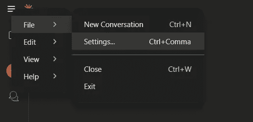

> Windows: `%APPDATA%\Claude\claude_desktop_config.json`

> macOS: `~/Library/Application Support/Claude/claude_desktop_config.json`

然后，将以下条目添加到 `mcpServers` 部分：

```
{
  "mcpServers": {
    "Calculator Server": {
      "command": "C:\\Users\\Codem\\.local\\bin\\uv.EXE",
      "args": [
        "run",
        " - with",
        "mcp[cli]",
        "mcp",
        "run",
        "Absolute path to calculator.py"
      ]
    }
  }
}
```

使用MCP服务器`calculator.py`的实际路径替换`calculator.py`的绝对路径。

### 5.4 使用 Claude 桌面测试 MCP 工具

重新启动 Claude Desktop 应用程序，可以查看 MCP 工具是否在 IDE中加载成功，加载后，将能够直接在界面中使用该工具。

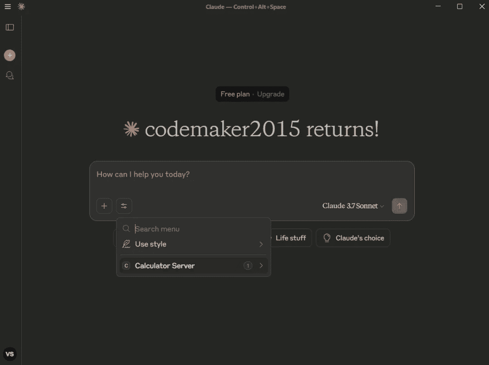

## Example2、与SQLite数据库交互

在前面的示例中，我们创建了一个`add`工具并将其与 Claude Desktop 集成。但是，这种基本算术函数Claude可能不会响应，因为这个计算比较简单，在 IDE 本地就可以处理，不需要外部处理。

现在，让我们继续讨论一个更实际的用例，从本地源检索数据，并使 LLM 访问这些数据，以进行动态和上下文感知交互。

### 6.1 获取示例数据库

下载 `community.db` 文件（下载地址：https://doimages.nyc3.cdn.digitaloceanspaces.com/006Community/MCP-server-python/community.db），其中包含包含示例数据的 `chatters` 表。下载后，将数据库文件移动到您的项目目录中。

### 6.2 创建 SQLite MCP 服务器

创建一个名为 `sqlite_server.py` 的新文件，并向其添加以下代码。

```
# sqlite-server.py
from mcp.server.fastmcp import FastMCP
import sqlite3

# Initialize the MCP server with a name
mcp = FastMCP("Community Chatters")

# Define a tool to fetch the top chatters from the SQLite database
@mcp.tool()
def get_top_chatters():
    """Retrieve the top chatters sorted by number of messages."""
    # Connect to the SQLite database    
    conn = sqlite3.connect('E:\\Experiments\\GenerativeAI\\MCP\\mcp_demo\\community.db')    
    cursor = conn.cursor()        
    
    # Execute the query to fetch chatters sorted by messages    
    cursor.execute("SELECT name, messages FROM chatters ORDER BY messages DESC")    
    results = cursor.fetchall()    
    conn.close()        
    
    # Format the results as a list of dictionaries    
    chatters = [{"name": name, "messages": messages} for name, messages in results]    
    return chatters

# Run the MCP server locally
if __name__ == '__main__':
    mcp.run()
```

> 确保在 `sqlite3.connect()` 方法中提供数据库的绝对路径 。如果使用相对路径，Claude Desktop 可能无法正确定位或访问数据库。

使用以下命令测试 sqlite 服务器。

```
mcp dev sqlite_server.py
```

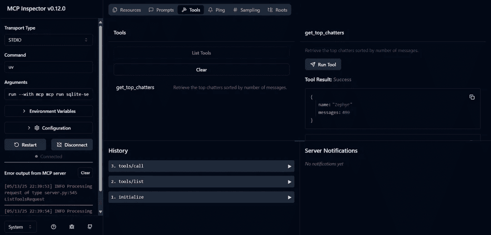

### 6.3 使用 Claude Desktop 进行测试

首先，通过运行以下命令将 SQLite MCP 服务器与 Claude 集成：

```
mcp install sqlite_server.py
```

接下来，重新启动 Claude Desktop 应用程序。运行后，您可以直接在界面中开始询问与本地数据库相关的问题。执行 SQLite 服务器 MCP 时，将出现提示，请求运行 MCP 工具的权限。批准提示就可以继续。


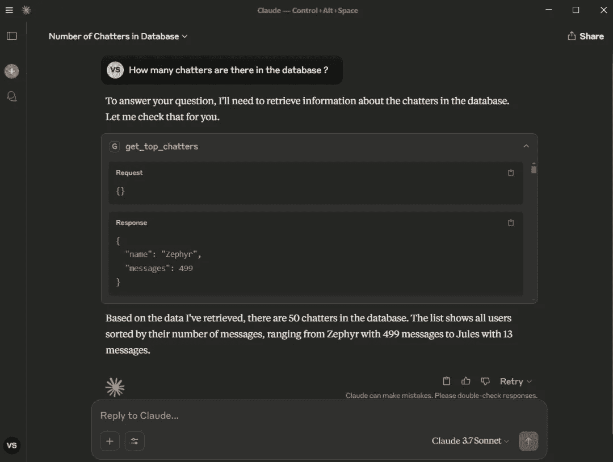

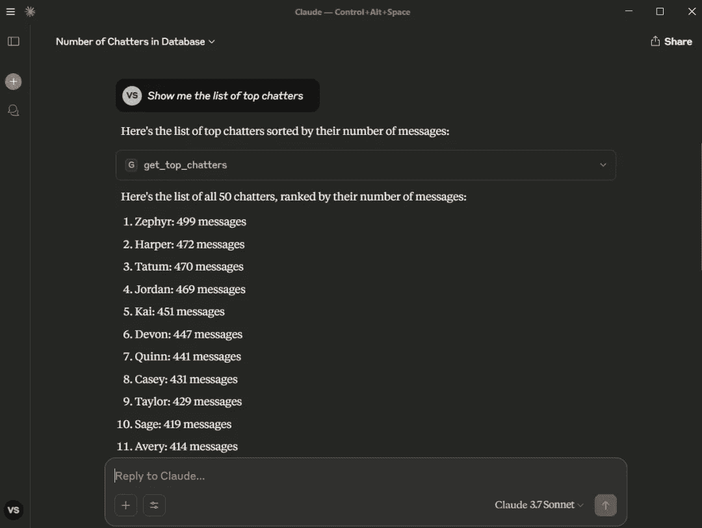

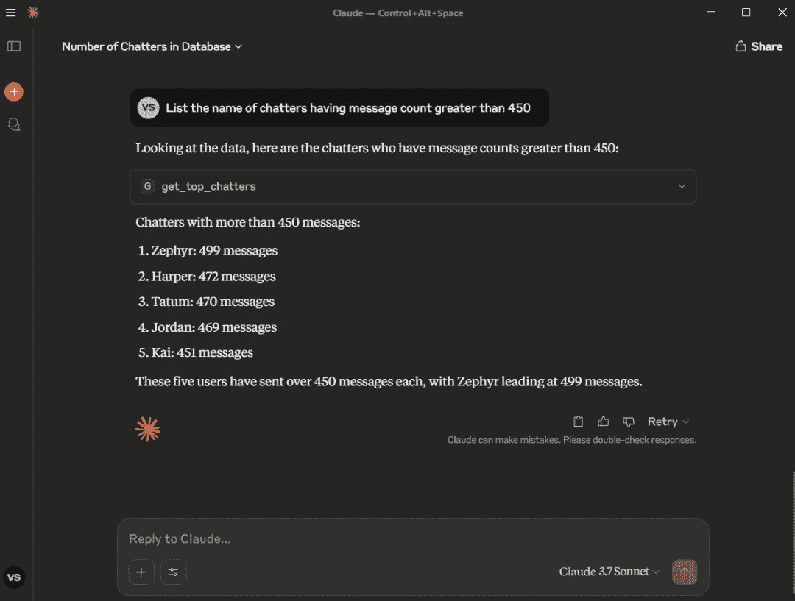

## Example3、使用预置MCP服务器

Anthropic 及其社区提供了一组预构建的 MCP 服务器，这些服务器可以直接与 Claude Desktop 或 Cursor 集成，以便在您的应用程序中启用此功能。地址：

https://github.com/modelcontextprotocol/servers

在本节中，我们将实现 File System 和 Git MCP 服务器。

### 7.1 文件系统

要启用文件系统功能，我们将在 Claude for Desktop 中安装预构建的 Filesystem MCP 服务器 。

使用任何文本编辑器打开配置文件，并将以下内容附加到文件末尾。

```
{
  "mcpServers": {
    "filesystem": {
      "command": "npx",
      "args": [
        "-y",
        "@modelcontextprotocol/server-filesystem",
        "/path/to/directory"
      ]
    }
  }
}
```

例如，示例配置文件如下所示：


```json
{
  "mcpServers": {
    "Calculator Server": {
      "command": "C:\\Users\\Codem\\.local\\bin\\uv.EXE",
      "args": [
        "run",
        "--with",
        "mcp[cli]",
        "mcp",
        "run",
        "E:\\Experiments\\GenerativeAI\\MCP\\mcp_demo\\calculator.py"
      ]
    },
    "Community Chatters": {
      "command": "C:\\Users\\Codem\\.local\\bin\\uv.EXE",
      "args": [
        "run",
        "--with",
        "mcp[cli]",
        "mcp",
        "run",
        "E:\\Experiments\\GenerativeAI\\MCP\\mcp_demo\\sqlite_server.py"
      ]
    },
    "filesystem": {
      "command": "npx",
      "args": [
        "-y",
        "@modelcontextprotocol/server-filesystem",
        "E:\\Experiments\\GenerativeAI\\MCP\\mcp_demo"
      ]
    }
  }
}
```

更新配置文件后，重新启动 Claude for Desktop 以应用更改。运行后，可以直接在界面中开始询问与指定文件夹相关的问题。


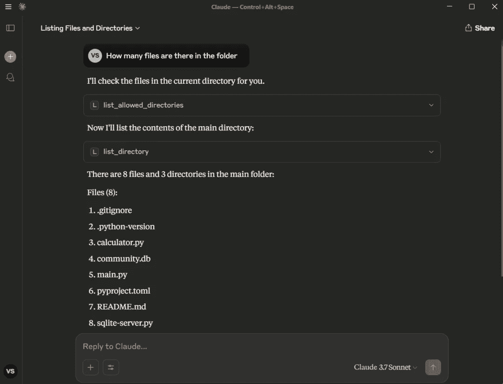

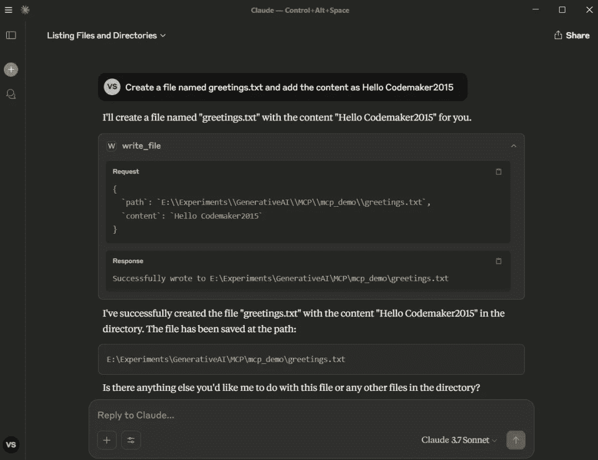

## 7.2 Git MCP服务器

Anthropic 提供了 `mcp-server-git` MCP 服务器，其中包括用于使用大型语言模型读取、搜索和作 Git 存储库的工具。

要启用 `git` 功能，请使用任何文本编辑器打开配置文件，并将以下内容附加到文件末尾。

```json
{
  "mcpServers": {
    "git": {
      "command": "uvx",
      "args": ["mcp-server-git", "--repository", "path/to/git/repo"]
    }
  }
}
```

应用程序现在启用了 Git 支持，允许您通过大型语言模型 （LLM） 执行 Git 命令。

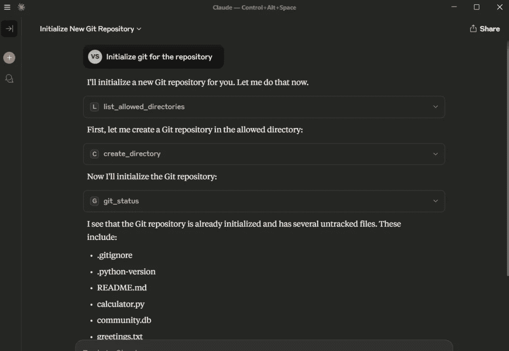

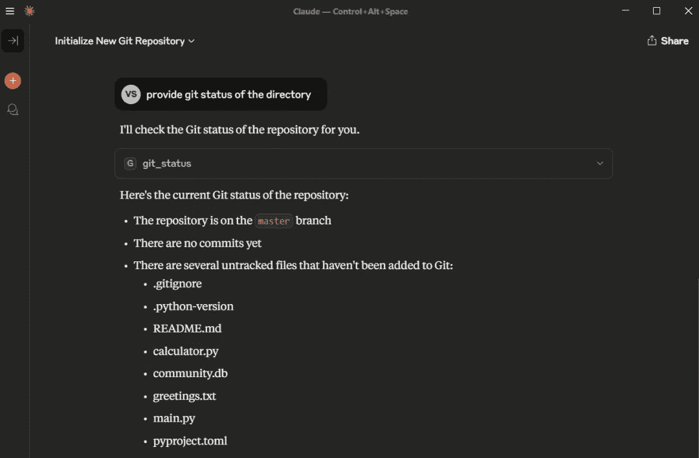

## Example4、使用`python` MCP客户端

如果想以编程方式执行特定任务，可以使用 MCP Python SDK 创建客户端。在前面的部分中，我们创建了一个简单的工具 `calculator.py` 来添加两个数字。现在，让我们使用 MCP 客户端调用 `add` 工具并执行添加作。

创建一个名为 `calculator_client.py` 的文件，并向其添加以下代码。

```python
from mcp import ClientSession, StdioServerParameters, types
from mcp.client.stdio import stdio_client

# Create server parameters for stdio connection
server_params = StdioServerParameters(
    command="python",  # Executable
    args=["calculator.py"],  # Optional command line arguments
    env=None,  # Optional environment variables
)
    
async def run():
    async with stdio_client(server_params) as (read, write):
        async with ClientSession(read, write) as session:
            # Initialize the connection
            await session.initialize()
            
            # Call a tool
            result = await session.call_tool("add", arguments={"a": 3, "b": 4})
            print(f"Result of add tool: {result}")
            
if __name__ == "__main__":
    import asyncio
    
    asyncio.run(run())
```

要运行客户端，请使用以下命令在终端中启动服务器：

```python
python calculator.py
```

接下来，打开另一个终端并使用以下命令运行客户端：

```python
python calculator_client.py
```

两者都运行后，将看到类似于以下内容的输出：

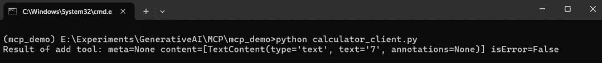

## 8.1 使用 MCP 服务器进行股票价格比较

在本节中，我们将使用 Yahoo 财经 Python API 构建自定义 MCP 服务器。该服务器将能够获取实时股票价格、进行比较并提供历史数据分析。

### 安装依赖项

使用 `PIP` 命令安装 `YFinanace` Python 软件包。

```python
pip install yfinance
```

创建一个名为 `stock_price_server.py` 的文件，并向其添加以下代码。

```python
from mcp.server.fastmcp import FastMCP
import yfinance as yf

# Create an MCP server with a custom name
mcp = FastMCP("Stock Price Server")

@mcp.tool()
def get_stock_price(symbol: str) -> float:
    """
    Retrieve the current stock price for the given ticker symbol.
    Returns the latest closing price as a float.
    """
    try:
        ticker = yf.Ticker(symbol)
        # Get today's historical data; may return empty if market is closed or symbol is invalid.
        data = ticker.history(period="1d")
        if not data.empty:
            # Use the last closing price from today's data
            price = data['Close'].iloc[-1]
            return float(price)
        else:
            # As a fallback, try using the regular market price from the ticker info
            info = ticker.info
            price = info.get("regularMarketPrice", None)
            if price is not None:
                return float(price)
            else:
                return -1.0  # Indicate failure
    except Exception:
        # Return -1.0 to indicate an error occurred when fetching the stock price
        return -1.0
        
@mcp.resource("stock://{symbol}")
def stock_resource(symbol: str) -> str:
    """
    Expose stock price data as a resource.
    Returns a formatted string with the current stock price for the given symbol.
    """
    price = get_stock_price(symbol)
    if price < 0:
        return f"Error: Could not retrieve price for symbol '{symbol}'."
    return f"The current price of '{symbol}' is ${price:.2f}."
    
@mcp.tool()
def get_stock_history(symbol: str, period: str = "1mo") -> str:
    """
    Retrieve historical data for a stock given a ticker symbol and a period.
    Returns the historical data as a CSV formatted string.
    
    Parameters:
        symbol: The stock ticker symbol.
        period: The period over which to retrieve historical data (e.g., '1mo', '3mo', '1y').
    """
    try:
        ticker = yf.Ticker(symbol)
        data = ticker.history(period=period)
        if data.empty:
            return f"No historical data found for symbol '{symbol}' with period '{period}'."
        # Convert the DataFrame to a CSV formatted string
        csv_data = data.to_csv()
        return csv_data
    except Exception as e:
        return f"Error fetching historical data: {str(e)}"
        
@mcp.tool()
def compare_stocks(symbol1: str, symbol2: str) -> str:
    """
    Compare the current stock prices of two ticker symbols.
    Returns a formatted message comparing the two stock prices.
    
    Parameters:
        symbol1: The first stock ticker symbol.
        symbol2: The second stock ticker symbol.
    """
    price1 = get_stock_price(symbol1)
    price2 = get_stock_price(symbol2)
    if price1 < 0 or price2 < 0:
        return f"Error: Could not retrieve data for comparison of '{symbol1}' and '{symbol2}'."
    if price1 > price2:
        result = f"{symbol1} (${price1:.2f}) is higher than {symbol2} (${price2:.2f})."
    elif price1 < price2:
        result = f"{symbol1} (${price1:.2f}) is lower than {symbol2} (${price2:.2f})."
    else:
        result = f"Both {symbol1} and {symbol2} have the same price (${price1:.2f})."
    return result
    
if __name__ == "__main__":
    mcp.run()
```

通过在终端中运行以下命令，使用 MCP 检查器测试 MCP 服务器。

```python
mcp dev stock_price_server.py
```

通过运行以下命令，将股票价格服务器与 Claude for Desktop 集成：

```python
mcp install stock_price_server.py --with yfinance
```

> 如果您的服务器有任何需要安装的依赖项，请务必使用- with参数指定它们。这可确保在服务器运行之前安装必要的库和模块。

集成后，重新启动 Claude for Desktop 以启用新的 MCP 服务器以进行与股票价格相关的查询。

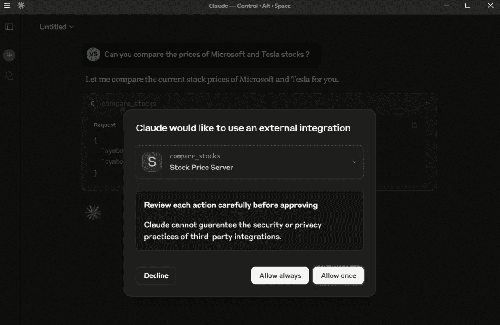

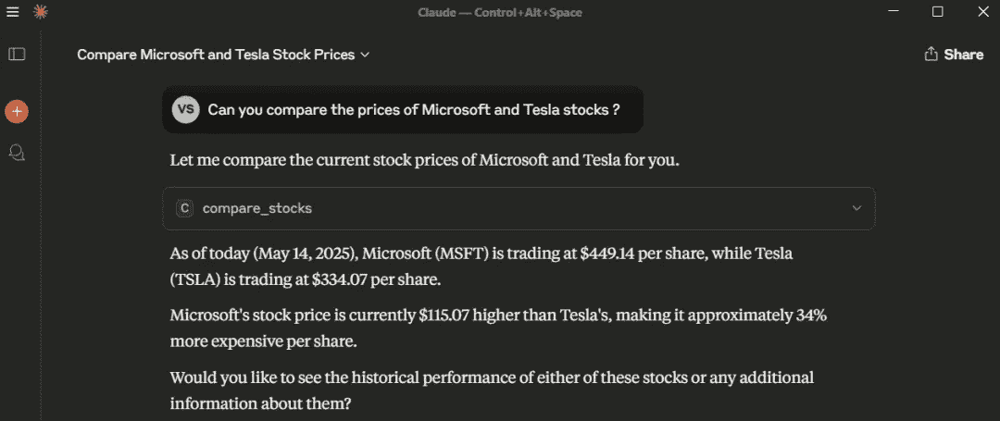

## 8.2 构建用于股票市场分析的 MCP 服务器


手动执行股票市场预测和分析可能是一项繁琐且耗时的任务。相反，想象一下能够简单地问：“现在 MSFT 的 RSI 是多少？”

MCP服务器可以立即获取最新的股票数据、计算 RSI 并返回结果——这使得做出明智的交易决策变得更加容易，而无需在多个应用程序和网站之间切换。

在本节中，我们将使用 Alpha Vantage API提取实时股票数据并将其集成到 MCP 服务器中。这种集成使我们能够使用定制的 AI 工具分析股票。

## 安装依赖项

对于单独的项目，请创建一个新的 `uv` 项目，并使用以下命令添加依赖项。

```
# Create a new directory for our project
uv init finance
cd finance

# Create virtual environment and activate it
uv venv
.venv\Scripts\activate

# Install dependencies
uv add mcp[cli] requests pandas tabulate
```

对于现有项目（`mcp_demo`），请使用 `PIP` 命令安装 MCP 和 `httpx` Python 软件包。

```
pip install requests pandas tabulate
```

## 8.3 使用 Alpha Vantage API 获取股票市场数据

Alpha Vantage可提供实时和历史金融市场数据，它提供了一系列 API 来访问有关股票、货币、加密货币等的信息。

要开始使用 Alpha Vantage，您需要在他们的官方网站（`https://www.alphavantage.co/support/#api-key`）上注册并获得免费的 API 密钥。免费套餐每天最多允许 25 个 API 请求。获得 API 密钥后，您可以使用 `TIME_SERIES_INTRADAY` 端点检索当日股票价格数据。此 API 返回实时更新的时间序列数据，其中包含关键指标（如开盘价、最高价、最低价、收盘价和成交量）。

### 需要指定如下参数：

+ 股票代码；
+ 数据点之间的间隔；
+ API Key；

### API调用示例如下：

```
https://www.alphavantage.co/query?function=TIME_SERIES_INTRADAY&symbol=MSFT&interval=5min&apikey=YOUR_API_KEY
```

这会调用返回 Microsoft 股票的最新 5 分钟间隔数据，然后就可以分析这些数据并在应用程序或分析工作流程中使用这些数据。

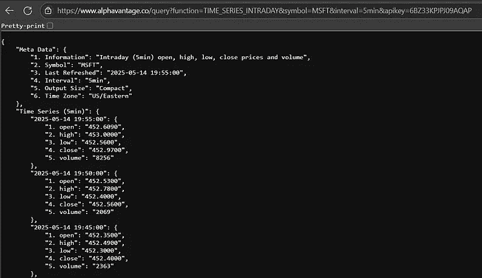

## 8.4 使用MCP Tools进行股票分析

我们使用MCP工具来进行股票分析。此时，MCP服务器将创建移动平均线、相对强弱指数和交易建议工具。

### Tool 1：移动平均线

移动平均线用于股票分析，以平滑价格数据并识别趋势。

+ 短期平均值（5-10 天）反应迅速，凸显了近期的市场变化。
+ 长期平均值（50-200 天）变化缓慢，并揭示出更广泛、持续的趋势。

用于计算移动平均线的实现工具如下所示：

```
from mcp import tool  # 需确保正确导入 mcp 相关装饰器，根据实际库结构调整
import pandas as pd
from datetime import datetime
# 以下两个需根据实际实现补充，这里模拟定义
class AlphaVantageAPI:
    @staticmethod
    def get_intraday_data(symbol, interval, outputsize):
        # 实际应实现调用 Alpha Vantage API 获取数据逻辑，这里返回模拟空 DataFrame
        return pd.DataFrame()
class MarketData:
    def __init__(self, symbol, interval, data, last_updated):
        self.symbol = symbol
        self.interval = interval
        self.data = data
        self.last_updated = last_updated

market_data_cache = {}  # 初始化缓存字典

@tool()  # 假设 mcp.tool 装饰器可这样导入使用，若实际有不同命名空间需调整
def calculate_moving_averages(symbol: str, short_period: int = 20, long_period: int = 50) -> dict:
    """
    Calculate short and long moving averages for a symbol
    
    Args:    
        symbol: The ticker symbol to analyze        
        short_period: Short moving average period in minutes        
        long_period: Long moving average period in minutes            
    Returns:    
        Dictionary with moving average data and analysis    
    """
    cache_key = f"{symbol}_1min"
    
    if cache_key not in market_data_cache:
        df = AlphaVantageAPI.get_intraday_data(symbol, "1min", outputsize="full")
        market_data_cache[cache_key] = MarketData(
            symbol=symbol,
            interval="1min",
            data=df,
            last_updated=datetime.now()
        )
        
    data = market_data_cache[cache_key].data
    
    # 处理数据为空情况，避免后续计算报错，这里简单返回空结果，实际可优化
    if data.empty:
        return {"error": "No data available for the given symbol"}
    
    # Calculate moving averages
    data[f'SMA{short_period}'] = data['close'].rolling(window=short_period).mean()
    data[f'SMA{long_period}'] = data['close'].rolling(window=long_period).mean()
    
    # Get latest values
    latest = data.iloc[-1]
    current_price = latest['close']
    short_ma = latest[f'SMA{short_period}']
    long_ma = latest[f'SMA{long_period}']
    
    # Determine signal
    if short_ma > long_ma:
        signal = "BULLISH (Short MA above Long MA)"
    elif short_ma < long_ma:
        signal = "BEARISH (Short MA below Long MA)"
    else:
        signal = "NEUTRAL (MAs are equal)"
        
    # Check for crossover in the last 5 periods
    last_5 = data.iloc[-5:]
    crossover = False
    crossover_type = ""
    
    for i in range(1, len(last_5)):
        prev = last_5.iloc[i-1]
        curr = last_5.iloc[i]
        
        # Golden Cross (short crosses above long)
        if prev[f'SMA{short_period}'] <= prev[f'SMA{long_period}'] and curr[f'SMA{short_period}'] > curr[f'SMA{long_period}']:
            crossover = True
            crossover_type = "GOLDEN CROSS (Bullish)"
            break
            
        # Death Cross (short crosses below long)
        if prev[f'SMA{short_period}'] >= prev[f'SMA{long_period}'] and curr[f'SMA{short_period}'] < curr[f'SMA{long_period}']:
            crossover = True
            crossover_type = "DEATH CROSS (Bearish)"
            break
            
    return {
        "symbol": symbol,
        "current_price": current_price,
        f"SMA{short_period}": short_ma,
        f"SMA{long_period}": long_ma,
        "signal": signal,
        "crossover_detected": crossover,
        "crossover_type": crossover_type if crossover else "None",
        "analysis": f"""Moving Average Analysis for {symbol}:
Current Price: ${current_price:.2f}
{short_period}-period SMA: ${short_ma:.2f}
{long_period}-period SMA: ${long_ma:.2f}
Signal: {signal}

Recent Crossover: {"Yes - " + crossover_type if crossover else "No"}

Recommendation: {
    "STRONG BUY" if crossover and crossover_type == "GOLDEN CROSS (Bullish)" else
    "BUY" if signal == "BULLISH (Short MA above Long MA)" else
    "STRONG SELL" if crossover and crossover_type == "DEATH CROSS (Bearish)" else
    "SELL" if signal == "BEARISH (Short MA below Long MA)" else
    "HOLD"
}"""
    }
```

### Tool 2：相对强弱指数（RSI）

相对强弱指数（RSI）是一种动量指标，有助于识别资产的超买（RSI > 70）或超卖（RSI < 30）情况。在典型的 14 天周期内计算，它使用平均收益与损失的比率来评估价格变动的速度和变化，有助于做出更好的交易决策。

用于计算 RSI 的实现工具。


## 计算相对强弱指数（RSI）

```
@mcp.tool()
def calculate_rsi(symbol: str, period: int = 14) -> Dict[str, Any]:
    """
    Calculate Relative Strength Index (RSI) for a symbol
    
    Args:
        symbol: The ticker symbol to analyze
        period: RSI calculation period in minutes
        
    Returns:
        Dictionary with RSI data and analysis
    """
    cache_key = f"{symbol}_1min"
    
    if cache_key not in market_data_cache:
        df = AlphaVantageAPI.get_intraday_data(symbol, "1min", outputsize="full")
        market_data_cache[cache_key] = MarketData(
            symbol=symbol,
            interval="1min",
            data=df,
            last_updated=datetime.now()
        )
    
    data = market_data_cache[cache_key].data.copy()
    
    # Calculate price changes
    delta = data['close'].diff()
    
    # Create gain and loss series
    gain = delta.copy()
    loss = delta.copy()
    gain[gain < 0] = 0
    loss[loss > 0] = 0
    loss = abs(loss)
    
    # Calculate average gain and loss
    avg_gain = gain.rolling(window=period).mean()
    avg_loss = loss.rolling(window=period).mean()
    
    # Calculate RS and RSI
    rs = avg_gain / avg_loss
    rsi = 100 - (100 / (1 + rs))
    
    # Get latest RSI
    latest_rsi = rsi.iloc[-1]
    
    # Determine signal
    if latest_rsi < 30:
        signal = "OVERSOLD (Potential buy opportunity)"
    elif latest_rsi > 70:
        signal = "OVERBOUGHT (Potential sell opportunity)"
    else:
        signal = "NEUTRAL"
        
    return {
        "symbol": symbol,
        "period": period,
        "rsi": latest_rsi,
        "signal": signal,
        "analysis": f"""RSI Analysis for {symbol}:
            {period}-period RSI: {latest_rsi:.2f}
            Signal: {signal}
            
            Recommendation: {
                "BUY" if latest_rsi < 30 else
                "SELL" if latest_rsi > 70 else
                "HOLD"
            }"""
    }
```

## Tool 3：交易推荐

该工具汇总了来自移动平均线和 RSI 指标的见解，以提供有关是否购买、持有或出售资产的明确建议。

```
@mcp.tool()
def trade_recommendation(symbol: str) -> Dict[str, Any]:
    """
    Provide a comprehensive trade recommendation based on multiple indicators
    
    Args:
        symbol: The ticker symbol to analyze
        
    Returns:
        Dictionary with trading recommendation and supporting data
    """
    # Calculate individual indicators
    ma_data = calculate_moving_averages(symbol)
    rsi_data = calculate_rsi(symbol)
    
    # Extract signals
    ma_signal = ma_data["signal"]
    ma_crossover = ma_data["crossover_detected"]
    ma_crossover_type = ma_data["crossover_type"]
    rsi_value = rsi_data["rsi"]
    rsi_signal = rsi_data["signal"]
    
    # Determine overall signal strength
    signal_strength = 0
    
    # MA contribution
    if "BULLISH" in ma_signal:
        signal_strength += 1
    elif "BEARISH" in ma_signal:
        signal_strength -= 1
        
    # Crossover contribution
    if ma_crossover:
        if "GOLDEN" in ma_crossover_type:
            signal_strength += 2
        elif "DEATH" in ma_crossover_type:
            signal_strength -= 2
            
    # RSI contribution
    if "OVERSOLD" in rsi_signal:
        signal_strength += 1.5
    elif "OVERBOUGHT" in rsi_signal:
        signal_strength -= 1.5
        
    # Determine final recommendation
    if signal_strength >= 2:
        recommendation = "STRONG BUY"
    elif signal_strength > 0:
        recommendation = "BUY"
    elif signal_strength <= -2:
        recommendation = "STRONG SELL"
    elif signal_strength < 0:
        recommendation = "SELL"
    else:
        recommendation = "HOLD"
        
    # Calculate risk level (simple version)
    risk_level = "MEDIUM"
    if abs(signal_strength) > 3:
        risk_level = "LOW"  # Strong signal, lower risk
    elif abs(signal_strength) < 1:
        risk_level = "HIGH"  # Weak signal, higher risk
        
    analysis = f"""# Trading Recommendation for {symbol}
        ## Summary
        Recommendation: {recommendation}
        Risk Level: {risk_level}
        Signal Strength: {signal_strength:.1f} / 4.5
        
        ## Technical Indicators
        Moving Averages: {ma_signal}
        Recent Crossover: {"Yes - " + ma_crossover_type if ma_crossover else "No"}
        RSI ({rsi_data["period"]}): {rsi_value:.2f} - {rsi_signal}
        
        ## Reasoning
        This recommendation is based on a combination of Moving Average analysis and RSI indicators.
        {
             f"The {ma_crossover_type} provides a strong directional signal. " if ma_crossover else ""
        }{
             f"The RSI indicates the stock is {rsi_signal.split(' ')[0].lower()}. " if "NEUTRAL" not in rsi_signal else ""
        }
        
        ## Action Plan
        {
             "Consider immediate entry with a stop loss at the recent low. Target the next resistance level." if recommendation == "STRONG BUY" else
             "Look for a good entry point on small dips. Set reasonable stop loss." if recommendation == "BUY" else
             "Consider immediate exit or setting tight stop losses to protect gains." if recommendation == "STRONG SELL" else
             "Start reducing position on strength or set trailing stop losses." if recommendation == "SELL" else
             "Monitor the position but no immediate action needed."
         }
         """
    return {
        "symbol": symbol,
        "recommendation": recommendation,
        "risk_level": risk_level,
        "signal_strength": signal_strength,
        "ma_signal": ma_signal,
        "rsi_signal": rsi_signal,
        "current_price": ma_data["current_price"],
        "analysis": analysis
    }
```

## Prompt1：分析单个 `ticker`


## Prompt1：分析单个 ticker

```
@mcp.prompt()
def analyze_ticker(symbol: str) -> str:
    """
    Analyze a ticker symbol for trading opportunities
    """
    return f"""You are a professional stock market analyst. I would like you to analyze the stock {symbol} and provide trading insights.
        
        Start by examining the current market data and technical indicators. Here are the specific tasks:
        
        1. First, check the current market data for {symbol}
        2. Calculate the moving averages using the calculate_moving_averages tool
        3. Calculate the RSI using the calculate_rsi tool
        4. Generate a comprehensive trade recommendation using the trade_recommendation tool
        5. Based on all this information, provide your professional analysis, highlighting:
        - The current market position
        - Key technical indicators and what they suggest
        - Potential trading opportunities and risks
        - Your recommended action (buy, sell, or hold) with a brief explanation
        
        Please organize your response in a clear, structured format suitable for a professional trader.
        """
```

## Prompt2：比较多个 ticker

```
@mcp.prompt()
def compare_tickers(symbols: str) -> str:
    """
    Compare multiple ticker symbols for the best trading opportunity
    
    Args:
        symbols: Comma-separated list of ticker symbols
    """
    symbol_list = [s.strip() for s in symbols.split(",")]
    symbol_section = "\n".join([f"- {s}" for s in symbol_list])
    
    return f"""You are a professional stock market analyst. I would like you to compare these stocks and identify the best trading opportunity:
    
        {symbol_section}
        
        For each stock in the list, please:
        
        1. Check the current market data using the appropriate resource
        2. Generate a comprehensive trade recommendation using the trade_recommendation tool
        3. Compare all stocks based on:
        - Current trend direction and strength
        - Technical indicator signals
        - Risk/reward profile
        - Trading recommendation strength
        
        After analyzing each stock, rank them from most promising to least promising trading opportunity. Explain your ranking criteria and why you believe the top-ranked stock represents the best current trading opportunity.
        
        Conclude with a specific recommendation on which stock to trade and what action to take (buy, sell, or hold).
        """
```

## Prompt3：构建日内交易策略

```
@mcp.prompt()
def intraday_strategy_builder(symbol: str) -> str:
    """
    Build a custom intraday trading strategy for a specific ticker
    """
    return f"""You are an expert algorithmic trader specializing in intraday strategies. I want you to develop a custom intraday trading strategy for {symbol}.
    
        Please follow these steps:
        
        1. First, analyze the current market data for {symbol} using the market-data resource
        2. Calculate relevant technical indicators:
        - Moving averages (short and long periods)
        - RSI
        3. Based on your analysis, design an intraday trading strategy that includes:
        - Specific entry conditions (technical setups that would trigger a buy/sell)
        - Exit conditions (both take-profit and stop-loss levels)
        - Position sizing recommendations
        - Optimal trading times during the day
        - Risk management rules
        
        Make your strategy specific to the current market conditions for {symbol}, not just generic advice. Include exact indicator values and price levels where possible.
        
        Conclude with a summary of the strategy and how a trader should implement it for today's trading session.
        """
```

## 8.5 股票市场分析的完整代码

创建名为 `stock_analysis_server.py` 的文件以实现 MCP 服务器。将以下代码添加到其中。


# stock_analysis_server.py

```python
from mcp.server.fastmcp import FastMCP
import requests
import pandas as pd
from dataclasses import dataclass
from datetime import datetime
from typing import Dict, Any

# Create the MCP server
mcp = FastMCP("Stock Analysis Server", dependencies=["requests", "pandas", "tabulate"])
```

## Constants and configurations

```python
API_KEY = "6BZ33KPJPJ09AQAP"  # Replace with your actual AlphaVantage API key

@dataclass
class MarketData:
    symbol: str
    interval: str
    data: pd.DataFrame
    last_updated: datetime

class AlphaVantageAPI:
    @staticmethod
    def get_intraday_data(symbol: str, interval: str = "1min", outputsize: str = "compact") -> pd.DataFrame:
        """Fetch intraday data from AlphaVantage API"""
        url = f"https://www.alphavantage.co/query?function=TIME_SERIES_INTRADAY&symbol={symbol}&interval={interval}&outputsize={outputsize}&apikey={API_KEY}"
        
        response = requests.get(url)
        data = response.json()
        
        # Check for error responses
        if "Error Message" in data:
            raise ValueError(f"API Error: {data['Error Message']}")
        if "Note" in data:
            print(f"API Note: {data['Note']])
            
        # Extract time series data
        time_series_key = f"Time Series ({interval})"
        if time_series_key not in data:
            raise ValueError(f"No time series data found for {symbol} with interval {interval}")
            
        time_series = data[time_series_key]
        
        # Convert to DataFrame
        df = pd.DataFrame.from_dict(time_series, orient="index")
        df.index = pd.to_datetime(df.index)
        df = df.sort_index()
        
        # Rename columns and convert to numeric
        df.columns = [col.split(". ")[1] for col in df.columns]
        for col in df.columns:
            df[col] = pd.to_numeric(df[col])
        return df

# In-memory cache for market data
market_data_cache: Dict[str, MarketData] = {}
```

## Resources

```python
@mcp.resource("config://app")
def get_config() -> str:
    """Static configuration data"""
    return "App configuration here"
```

## Technical Analysis Tools

```python
@mcp.tool()
def calculate_moving_averages(symbol: str, short_period: int = 20, long_period: int = 50) -> Dict[str, Any]:
    """
    Calculate short and long moving averages for a symbol
    
    Args:
        symbol: The ticker symbol to analyze
        short_period: Short moving average period in minutes
        long_period: Long moving average period in minutes
    Returns:
        Dictionary with moving average data and analysis
    """
    cache_key = f"{symbol}_1min"
    
    if cache_key not in market_data_cache:
        df = AlphaVantageAPI.get_intraday_data(symbol, "1min", outputsize="full")
        market_data_cache[cache_key] = MarketData(
            symbol=symbol,
            interval="1min",
            data=df,
            last_updated=datetime.now()
        )
    
    data = market_data_cache[cache_key].data
    
    # Calculate moving averages
    data[f'SMA{short_period}'] = data['close'].rolling(window=short_period).mean()
    data[f'SMA{long_period}'] = data['close'].rolling(window=long_period).mean()
    
    # Get latest values
    latest = data.iloc[-1]
    current_price = latest['close']
    short_ma = latest[f'SMA{short_period}']
    long_ma = latest[f'SMA{long_period}']
    
    # Determine signal
    if short_ma > long_ma:
        signal = "BULLISH (Short MA above Long MA)"
    elif short_ma < long_ma:
        signal = "BEARISH (Short MA below Long MA)"
    else:
        signal = "NEUTRAL (MAs are equal)"
    
    # Check for crossover in the last 5 periods
    last_5 = data.iloc[-5:]
    crossover = False
    crossover_type = ""
    
    for i in range(1, len(last_5)):
        prev = last_5.iloc[i-1]
        curr = last_5.iloc[i]
        
        # Golden Cross (short crosses above long)
        if prev[f'SMA{short_period}'] <= prev[f'SMA{long_period}'] and curr[f'SMA{short_period}'] > curr[f'SMA{long_period}']:
            crossover = True
            crossover_type = "GOLDEN CROSS (Bullish)"
            break
            
        # Death Cross (short crosses below long)
        if prev[f'SMA{short_period}'] >= prev[f'SMA{long_period}'] and curr[f'SMA{short_period}'] < curr[f'SMA{long_period}']:
            crossover = True
            crossover_type = "DEATH CROSS (Bearish)"
            break
            
    return {
        "symbol": symbol,
        "current_price": current_price,
        f"SMA{short_period}": short_ma,
        f"SMA{long_period}": long_ma,
        "signal": signal,
        "crossover_detected": crossover,
        "crossover_type": crossover_type if crossover else "None",
        "analysis": f"""Moving Average Analysis for {symbol}:
            Current Price: ${current_price:.2f}
            {short_period}-period SMA: ${short_ma:.2f}
            {long_period}-period SMA: ${long_ma:.2f}
            Signal: {signal}
            Recent Crossover: {"Yes - " + crossover_type if crossover else "No"}
            
            Recommendation: {
                "STRONG BUY" if crossover and crossover_type == "GOLDEN CROSS (Bullish)" else
                "BUY" if signal == "BULLISH (Short MA above Long MA)" else
                "STRONG SELL" if crossover and crossover_type == "DEATH CROSS (Bearish)" else
                "SELL" if signal == "BEARISH (Short MA below Long MA)" else
                "HOLD"
            }"""
    }

@mcp.tool()
def calculate_rsi(symbol: str, period: int = 14) -> Dict[str, Any]:
    """
    Calculate Relative Strength Index (RSI) for a symbol
    
    Args:
        symbol: The ticker symbol to analyze
        period: RSI calculation period in minutes
    
    Returns:
        Dictionary with RSI data and analysis
    """
    cache_key = f"{symbol}_1min"
    
    if cache_key not in market_data_cache:
        df = AlphaVantageAPI.get_intraday_data(symbol, "1min", outputsize="full")
        market_data_cache[cache_key] = MarketData(
            symbol=symbol,
            interval="1min",
            data=df,
            last_updated=datetime.now()
        )
    
    data = market_data_cache[cache_key].data.copy()
    
    # Calculate price changes
    delta = data['close'].diff()
    
    # Create gain and loss series
    gain = delta.copy()
    loss = delta.copy()
    gain[gain < 0] = 0
    loss[loss > 0] = 0
    loss = abs(loss)
    
    # Calculate average gain and loss
    avg_gain = gain.rolling(window=period).mean()
    avg_loss = loss.rolling(window=period).mean()
    
    # Calculate RS and RSI
    rs = avg_gain / avg_loss
    rsi = 100 - (100 / (1 + rs))
    
    # Get latest RSI
    latest_rsi = rsi.iloc[-1]
    
    # Determine signal
    if latest_rsi < 30:
        signal = "OVERSOLD (Potential buy opportunity)"
    elif latest_rsi > 70:
        signal = "OVERBOUGHT (Potential sell opportunity)"
    else:
        signal = "NEUTRAL"
    return {
        "symbol": symbol,
        "period": period,
        "rsi": latest_rsi,
        "signal": signal,
        "analysis": f"""RSI Analysis for {symbol}:
            {period}-period RSI: {latest_rsi:.2f}
            Signal: {signal}
            
            Recommendation: {
                "BUY" if latest_rsi < 30 else
                "SELL" if latest_rsi > 70 else
                "HOLD"
            }"""
    }

@mcp.tool()
def trade_recommendation(symbol: str) -> Dict[str, Any]:
    """
    Provide a comprehensive trade recommendation based on multiple indicators
    
    Args:
        symbol: The ticker symbol to analyze
        
    Returns:
        Dictionary with trading recommendation and supporting data
    """
    # Calculate individual indicators
    ma_data = calculate_moving_averages(symbol)
    rsi_data = calculate_rsi(symbol)
    
    # Extract signals
    ma_signal = ma_data["signal"]
    ma_crossover = ma_data["crossover_detected"]
    ma_crossover_type = ma_data["crossover_type"]
    rsi_value = rsi_data["rsi"]
    rsi_signal = rsi_data["signal"]
    
    # Determine overall signal strength
    signal_strength = 0
    
    # MA contribution
    if "BULLISH" in ma_signal:
        signal_strength += 1
    elif "BEARISH" in ma_signal:
        signal_strength -= 1
        
    # Crossover contribution
    if ma_crossover:
        if "GOLDEN" in ma_crossover_type:
            signal_strength += 2
        elif "DEATH" in ma_crossover_type:
            signal_strength -= 2
                
    # RSI contribution
    if "OVERSOLD" in rsi_signal:
        signal_strength += 1.5
    elif "OVERBOUGHT" in rsi_signal:
        signal_strength -= 1.5
        
    # Determine final recommendation
    if signal_strength >= 2:
        recommendation = "STRONG BUY"
    elif signal_strength > 0:
        recommendation = "BUY"
    elif signal_strength <= -2:
        recommendation = "STRONG SELL"
    elif signal_strength < 0:
        recommendation = "SELL"
    else:
        recommendation = "HOLD"
        
    # Calculate risk level (simple version)
    risk_level = "MEDIUM"
    if abs(signal_strength) > 3:
        risk_level = "LOW"  # Strong signal, lower risk
    elif abs(signal_strength) < 1:
        risk_level = "HIGH"  # Weak signal, higher risk
        
    analysis = f"""# Trading Recommendation for {symbol}
    
    ## Summary
    Recommendation: {recommendation}
    Risk Level: {risk_level}
    Signal Strength: {signal_strength:.1f} / 4.5
    
    ## Technical Indicators
    Moving Averages: {ma_signal}
    Recent Crossover: {"Yes - " + ma_crossover_type if ma_crossover else "No"}
    RSI ({rsi_data["period"]}): {rsi_value:.2f} - {rsi_signal}
    
    ## Reasoning
    This recommendation is based on a combination of Moving Average analysis and RSI indicators.
    {
        f"The {ma_crossover_type} provides a strong directional signal. " if ma_crossover else ""
    }{
        f"The RSI indicates the stock is {rsi_signal.split(' ')[0].lower()}. " if "NEUTRAL" not in rsi_signal else ""
    }
    
    ## Action Plan
    {
        "Consider immediate entry with a stop loss at the recent low. Target the next resistance level." if recommendation == "STRONG BUY" else
        "Look for a good entry point on small dips. Set reasonable stop loss." if recommendation == "BUY" else
        "Consider immediate exit or setting tight stop losses to protect gains." if recommendation == "STRONG SELL" else
        "Start reducing position on strength or set trailing stop losses." if recommendation == "SELL" else
        "Monitor the position but no immediate action needed."
    }
    """
    
    return {
        "symbol": symbol,
        "recommendation": recommendation,
        "risk_level": risk_level,
        "signal_strength": signal_strength,
        "ma_signal": ma_signal,
        "rsi_signal": rsi_signal,
        "current_price": ma_data["current_price"],
        "analysis": analysis
    }
```

## Prompts

```python
@mcp.prompt()
def analyze_ticker(symbol: str) -> str:
    """
    Analyze a ticker symbol for trading opportunities
    """
    return f"""You are a professional stock market analyst. I would like you to analyze the stock {symbol} and provide trading insights.
    
    Start by examining the current market data and technical indicators. Here are the specific tasks:
    
    1. First, check the current market data for {symbol}
    2. Calculate the moving averages using the calculate_moving_averages tool
    3. Calculate the RSI using the calculate_rsi tool
    4. Generate a comprehensive trade recommendation using the trade_recommendation tool
    5. Based on all this information, provide your professional analysis, highlighting:
    - The current market position
    - Key technical indicators and what they suggest
    - Potential trading opportunities and risks
    - Your recommended action (buy, sell, or hold) with a brief explanation
    
    Please organize your response in a clear, structured format suitable for a professional trader.
    """

@mcp.prompt()
def compare_tickers(symbols: str) -> str:
    """
    Compare multiple ticker symbols for the best trading opportunity
    
    Args:
        symbols: Comma-separated list of ticker symbols
    """
    symbol_list = [s.strip() for s in symbols.split(",")]
    symbol_section = "\n".join([f"- {s}" for s in symbol_list])
    
    return f"""You are a professional stock market analyst. I would like you to compare these stocks and identify the best trading opportunity:
        {symbol_section}
        
        For each stock in the list, please:
        1. Check the current market data using the appropriate resource
        2. Generate a comprehensive trade recommendation using the trade_recommendation tool
        3. Compare all stocks based on:
        - Current trend direction and strength
        - Technical indicator signals
        - Risk/reward profile
        - Trading recommendation strength
        
        After analyzing each stock, rank them from most promising to least promising trading opportunity. Explain your ranking criteria and why you believe the top-ranked stock represents the best current trading opportunity.
        
        Conclude with a specific recommendation on which stock to trade and what action to take (buy, sell, or hold).
    """

@mcp.prompt()
def intraday_strategy_builder(symbol: str) -> str:
    """
    Build a custom intraday trading strategy for a specific ticker
    """
    return f"""You are an expert algorithmic trader specializing in intraday strategies. I want you to develop a custom intraday trading strategy for {symbol}.
    
    Please follow these steps:
    
    1. First, analyze the current market data for {symbol} using the market-data resource
    2. Calculate relevant technical indicators:
    - Moving averages (short and long periods)
    - RSI
    3. Based on your analysis, design an intraday trading strategy that includes:
    - Specific entry conditions (technical setups that would trigger a buy/sell)
    - Exit conditions (both take-profit and stop-loss levels)
    - Position sizing recommendations
    - Optimal trading times during the day
    - Risk management rules
    
    Make your strategy specific to the current market conditions for {symbol}, not just generic advice. Include exact indicator values and price levels where possible.
    
    Conclude with a summary of the strategy and how a trader should implement it for today's trading session.
    """
```


### 8.6 将 MCP 服务器与 Claude Desktop 集成

通过运行以下命令，将股票价格服务器与 Claude for Desktop 集成：

```
mcp install stock_analysis_server.py --with requests --with pandas --with tabulate
```

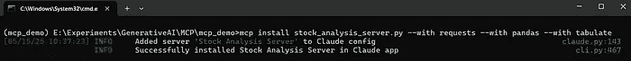

集成后，重新启动 Claude for Desktop 以启用新的 MCP 服务器以进行股票分析相关查询。

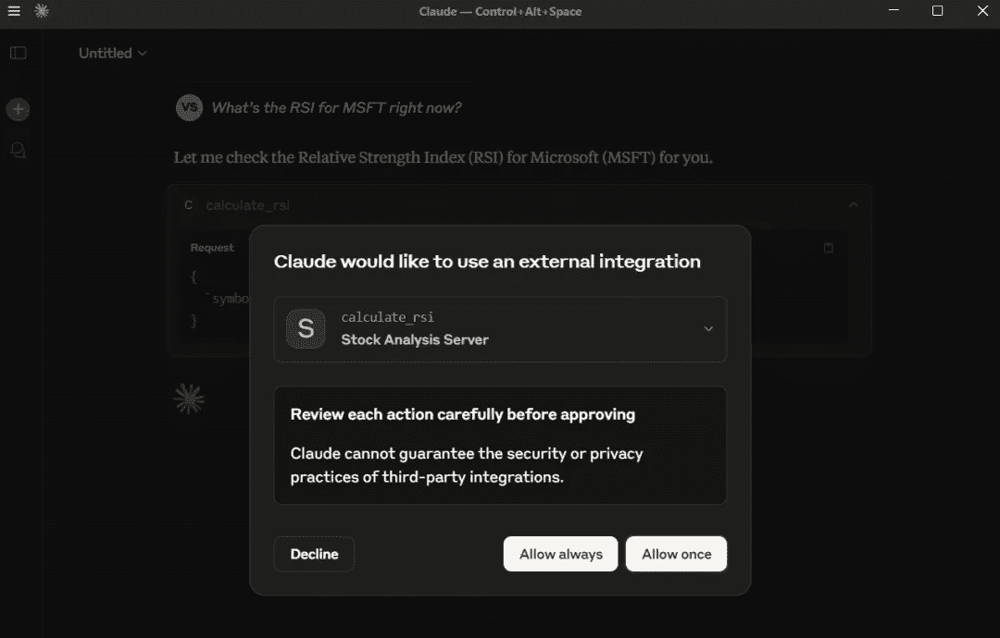

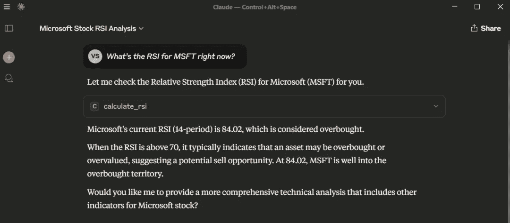

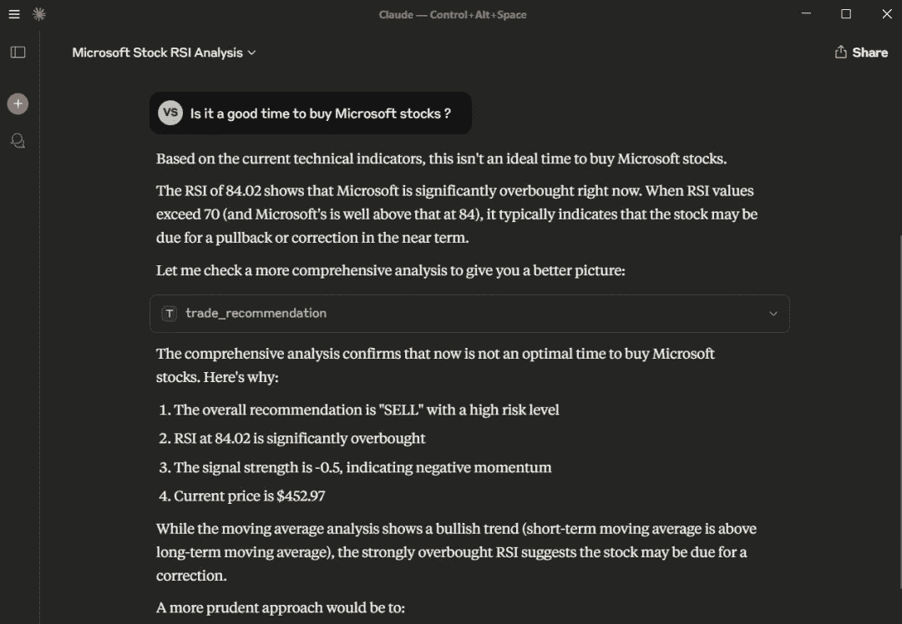
