# 本地数据助手! 用MCP+魔搭API-Inference 搭建

> 来源：[https://v11enp9ok1h.feishu.cn/docx/Nrghd36YRosz4yx8TWRcFAKjnDe](https://v11enp9ok1h.feishu.cn/docx/Nrghd36YRosz4yx8TWRcFAKjnDe)

### 00.引言

还在为大模型开发的复杂技术栈、框架不兼容和工具调用问题头疼吗？MCP（Model Context Protocol servers）来拯救你了！它用统一的技术栈、兼容主流框架和简化工具调用的方式，让大模型开发变得简单高效。

本文将带你学习一下MCP是什么，以及如何用MCP打造一个数据助手，用自然语言与数据库交互。

### 01.MCP是什么

MCP，全称是“模型上下文协议”（Model Context Protocol），是Anthropic开源的一个标准协议。打个比方，它就像是AI世界的“USB-C”接口。你知道USB-C吧？一根线就能连接手机、电脑、充电器，超级方便。MCP的作用也差不多，它让AI模型（比如Claude）可以轻松地跟外部的数据源和工具连接起来，比如数据库、文件系统、API等等。 MCP 帮助您在大型语言模型（LLMs）的基础上构建智能代理和复杂的工作流程。大型语言模型通常需要与数据和工具进行集成，而 MCP 提供了以下功能：

+   一个不断扩展的预构建集成列表，您的 LLM 可以直接接入使用

+   基于标准的模型上下文协议，可以方便的切换不同的LLM

+   数据更加安全

#### MCP的核心架构

这张图展示了MCP的核心架构：host，client和server是独立的。host可以是客户端或者APP，client建立起跟server的连接，而server实现对data、resource的封装，可以看成工具调用。

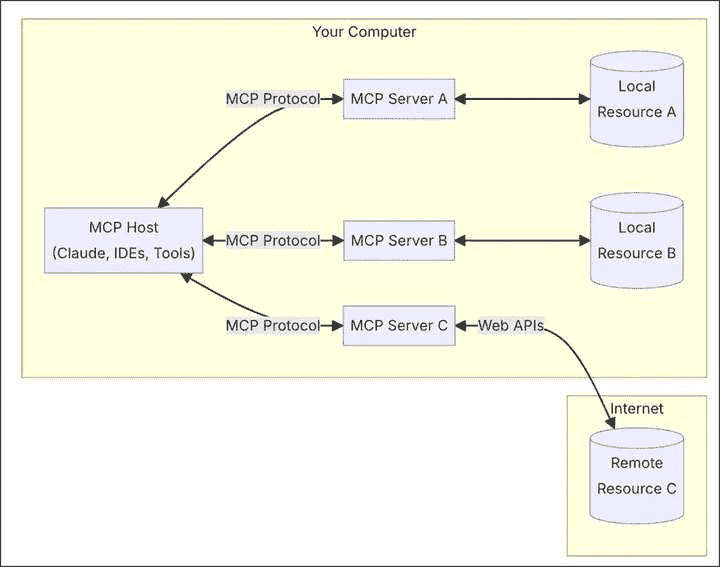

MCP Hosts: 例如 Claude Desktop、集成开发环境（IDE）或希望通过 MCP 访问数据的 AI 工具等程序

MCP Clients: 协议客户端，负责和大模型进行输入输出交互

MCP Server: 协议服务端，负责和外部服务进行交互，暴露外部服务的接口，并且和客户端进行通信

Local Data Resource: 本地的文件，数据等

Remote Resource: 远程的服务，可以通过Server连接

#### MCP在数据开发上的优势

做过数据开发或者数据应用的同学都肯定被一堆问题困扰过，特别的是数据和模型的部署问题，数据在本地，模型在哪里？应用在哪里？很多时候我们的数据因为安全问题无法上云，只能在本地或者私有环境中，但模型很多时候在云上，而且我们还需要准备环境部署应用层代码。

而现在，MCP可以帮助你解决这个困扰。通过几个问题，我们来对比一下使用或者不使用MCP的情况下数据助手的开发和部署方案。

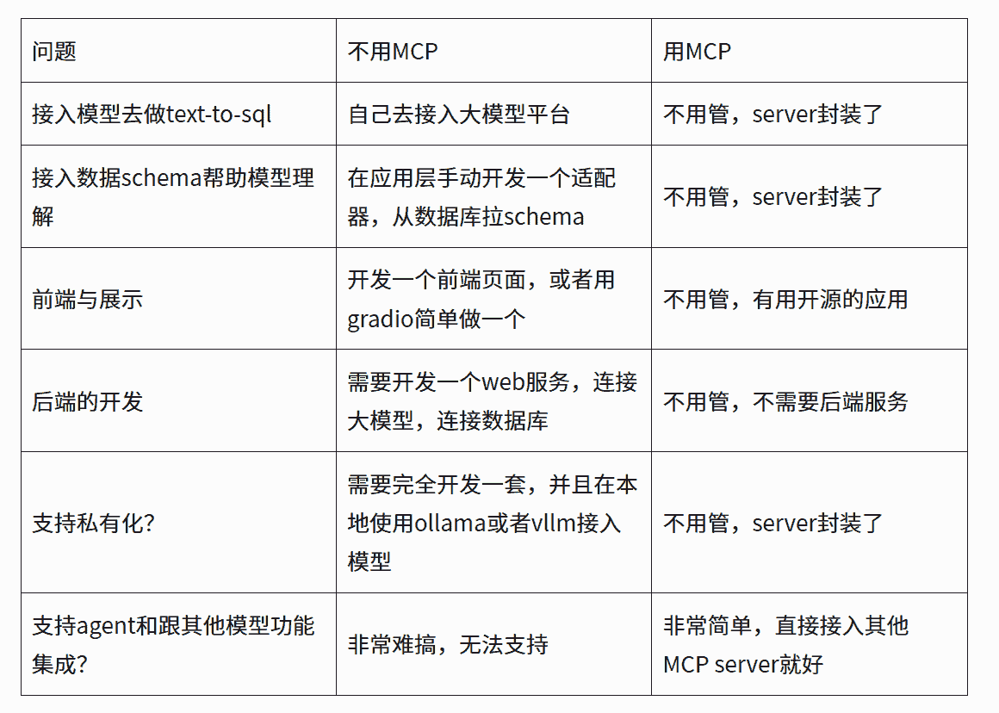

### 2.让我们构建一个数据集助手吧

我们在本地机器上构建数据助手，调用云上的模型，处理本地机器的数据。

本地开发环境：

-Macbook M3 Pro

-MySQL 5.8 （需要在本地有个数据库，如果没有的话可以提前装上mysql并构建一个虚拟的数据库）

#### 准备一个MCP数据服务

我们需要一个MCP服务把数据库接入进来，现在有非常多的MCP server都可以帮我连接数据库，比如社区在维护的MCP server[1]、MCP server的平台（Smithery.AI[2]、MCP.run[3]），但基本上都只是提供了一个SQL执行接口。

为了更好的工具调用效果，选择支持自然语言接口的析言MCP服务（Xiyan-mcp-server[4]），可以用自然语言访问数据库，并从数据库获得答案，是当前Test-to-SQL公开基准上的SOTA。

#### step1: 如何安装和启动析言MCP数据服务

+   安装xiyan-mcp-server

在终端上运行以下命令

```
pip install xiyan-mcp-server
```

+   配置模型和数据库

需要将两类配置信息写入配置文件config.yml，模型配置（LLM ）和数据库配置（Database）。

模型配置：魔搭上部署了XiYanSQL-QwenCoder-32B——xiyan_mcp_server官方提供的专属模型——的推理服务，在该模型页面[5]（右侧的推理API- Inference部分），可找到配置信息（name、key、url）。

数据库配置：默认本地有mysql数据库，数据库的配置信息包括：本地数据库host、port、username、password和database名字。

**整体的配置如下：**

```
model:
  name: &quot;XGenerationLab/XiYanSQL-QwenCoder-32B-2412&quot;
  key: &quot;xxxx&quot;   # key可从https://www.modelscope.cn/my/myaccesstoken 页面获取
  url: &quot;https://api-inference.modelscope.cn/v1/&quot;

database:
  host: &quot;localhost&quot;
  port: 3306
  user: &quot;root&quot;
  password: &quot;123456&quot;
  database: &quot;mydb&quot;
```

将这个配置文件放在本地（假设为/path/to/config.yml）

step2: 如何使用mcp inspector调试服务

选择mcp inspector[6]作为调试器

+   **在终端安装node.js**

```
brew install node
```

+   **用终端启动inspector**

```
npx @modelcontextprotocol/inspector -e YML= /path/to/config.yml python -m xiyan_mcp_server
```

这个inspector会直接在本地拉起一个web服务供调试用，地址在http://localhost:5173

打开inspector web服务，点击connect，绿灯亮起表示已连接

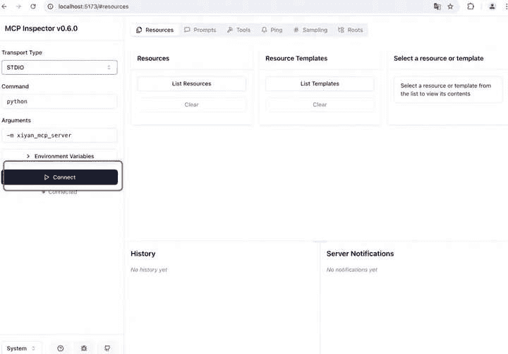

+   切换到tools页面，点击list tools会跳出来文本到sql的工具

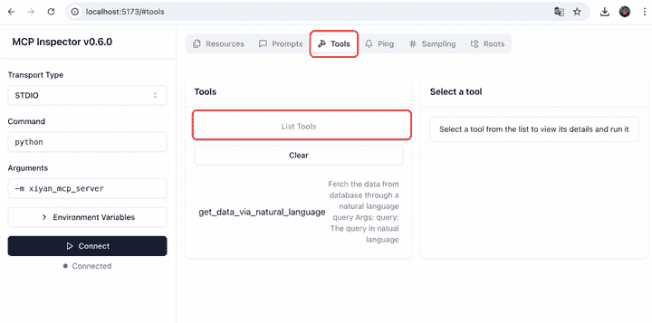

点击get_data_via_natural_language工具，用自然语言取个数据看看

输入问题“查询年龄16岁以上的邮箱”，点击“run tool”

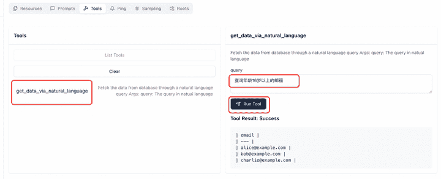

输出是个markdown格式的数据

```
| email |
| --- |
| alice@example.com |
| bob@example.com |
| charlie@example.com |
```

#### 准备一个客户端

为了更方便交互，我们找一个客户端来调用后台的数据服务。目前有非常多支持MCP的客户端，比如开源的MCP的client[7]、闭源的claude desktop等等。这里我们选用的是goose，这是一个开源的支持MCP的client，原生支持MacOS。

step1: 如何在本地安装配置goose

goose[8]下载与安装

下载地址：

https://block.github.io/goose/docs/quickstart/

下载后根据提示一步步安装即可。

step2: 在goose后台配置LLM模型

为了能用起来chat，需要找一个大语言模型API。我们选择用通义千问2.5-72B-Instruct[9]，魔搭社区上提供了兼容OpenAI接口的推理API，只需要在后台配置endpoint就好。

在标签栏点击Goose- setting进入到设置页

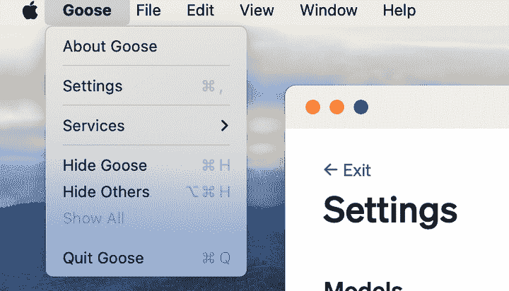

+   新增OpenAI的模型：Models——Browse——AddModel

这里我们选用通义千问2.5-72B的模型[9]，模型名字填Qwen/Qwen2.5-72B-Instruct即可。

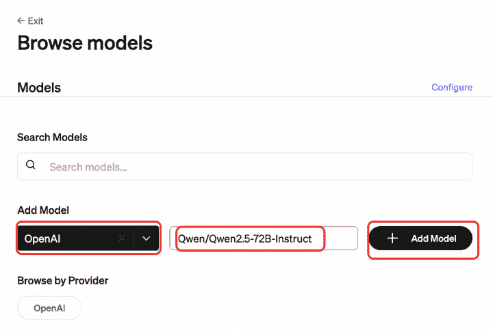

+   配置模型endpoint和key: Models——Browse——Configure——OpenAI——“+”号

第一栏：Key从https://www.modelscope.cn/my/myaccesstoken 页面获取。

第二栏：通义千问2.5-72B的模型直接填“https://api-inference.modelscope.cn/” 。

第三栏：用默认的即可。

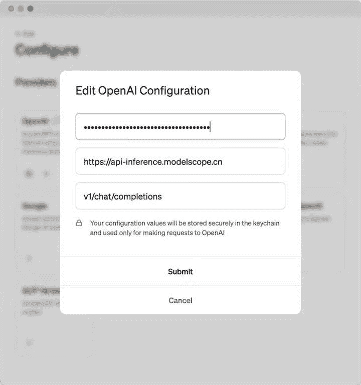

step3: 添加xiyan_mcp_server拓展

+   点击Extensions——Add custon extension

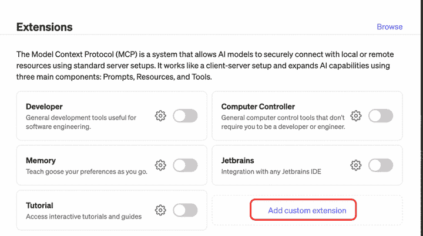

+   在拓展参数上填入启动命令，ID、Name和Description的内容自定义即可。

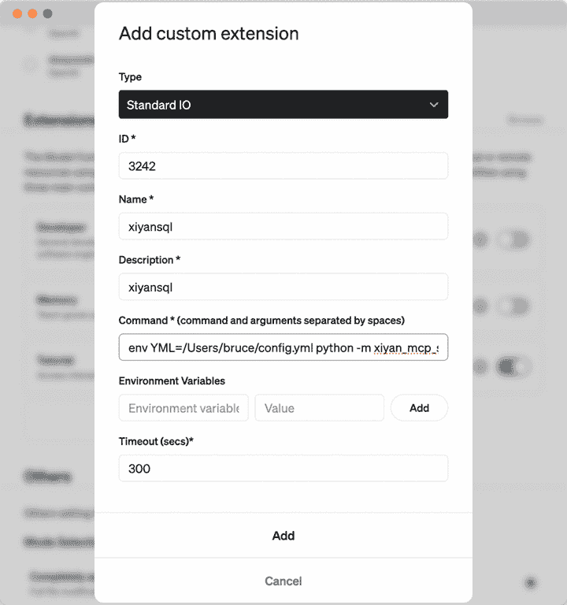

#### step4: 开启新的会话测试

回到goose主页面，新开一个会话测试，比如在会话栏输入“查询年龄16岁以上的邮箱”

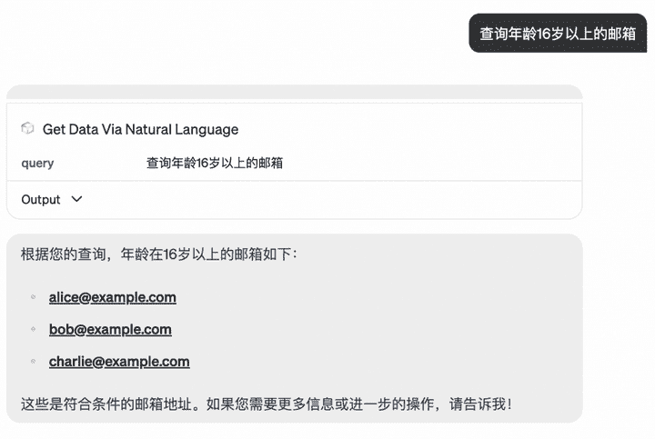

### 03.用新建的数据助手处理真实的数据库

我从云端拷贝了一份真正的数据库到本地，测试了更多问题，具体请看图。

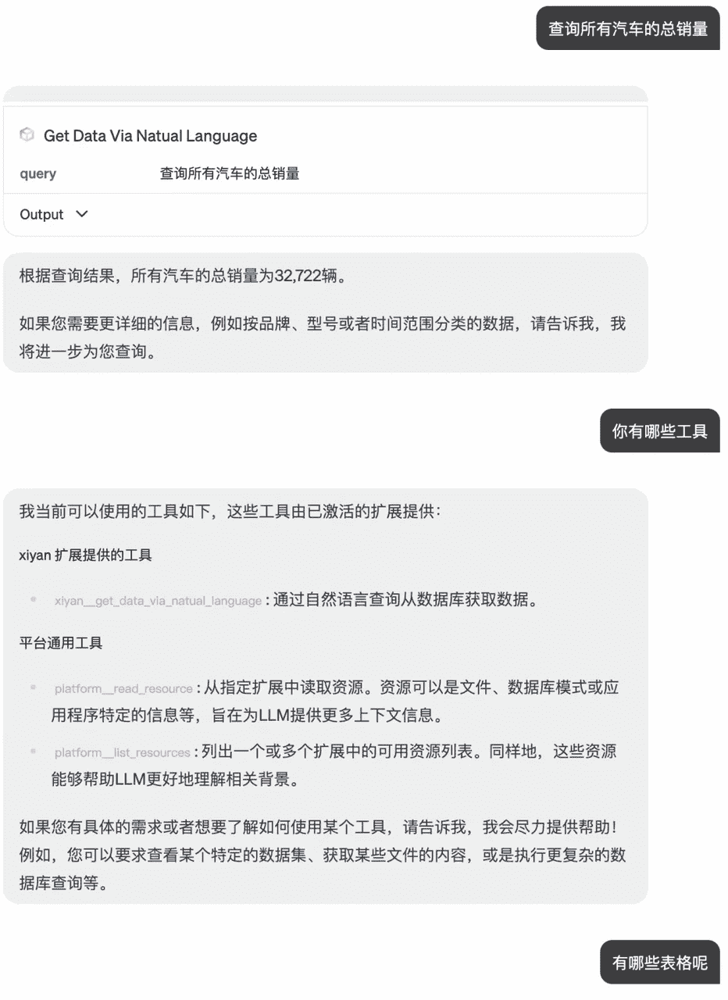

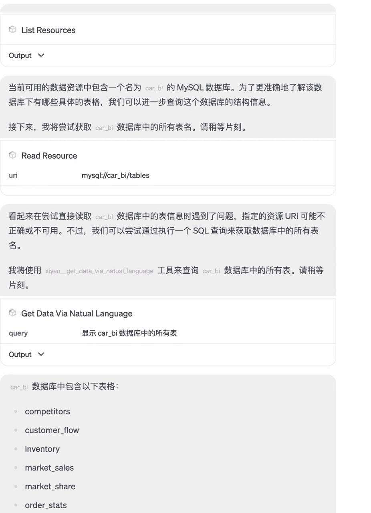

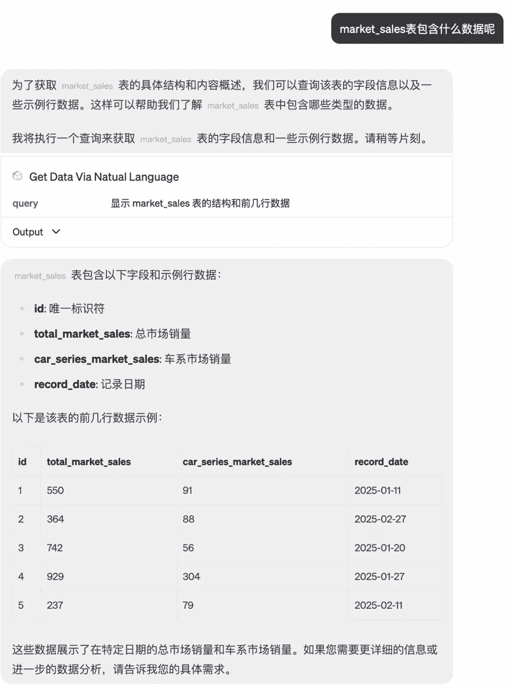

依靠MCP的强大框架和各种开源工具，我们实现了没写一行代码就轻松搭建了一个完善的数据助手 ，可以用自然语言从数据库取数。未来甚至可以接入更多MCP，做更多更全面更有深度的数据分析，简直太棒啦！