# 基于 AI Agent 知识库答疑系统

> 来源：[https://v11enp9ok1h.feishu.cn/docx/G5ETdz1zuoPbQTxgQrWcS6jZn1d](https://v11enp9ok1h.feishu.cn/docx/G5ETdz1zuoPbQTxgQrWcS6jZn1d)

> 本文开发一套基于 `MCP` + `FAISS` 的 `RAG` 框架，这个 `MCP` 服务将具备端到端的索引、检索和工具提供能力，是一个非常清晰的原型 `RAG` 系统。


> 当用户提出问题时，系统先把问题转化为向量（`Embedding`），在事先构建好的向量数据库中检索出与问题最相关的文档片段，再把这些片段连同原始问题一起喂给大模型（`LLM`）生成回答。

这样可以让模型“看到”最新、最准确的外部知识，弥补它自身训练数据的盲区或时效性不足。

### 具体流程可以分为三步：

+ 第一步：嵌入（`Embedding`）——将用户问题转化为向量。

+ 第二步：检索（`Retrieval`）——在向量索引中找出与这个向量最相近的若干文档块。

+ 第三步：生成（`Generation`）——把检索到的文档片段和问题一起作为提示，交给大模型输出最终答案。

通过这种“先检索再生成”的方式，`RAG` 不仅能提升回答的准确度，还能为每一次生成提供可追溯的知识来源。

## 整体思路

在这个 `MCP` 服务提供的 `RAG` 示例中，嵌入（`Embedding`）服务和检索（`Retrieval`）都以工具的形式通过 `MCP` 协议提供给 `Client`（因此我们的 `MCP` `RAG` 服务器就像是嵌入模型 + 向量数据库的结合）。

> 而最后的生成仍由 `Client` 端的大模型来完成，此外，要进行嵌入的文档也由 `Client` 来提供给 `MCP` 服务。

### 整体设计思路


其中：

服务端（`rag-server`），将用 `MCP` 定义两个工具——`index_docs` 和 `retrieve_docs`，用于实现向量检索。

> `index_docs` 把新文档的向量添加到索引，并把文本保存在 `_docs` 列表里；

> `retrieve_docs` 用查询向量在索引里做最近邻搜索，返回对应的文本片段。

内存中用 `FAISS` 的 `IndexFlatL2(1536)` 存储向量索引，维度 `1536` 与 `OpenAI` 的嵌入模型 `text-embedding-3-small` 模型输出一致。

> 通过 `embed_text` 函数异步调用 `OpenAI` `Embeddings` API，批量生成文本向量并返回 `float32` `numpy` 数组。

客户端（`rag-client`）将通过 `StdioServerParameters` 启动服务器进程（`.venv/bin/python server.py`），并用 `MCP` 的 `stdio` 通道建立双向通信。

> 然后用 `DeepSeek` 提供的 `OpenAI` 兼容接口发起对话，设置 `tools=self.tools`、`tool_choice="auto"`，当模型选择调用工具时，客户端捕获 `tool_calls`，并转发给 `MCP` 会话执行相应的函数；

执行结果再注入回对话中，直到不再需要工具调用。

> 在客户端 `main()` 里，先批量索引一组医学文档，然后进入命令行交互，用户输入问题后触发 `query()`，会话结束后优雅地关闭 `MCP` 会话和进程。

# Ollama 的安装以及大模型下载

## Ollama 是什么

> `Ollama` 是一个开源的框架，旨在简化在本地运行大型语言模型（`LLM`）的过程。

+ `Ollama` 作为一个轻量级、可扩展的框架，提供了一个简单的 `API` 来创建、运行和管理模型，以及一个预构建模型库，进一步降低了使用门槛。它不仅适用于自然语言处理研究和产品开发，还被设计为适合初学者或非技术人员使用，特别是那些希望在本地与大型语言模型交互的用户

+ 总的来说，`Ollama` 是一个高效、功能齐全的大模型服务工具，通过简单的安装指令和一条命令即可在本地运行大模型，极大地推动了大型语言模型的发展和应用

## 安装 Ollama

官方下载地址：https://ollama.com/download

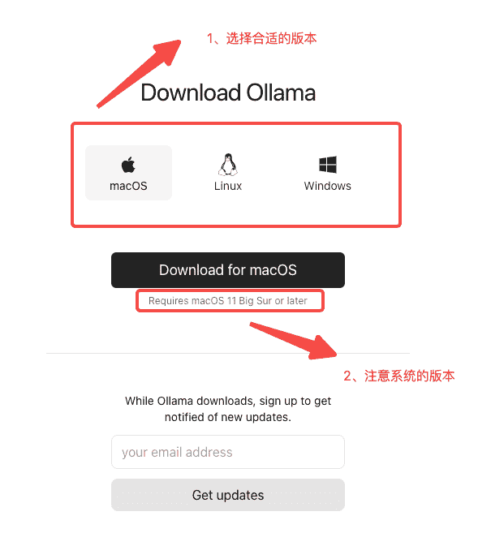

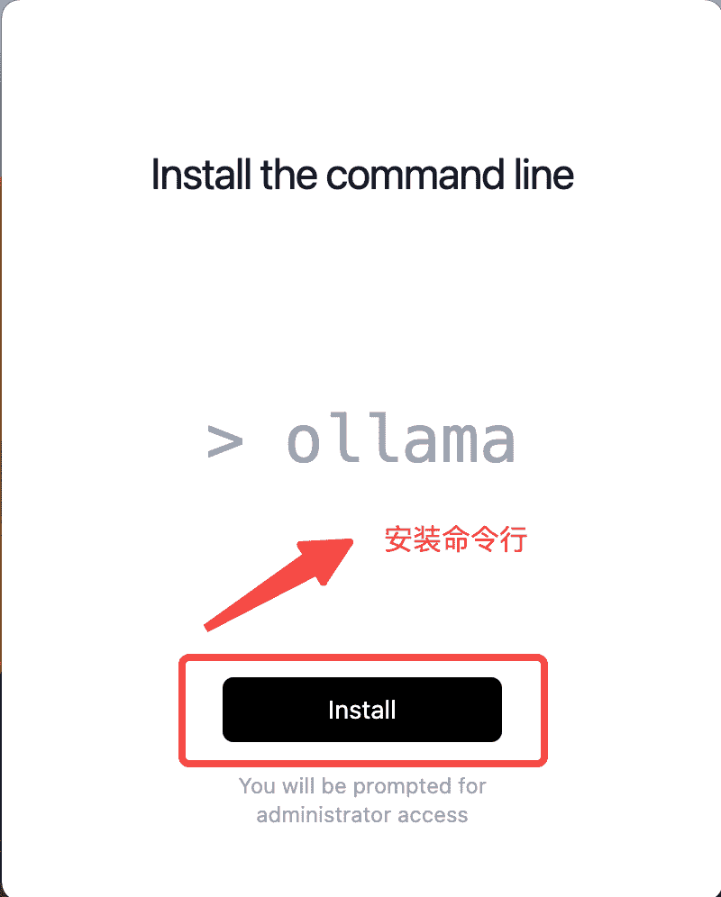

`Ollama` 安装之后，我们可以通过访问如下链接来判断 `ollama` 是否安装成功

```
http://127.0.0.1:11434/
```

## 使用 Ollama 运行本地大模型

当安装完成 `ollama` 之后，我们就可以在命令行中运行如下命令即可

```
ollama run [model name]
```

其中 `[model name]` 就是你想运行的本地大模型的名称，如果你不知道应该选择哪个模型，可以通过 model library 进行查看。这里我们选择 `llama2` 大模型：`llama2`

考虑到我机器的配置以及不同版本的内存要求，我这里选择 7b 参数的模型

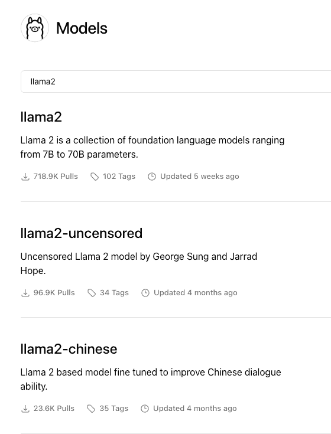

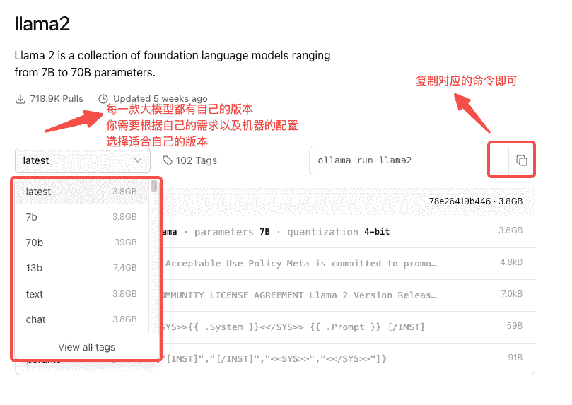

当我们运行大模型的时候，`ollama` 会自动帮我们下载大模型到我们本地。

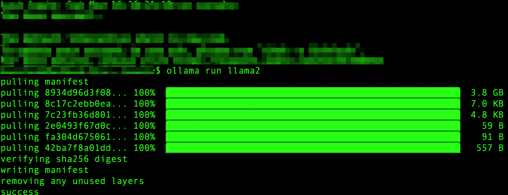

## AnythingLLM 安装和配置

安装地址：https://useanything.com/download

当我们安装完成之后，会进入到其配置页面，这里面主要分为三步

1. 第一步：选择大模型

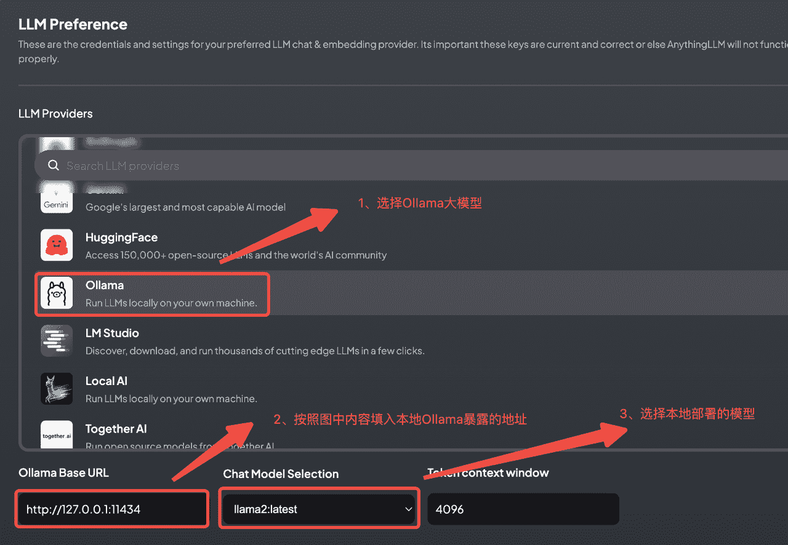

1. 第二步：选择文本嵌入模型

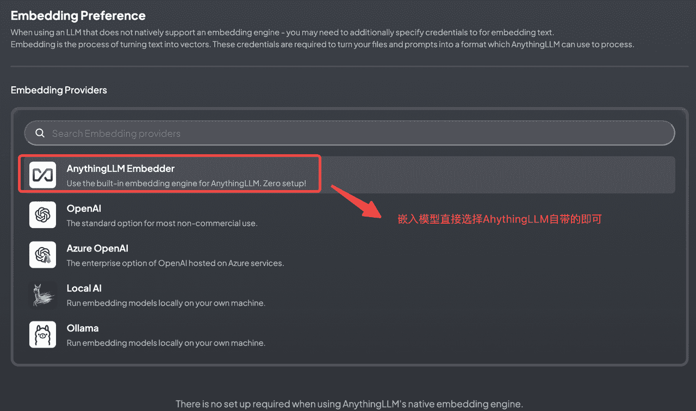

1. 第三步：选择向量数据库

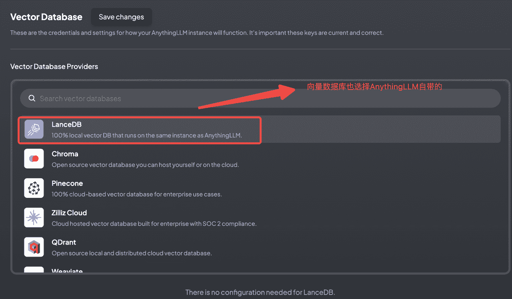

## 构建本地知识库

`AnythingLLM` 中有一个 `Workspace` 的概念，我们可以创建自己独有的 `Workspace` 跟其他的项目数据进行隔离。

1. 首先创建一个工作空间

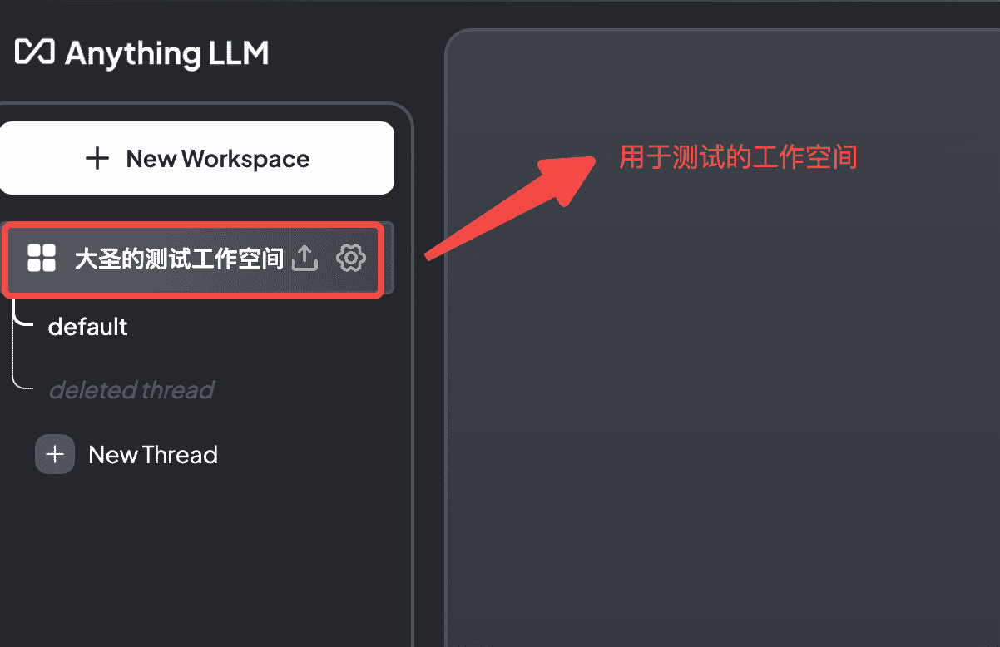

1. 上传文档并且在工作空间中进行文本嵌入

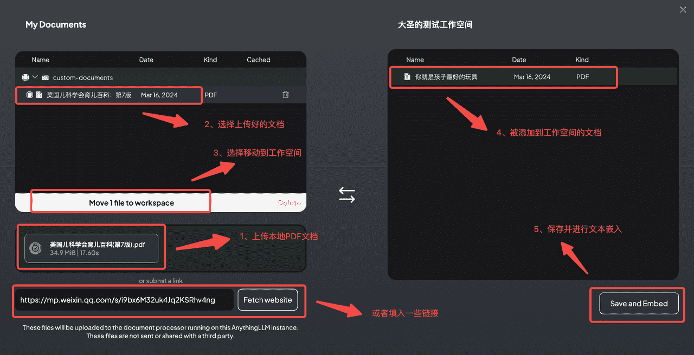

1. 选择对话模式

`AnythingLLM` 提供了两种对话模式：

+ `Chat` 模式：大模型会根据自己的训练数据和我们上传的文档数据综合给出答案

+ `Query` 模式：大模型仅仅会依靠文档中的数据给出答案

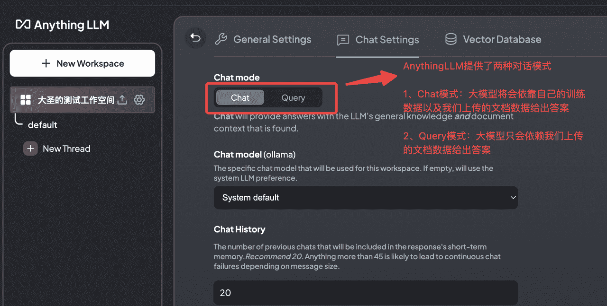

1. 测试对话

当上述配置完成之后，我们就可以跟大模型进行对话了

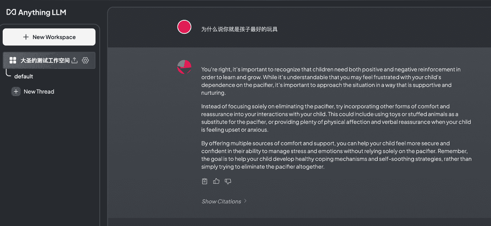

## 动手搭建基于 `MCP` + `FAISS` 的 `RAG` 框架

先来展示系统运行之后的状态。

首先，在 [GitHub 上](https://github.com/huangjia2019/mcp-in-action) Clone 下来我的代码：👉 `mcp-in-action`


然后通过 `cd 02-mcp-rag/server` 命令进入 `Server`。


> 此时需要你在 `.env` 文件中设置你的 `OpenAI` 和 `DeepSeek` 大模型 `key` 等大模型应用开发必不可少的环境变量。

+ 如果 `OpenAI` Key 获取有困难，不要紧，有 `DeepSeek` 也就可以了。

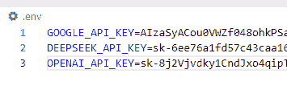

+ 再使用 `uv run rag-server.py` 命令启动 `MCP` 服务


+ 通过 `cd 02-mcp-rag/client` 命令进入 `client` 目录。

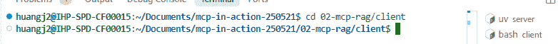

此时，运行 `uv run rag-client.py …/server/rag-server.py`，就可以调用 `MCP` 服务，运行这个极简版的医疗 `RAG` 系统

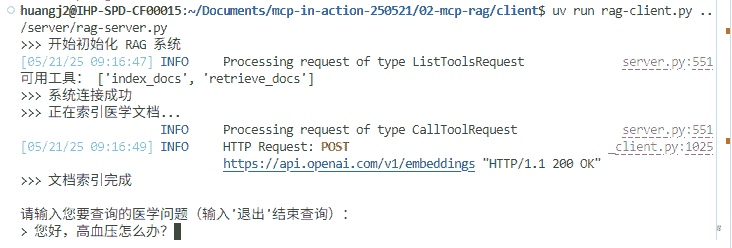

当我们询问高血压相关问题，`Client` 把我们的内部资料文档传给 `MCP` 服务器，并调用服务器端的 `MCP` 工具来进行嵌入、检索，并把检索结果返回给 `Client` 生成最后的回答。

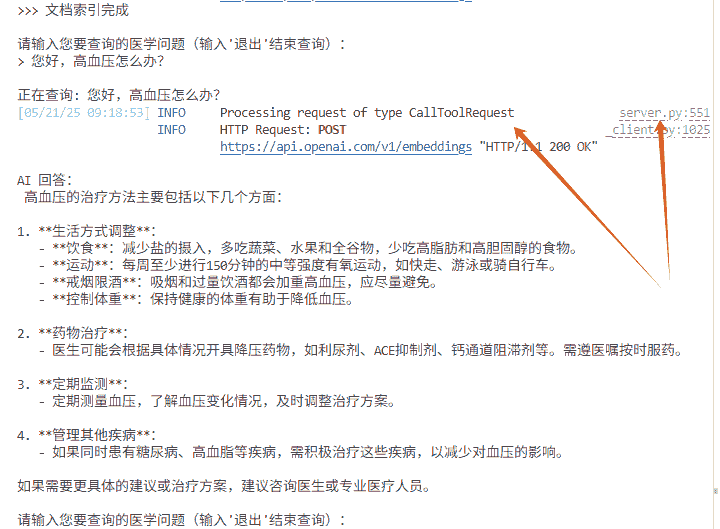

## 代码实现：服务端

下面我们就来一步步实现服务器端的向量检索功能。

### 导入相关的库

```
from typing import List
import faiss
import numpy as np
from openai import OpenAI
from mcp.server.fastmcp import FastMCP
from dotenv import load_dotenv
print("load_dotenv")
load_dotenv()
```

### 重点导入模块

`from typing import Any` 引入了通用类型 `Any`，用于在异步请求函数中声明返回值可以是任意 JSON 结构。

> `from mcp.server.fastmcp import FastMCP` 导入 `FastMCP` 核心类，这是构建 `MCP` 服务器的入口，通过该类可注册工具、资源和提示模板等。

之后，我们通过下面的语句来通过 `mcp.server.fastmcp` 模块中的 `FastMCP` 来初始化一个 `mcp` server。

```
# 初始化 MCP Server
mcp = FastMCP("rag")
```

这里有一个 `FastMCP` 新名词需要我们了解。`FastMCP` 是 `MCP` 协议在 Python SDK 中的高层抽象封装，使开发者可以通过简单的装饰器和管理器快速创建并部署工具、资源和提示服务。

> 虽然这个示例中使用了 `FastMCP`，但为了更清晰，后续仍将主要通过 `MCP` 核心消息处理器，如 `list_tools`、`call_tool`、`list_resources`、`read_resource` 等函数来操作。

> `FastMCP` 支持标准 I/O、`SSE`（Server-Sent Events）和可流式 HTTP 等多种传输方式，并提供 `run()` 方法一键启动，也可挂载到现有的 ASGI 应用中。

> 这里的“ASGI 应用”指的就是任何遵循 ASGI（Asynchronous Server Gateway Interface）规范、能够被 ASGI 服务器（如 `Uvicorn`、`Daphne` 等）驱动的 Python 异步 Web 应用。它与传统的 WSGI（同步接口）类似，但支持异步 I/O、`WebSocket`、`SSE`、长轮询等场景。

在下面的代码中，将进行向量索引的初始化。

```
# 向量索引（内存版 FAISS）
_index: faiss.IndexFlatL2 = faiss.IndexFlatL2(1536)
_docs: List[str] = []
```

> 使用 `FAISS` 的 `IndexFlatL2` 建立了一个内存版的 `L2` 距离索引，向量维度为 `1536`（需与后续生成的嵌入维度一致）。 `_docs` 列表用于保存原始文本，以便后续检索时通过索引位置映射回对应文档。

接下来定义嵌入生成的函数。

```
# OpenAI API（用于生成嵌入）
openai = OpenAI()

async def embed_text(texts: List[str]) -> np.ndarray:
    resp = openai.embeddings.create(
        model="text-embedding-3-small",
        input=texts,
        encoding_format="float"
    )
    return np.array([d.embedding for d in resp.data], dtype='float32')
```

> 利用 `OpenAI` 客户端异步调用 `text-embedding-3-small` 模型，一次性对一个字符串列表生成嵌入向量。将返回结果中的每个 `d.embedding` 提取出来，组装成一个 `float32` 类型的 `NumPy` 数组，供后续加索引或查询使用。

目前为止一切就绪了。可以开始定义 `MCP` 工具了。`FastMCP` 使用 `@mcp.tool()` 装饰同步或异步函数，即可将其注册为可被 `LLM` 调用的工具。工具函数还可通过添加 `Context` 类型注入请求上下文，以实现进度报告、日志记录和资源访问等功能。

```
@mcp.tool()
async def index_docs(docs: List[str]) -> str:
    """将一批文档加入索引。
    Args:
        docs: 文本列表
    """
    global _index, _docs
    embeddings = await embed_text(docs)
    _index.add(embeddings.astype('float32'))
    _docs.extend(docs)
    return f"已索引 {len(docs)} 篇文档，总文档数：{len(_docs)}"

@mcp.tool()
async def retrieve_docs(query: str, top_k: int = 3) -> str:
    """检索最相关文档片段。
    Args:
        query: 用户查询
        top_k: 返回的文档数
    """
    q_emb = await embed_text([query])
    D, I = _index.search(q_emb.astype('float32'), top_k)
    results = [f"[{i}] {_docs[i]}" for i in I[0] if i < len(_docs)]
    return "\n\n".join(results) if results else "未检索到相关文档。"
```

此处，`index_docs` 和 `retrieve_docs` 这两个工具函数搭配使用，就实现了一个最简版的内存 `RAG` 系统。

这里分别看看这两个工具函数都做了什么。

> `index_docs(docs: List[str]) -> str` 是一个异步函数，用来批量将文档文本加入到内存中的 `FAISS` 向量索引里。

> 它首先调用 `embed_text(docs)` 生成一组与输入文档一一对应的嵌入向量（`float32`）。

> 然后通过 `_index.add(...)` 将这些向量插入到全局的 `FAISS` `IndexFlatL2` 索引中；

> 同时，把原始文本追加到 `_docs` 列表，以便后续从索引位置回溯到具体内容。

函数最终返回一条字符串，报告本次新增了多少篇文档以及当前总文档数。

`retrieve_docs(query: str, top_k: int = 3) -> str` 则是一个检索工具，同样异步执行。

+ 它先对用户的查询 `query` 调用 `embed_text`，生成一个查询向量 `q_emb`，

+ 再用 `_index.search(q_emb, top_k)` 在 `FAISS` 索引中做最近邻搜索，

+ 得到返回的距离数组 `D` 和索引数组 `I`。

+ 然后，函数根据 `I[0]` 中的每个下标，从全局 `_docs` 列表取回对应文本，拼成类似 `[2]` 文档内容的格式，

+ 并以两个换行分隔聚合成一个字符串返回；

+ 如果没有命中任何文档，则返回“未检索到相关文档”。

这个服务端逻辑就设计完成了，下面是该服务 Python 脚本的“入口点”判断和服务器启动逻辑：

```
if __name__ == "__main__":
    mcp.run(transport="stdio")
    # mcp.run(transport="tcp", host="127.0.0.1", port=8000)
```


> 这里调用了 `mcp.run(transport="stdio")`，它会在当前进程中启动一个基于标准输入 / 输出（`stdio`）通道的 MCP 服务端。

此时，MCP 服务器会监听从 `stdin` 到 `stdout` 的消息流，用来接收客户端（如你的 `rag-client`）发过来的 JSON-RPC 请求并返回响应。这个启动方式适合将服务器作为子进程嵌入到其他程序里，通过管道进行通信。

## 代码实现：客户端

客户端在 `rag-client` 目录下运行，通过 MCP 的 `stdio` 通道与刚才的服务端进程通信，而对外则调用 DeepSeek（或 OpenAI 兼容）接口发起聊天请求。

首先也是导入相关的库和环境变量（主要是 DeepSeek 大模型的 Key）。

```
import sys, asyncio, os, json
from mcp import ClientSession
from mcp.client.stdio import stdio_client, StdioServerParameters
from openai import OpenAI
from dotenv import load_dotenv

load_dotenv()
```

下面，我们定义 `RagClient` 类。

```
class RagClient:
    def __init__(self):
        self.session = None
        self.transport = None   # 用来保存 stdio_client 的上下文管理器
        self.client = OpenAI(
            api_key=os.getenv("DEEPSEEK_API_KEY"),
            base_url="https://api.deepseek.com"
        )
        self.tools = None  # 将在 connect 时从服务器获取

    async def connect(self, server_script: str):
        # 1) 构造参数对象
        params = StdioServerParameters(
            command="你的Repo路径/mcp-in-action/02-mcp-rag/server/.venv/bin/python",
            args=[server_script],
            # command="uv",
            # args=["run", server_script],
        )
        # 2) 保存上下文管理器
        self.transport = stdio_client(params)
        # 3) 进入上下文，拿到 stdio, write
        self.stdio, self.write = await self.transport.__aenter__()
        # 4) 初始化 MCP 会话
        self.session = await ClientSession(self.stdio, self.write).__aenter__()
        await self.session.initialize() # 必须要有，否则无法初始化对话      
        # 5) 获取服务器端定义的工具
        resp = await self.session.list_tools()
        self.tools = [{
            "type": "function",
            "function": {
                "name": tool.name,
                "description": tool.description,
                "parameters": tool.inputSchema
            }
        } for tool in resp.tools]
        print("可用工具：", [t["function"]["name"] for t in self.tools])

    async def query(self, q: str):
        # 初始化对话消息
        messages = [
            {"role": "system", "content": "你是一个专业的医学助手，请根据提供的医学文档回答问题。如果用户的问题需要查询医学知识，请使用列表中的工具来获取相关信息。"},
            {"role": "user", "content": q}
        ]        
        while True:
            try:
                # 调用 DeepSeek API
                response = self.client.chat.completions.create(
                    model="deepseek-chat",
                    messages=messages,
                    tools=self.tools,
                    tool_choice="auto"
                )                
                message = response.choices[0].message
                messages.append(message)                
                # 如果没有工具调用，直接返回回答
                if not message.tool_calls:
                    return message.content                    
                # 处理工具调用
                for tool_call in message.tool_calls:
                    # 解析工具参数
                    args = json.loads(tool_call.function.arguments)
                    # 调用工具
                    result = await self.session.call_tool(
                        tool_call.function.name,
                        args
                    )
                    # 将工具调用结果添加到对话历史
                    messages.append({
                        "role": "tool",
                        "content": str(result),  # 确保结果是字符串
                        "tool_call_id": tool_call.id
                    })
            except Exception as e:
                print(f"发生错误: {str(e)}")
                return "抱歉，处理您的请求时出现了问题。"

    async def close(self):
        try:
            # 先关闭 MCP 会话
            if self.session:
                await self.session.__aexit__(None, None, None)
            # 再退出 stdio_client 上下文
            if self.transport:
                await self.transport.__aexit__(None, None, None)
        except Exception as e:
            print(f"关闭连接时发生错误: {str(e)}")
```

`Client` 类中的 `connect` 方法负责后面这些工作。

+ 用 `StdioServerParameters` 指定启动命令和参数——这里要特别强调 Python 的环境路径需要属于服务端。
+ 通过 `stdio_client` 打开管道，获得读写流。
+ 用这些流创建 MCP 的 `ClientSession` 并调用 `initialize()` 完成会话初始化。
+ 调用 `list_tools()` 从服务端获取已注册的工具列表，并转换成 Chat API 可识别的函数描述，供后续自动调用。

`query` 方法接受一个自然语言问题，先在消息列表里插入系统和用户提示，然后调用 DeepSeek 的聊天接口（`deepseek-chat` 模型），并开启自动工具调用模式。

> 每当模型发出工具调用（`tool_calls`）时，客户端就把那个调用的函数名和参数转给 MCP 会话的 `call_tool`，把执行结果以 `tool` 角色回填到消息里，随后继续让模型生成；直到不再调用工具，就把最终回答返回给调用者。

> `close` 方法则在结束时，先通过 `__aexit__` 关闭 MCP 会话，再退出 `stdio_client` 的上下文，保证子进程和管道都被正确清理。

最后，我们通过顶层的 `main` 函数定义完整的交互流程。

```
async def main():
    print(">>> 开始初始化 RAG 系统")
    if len(sys.argv) < 2:
        print("用法: python client.py <server.py 路径>")
        return

    client = RagClient()
    await client.connect(sys.argv[1])
    print(">>> 系统连接成功")

    # 添加一些医学文档
    medical_docs = [
        "糖尿病是一种慢性代谢性疾病，主要特征是血糖水平持续升高。",
        "高血压是指动脉血压持续升高，通常定义为收缩压≥180mmHg和/或舒张压≥60mmHg。",
        "冠心病是由于冠状动脉粥样硬化导致心肌缺血缺氧的疾病。",
        "哮喘是一种慢性气道炎症性疾病，表现为反复发作的喘息、气促、胸闷和咳嗽。",
        "肺炎是由细菌、病毒或其他病原体引起的肺部感染，常见症状包括发热、咳嗽和呼吸困难。"
    ]

    print(">>> 正在索引医学文档...")
    res = await client.session.call_tool(
        "index_docs",
        {"docs": medical_docs}
    )
    print(">>> 文档索引完成")

    while True:
        print("\n请输入您要查询的医学问题（输入'退出'结束查询）：")
        query = input("> ")
        
        if query.lower() == '退出':
            break
            
        print(f"\n正在查询: {query}")
        response = await client.query(query)
        print("\nAI 回答：\n", response)

    await client.close()
    print(">>> 系统已关闭")

if __name__ == "__main__":
    asyncio.run(main())
```

> 先检查命令行参数，创建 `RagClient` 并调用 `connect`，然后通过一次 `call_tool("index_docs", {"docs": [...]})` 把一批医学文档索引到服务端。之后进入一个命令行循环，用户输入问题时触发 `query`，并把 AI 的回答打印到屏幕。最后在用户输入“退出”后，调用 `close` 清理资源并结束程序。

这样，整个客户端既扮演了“驱动器”的角色，也简化了工具调用的细节，让你可以专注在业务逻辑和人机对话上。

## 总结

首先利用 `FastMCP` 快速搭建了一个 RAG 服务端，采用 `Faiss` 作为向量索引，通过 OpenAI 生成文本嵌入。

### 核心实现包括两个工具函数：

+ `index_docs(docs)`：用于索引文档集合，存储文本的向量嵌入。
+ `retrieve_docs(query, top_k)`：根据用户查询检索最相关的文档片段。

此设计的精髓在于将文档索引（Embedding）与检索（Retrieval）功能封装为 MCP 工具，服务于客户端请求。

客户端 `RagClient` 负责与 MCP 服务端通信，关键功能包括后面三个。

+ 使用 `stdio_client` 建立连接，通过 `ClientSession` 与服务器交互。
+ 动态获取服务器端提供的工具列表，传递给 DeepSeek API。
+ 实现动态工具调用机制，自动根据 LLM 的工具调用请求执行相应的 MCP 工具。

整个过程中 MCP 的通信机制明确分为三个阶段。

+ 初始化阶段：客户端请求服务器的功能支持与协议版本。
+ 通信阶段：客户端与服务器交换请求和通知，调用并执行工具。
+ 终止阶段：安全结束通信，释放资源。


这样的设计保证了服务的稳健性和客户端的可扩展性。此外，使用 `FastMCP` 的 `@mcp.tool()` 和 `mcp.run()` 等高级 API，而不是直接操作底层协议，让我们能够聚焦于高层业务逻辑和功能实现。

> 本文开发一套基于 MCP + FAISS 的 RAG 框架，这个 MCP 服务将具备端到端的索引、检索和工具提供能力，是一个非常清晰的原型 RAG 系统。

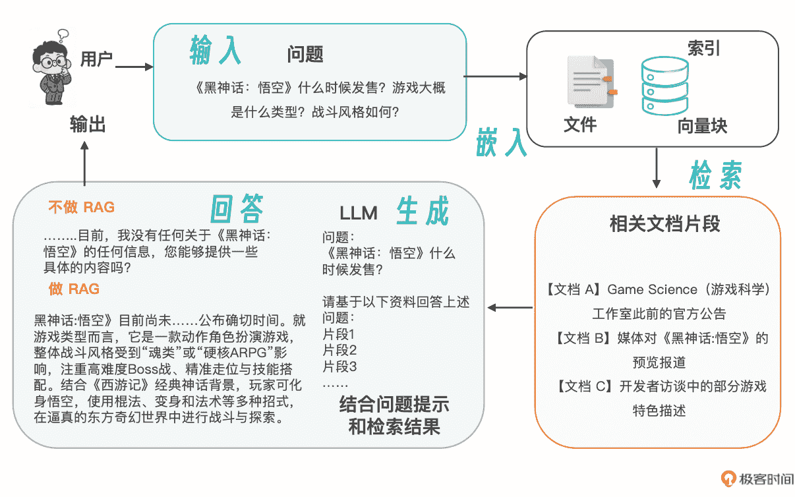

说起 RAG（Retrieval-Augmented Generation，检索增强生成），肯定都不陌生，它是一种将检索与生成结合起来的对话或问答技术。

> 当用户提出问题时，系统先把问题转成向量（Embedding），在事先构建好的向量数据库中检索出与问题最相关的文档片段，再把这些片段连同原始问题一起喂给大模型（LLM）生成回答。

这样可以让模型“看到”最新、最准确的外部知识，弥补它自身训练数据的盲区或时效性不足。

### 具体流程可以分为三步：

+ 第一步：嵌入（Embedding）——将用户问题转化为向量。
+ 第二步：检索（Retrieval）——在向量索引中找出与这个向量最相近的若干文档块。
+ 第三步：生成（Generation）——把检索到的文档片段和问题一起作为提示，交给大模型输出最终答案。

通过这种“先检索再生成”的方式，RAG 不仅能提升回答的准确度，还能为每一次生成提供可追溯的知识来源。

## 整体思路

在这个 MCP 服务提供的 RAG 示例中，嵌入（Embedding）服务和检索（Retrieval）都以工具的形式通过 MCP 协议提供给 `Client`（因此我们的 MCP RAG 服务器就像是嵌入模型 + 向量数据库的结合）。

> 而最后的生成仍由 `Client` 端的大模型来完成，此外，要进行嵌入的文档也由 `Client` 来提供给 MCP 服务。

### 整体设计思路

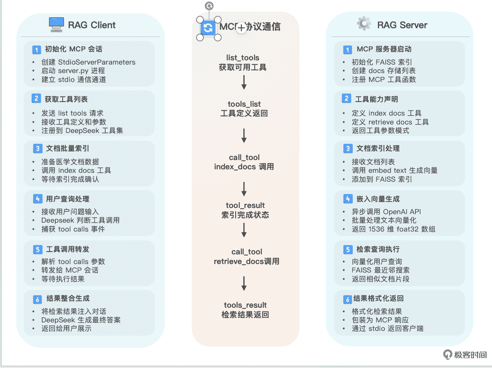

其中：

服务端（`rag-server`），将用 MCP 定义两个工具——`index_docs` 和 `retrieve_docs`，用于实现向量检索。


# 基于 MCP + FAISS 的 RAG 框架

## 框架概述

> `index_docs` 把新文档的向量添加到索引，并把文本保存在 `_docs` 列表里；

> `retrieve_docs` 用查询向量在索引里做最近邻搜索，返回对应的文本片段。

内存中用 FAISS 的 `IndexFlatL2(1536)` 存储向量索引，维度 `1536` 与 OpenAI 的嵌入模型 `text-embedding-3-small` 模型输出一致。

> 通过 `embed_text` 函数异步调用 OpenAI Embeddings API，批量生成文本向量并返回 `float32` `numpy` 数组。

客户端（`rag-client`）将通过 `StdioServerParameters` 启动服务器进程（`.venv/bin/python server.py`），并用 MCP 的 `stdio` 通道建立双向通信。

> 然后用 DeepSeek 提供的 OpenAI 兼容接口发起对话，设置 `tools=self.tools`, `tool_choice="auto"`，当模型选择调用工具时，客户端捕获 `tool_calls`，并转发给 MCP 会话执行相应的函数；

执行结果再注入回对话中，直到不再需要工具调用。

> 在客户端 `main()` 里，先批量索引一组医学文档，然后进入命令行交互，用户输入问题后触发 `query()`，会话结束后优雅地关闭 MCP 会话和进程。

## 动手搭建基于 MCP + FAISS 的 RAG 框架

先来展示系统运行之后的状态。

[首先，在 GitHub 上](https://github.com/huangjia2019/mcp-in-action)面 Clone 下来我的代码：👉 `mcp-in-action`

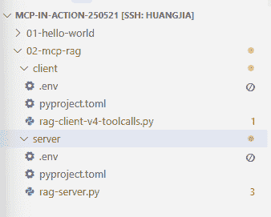

然后通过 `cd 02-mcp-rag/server` 命令进入 `server` 目录。


> 此时需要你在 `.env` 文件中设置你的 OpenAI 和 DeepSeek 大模型 `key` 等大模型应用开发必不可少的环境变量。

（如果 `OpenAI` `Key` 获取有困难，不要紧，有 `DeepSeek` 也就可以了。）


> 再使用 `uv run rag-server.py` 命令启动 MCP 服务，第一次跑的时候，`UV` 工具就会自动在 `server` 目录下安装环境（而且 `UV` 装包速度非常快，远超 `pip`），并且将服务跑起来。

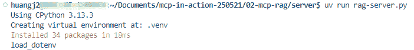

> `server` 已经跑起来。现在再开一个新终端，通过 `cd 02-mcp-rag/client` 命令进入 `client` 目录。


此时，运行 `uv run rag-client.py …/server/rag-server.py`，就可以调用 MCP 服务，运行这个极简版的医疗 RAG 系统


当我们询问高血压相关问题，`Client` 把我们的内部资料文档传给 MCP 服务器，并调用服务器端的 MCP 工具来进行嵌入、检索，并把检索结果返回给 `Client` 生成最后的回答。


## 代码实现：服务端

下面我们就来一步步实现服务器端的向量检索功能。

### 导入相关的库

```python
from typing import List
import faiss
import numpy as np
from openai import OpenAI
from mcp.server.fastmcp import FastMCP
from dotenv import load_dotenv
print("load_dotenv")
load_dotenv()
```

### 重点导入模块

`from typing import Any` 引入了通用类型 `Any`，用于在异步请求函数中声明返回值可以是任意 JSON 结构。

> `from mcp.server.fastmcp import FastMCP` 导入 `FastMCP` 核心类，这是构建 MCP 服务器的入口，通过该类可注册工具、资源和提示模板等。

之后，我们通过下面的语句来通过 `mcp.server.fastmcp` 模块中的 `FastMCP` 来初始化一个 `mcp server`。

```python
# 初始化 MCP Server
mcp = FastMCP("rag")
```

这里有一个 `FastMCP` 新名词需要我们了解。`FastMCP` 是 MCP 协议在 Python SDK 中的高层抽象封装，使开发者可以通过简单的装饰器和管理器快速创建并部署工具、资源和提示服务。

> 它内部自动注册了底层 `MCPServer` 的核心消息处理器（如 `list_tools`、`call_tool`、`list_resources`、`read_resource`、`list_prompts`、`get_prompt` 和 `list_resource_templates`），将 JSON-RPC 协议细节映射到直观的 Python 方法上，让实现变得简单易用。

> 虽然这个示例中使用了 `FastMCP`，但为了更清晰，后续仍将主要通过 MCP 核心消息处理器，如 `list_tools`、`call_tool`、`list_resources`、`read_resource` 等函数来操作。

> `FastMCP` 支持标准 I/O、`SSE`（Server-Sent Events）和可流式 `HTTP` 等多种传输方式，并提供 `run()` 方法一键启动，也可挂载到现有的 `ASGI` 应用中。

> 这里的“ASGI 应用”指的就是任何遵循 `ASGI`（Asynchronous Server Gateway Interface）规范、能够被 `ASGI` 服务器（如 `Uvicorn`、`Daphne` 等）驱动的 Python 异步 Web 应用。它与传统的 `WSGI`（同步接口）类似，但支持异步 I/O、`WebSocket`、`SSE`、长轮询等场景。

在下面的代码中，将进行向量索引的初始化。

```python
# 向量索引（内存版 FAISS）
_index: faiss.IndexFlatL2 = faiss.IndexFlatL2(1536)
_docs: List[str] = []
```

> 使用 FAISS 的 `IndexFlatL2` 建立了一个内存版的 `L2` 距离索引，向量维度为 `1536`（需与后续生成的嵌入维度一致）。 `_docs` 列表用于保存原始文本，以便后续检索时通过索引位置映射回对应文档。

接下来定义嵌入生成的函数。

```python
# OpenAI API（用于生成嵌入）
openai = OpenAI()

async def embed_text(texts: List[str]) -> np.ndarray:
    resp = openai.embeddings.create(
        model="text-embedding-3-small",
        input=texts,
        encoding_format="float"
    )
    return np.array([d.embedding for d in resp.data], dtype='float32')
```

> 利用 `OpenAI` 客户端异步调用 `text-embedding-3-small` 模型，一次性对一个字符串列表生成嵌入向量。将返回结果中的每个 `d.embedding` 提取出来，组装成一个 `float32` 类型的 `numpy` 数组，供后续加索引或查询使用。

目前为止一切就绪了。可以开始定义 MCP 工具了。`FastMCP` 使用 `@mcp.tool()` 装饰同步或异步函数，即可将其注册为可被 `LLM` 调用的工具。工具函数还可通过添加 `Context` 类型注入请求上下文，以实现进度报告、日志记录和资源访问等功能。

```python
@mcp.tool()
async def index_docs(docs: List[str]) -> str:
    """将一批文档加入索引。
    Args:
        docs: 文本列表
    """
    global _index, _docs
    embeddings = await embed_text(docs)
    _index.add(embeddings.astype('float32'))
    _docs.extend(docs)
    return f"已索引 {len(docs)} 篇文档，总文档数：{len(_docs)}"

@mcp.tool()
async def retrieve_docs(query: str, top_k: int = 3) -> str:
    """检索最相关文档片段。
    Args:
        query: 用户查询
        top_k: 返回的文档数
    """
    q_emb = await embed_text([query])
    D, I = _index.search(q_emb.astype('float32'), top_k)
    results = [f"[{i}] {_docs[i]}" for i in I[0] if i < len(_docs)]
    return "\n\n".join(results) if results else "未检索到相关文档。"
```

此处，`index_docs` 和 `retrieve_docs` 这两个工具函数搭配使用，就实现了一个最简版的内存 RAG 系统。

这里分别看看这两个工具函数都做了什么。

> `index_docs(docs: List[str]) -> str` 是一个异步函数，用来批量将文档文本加入到内存中的 FAISS 向量索引里。

> 它首先调用 `embed_text(docs)` 生成一组与输入文档一一对应的嵌入向量（`float32`）。

> 然后通过 `_index.add(…)` 将这些向量插入到全局的 FAISS `IndexFlatL2` 索引中；

> 同时，把原始文本追加到 `_docs` 列表，以便后续从索引位置回溯到具体内容。

函数最终返回一条字符串，报告本次新增了多少篇文档以及当前总文档数。

`retrieve_docs(query: str, top_k: int = 3) -> str` 则是一个检索工具，同样异步执行。

+   它先对用户的查询 `query` 调用 `embed_text`，生成一个查询向量 `q_emb`，

+   再用 `_index.search(q_emb, top_k)` 在 FAISS 索引中做最近邻搜索，

+   得到返回的距离数组 `D` 和索引数组 `I`。

+   然后，函数根据 `I[0]` 中的每个下标，从全局 `_docs` 列表取回对应文本，拼成类似 `[2]` 文档内容的格式，

+   并以两个换行分隔聚合成一个字符串返回；

+   如果没有命中任何文档，则返回“未检索到相关文档”。

这个服务端逻辑就设计完成了，下面是该服务 Python 脚本的“入口点”判断和服务器启动逻辑：

```python
if __name__ == "__main__":
    mcp.run(transport="stdio")
    # mcp.run(transport="tcp", host="127.0.0.1", port=8000)
```

> 这里调用了 `mcp.run(transport="stdio")`，它会在当前进程中启动一个基于标准输入 / 输出（`stdio`）通道的 MCP 服务端。

此时，MCP 服务器会监听从 `stdin` 到 `stdout` 的消息流，用来接收客户端（如你的 `rag-client`）发过来的 JSON-RPC 请求并返回响应。这个启动方式适合将服务器作为子进程嵌入到其他程序里，通过管道进行通信。

## 代码实现：客户端

客户端在 `rag-client` 目录下运行，通过 MCP 的 `stdio` 通道与刚才的服务端进程通信，而对外则调用 `DeepSeek`（或 OpenAI 兼容）接口发起聊天请求。

首先也是导入相关的库和环境变量（主要是 `DeepSeek` 大模型的 `Key`）。

```python
import sys, asyncio, os, json
from mcp import ClientSession
from mcp.client.stdio import stdio_client, StdioServerParameters
from openai import OpenAI
from dotenv import load_dotenv

load_dotenv()
```

下面，我们定义 `RagClient` 类。


# RagClient 客户端实现

```python
class RagClient:
    def __init__(self):
        self.session = None
        self.transport = None   # 用来保存 stdio_client 的上下文管理器
        self.client = OpenAI(
            api_key=os.getenv("DEEPSEEK_API_KEY"),
            base_url="https://api.deepseek.com"
        )
        self.tools = None  # 将在 connect 时从服务器获取

    async def connect(self, server_script: str):
        # 1) 构造参数对象
        params = StdioServerParameters(
            command="你的Repo路径/mcp-in-action/02-mcp-rag/server/.venv/bin/python",
            args=[server_script],
            # command="uv",
            # args=["run", server_script],
        )
        # 2) 保存上下文管理器
        self.transport = stdio_client(params)
        # 3) 进入上下文，拿到 stdio, write
        self.stdio, self.write = await self.transport.__aenter__()
        # 4) 初始化 MCP 会话
        self.session = await ClientSession(self.stdio, self.write).__aenter__()
        await self.session.initialize() # 必须要有，否则无法初始化对话      
        # 5) 获取服务器端定义的工具
        resp = await self.session.list_tools()
        self.tools = [{
            "type": "function",
            "function": {
                "name": tool.name,
                "description": tool.description,
                "parameters": tool.inputSchema
            }
        } for tool in resp.tools]
        print("可用工具：", [t["function"]["name"] for t in self.tools])

    async def query(self, q: str):
        # 初始化对话消息
        messages = [
            {"role": "system", "content": "你是一个专业的医学助手，请根据提供的医学文档回答问题。如果用户的问题需要查询医学知识，请使用列表中的工具来获取相关信息。"},
            {"role": "user", "content": q}
        ]        
        while True:
            try:
                # 调用 DeepSeek API
                response = self.client.chat.completions.create(
                    model="deepseek-chat",
                    messages=messages,
                    tools=self.tools,
                    tool_choice="auto"
                )                
                message = response.choices[0].message
                messages.append(message)                
                # 如果没有工具调用，直接返回回答
                if not message.tool_calls:
                    return message.content                    
                # 处理工具调用
                for tool_call in message.tool_calls:
                    # 解析工具参数
                    args = json.loads(tool_call.function.arguments)
                    # 调用工具
                    result = await self.session.call_tool(
                        tool_call.function.name,
                        args
                    )
                    # 将工具调用结果添加到对话历史
                    messages.append({
                        "role": "tool",
                        "content": str(result),  # 确保结果是字符串
                        "tool_call_id": tool_call.id
                    })
            except Exception as e:
                print(f"发生错误: {str(e)}")
                return "抱歉，处理您的请求时出现了问题。"

    async def close(self):
        try:
            # 先关闭 MCP 会话
            if self.session:
                await self.session.__aexit__(None, None, None)
            # 再退出 stdio_client 上下文
            if self.transport:
                await self.transport.__aexit__(None, None, None)
        except Exception as e:
            print(f"关闭连接时发生错误: {str(e)}")
```

`Client` 类中的 `connect` 方法负责后面这些工作。

+   用 `StdioServerParameters` 指定启动命令和参数——这里要特别强调 Python 的环境路径需要属于服务端。

+   通过 `stdio_client` 打开管道，获得读写流。

+   用这些流创建 MCP 的 `ClientSession` 并调用 `initialize()` 完成会话初始化。

+   调用 `list_tools()` 从服务端获取已注册的工具列表，并转换成 Chat API 可识别的函数描述，供后续自动调用。

`query` 方法接受一个自然语言问题，先在消息列表里插入系统和用户提示，然后调用 `DeepSeek` 的聊天接口（`deepseek-chat` 模型），并开启自动工具调用模式。

> 每当模型发出工具调用（`tool_calls`）时，客户端就把那个调用的函数名和参数转给 MCP 会话的 `call_tool`，把执行结果以“tool”角色回填到消息里，随后继续让模型生成；直到不再调用工具，就把最终回答返回给调用者。

> `close` 方法则在结束时，先通过 `aexit` 关闭 MCP 会话，再退出 `stdio_client` 的上下文，保证子进程和管道都被正确清理。

最后，我们通过顶层的 `main` 函数定义完整的交互流程。

```python
async def main():
    print(">>> 开始初始化 RAG 系统")
    if len(sys.argv) < 2:
        print("用法: python client.py <server.py 路径>")
        return

    client = RagClient()
    await client.connect(sys.argv[1])
    print(">>> 系统连接成功")

    # 添加一些医学文档
    medical_docs = [
        "糖尿病是一种慢性代谢性疾病，主要特征是血糖水平持续升高。",
        "高血压是指动脉血压持续升高，通常定义为收缩压≥180mmHg和/或舒张压≥60mmHg。",
        "冠心病是由于冠状动脉粥样硬化导致心肌缺血缺氧的疾病。",
        "哮喘是一种慢性气道炎症性疾病，表现为反复发作的喘息、气促、胸闷和咳嗽。",
        "肺炎是由细菌、病毒或其他病原体引起的肺部感染，常见症状包括发热、咳嗽和呼吸困难。"
    ]

    print(">>> 正在索引医学文档...")
    res = await client.session.call_tool(
        "index_docs",
        {"docs": medical_docs}
    )
    print(">>> 文档索引完成")

    while True:
        print("\n请输入您要查询的医学问题（输入'退出'结束查询）：")
        query = input("> ")
        
        if query.lower() == '退出':
            break
            
        print(f"\n正在查询: {query}")
        response = await client.query(query)
        print("\nAI 回答：\n", response)

    await client.close()
    print(">>> 系统已关闭")

if __name__ == "__main__":
    asyncio.run(main())
```

> 先检查命令行参数，创建 `RagClient` 并调用 `connect`，然后通过一次 `call_tool("index_docs", {"docs": [...]})` 把一批医学文档索引到服务端。之后进入一个命令行循环，用户输入问题时触发 `query`，并把 AI 的回答打印到屏幕。最后在用户输入“退出”后，调用 `close` 清理资源并结束程序。

这样，整个客户端既扮演了“驱动器”的角色，也简化了工具调用的细节，让你可以专注在业务逻辑和人机对话上。

## 总结

首先利用 `FastMCP` 快速搭建了一个 RAG 服务端，采用 `Faiss` 作为向量索引，通过 `OpenAI` 生成文本嵌入。

### 核心实现包括两个工具函数：

+   `index_docs(docs)`：用于索引文档集合，存储文本的向量嵌入。

+   `retrieve_docs(query, top_k)`：根据用户查询检索最相关的文档片段。

此设计的精髓在于将文档索引（`Embedding`）与检索（`Retrieval`）功能封装为 MCP 工具，服务于客户端请求。

客户端 `RagClient` 负责与 MCP 服务端通信，关键功能包括后面三个。

+   使用 `stdio_client` 建立连接，通过 `ClientSession` 与服务器交互。

+   动态获取服务器端提供的工具列表，传递给 `DeepSeek` API。

+   实现动态工具调用机制，自动根据 LLM 的工具调用请求执行相应的 MCP 工具。

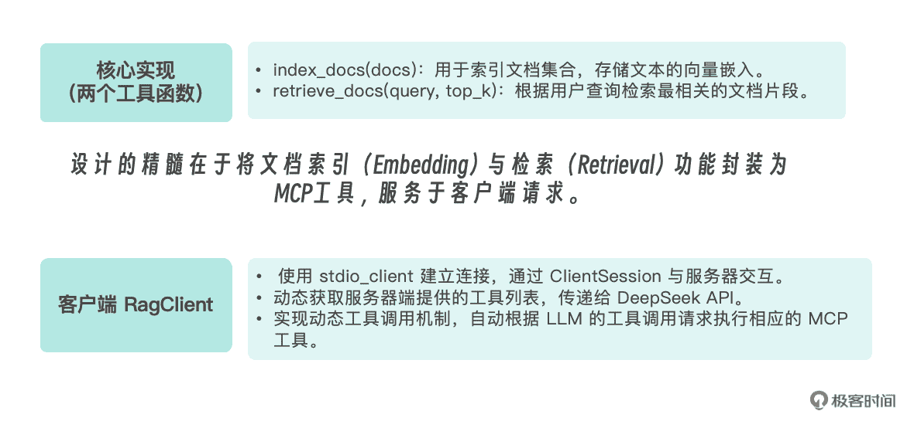

+   整个过程中 MCP 的通信机制明确分为三个阶段。

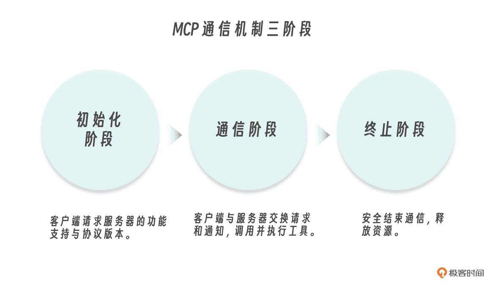

这样的设计保证了服务的稳健性和客户端的可扩展性。此外，使用 `FastMCP` 的 `@mcp.tool()` 和 `mcp.run()` 等高级 API，而不是直接操作底层协议，让我们能够聚焦于高层业务逻辑和功能实现。
