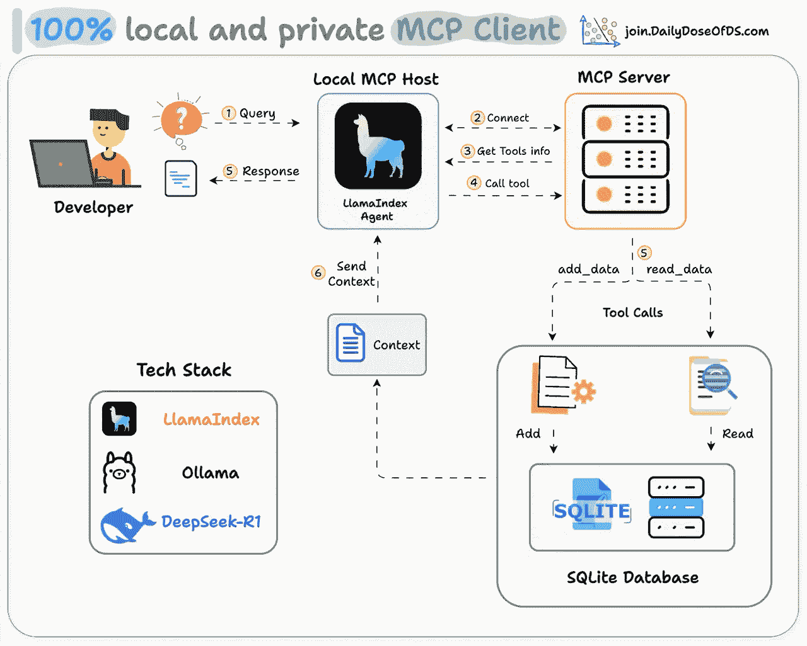
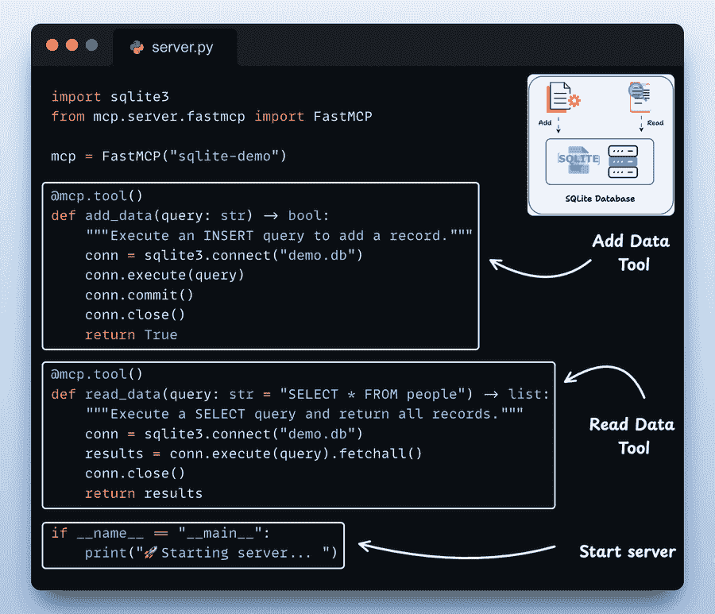
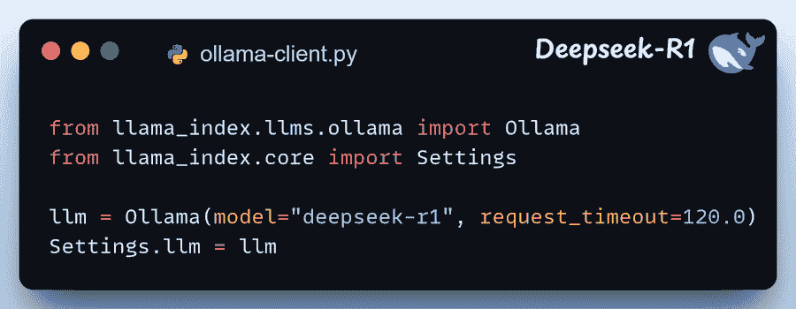
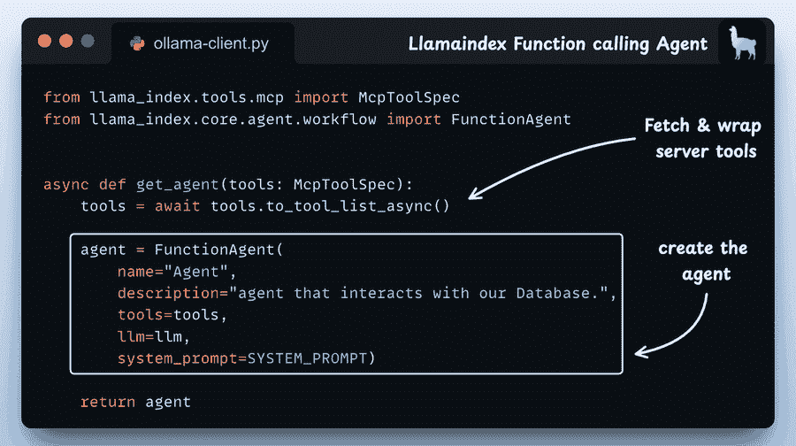
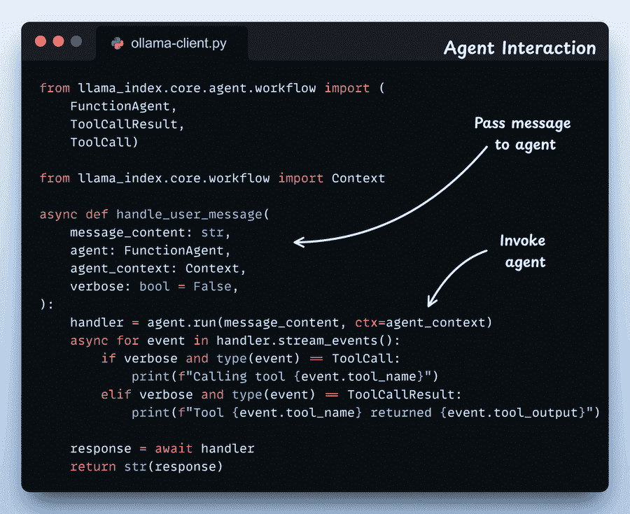
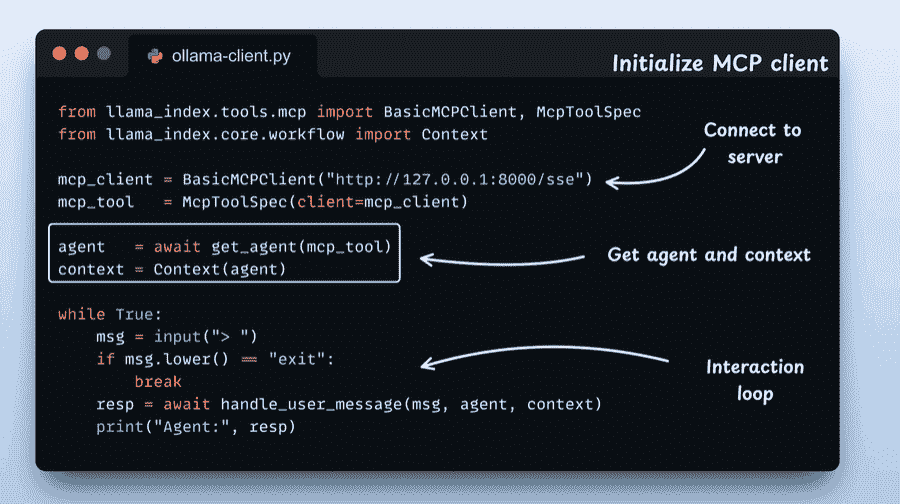

# 100%本地私有MCP客户端架构

> 来源：[https://v11enp9ok1h.feishu.cn/docx/GLYedtbCCohWGGxAMwrcBEQZnBf](https://v11enp9ok1h.feishu.cn/docx/GLYedtbCCohWGGxAMwrcBEQZnBf)

MCP 客户端是 AI 应用（如 Cursor）中的一个组件，用于建立与外部工具的连接。了解如何 100% 在本地构建它。



### 技术栈：

+   **LlamaIndex：**构建 MCP 驱动的智能体

+   **Ollama：**本地部署 Deepseek-R1 模型

+   **LightningAI：**用于开发和托管

### 工作流程：

1.  用户提交查询

1.  智能体连接到 MCP 服务器以发现工具

1.  根据查询，智能体调用合适的工具并获取上下文

1.  智能体返回上下文感知的响应

## 构建 SQLite MCP 服务器

为简化演示，我们构建了一个包含两个工具的简单 SQLite 服务器：

+   添加数据（**add data**）

+   获取数据（**fetch data**）



```
import sqlite3
from mcp.server.fastmcp import FastMCP

mcp = FastMCP(&quot;sqlite-demo&quot;)

@mcp.tool()
def add_data(query: str) -&gt; bool:
    &quot;&quot;&quot;执行INSERT查询以添加记录。&quot;&quot;&quot;
    conn = sqlite3.connect(&quot;demo.db&quot;)
    conn.execute(query)
    conn.commit()
    conn.close()
    return True

@mcp.tool()
def read_data(query: str = &quot;SELECT * FROM people&quot;) -&gt; list:
    &quot;&quot;&quot;执行SELECT查询并返回所有记录。&quot;&quot;&quot;
    conn = sqlite3.connect(&quot;demo.db&quot;)
    results = conn.execute(query).fetchall()
    conn.close()
    return results

if __name__ == &quot;__main__&quot;:
    print(&quot;Starting server...&quot;)
```

### 设置 LLM

我们将通过 **Ollama** 本地部署 **Deepseek-R1 **作为 MCP 智能体的大语言模型（LLM）。



```
from llama_index.llms.ollama import Ollama
from llama_index.core import Settings

llm = Ollama(model=&quot;deepseek-r1&quot;, request_timeout=120.0)
Settings.llm = llm
```

## 定义系统提示词

我们定义智能体的指导指令，要求在回答用户查询前使用工具。可根据需要自由调整。

```
SYSTEM_PROMPT = &quot;&quot;&quot;
你是一个用于工具调用的AI助手。
在提供帮助前，请使用我们的工具与数据库交互。
&quot;&quot;&quot;
```

## 定义智能体

我们定义一个函数来构建典型的 LlamaIndex 智能体，并传入适当的参数。

传递给智能体的工具是 MCP 工具，llama_index 将其封装为原生工具，便于 FunctionAgent 使用。



```
from llama_index.tools.mcp import McpToolSpec
from llama_index.core.agent.workflow import FunctionAgent

async def get_agent(tools: McpToolSpec):
    # 获取并封装服务器工具
    tools = await tools.to_tool_list_async()
    
    # 创建智能体
    agent = FunctionAgent(
        name=&quot;Agent&quot;,
        description=&quot;与数据库交互的智能体。&quot;,
        tools=tools,
        llm=llm,
        system_prompt=SYSTEM_PROMPT
    )
    return agent
```

##  定义智能体交互

我们将用户消息传递给 FunctionAgent，并使用共享 Context 进行记忆管理，流式处理工具调用并返回回复。所有聊天历史和工具调用均在此处管理。



```
from llama_index.core.agent.workflow import (
    FunctionAgent,
    ToolCallResult,
    ToolCall
)
from llama_index.core.workflow import Context

async def handle_user_message(
    message_content: str,
    agent: FunctionAgent,
    agent_context: Context,
    verbose: bool = False,
):
    # 将消息传递给智能体
    handler = agent.run(message_content, ctx=agent_context)
    
    # 调用智能体
    async for event in handler.stream_events():
        if verbose and type(event) == ToolCall:
            print(f&quot;调用工具 {event.tool_name}&quot;)
        elif verbose and type(event) == ToolCallResult:
            print(f&quot;工具 {event.tool_name} 返回结果 {event.tool_output}&quot;)
    
    response = await handler
    return str(response)
```

## 初始化 MCP 客户端和智能体

启动 MCP 客户端，加载其工具，并将其封装为 LlamaIndex 中函数调用智能体的原生工具。然后将这些工具传递给智能体并添加上下文管理器。



```
from llama_index.tools.mcp import BasicMCPlient, McpToolSpec
from llama_index.core.workflow import Context

# 连接到服务器
mcp_client = BasicMCPlient(&quot;http://127.0.0.1:8000/sse&quot;)
mcp_tool = McpToolSpec(client=mcp_client)

# 获取智能体和上下文
agent = await get_agent(mcp_tool)
context = Context(agent)

# 交互循环
while True:
    msg = input(&quot;&gt; &quot;)
    if msg.lower() == &quot;exit&quot;:
        break
    resp = await handle_user_message(msg, agent, context)
    print(&quot;智能体:&quot;, resp)
```

## 运行智能体

最后，我们开始与智能体交互，并从 SQLite MCP 服务器访问工具。

```
# 运行智能体！
while True:
    user_input = input(&quot;输入消息: &quot;)
    if user_input == &quot;exit&quot;:
        break
    print(&quot;用户:&quot;, user_input)
    response = await handle_user_message(user_input, 
                                        agent, agent_context, verbose=True)
    print(&quot;智能体:&quot;, response)
```

### 交互示例：

```
用户：添加数据到数据库：Rafael Nadal，39岁，网球运动员
调用工具 add_data，参数 {&#x27;query&#x27;: &#x27;INSERT INTO people (name, age, profession) VALUES (&quot;Rafael Nadal&quot;, 39, &quot;Tennis Player&quot;)&#x27;}
工具 add_data 返回结果 True
智能体：数据已成功添加。

用户：获取数据
调用工具 read_data，参数 {&#x27;query&#x27;: &#x27;SELECT * FROM people&#x27;}
工具 read_data 返回结果 [(1, &#x27;Rafael Nadal&#x27;, 39, &#x27;Tennis Player&#x27;)]
智能体：数据库中的数据如下：

1. ID: 1
   姓名: Rafael Nadal
   年龄: 39
   职业: 网球运动员
```

## 实现总结

通过以上 7 个步骤，我们完成了 100% 本地 MCP 客户端的构建，包括：

1.  设计 MCP 客户端架构

1.  实现 SQLite MCP 服务器

1.  配置本地 LLM (Deepseek-R1)

1.  定义智能体系统提示和工具调用逻辑

1.  实现智能体交互流程

1.  初始化客户端与服务器连接

1.  运行智能体并验证数据交互功能