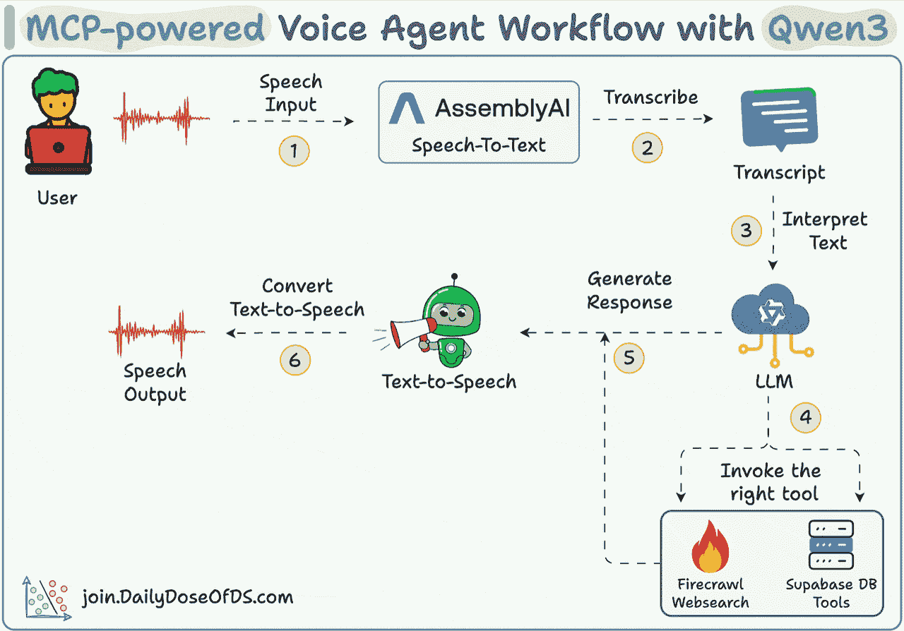
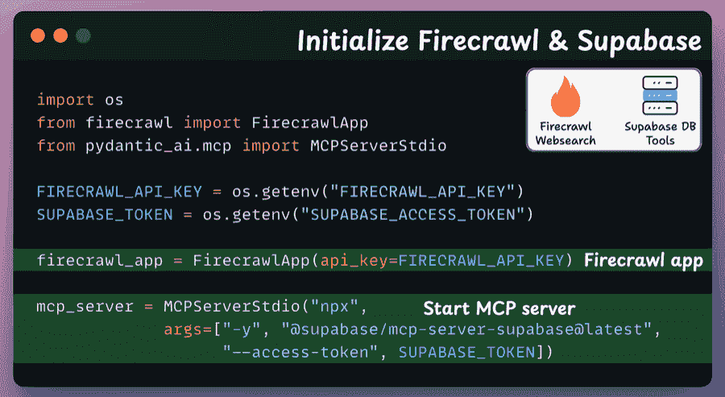
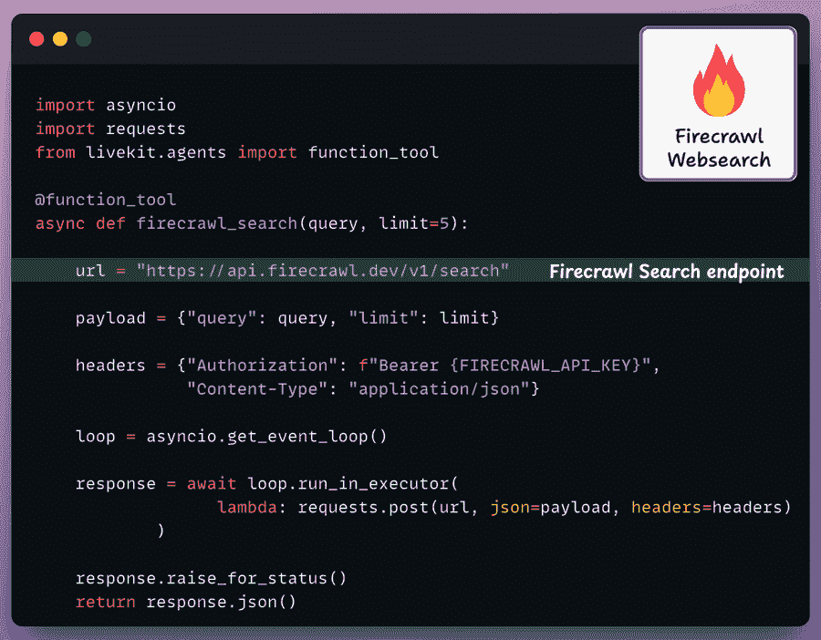
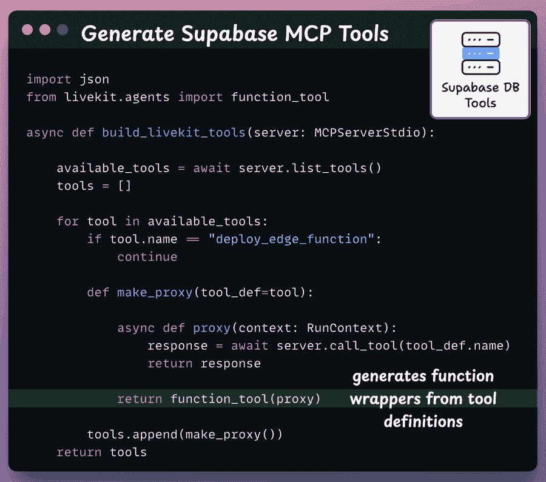
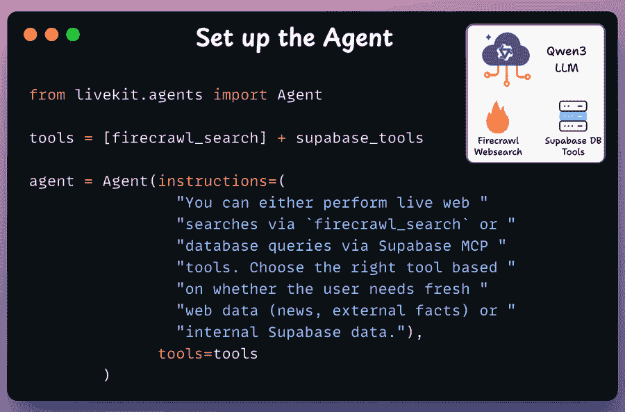
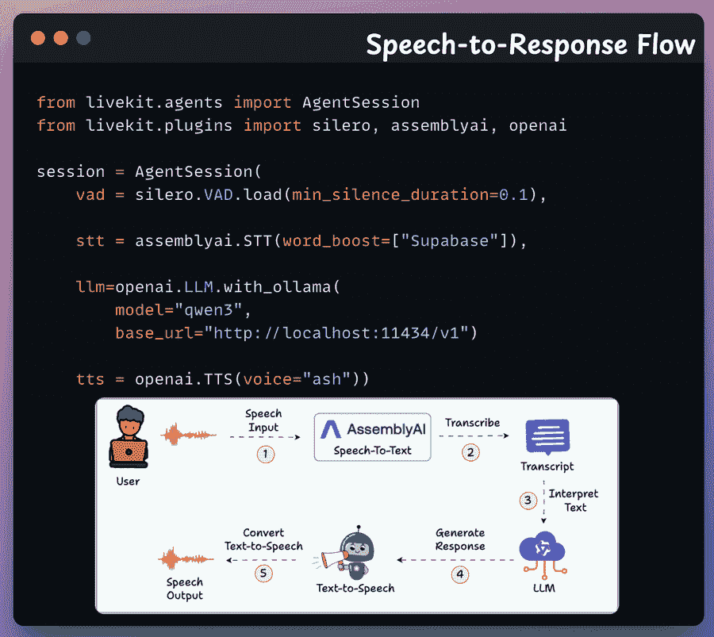
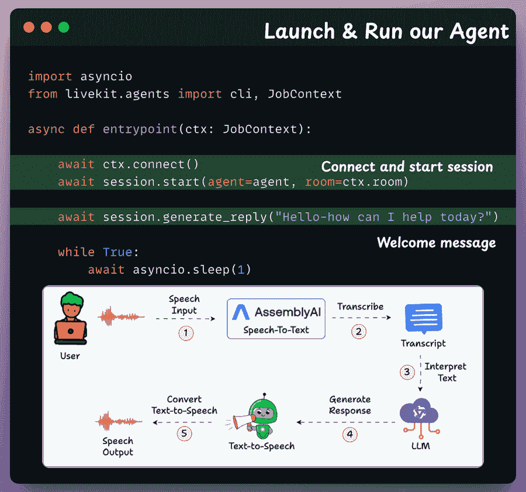

#  mcp-powered Voice Agent

> 来源：[https://v11enp9ok1h.feishu.cn/docx/UQTqdoT00ocKopxHhWfcxTYAnjg](https://v11enp9ok1h.feishu.cn/docx/UQTqdoT00ocKopxHhWfcxTYAnjg)

# MCP 驱动语音Agent翻译教程

本项目将教你如何构建一个 MCP 驱动的语音代理，它可以查询数据库，并在需要时回退到网络搜索。



**技术栈**：

+   **AssemblyAI**（语音转文本）

+   **Firecrawl（**网络搜索）

+   **Supabase（**数据库）

+   **Livekit（**编排工具）

+   **Qwen3**（大型语言模型）

**工作流程**：

+   用户的语音查询通过 AssemblyAI 转录为文本。

+   代理发现数据库和网络工具。

+   大型语言模型调用正确的工具，获取数据并生成响应。

+   应用程序通过文本转语音功能交付响应。

#### 初始化 Firecrawl 和 Supabase

我们实例化 Firecrawl 以启用网络搜索，并启动 MCP 服务器以向代理公开 Supabase 工具。



```
import os
from firecrawl import FirecrawlApp
from pydantic_ai.mcp import MCPServerStudio

FIRECRAWL_API_KEY = os.getenv(&quot;FIRECRAWL_API_KEY&quot;)
SUPABASE_TOKEN = os.getenv(&quot;SUPABASE_ACCESS_TOKEN&quot;)

firecrawl_app = FirecrawlApp(api_key=FIRECRAWL_API_KEY)  # Firecrawl应用
mcp_server = MCPServerStudio(&quot;npx&quot;, 
   args=[&quot;-y&quot;, &quot;@supabase/mcp-server-supabase@latest&quot;, 
         &quot;--access-token&quot;, SUPABASE_TOKEN])  # 启动MCP服务器
```

#### 定义网络搜索工具

我们使用 Firecrawl 搜索端点获取实时网络搜索结果。这为我们的代理提供了最新的在线信息。



```
import asyncio
import requests
from livekit.agents import function_tool

@function_tool
async def firecrawl_search(query, limit=5):
    url = &quot;https://api.firecrawl.dev/v1/search&quot;  # Firecrawl搜索端点
    payload = {&quot;query&quot;: query, &quot;limit&quot;: limit}
    headers = {&quot;Authorization&quot;: f&quot;Bearer {FIRECRAWL_API_KEY}&quot;,
               &quot;Content-Type&quot;: &quot;application/json&quot;}
    
    loop = asyncio.get_event_loop()
    response = await loop.run_in_executor(
        None, lambda: requests.post(url, json=payload, headers=headers)
    )
    
    response.raise_for_status()
    return response.json()
```

#### 获取 Supabase MCP 工具

我们通过 MCP 服务器列出 Supabase 工具，并将每个工具包装为 LiveKit 工具供代理使用



```
import json
from livekit.agents import function_tool

async def build_livekit_tools(server: MCPServerStdio):
    available_tools = await server.list_tools()
    tools = []

    for tool in available_tools:
        if tool.name == &quot;deploy_edge_function&quot;:
            continue

        def make_proxy(tool_def=tool):
            async def proxy(context: RunContext):
                response = await server.call_tool(tool_def.name)
                return response

            return function_tool(proxy)

        tools.append(make_proxy())
    return tools
```

### 构建Agent

我们设置代理的指令，指导其如何处理用户查询。我们还为其提供了之前定义的 Firecrawl 网络搜索和 Supabase 工具的访问权限。



```
from livekit.agents import Agent

tools = [firecrawl_search] + supabase_tools
agent = Agent(instructions=(
    &quot;你可以通过&#x27;firecrawl_search&#x27;执行实时网络搜索，&quot;
    &quot;或通过Supabase MCP工具执行数据库查询。&quot;
    &quot;根据用户是否需要最新网络数据（新闻、外部事实）或内部Supabase数据选择合适的工具。&quot;
), tools=tools)
```

#### 配置语音到响应流程

+   使用 AssemblyAI 语音转文本转录用户语音。

+   通过 Ollama 在本地部署的 Qwen3 大型语言模型调用正确的工具。

+   通过文本转语音生成语音输出。



```
from livekit.agents import AgentSession
from livekit.plugins import silero, assemblyai, openai

session = AgentSession(
    vad = silero.VAD.load(min_silence_duration=0.1),
    stt = assemblyai.STT(word_boost=[&quot;Supabase&quot;]),
    llm=openai.LLM.with_ollama(
        model=&quot;qwen3&quot;,
        base_url=&quot;http://localhost:11434/v1&quot;
    ),
    tts = openai.TTS(voice=&quot;alloy&quot;)
)
```

### 启动Agent

我们连接到 LiveKit 并以问候语开始会话。然后持续监听并响应，直到用户停止。



```
import sys
from livekit.agents import cli, JobContext

async def entrypoint(ctx: JobContext):
    await ctx.session.start(agent_name=&quot;...&quot;, connect=True)
    await ctx.session.generate_reply(&quot;你好！今天我能帮你什么？&quot;)
    
    while True:
        ...  # 持续监听和响应循环
```

#### 完成

+   如果查询与数据库相关，它通过 MCP 工具查询 Supabase。

+   否则，它通过 Firecrawl 执行网络搜索。