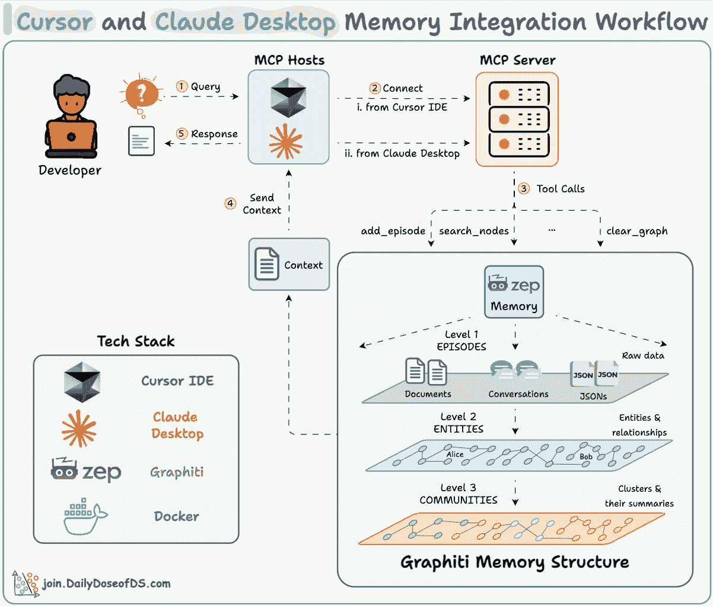
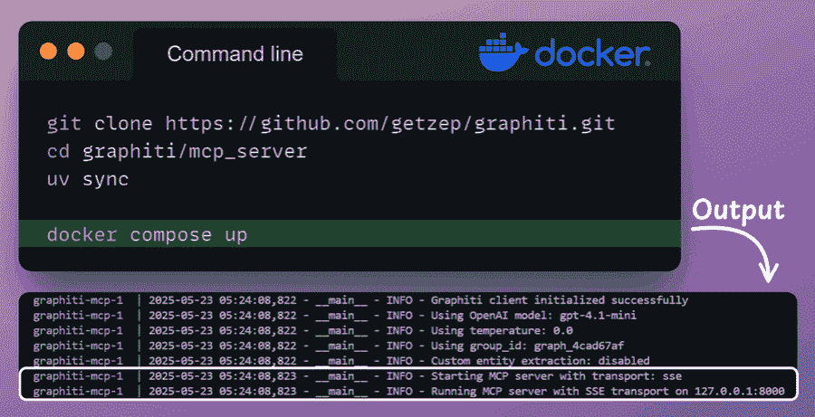
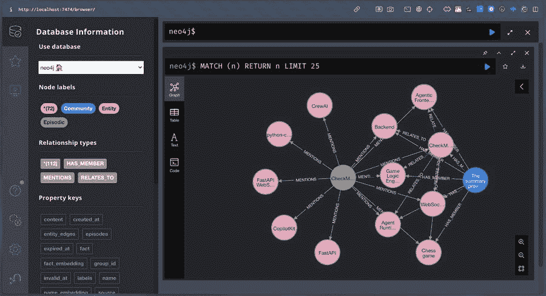
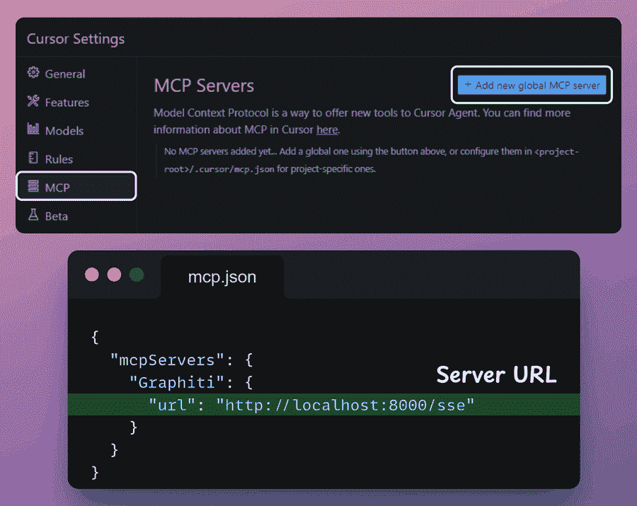
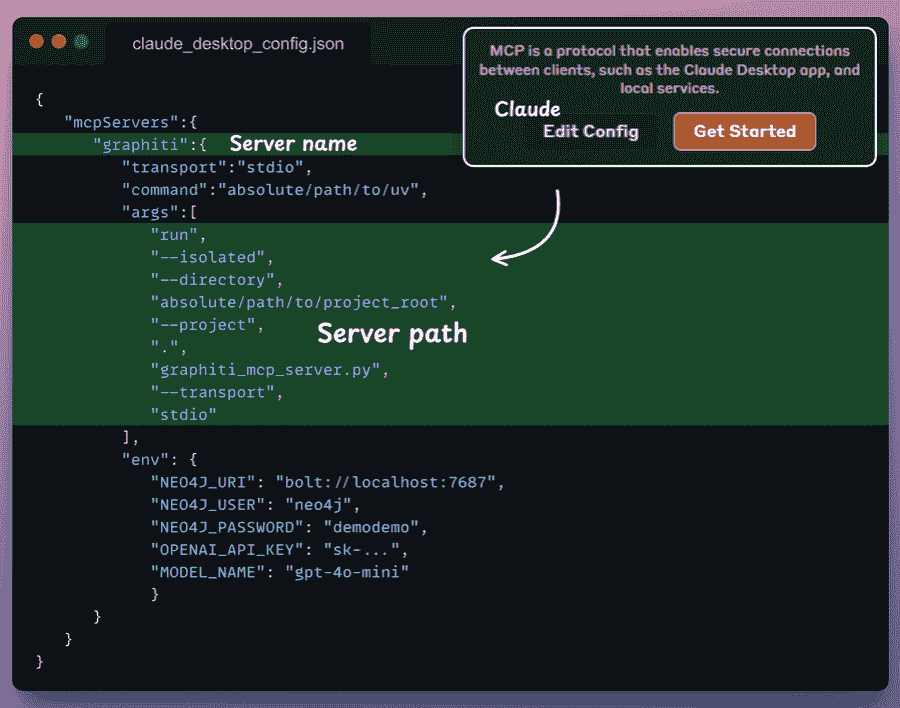
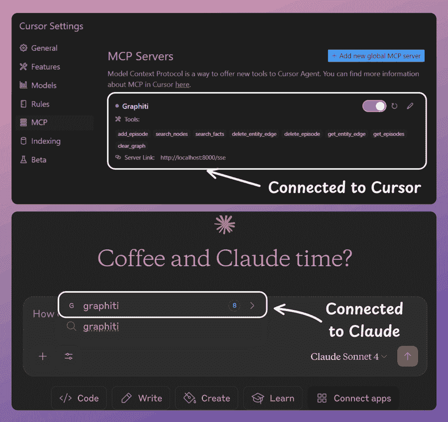

# Cursor与Claude Desktop内存整合工作流程

> 来源：[https://v11enp9ok1h.feishu.cn/docx/QfpAdf8BzoY6sYxiNficszZanff](https://v11enp9ok1h.feishu.cn/docx/QfpAdf8BzoY6sYxiNficszZanff)

开发人员独立使用 Claude Desktop 和 Cursor 时，没有上下文共享。了解如何添加一个公共内存层，实现跨操作而不丢失上下文。

### 技术栈

+   Zep 的 Graphiti MCP 作为 AI 代理的内存层。

+   Cursor 和 Claude 作为 MCP 主机。

### 工作流程

+   用户向 Cursor 和 Claude 提交查询。

+   使用 Graphiti MCP 将事实 / 信息存储在公共内存层中。

+   如果任何交互需要上下文，将查询内存。

+   Graphiti 跨多个主机共享内存。

### Docker 设置

使用 Docker Compose 部署 Graphiti MCP 服务器。此设置启动带有服务器发送事件 (SSE) 传输的 MCP 服务器。

上述 Docker 设置包含一个 Neo4j 容器，它将数据库作为本地实例启动。

此配置允许您使用 Neo4j 浏览器预览查询和可视化知识图谱。

## 将 MCP 服务器连接到 Cursor

工具和服务器准备就绪后，让我们将其与 Cursor IDE 集成！

前往：文件 → 首选项 → Cursor 设置 → MCP → 添加新的全局 MCP 服务器。在 JSON 文件中，添加如下所示内容。

### 将 MCP 服务器与 Claude 连接

前往文件 → 设置 → 开发者 → 编辑配置，添加如下所示内容。

我们的 Graphiti MCP 服务器已启动并连接到 Cursor 和 Claude！

现在您可以与 Claude Desktop 聊天，共享事实 / 信息，将响应存储在内存中，并从 Cursor 中检索它们，反之亦然。

通过这种方式，您可以通过单个 MCP 将 Claude 的见解直接传输到 Cursor 中。