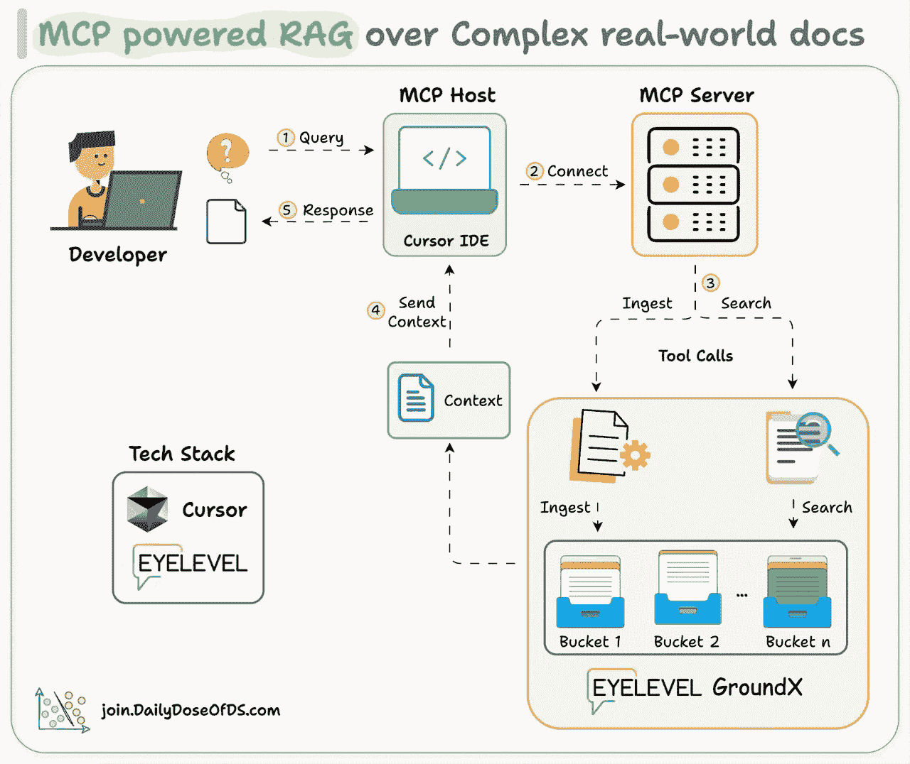
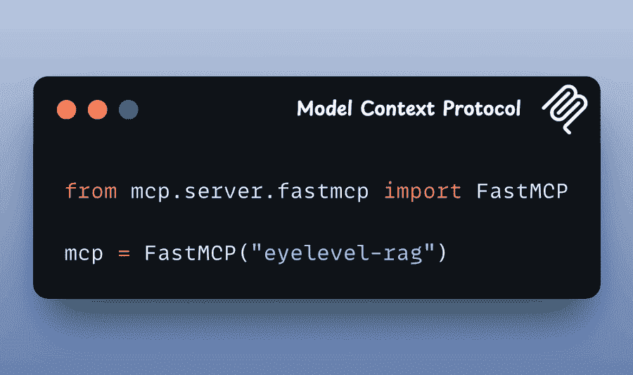
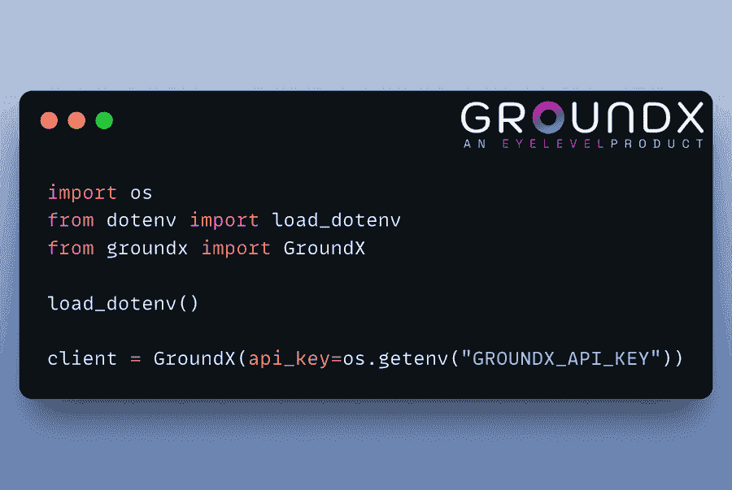
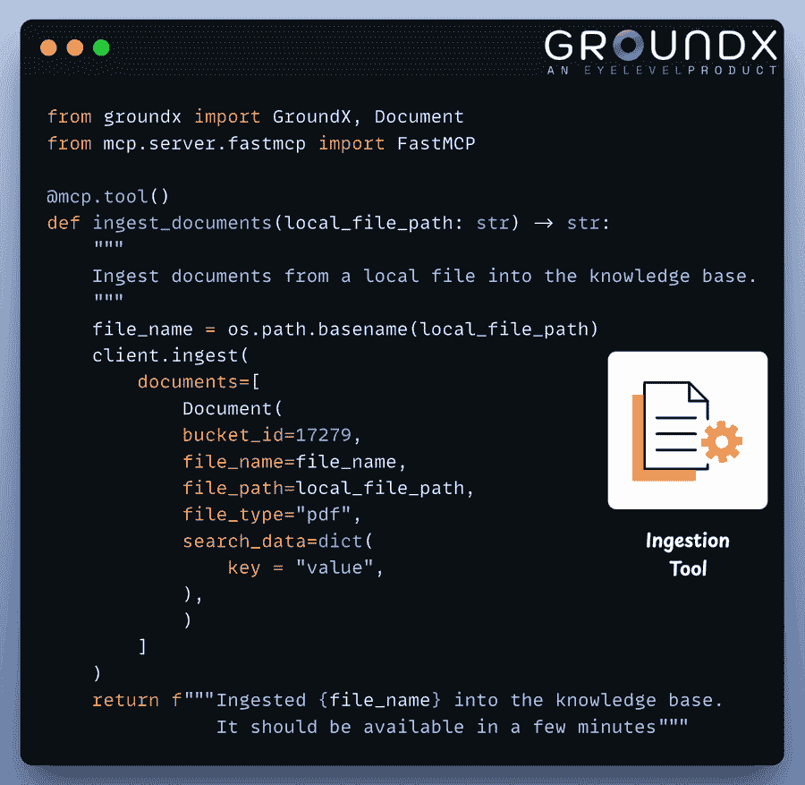
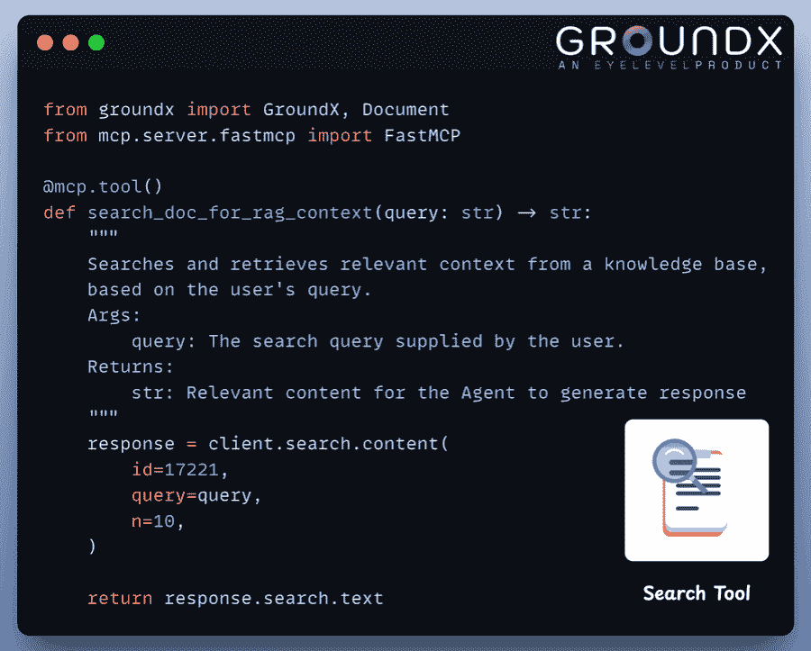
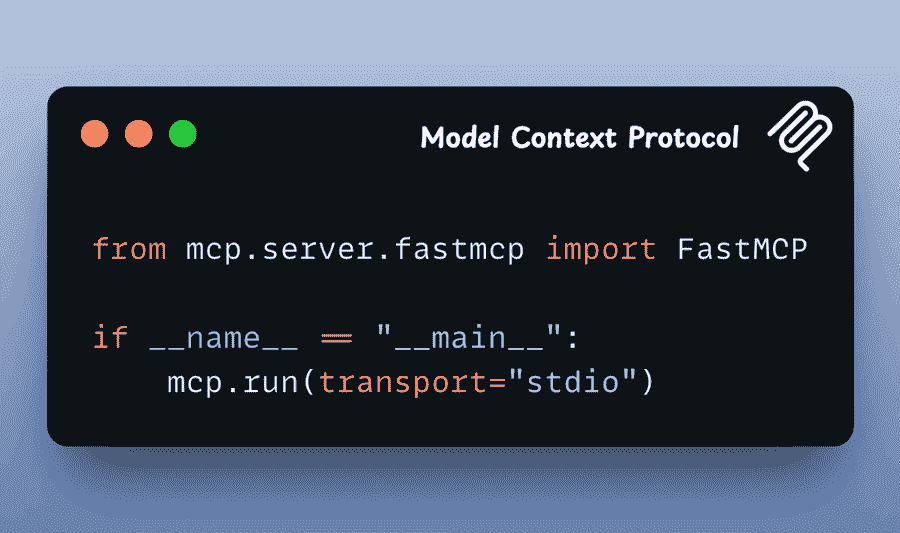
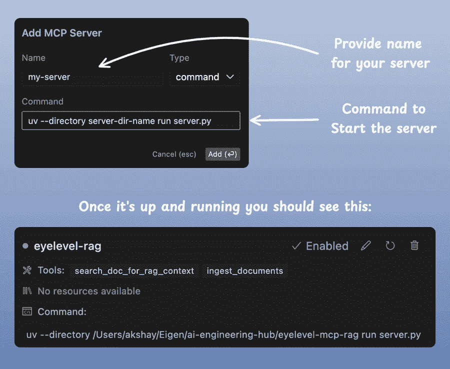

# MCP 驱动的 RAG 系统教程：复杂文档处理

> 来源：[https://v11enp9ok1h.feishu.cn/docx/TvwNdKAgHo755QxDCFEcg8rpn4d](https://v11enp9ok1h.feishu.cn/docx/TvwNdKAgHo755QxDCFEcg8rpn4d)



## 技术栈

+   **Cursor** 作为 MCP 客户端

+   EylevelAI's GroundX 用于构建可处理复杂文档的 MCP 服务器

## 工作流程

+   用户与 MCP 客户端（Cursor IDE）交互

+   客户端连接到 MCP 服务器并选择工具

+   工具利用 GroundX 对文档进行高级搜索

+   客户端使用搜索结果生成响应

###

### 设置服务器

首先，我们使用 FastMCP 设置本地 MCP 服务器并为其命名：



```
from mcp.server.fastmcp import FastMCP
mcp = FastMCP(&quot;eyelevel-rag&quot;)
```

### 创建 GroundX 客户端

GroundX 提供复杂真实世界文档的搜索和检索功能。以下是设置客户端的方法：



```
import os
from dotenv import load_dotenv
from groundx import GroundX

load_dotenv()
client = GroundX(api_key=os.getenv(&quot;GROUNDX_API_KEY&quot;))
```

###

### 创建摄入工具

此工具用于将新文档摄入知识库。用户只需提供要摄入的文档路径：



```
from groundx import GroundX, Document
from mcp.server.fastmcp import FastMCP

@mcp.tool()
def ingest_documents(local_file_path: str) -&gt; str:
    &quot;&quot;&quot;
    从本地文件将文档摄入知识库。
    &quot;&quot;&quot;
    file_name = os.path.basename(local_file_path)
    client.ingest(
        documents=[
            Document(
                bucket_id=17279,
                file_name=file_name,
                file_path=local_file_path,
                file_type=&quot;pdf&quot;,
                search_data=dict(
                    key = &quot;value&quot;,
                ),
            )
        ]
    )
    return f&quot;已将{file_name}摄入知识库。几分钟后即可使用。&quot;
```

### 创建搜索工具

此工具利用 GroundX 的高级功能对复杂真实世界文档进行搜索和检索。实现方法如下：



```
from groundx import GroundX, Document
from mcp.server.fastmcp import FastMCP

@mcp.tool()
def search_doc_for_rag_context(query: str) -&gt; str:
    &quot;&quot;&quot;
    基于用户查询从知识库搜索和检索相关上下文。
    
    参数:
        query: 用户提供的搜索查询
        
    返回:
        str: 供智能体生成响应的相关内容
    &quot;&quot;&quot;
    response = client.search.content(
        id=17221,
        query=query,
        n=10,
    )
    return response.search.text
```

### 启动服务器

使用 stdio 作为传输机制启动 MCP 服务器：



```
from mcp.server.fastmcp import FastMCP

if __name__ == &quot;__main__&quot;:
    mcp.run(transport=&quot;stdio&quot;)
```

### 连接到 Cursor

在 Cursor IDE 中按照以下步骤操作：Cursor → 设置 → Cursor 设置 → MCP，然后添加并启动服务器：



**服务器运行后，您将看到以下内容**：

+   名称：eyelevel-rag（已启用）

+   工具：search_doc_for_rag_context, ingest_documents

+   命令：uv -C directory /User/ashkay/General-engineering/llm-based-rag/run server.py