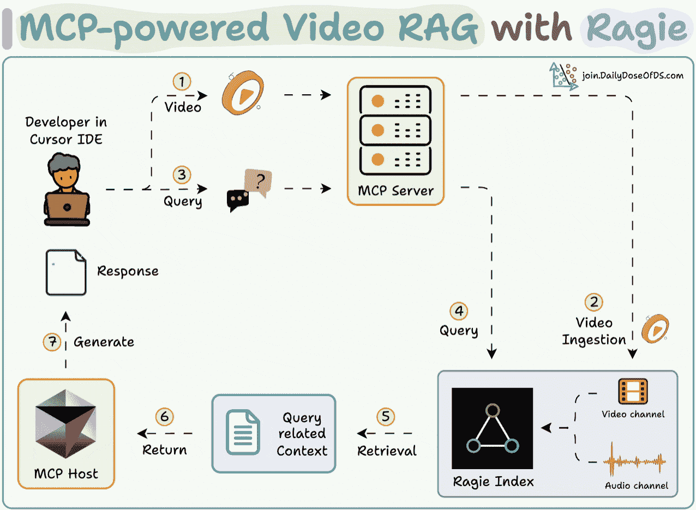
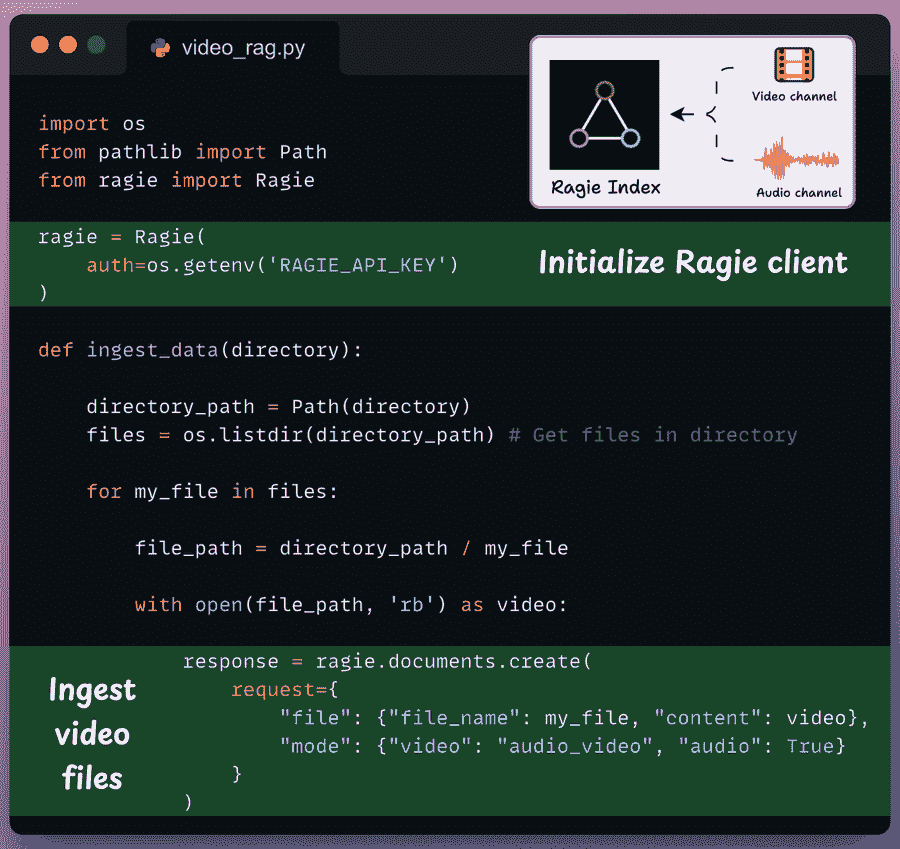
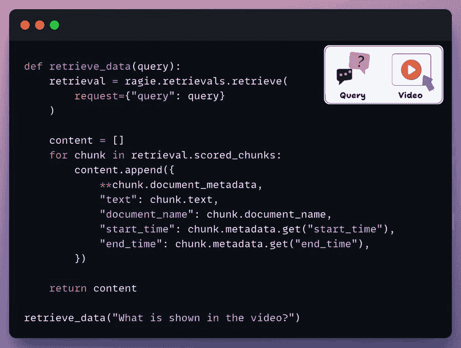
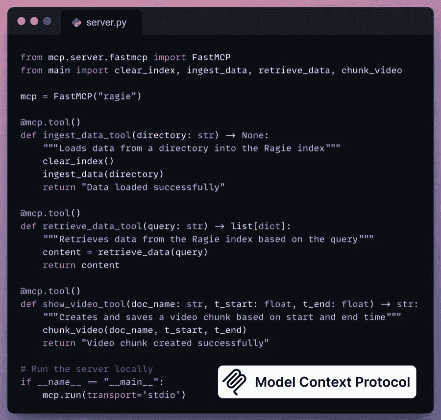
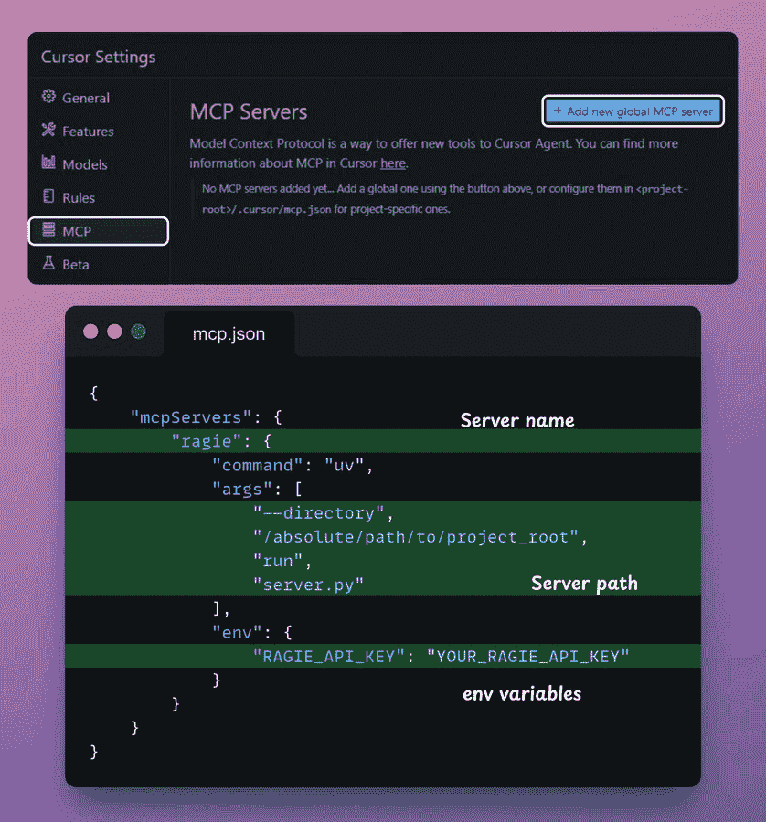

# 优化版视频检索增强生成系统

> 来源：[https://v11enp9ok1h.feishu.cn/docx/DHtLdqIsgoZ9CBxBKELcw5Qunvg](https://v11enp9ok1h.feishu.cn/docx/DHtLdqIsgoZ9CBxBKELcw5Qunvg)

我们拥有一个 MCP 驱动的视频 RAG 系统，它可以摄入视频并允许您与之交互。它还能获取事件发生的确切视频片段。



**技术栈**

+   RagieAI 用于视频摄入和检索

+   Cursor 作为 MCP 主机

**工作流程**

+   用户指定视频文件和查询

+   摄入工具将视频编入 Ragie 索引

+   查询工具从 Ragie 索引中检索带引用的信息

+   视频展示工具返回回答查询的视频片段

#### 数据摄入

我们实现了一种将视频文件摄入 Ragie 索引的方法。我们还指定了音视频模式，以便在摄入过程中同时加载音频和视频通道。



```
import os
from pathlib import Path
from ragie import Ragie

# 初始化Ragie客户端
ragie = Ragie(
    auth=os.getenv(&#x27;RAGIE_API_KEY&#x27;)
)

def ingest_data(directory):
    directory_path = Path(directory)
    files = os.listdir(directory_path)  # 获取目录中的文件
    
    for my_file in files:
        file_path = directory_path / my_file
        
        with open(file_path, &#x27;rb&#x27;) as video:
            # 摄入视频文件
            response = ragie.documents.create(
                request={
                    &quot;file&quot;: {&quot;file_name&quot;: my_file, &quot;content&quot;: video},
                    &quot;mode&quot;: {&quot;video&quot;: &quot;audio_video&quot;, &quot;audio&quot;: True}
                }
            )
```

#### 数据检索

根据用户查询从视频中检索相关片段

每个片段都有开始时间、结束时间以及对应视频片段的更多细节。



```
def retrieve_data(query):
    retrieval = ragie.retrievals.retrieve(
        request={&quot;query&quot;: query}
    )
    
    content = []
    for chunk in retrieval.scored_chunks:
        content.append({
            **chunk.document_metadata,
            &quot;text&quot;: chunk.text,
            &quot;document_name&quot;: chunk.document_name,
            &quot;start_time&quot;: chunk.metadata.get(&quot;start_time&quot;),
            &quot;end_time&quot;: chunk.metadata.get(&quot;end_time&quot;),
        })
    
    return content

retrieve_data(&quot;视频中展示了什么内容？&quot;)
```

#### 创建 MCP 服务器

我们将 RAG 流水线集成到带有 3 个工具的 MCP 服务器中：

+   ingest_data_tool: 将数据摄入 Ragie 索引

+   retrieve_data_tool: 根据用户查询检索数据

+   show_video_tool: 从原始视频创建视频片段



```
from mcp.server.fastmcp import FastMCP
from main import clear_index, ingest_data, retrieve_data, chunk_video

mcp = FastMCP(&quot;ragie&quot;)

@mcp.tool()
def ingest_data_tool(directory: str) -&gt; None:
    &quot;&quot;&quot;将目录中的数据加载到Ragie索引中&quot;&quot;&quot;
    clear_index()
    ingest_data(directory)
    return &quot;数据加载成功&quot;

@mcp.tool()
def retrieve_data_tool(query: str) -&gt; list[dict]:
    &quot;&quot;&quot;根据查询从Ragie索引中检索数据&quot;&quot;&quot;
    content = retrieve_data(query)
    return content

@mcp.tool()
def show_video_tool(doc_name: str, t_start: float, t_end: float) -&gt; str:
    &quot;&quot;&quot;根据开始和结束时间创建并保存视频片段&quot;&quot;&quot;
    chunk_video(doc_name, t_start, t_end)
    return &quot;视频片段创建成功&quot;

# 在本地运行服务器
if __name__ == &quot;__main__&quot;:
    mcp.run(transport=&#x27;stdio&#x27;)
```

#### 将 MCP 服务器与 Cursor 集成

要将 MCP 服务器与 Cursor 集成，请转到设置→MCP→添加新的全局 MCP 服务器。

