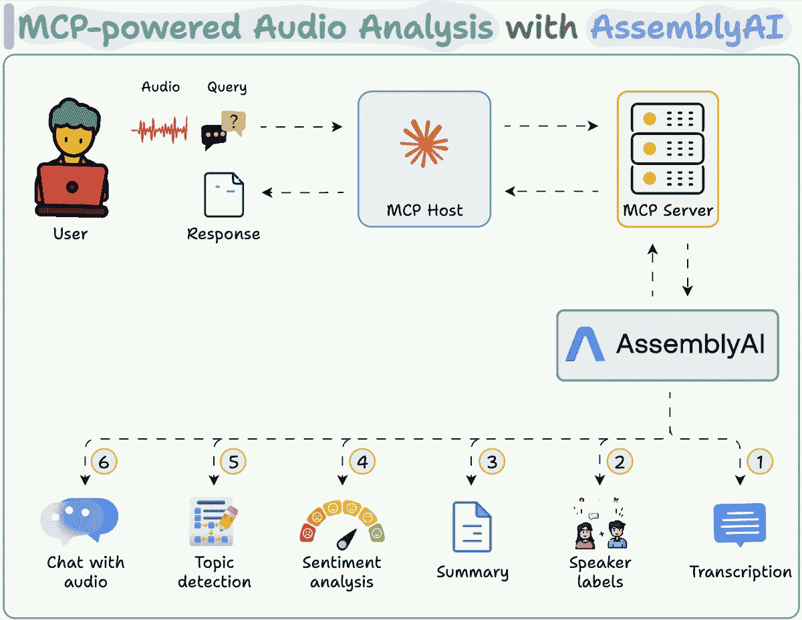
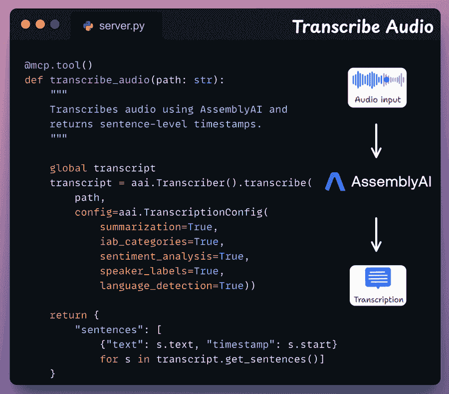
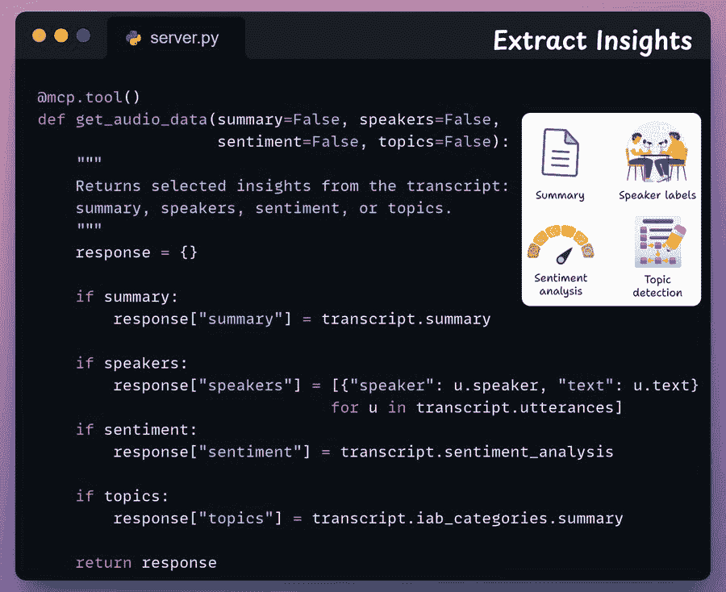
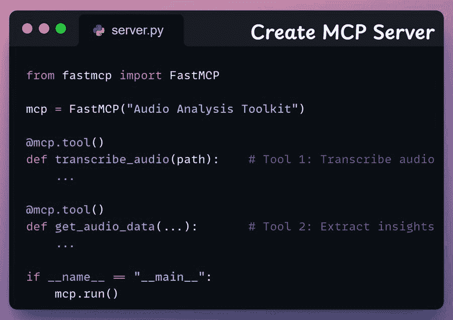
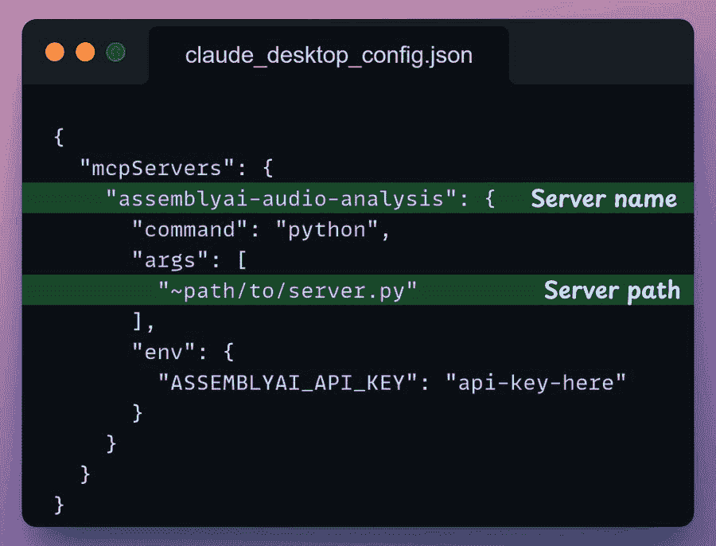
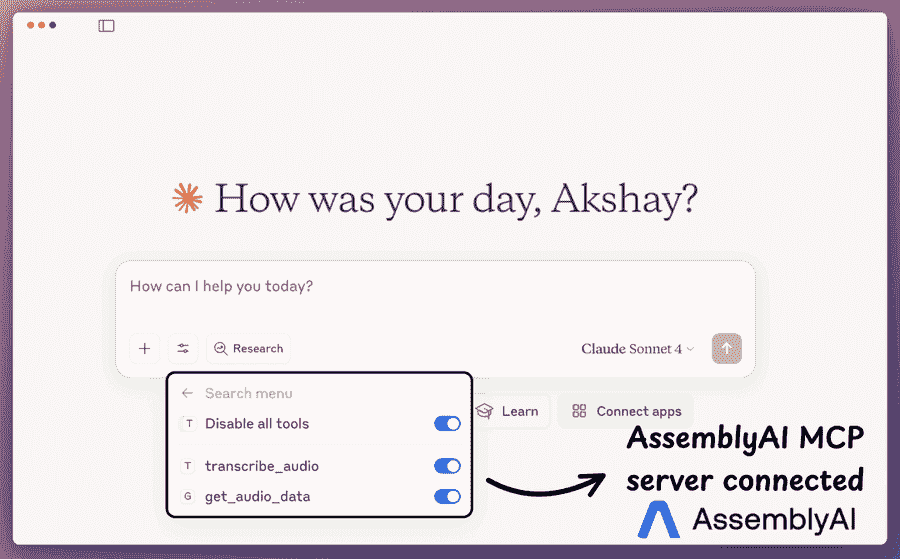

# Mcp-powered Audio Analysis Toolkit

> 来源：[https://v11enp9ok1h.feishu.cn/docx/WsvzdffcGoGOg2xJsoEcJFIJnff](https://v11enp9ok1h.feishu.cn/docx/WsvzdffcGoGOg2xJsoEcJFIJnff)

## MCP 驱动的 AssemblyAI 音频分析

我们拥有一个 MCP 驱动的音频分析工具包，它可以接受音频文件并让你转录音频，提取情感分析、说话人标签、摘要和主题检测等洞察。你还可以与音频进行对话。

### **技术栈**

+   AssemblyAI 用于转录和音频分析

+   Claude Desktop 作为 MCP 主机

+   Streamlit 用于用户界面

### **工作流程**

+   用户的音频输入通过本地 MCP 服务器发送到 AssemblyAI

+   AssemblyAI 转录音频，同时提供摘要、说话人标签、情感和主题

+   转录后，用户还可以与音频对话

## 转录 MCP 工具

此工具接受用户的音频输入，并使用 AssemblyAI 进行转录。我们还存储完整的转录文本，以便在下一个工具中使用。

## 音频分析工具

接下来，我们有一个工具，可以从转录文本中返回特定洞察，如说话人标签、情感、主题和摘要。

## 创建 MCP 服务器

现在，我们将设置一个 MCP 服务器来使用上面创建的工具。

## 将 MCP 服务器与 Claude Desktop 集成

前往文件→设置→开发者→编辑配置，并添加以下代码。

## 工具集成与使用

服务器配置完成后，Claude Desktop 将在工具菜单中显示我们上面构建的两个工具：

+   transcribe_audio

+   get_audio_data

这就是我们基于 MCP 的音频分析工具包！为了方便使用，我们为音频分析应用创建了 Streamlit UI。你可以上传音频，提取洞察，并使用 AssemblyAI 的 LeMUR 与之对话。代码如下。