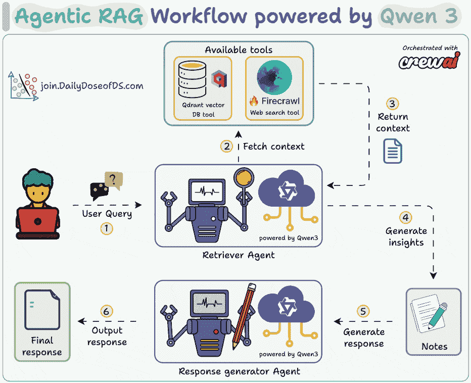
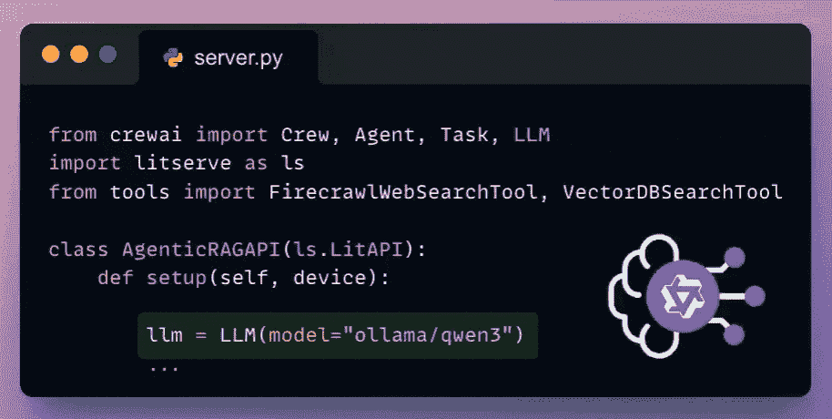

# Agentic RAG

> 来源：[https://v11enp9ok1h.feishu.cn/docx/KaPrdeLbFod2zCxnnr3cZ1pznDc](https://v11enp9ok1h.feishu.cn/docx/KaPrdeLbFod2zCxnnr3cZ1pznDc)

构建具有智能体能力的RAG管道，能够从不同来源如向量数据库和互联网动态获取上下文。



#### 设置LLM（大语言模型）

CrewAI与所有主流LLM和提供商无缝集成。以下是通过Ollama设置本地Qwen 3的方法：



```
from crewai import Crew, Agent, Task, LLM
import litserve as ls
from tools import FirecrawlWebSearchTool, VectorDBSearchTool

class AgenticRAGAPI(ls.LitAPI):def setup(self, device):
        llm = LLM(model=&quot;ollama/qwen3&quot;)...
```

### 定义研究智能体和任务

该智能体接受用户查询，并使用向量数据库工具和由Firecrawl提供支持的网络搜索工具检索相关上下文。

再次，将其放入LitServe的setup()方法中：

python

```
from crewai import Crew, Agent, Task, LLM
import litserve as ls
from tools import FirecrawlWebSearchTool, VectorDBSearchTool

class AgenticRAGAPI(ls.LitAPI):def setup(self, device):
        llm = LLM(model=&quot;ollama/qwen3&quot;)
        
        researcher_agent = Agent(role=&quot;Senior Researcher&quot;,
                                 goal=&quot;Research about the user query...&quot;,
                                 backstory=&quot;You are a skilled researcher...&quot;,
                                 tools=[FirecrawlWebSearchTool(), VectorDBSearchTool],
                                 llm=llm)
        
        researcher_task = Task(description=&quot;Research about: {query}&quot;,
                               agent=researcher_agent)...
```