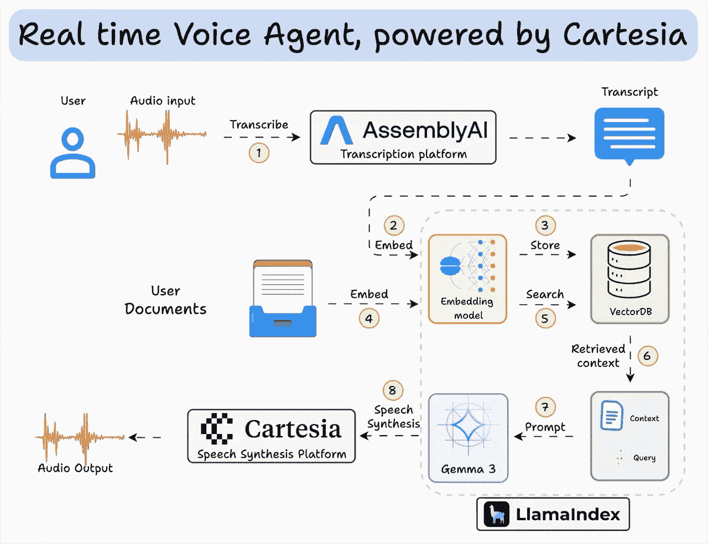
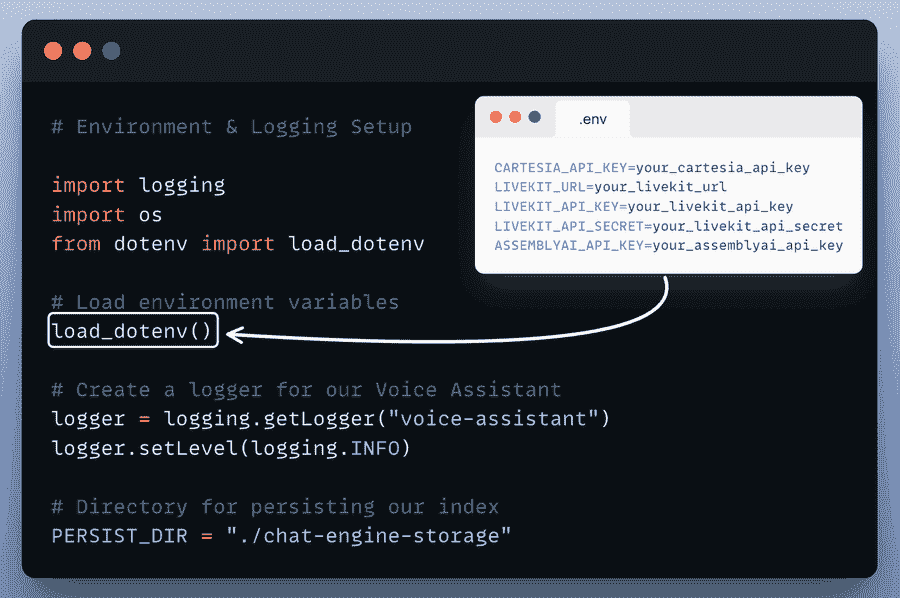
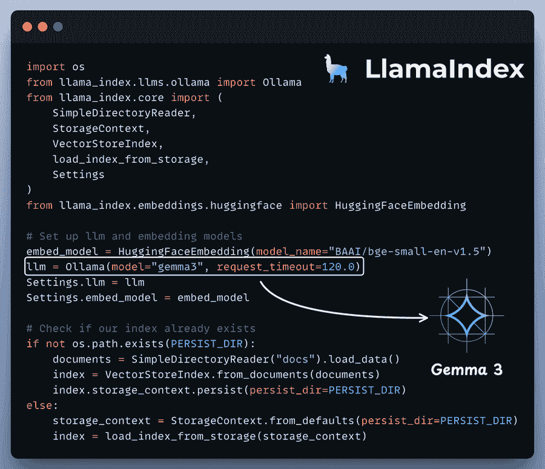
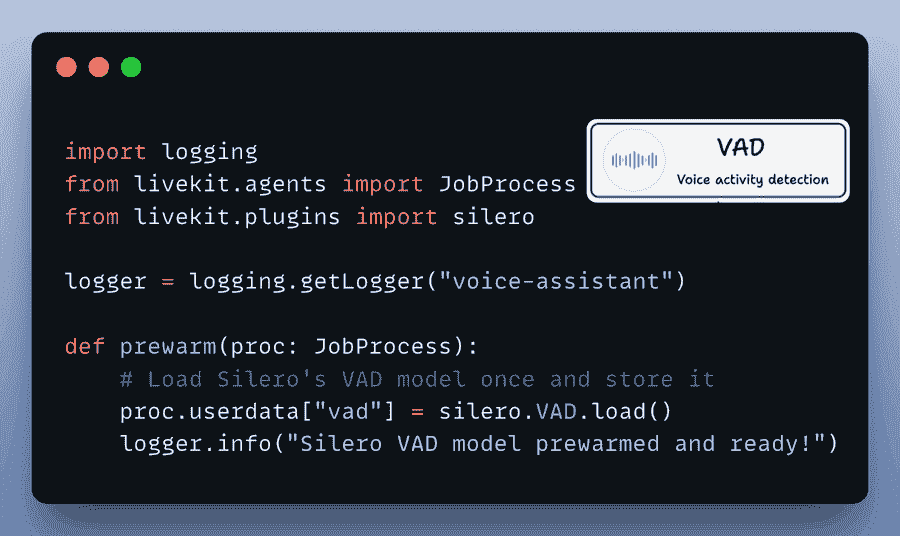
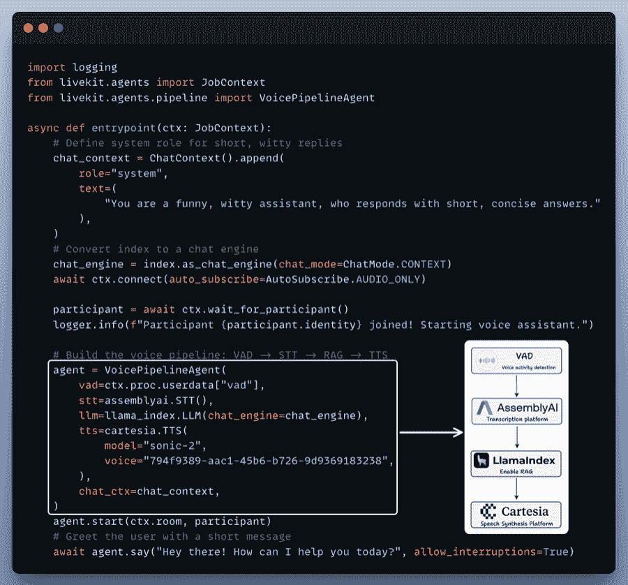
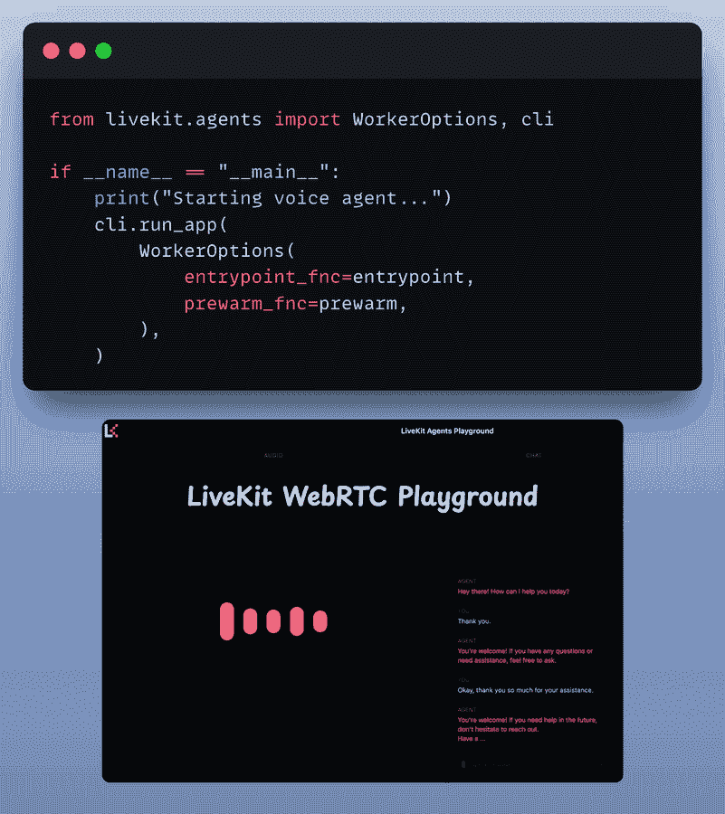

# 实时语音交互RAG智能体构建教程

> 来源：[https://v11enp9ok1h.feishu.cn/docx/UW9cdqvnyolEoGx7EudcW3CYnPg](https://v11enp9ok1h.feishu.cn/docx/UW9cdqvnyolEoGx7EudcW3CYnPg)

## 1. 系统架构概述



上图展示了基于Cartesia的实时语音Agent架构，主要包含以下组件和流程：

### 1.1 技术栈

+   **CartesiaAI**：用于最先进的文本转语音（SOTA text-to-speech）

+   **AssemblyAI**：用于语音转文本（speech-to-text）

+   **LlamaIndex**：提供RAG功能支持

+   **Livekit**：用于实时音视频编排

### 1.2 工作流程

1.  **音频输入**：用户通过麦克风输入语音

1.  **语音转文本**：AssemblyAI将音频转录为文本

1.  **文档嵌入**：用户文档通过嵌入模型转换为向量

1.  **向量存储**：嵌入后的文档存储在VectorDB中

1.  **检索上下文**：根据用户查询从向量数据库检索相关上下文

1.  **生成回答**：使用Gemma 3模型结合上下文生成回答

1.  **文本转语音**：Cartesia将生成的文本转换为语音输出

## 2. 环境设置与日志配置

首先，我们需要设置开发环境并配置日志系统，确保能够从.env文件加载配置并实时跟踪所有操作。



### 2.1 安装依赖与配置

```
import logging
import os
from dotenv import load_dotenv

# 加载环境变量
load_dotenv()# 为语音助手创建日志器
logger = logging.getLogger(&quot;voice-assistant&quot;)
logger.setLevel(logging.INFO)# 用于持久化索引的目录
PERSIST_DIR = &quot;./chat-engine-storage&quot;
```

### 2.2 环境变量配置（.env文件）

```
CARTESIA_API_KEY=your_cartesia_api_key
LIVEKIT_URL=your_livekit_url
LIVEKIT_API_KEY=your_livekit_api_key
LIVEKIT_API_SECRET=your_livekit_api_secret
ASSEMBLYAI_API_KEY=your_assemblyai_api_key
```

## 3. RAG设置

接下来，我们需要设置检索增强生成（RAG）系统，这是Agent能够基于用户文档生成回答的核心。



### 3.1 配置嵌入模型和索引

```
import os
from llama_index.llms.ollama import Ollama
from llama_index.core import (
    StorageContext,
    load_index_from_storage,
    VectorStoreIndex,
    SimpleDirectoryReader,
    settings,)from llama_index.embeddings.huggingface import HuggingFaceEmbeddings

# 设置LLM和嵌入模型
llm = Ollama(model_name=&quot;gemma-2b-it&quot;)
embed_model = HuggingFaceEmbeddings(model_name=&quot;BAAI/bge-small-en-v1.5&quot;)

settings.llm = llm
settings.embed_model = embed_model

# 检查持久化目录是否存在if not os.path.exists(PERSIST_DIR):# 从文档加载数据
    documents = SimpleDirectoryReader(&quot;docs&quot;).load_data()
    index = VectorStoreIndex.from_documents(documents)# 持久化索引
    index.storage_context.persist(persist_dir=PERSIST_DIR)else:# 从持久化目录加载索引
    storage_context = StorageContext.from_defaults(persist_dir=PERSIST_DIR)
    index = load_index_from_storage(storage_context)
```

这里我们使用了**Gemma 3**模型作为LLM（大语言模型），它将负责基于检索到的上下文生成回答。

## 4. 语音活动检测（VAD）设置

为了实现流畅的实时体验，我们需要添加语音活动检测（VAD）功能。我们将"预热"Silero VAD模型，以检测用户何时正在说话。



### 4.1 VAD模型初始化代码

```
import logging
from livekit.agents import JobProcess
from livekit.plugins import silero

logger = logging.getLogger(&quot;voice-assistant&quot;)def prewarm(proc: JobProcess):# 加载VAD模型并存储
    proc.userdata[&quot;vad&quot;] = silero.VAD.load()
    logger.info(&quot;Silero VAD model prewarmed and ready&quot;)
```

## 5. VoicePipelineAgent和入口点

这是我们将所有组件整合在一起的地方。VoicePipelineAgent将处理实时音频流、转录、RAG处理和语音合成的完整流程。

### 5.1 核心功能



VoicePipelineAgent实现了以下功能：

1.  监听实时音频

1.  使用AssemblyAI进行转录

1.  通过LlamaIndex结合文档生成回答

1.  使用Cartesia将回答转换为语音

### 5.2 代码实现

```
import logging
from livekit.agents import JobContext
from livekit.agents.pipeline import VoicePipelineAgent

async def entrypoint(ctx: JobContext):# 定义系统提示，指导助手行为
    chat_context = ChatContext()
    chat_context.append(
        role=&quot;system&quot;,
        text=&quot;You are a funny, witty assistant, who responds with short, concise answers.&quot;,)# 将索引转换为聊天引擎
    chat_engine = index.as_chat_engine(chat_mode=ChatMode.CONTEXT)await ctx.connect(auto_subscribe=AutoSubscribe.AUTO_ONLY)
    participant = await ctx.wait_for_participant()
    logger.info(f&quot;Participant {participant.identity} joined! Starting voice assistant.&quot;)# 构建语音管道：VAD → STT → RAG → TTS
    agent = VoicePipelineAgent(
        vad=ctx.userdata[&quot;vad&quot;],
        stt=assemblyai.STT(),
        llm=llama_index.LlamaIndexChatEngine(chat_engine),
        tts=cartesia.TTS(
            model=&quot;sonic-24khz&quot;,
            voice=&quot;794f9889-a8c1-45b6-b726-09d59619b238&quot;,),
        chat=ctx.chat_context,)
    
    agent.start(ctx.room, participant)# 用简短消息问候用户await agent.say(&quot;Hey there! How can I help you today?&quot;, allow_interruptions=True)
```

## 6. 运行应用程序

最后，我们将所有内容整合在一起，指定预热函数和主入口点来运行Agent。



### 6.1 主程序代码

```
from livekit.agents import WorkerOptions, cli

if __name__ == &quot;__main__&quot;:print(&quot;Starting voice agent...&quot;)
    cli.run_app(
        WorkerOptions(
            entrypoint_fn=entrypoint,
            prewarm_fn=prewarm,),)
```

运行上述代码后，你可以通过LiveKit WebRTC Playground测试实时语音交互：

## 7. 总结

恭喜！你已经成功构建了一个实时语音RAGAgent。这个Agent能够：

1.  监听实时音频输入

1.  使用AssemblyAI将语音转录为文本

1.  通过LlamaIndex结合用户文档生成回答

1.  使用Cartesia将文本回答转换为自然语音

## 8. 扩展建议

+   尝试不同的语音合成模型和声音

+   优化VAD参数以提高语音检测准确性

+   添加多语言支持

+   实现情感分析以调整回答语气

+   增加对话历史管理功能

希望本教程能帮助你构建自己的实时语音RAGAgent！如有任何问题或建议，请在评论区留言。