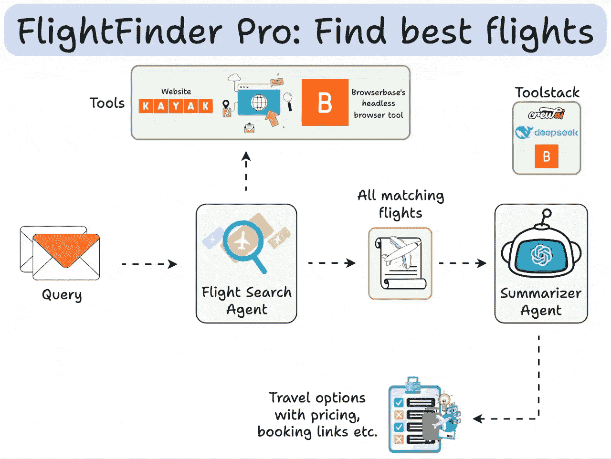
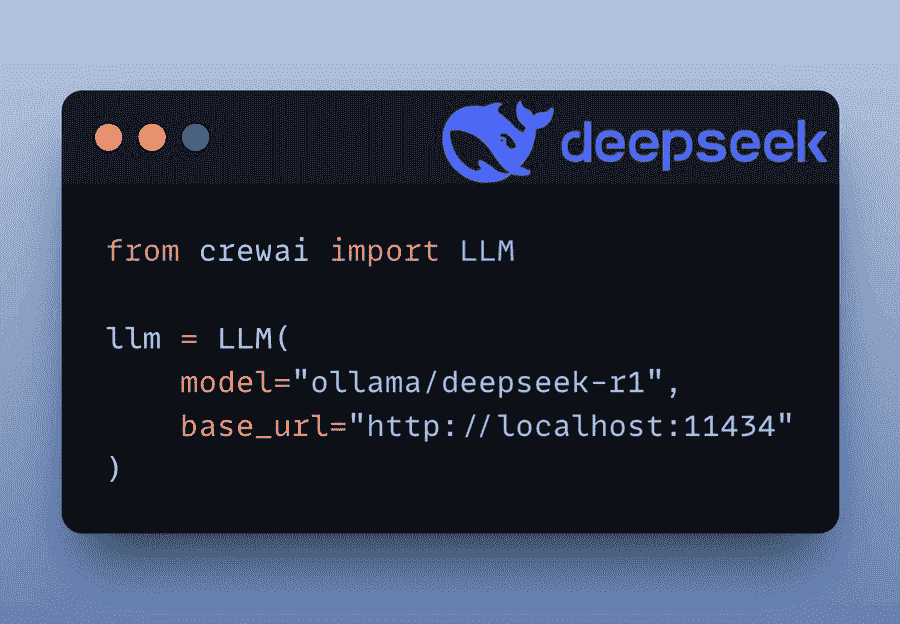
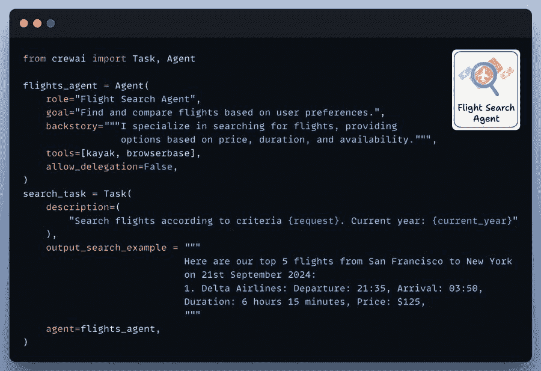
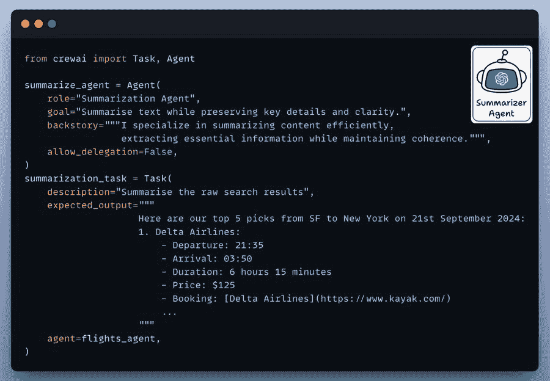
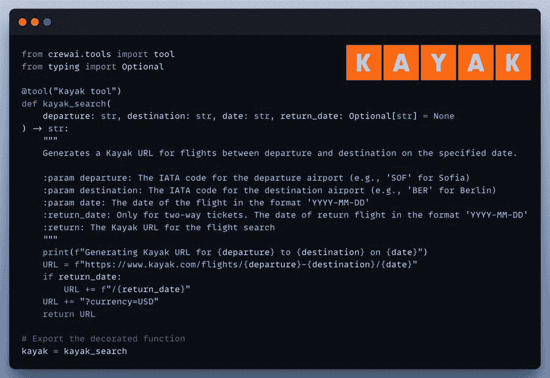
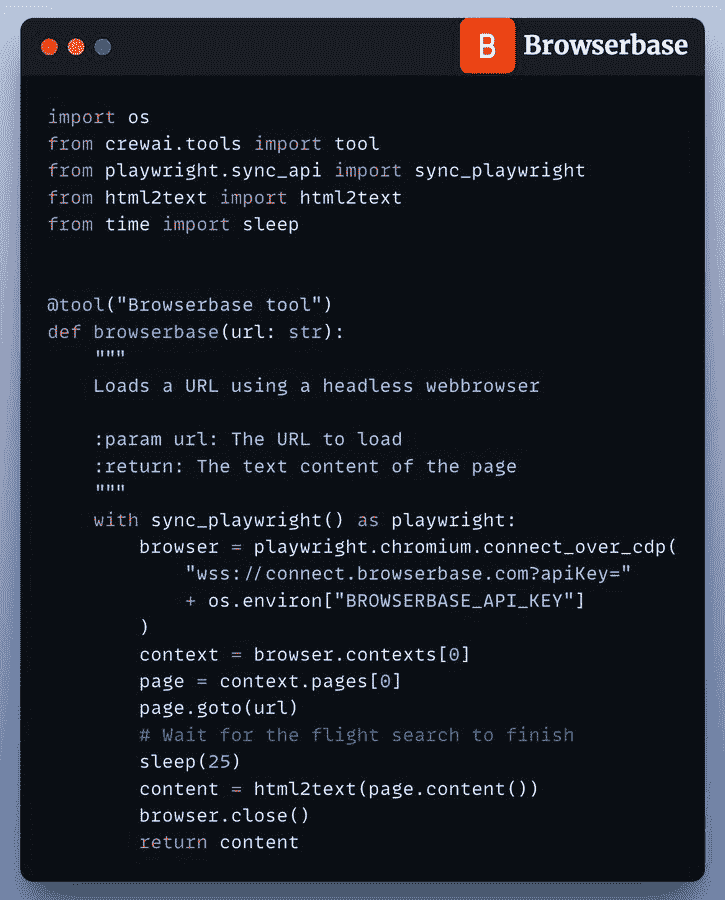
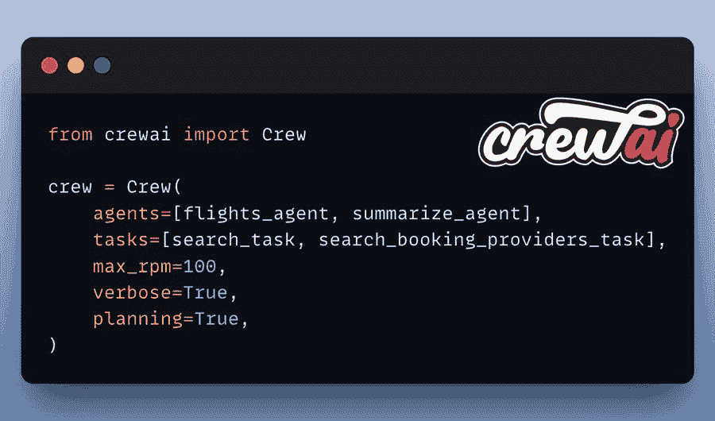
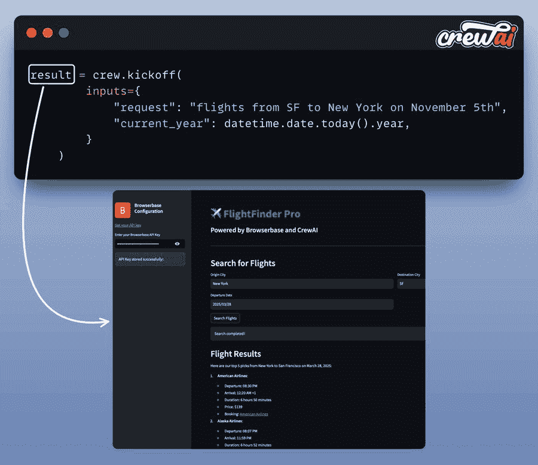
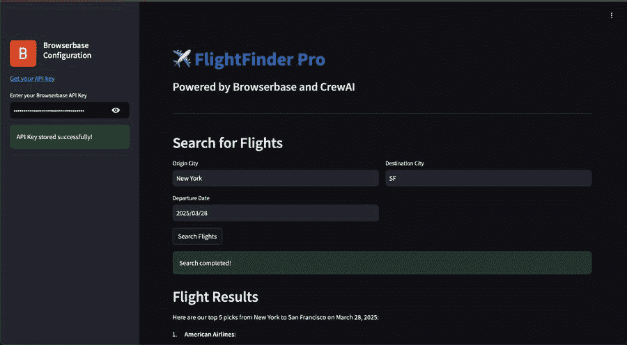

# 多智能体航班搜索系统实现指南

> 来源：[https://v11enp9ok1h.feishu.cn/docx/EMpndtljAo7aiKxqOO1cGXT5nnh](https://v11enp9ok1h.feishu.cn/docx/EMpndtljAo7aiKxqOO1cGXT5nnh)

## 系统架构：多智能体协作的核心设计



### 整体框架

**Flig**htFinder Pro采用分层架构设计，包含三大核心组件：

+   **用户交互层**：Streamlit界面接收自然语言查询

+   **智能体协作层**：CrewAI编排航班搜索与结果摘要智能体

+   **工具执行层**：Kayak URL生成器与Browserbase无头浏览器

### 工作流程

1.  **查询解析**：将"从旧金山到纽约的11月5日航班"转化为结构化参数

1.  **动态搜索**：模拟人类浏览行为获取实时航班数据

1.  **结果优化**：提取关键信息并生成用户友好的摘要报告

```
graph TD
    A[用户查询] --&gt; B{航班搜索智能体}
    B --&gt; C[Kayak工具生成URL]
    B --&gt; D[Browserbase获取数据]
    D --&gt; E{摘要智能体}
    E --&gt; F[格式化结果]
    F --&gt; G[Streamlit展示]
```

## 技术栈选型：构建智能系统的关键工具

### 核心框架

+   **CrewAI**：多智能体协作编排，支持角色定义与任务分配

+   **DeepSeek-R1**：本地部署的大语言模型，负责自然语言理解

+   **Ollama**：轻量级LLM管理工具，简化模型部署流程

### 工具集成

+   **Kayak API**：航班数据来源，提供实时票价与 availability 信息

+   **Browserbase**：无头浏览器服务，模拟人类交互获取动态内容

+   **Streamlit**：快速构建数据应用界面，实现即时交互

> **技术优势**：通过本地LLM部署（Ollama+DeepSeek）保障数据隐私，同时Browserbase的动态渲染能力解决了传统爬虫无法处理JavaScript渲染页面的问题。

## 实现步骤：从代码到系统的全流程

### 1. 环境配置与依赖安装

```
# 安装核心框架
pip install crewai playwright html2text streamlit

# 启动Ollama服务并拉取模型
ollama pull deepseek-ri
ollama serve
```

### 2. 大语言模型配置



```
from crewai import LLM

# 配置本地DeepSeek模型
llm = LLM(
    model=&quot;ollama/deepseek-ri&quot;,  # 模型名称
    base_url=&quot;http://localhost:11434&quot;  # Ollama服务地址)
```

### 3. 智能体定义

#### 航班搜索智能体



```
from crewai import Task, Agent

flights_agent = Agent(
    role=&quot;航班搜索专家&quot;,
    goal=&quot;根据用户偏好查找并比较航班选项&quot;,
    backstory=&quot;&quot;&quot;我专注于航班搜索领域，能够根据价格、时长和可用性提供最优选择。
    通过模拟人类浏览行为，我可以获取实时航班数据并进行多维度比较。&quot;&quot;&quot;,
    tools=[kayak, browserbase],  # 绑定工具
    allow_delegation=False,  # 禁止任务委派)# 定义搜索任务
search_task = Task(
    description=&quot;根据用户请求搜索航班（出发地、目的地、日期）&quot;,
    expected_output=&quot;&quot;&quot;返回格式示例：
    1. 达美航空：
       - 出发：21:35
       - 到达：03:50
       - 时长：6小时15分钟
       - 价格：$125
       - 预订链接：[达美航空](https://www.kayak.com/)&quot;&quot;&quot;,
    agent=flights_agent
)
```

#### 摘要智能体



```
summarize_agent = Agent(
    role=&quot;信息摘要专家&quot;,
    goal=&quot;提炼关键信息并保持内容清晰度&quot;,
    backstory=&quot;&quot;&quot;我擅长将复杂数据转化为易于理解的摘要，
    在保留关键细节的同时确保信息简洁明了。&quot;&quot;&quot;,
    allow_delegation=False,)

summarization_task = Task(
    description=&quot;总结原始搜索结果&quot;,
    agent=summarize_agent
)
```

### 4. 工具实现


#### Kayak URL生成工具



```
from crewai.tools import tool
from typing import Optional

@tool(&quot;Kayak搜索工具&quot;)def kayak_search(
    departure: str, 
    destination: str, 
    date: str, 
    return_date: Optional[str] = None) -&gt; str:&quot;&quot;&quot;生成Kayak航班搜索URL&quot;&quot;&quot;
    url = f&quot;https://www.kayak.com/flights/{departure}-{destination}/{date}&quot;if return_date:
        url += f&quot;/{return_date}&quot;return url + &quot;?currency=USD&quot;  # 指定货币单位
```

#### Browserbase无头浏览器工具



```
from playwright.sync_api import sync_playwright
from html2text import html2text

@tool(&quot;Browserbase浏览工具&quot;)def browserbase(url: str) -&gt; str:&quot;&quot;&quot;使用无头浏览器加载URL并提取文本内容&quot;&quot;&quot;with sync_playwright() as p:# 连接Browserbase服务
        browser = p.chromium.connect_over_cdp(f&quot;wss://connect.browserbase.com?apiKey={os.environ[&#x27;BROWSERBASE_API_KEY&#x27;]}&quot;)
        page = browser.contexts[0].pages[0]
        page.goto(url)
        page.wait_for_timeout(25000)  # 等待动态内容加载
        content = html2text(page.content())
        browser.close()return content
```

### 5. 智能体协同配置



```
from crewai import Crew

# 创建智能体团队
flight_crew = Crew(
    agents=[flights_agent, summarize_agent],
    tasks=[search_task, summarization_task],
    max_rpm=100,  # 速率限制
    verbose=True,  # 详细日志
    planning=True  # 启用任务规划功能)# 执行搜索任务
result = flight_crew.kickoff(inputs={&quot;request&quot;: &quot;flights from SF to New York on November 5th&quot;,&quot;current_year&quot;: datetime.date.today().year
})
```

## 界面设计：Streamlit实现用户交互



### 核心功能

+   自然语言查询输入框

+   实时结果展示区域

+   API密钥管理界面

```
import streamlit as st

st.title(&quot;✈️ FlightFinder Pro&quot;)
st.subheader(&quot;Powered by CrewAI &amp; Browserbase&quot;)# 侧边栏配置with st.sidebar:
    st.text_input(&quot;Browserbase API Key&quot;, type=&quot;password&quot;)
    st.button(&quot;保存配置&quot;)# 主界面
query = st.text_input(&quot;请输入航班需求&quot;, &quot;从纽约到旧金山的3月28日航班&quot;)if st.button(&quot;搜索航班&quot;):with st.spinner(&quot;正在查询...&quot;):
        result = flight_crew.kickoff(inputs={&quot;request&quot;: query})
        st.write(result)
```

### 界面预览



## 系统优化：提升性能与用户体验的关键策略

### 效率优化

+   **缓存机制**：对重复查询结果进行缓存，减少API调用

+   **并行处理**：同时搜索多个数据源，缩短响应时间

+   **智能等待**：基于页面加载状态动态调整等待时间，避免固定延迟

### 错误处理

+   航班数据获取失败时自动重试（最多3次）

+   无效日期输入时提供格式化建议

+   API密钥缺失时引导用户完成配置

## 实际应用案例

### 商务出行场景

用户输入："帮我找下周二从芝加哥到伦敦的商务舱，预算$1500以内"

系统处理流程：

1.  解析关键参数：出发地(芝加哥)、目的地(伦敦)、日期(下周二)、舱位(商务)、预算($1500)

1.  调用Kayak工具生成带筛选条件的搜索URL

1.  提取并排序符合预算的航班选项

1.  生成包含转机信息和退改政策的摘要报告

### 家庭旅行规划

支持多人同行、儿童票查询、特殊饮食需求等复杂场景，通过多智能体协作完成多维度搜索。

## 未来扩展方向

### 功能增强

+   酒店与航班捆绑搜索

+   价格趋势分析与预测

+   用户偏好学习系统

### 技术升级

+   多模态交互（语音输入/输出）

+   知识图谱整合（景点与航班关联推荐）

+   移动端适配（React Native重写前端）

## 总结：AI智能体协作的变革潜力

FlightFinder Pro展示了多**智能体系统**在旅行规划领域的强大能力，**通过角色**专业化（搜索专家vs摘要专家）和工具协同（Kayak+Browserbase），实现了传统单一工具无法企及的灵活性与智能化水平。本地LLM部署确保了数据隐私，而模块化设计使得系统易于扩展和维护。