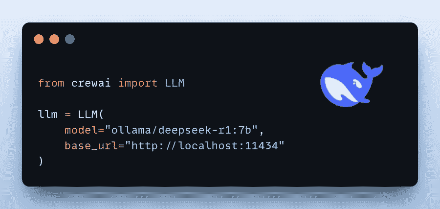
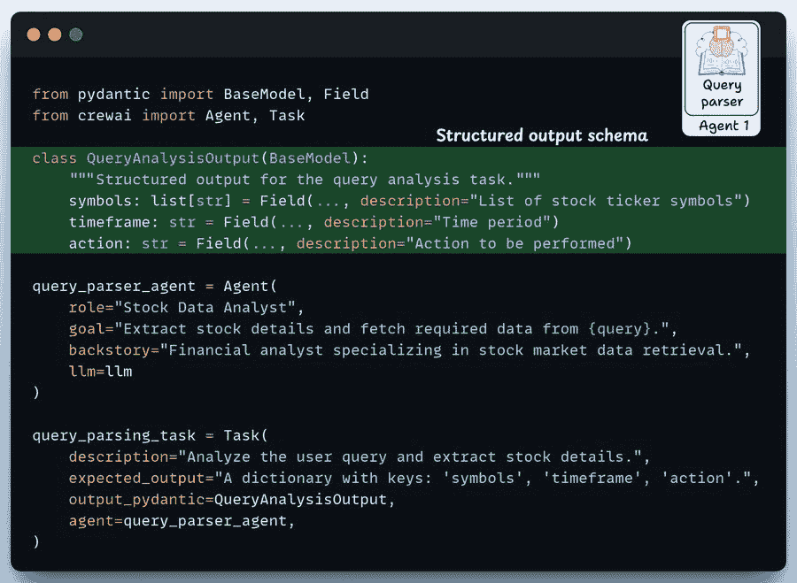
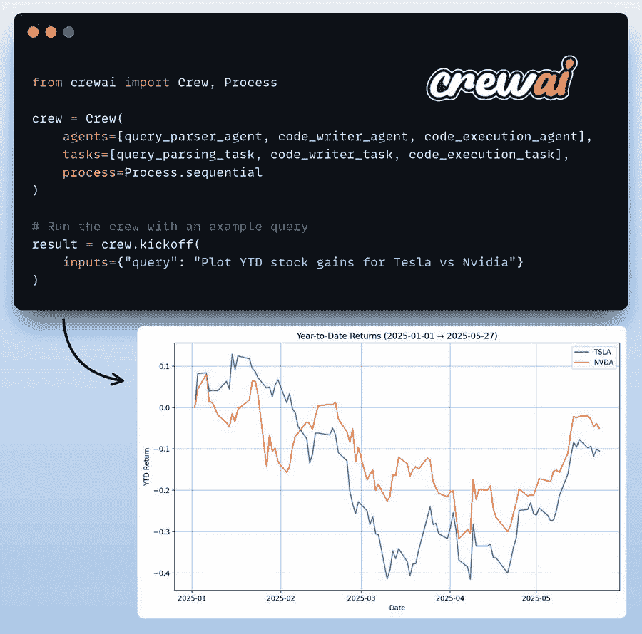
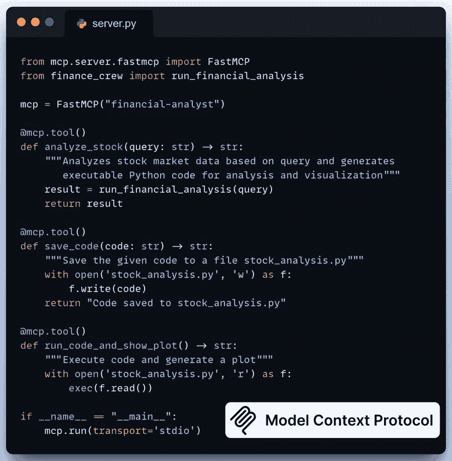
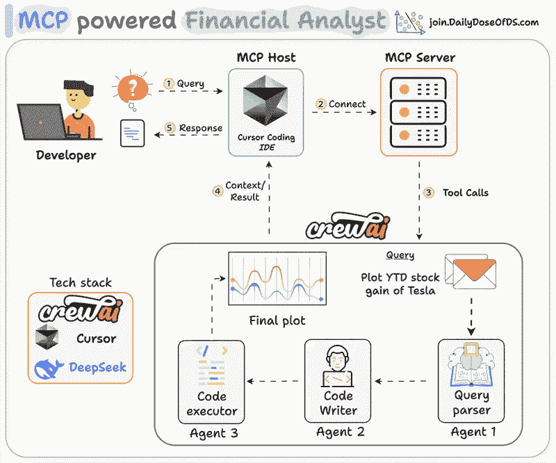
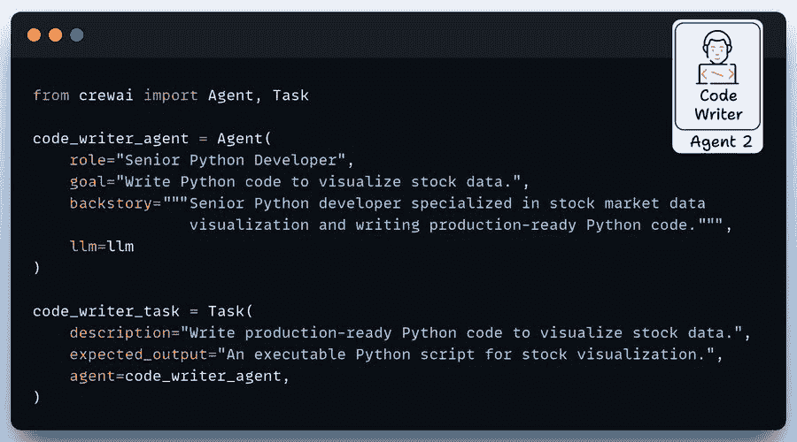
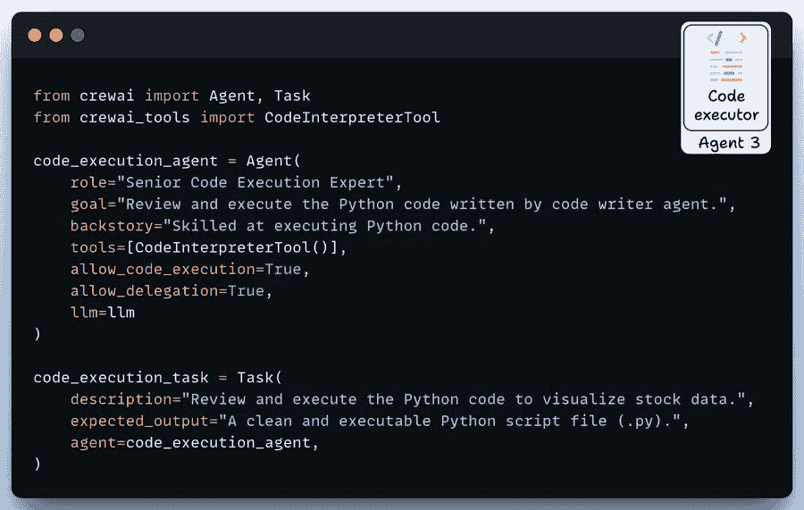

# Cursor +MCP金融分析Agent

> 来源：[https://v11enp9ok1h.feishu.cn/docx/LVDNdKe6KoUyijxQmFBcfLOOnWh](https://v11enp9ok1h.feishu.cn/docx/LVDNdKe6KoUyijxQmFBcfLOOnWh)

构建一个 MCP 驱动的 AI Agent，直接从 Cursor 或 Claude Desktop 获取、分析股票市场趋势并生成洞察。


### 技术栈

+   **CrewAI** **for mu**lti-agent orchestration
CrewAI 用于多代理编排

+   **Ollama** **to loc**ally serve DeepSeek-R1 LLM
Ollama 本地部署 DeepSeek-R1 大语言模型

+   **Cursor**** as th**e MCP host
Cursor 作为 MCP 主机

### 工作流程

1.  用户提交查询。

1.  MCP 代理启动金融分析师团队。

1.  团队进行研究并创建可执行脚本。

1.  代理运行脚本生成分析图表。

### 设置 LLM

我们将使用 DeepSeek-R1 作为大语言模型，通过 Ollama 在本地部署。



```
from crewai import LLM

llm = LLM(
    model=&quot;ollama/deepseek-r1:7b&quot;,
    base_url=&quot;http://localhost:11434&quot;
)
```

### 查询解析器代理

该代理接受自然语言查询，并使用 Pydantic 提取结构化输出。这确保了后续处理的输入干净且结构化！



```
from pydantic import BaseModel, Field
from crewai import Agent, Task

class QueryAnalysisOutput(BaseModel):
    &quot;&quot;&quot;查询分析任务的结构化输出。&quot;&quot;&quot;
    symbols: list[str] = Field(..., description=&quot;股票代码列表&quot;)
    timeframe: str = Field(..., description=&quot;时间周期&quot;)
    action: str = Field(..., description=&quot;要执行的操作&quot;)

query_parser_agent = Agent(
    role=&quot;股票数据分析师&quot;,
    goal=&quot;从{query}中提取股票详情并获取所需数据。&quot;,
    backstory=&quot;专注于股票市场数据检索的金融分析师。&quot;,
    llm=llm
)

query_parsing_task = Task(
    description=&quot;分析用户查询并提取股票详情。&quot;,
    expected_output=&quot;包含&#x27;symbols&#x27;、&#x27;timeframe&#x27;、&#x27;action&#x27;键的字典。&quot;,
    output_pydantic=QueryAnalysisOutput,
    agent=query_parser_agent,
)
```

### 代码编写Agent

该Agent使用 Pandas、Matplotlib 和 Yahoo Finance 库编写 Python 代码以可视化股票数据。


```
from crewai import Agent, Task

code_writer_agent = Agent(
    role=&quot;高级Python开发者&quot;,
    goal=&quot;编写Python代码以可视化股票数据。&quot;,
    backstory=&quot;&quot;&quot;专注于股票市场数据可视化和编写生产级Python代码的高级Python开发者。&quot;&quot;&quot;,
    llm=llm
)

code_writer_task = Task(
    description=&quot;编写生产级Python代码以可视化股票数据。&quot;,
    expected_output=&quot;用于股票可视化的可执行Python脚本。&quot;,
    agent=code_writer_agent,
)
```

### 代码执行


```
from crewai import Agent, Task
from crewai_tools import CodeInterpreterTool

code_execution_agent = Agent(
    role=&quot;高级代码执行专家&quot;,
    goal=&quot;审查并执行代码编写代理编写的Python代码。&quot;,
    backstory=&quot;擅长执行Python代码。&quot;,
    tools=[CodeInterpreterTool()],
    allow_code_execution=True,
    allow_delegation=True,
    llm=llm
)

code_execution_task = Task(
    description=&quot;审查并执行用于股票数据可视化的Python代码。&quot;,
    expected_output=&quot;干净且可执行的Python脚本文件（.py）。&quot;,
    agent=code_execution_agent,
)
```

### 设置团队并启动



```
from crewai import Crew, Process

crew = Crew(
    agents=[query_parser_agent, code_writer_agent, code_execution_agent],
    tasks=[query_parsing_task, code_writer_task, code_execution_task],
    process=Process.sequential
)

# 使用示例查询运行团队
result = crew.kickoff(
    inputs={&quot;query&quot;: &quot;绘制特斯拉与英伟达的年初至今股票涨幅&quot;}
)
```

### 创建 MCP 服务器

现在，我们将金融分析师封装在 MCP 工具中，并添加两个工具以增强用户体验。

+   save_code -> 将生成的代码保存到本地目录

+   run_code_and_show_plot -> 执行代码并生成图表



```
from mcp.server.fastmcp import FastMCP
from finance_crew import run_financial_analysis

mcp = FastMCP(&quot;financial-analyst&quot;)

@mcp.tool()
def analyze_stock(query: str) -&gt; str:
    &quot;&quot;&quot;基于查询分析股票市场数据并生成可执行的Python代码用于分析和可视化&quot;&quot;&quot;
    result = run_financial_analysis(query)
    return result

@mcp.tool()
def save_code(code: str) -&gt; str:
    &quot;&quot;&quot;将给定代码保存到文件stock_analysis.py&quot;&quot;&quot;
    with open(&#x27;stock_analysis.py&#x27;, &#x27;w&#x27;) as f:
        f.write(code)
    return &quot;代码已保存到stock_analysis.py&quot;

@mcp.tool()
def run_code_and_show_plot() -&gt; str:
    &quot;&quot;&quot;执行代码并生成图表&quot;&quot;&quot;
    with open(&#x27;stock_analysis.py&#x27;, &#x27;r&#x27;) as f:
        exec(f.read())
    return &quot;代码执行完毕并生成图表&quot;

if __name__ == &quot;__main__&quot;:
    mcp.run(transport=&quot;stdio&quot;)
```

### **Cursor** +MCP金融分析Agent

构建一个 MCP 驱动的 AI Agent，直接从 Cursor 或 Claude Desktop 获取、分析股票市场趋势并生成洞察。



### 技术栈

+   **CrewAI** **for mu**lti-agent orchestration
CrewAI 用于多代理编排

+   **Ollama** **to loc**ally serve DeepSeek-R1 LLM
Ollama 本地部署 DeepSeek-R1 大语言模型

+   **Cursor**** as th**e MCP host
Cursor 作为 MCP 主机

### 工作流程

1.  用户提交查询。

1.  MCP 代理启动金融分析师团队。

1.  团队进行研究并创建可执行脚本。

1.  代理运行脚本生成分析图表。

### 设置 LLM

我们将使用 DeepSeek-R1 作为大语言模型，通过 Ollama 在本地部署。


```
from crewai import LLM

llm = LLM(
    model=&quot;ollama/deepseek-r1:7b&quot;,
    base_url=&quot;http://localhost:11434&quot;
)
```

### 查询解析器代理

该代理接受自然语言查询，并使用 Pydantic 提取结构化输出。这确保了后续处理的输入干净且结构化！


```
from pydantic import BaseModel, Field
from crewai import Agent, Task

class QueryAnalysisOutput(BaseModel):
    &quot;&quot;&quot;查询分析任务的结构化输出。&quot;&quot;&quot;
    symbols: list[str] = Field(..., description=&quot;股票代码列表&quot;)
    timeframe: str = Field(..., description=&quot;时间周期&quot;)
    action: str = Field(..., description=&quot;要执行的操作&quot;)

query_parser_agent = Agent(
    role=&quot;股票数据分析师&quot;,
    goal=&quot;从{query}中提取股票详情并获取所需数据。&quot;,
    backstory=&quot;专注于股票市场数据检索的金融分析师。&quot;,
    llm=llm
)

query_parsing_task = Task(
    description=&quot;分析用户查询并提取股票详情。&quot;,
    expected_output=&quot;包含&#x27;symbols&#x27;、&#x27;timeframe&#x27;、&#x27;action&#x27;键的字典。&quot;,
    output_pydantic=QueryAnalysisOutput,
    agent=query_parser_agent,
)
```

### 代码编写Agent

该Agent使用 Pandas、Matplotlib 和 Yahoo Finance 库编写 Python 代码以可视化股票数据。



```
from crewai import Agent, Task

code_writer_agent = Agent(
    role=&quot;高级Python开发者&quot;,
    goal=&quot;编写Python代码以可视化股票数据。&quot;,
    backstory=&quot;&quot;&quot;专注于股票市场数据可视化和编写生产级Python代码的高级Python开发者。&quot;&quot;&quot;,
    llm=llm
)

code_writer_task = Task(
    description=&quot;编写生产级Python代码以可视化股票数据。&quot;,
    expected_output=&quot;用于股票可视化的可执行Python脚本。&quot;,
    agent=code_writer_agent,
)
```

### 代码执行



```
from crewai import Agent, Task
from crewai_tools import CodeInterpreterTool

code_execution_agent = Agent(
    role=&quot;高级代码执行专家&quot;,
    goal=&quot;审查并执行代码编写代理编写的Python代码。&quot;,
    backstory=&quot;擅长执行Python代码。&quot;,
    tools=[CodeInterpreterTool()],
    allow_code_execution=True,
    allow_delegation=True,
    llm=llm
)

code_execution_task = Task(
    description=&quot;审查并执行用于股票数据可视化的Python代码。&quot;,
    expected_output=&quot;干净且可执行的Python脚本文件（.py）。&quot;,
    agent=code_execution_agent,
)
```

### 设置团队并启动


```
from crewai import Crew, Process

crew = Crew(
    agents=[query_parser_agent, code_writer_agent, code_execution_agent],
    tasks=[query_parsing_task, code_writer_task, code_execution_task],
    process=Process.sequential
)

# 使用示例查询运行团队
result = crew.kickoff(
    inputs={&quot;query&quot;: &quot;绘制特斯拉与英伟达的年初至今股票涨幅&quot;}
)
```

### 创建 MCP 服务器

现在，我们将金融分析师封装在 MCP 工具中，并添加两个工具以增强用户体验。

+   save_code -> 将生成的代码保存到本地目录

+   run_code_and_show_plot -> 执行代码并生成图表


```
from mcp.server.fastmcp import FastMCP
from finance_crew import run_financial_analysis

mcp = FastMCP(&quot;financial-analyst&quot;)

@mcp.tool()
def analyze_stock(query: str) -&gt; str:
    &quot;&quot;&quot;基于查询分析股票市场数据并生成可执行的Python代码用于分析和可视化&quot;&quot;&quot;
    result = run_financial_analysis(query)
    return result

@mcp.tool()
def save_code(code: str) -&gt; str:
    &quot;&quot;&quot;将给定代码保存到文件stock_analysis.py&quot;&quot;&quot;
    with open(&#x27;stock_analysis.py&#x27;, &#x27;w&#x27;) as f:
        f.write(code)
    return &quot;代码已保存到stock_analysis.py&quot;

@mcp.tool()
def run_code_and_show_plot() -&gt; str:
    &quot;&quot;&quot;执行代码并生成图表&quot;&quot;&quot;
    with open(&#x27;stock_analysis.py&#x27;, &#x27;r&#x27;) as f:
        exec(f.read())
    return &quot;代码执行完毕并生成图表&quot;

if __name__ == &quot;__main__&quot;:
    mcp.run(transport=&quot;stdio&quot;)
```