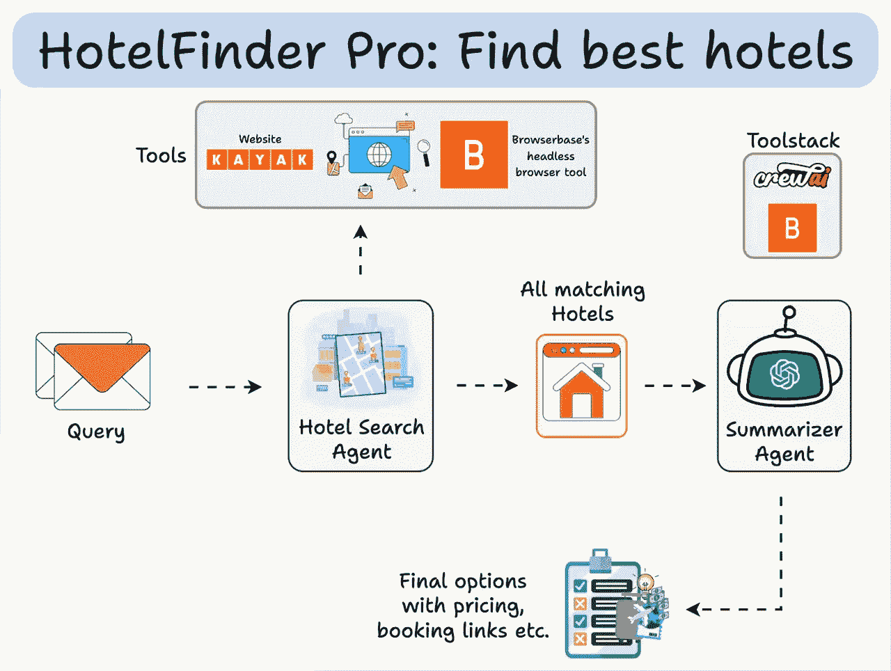
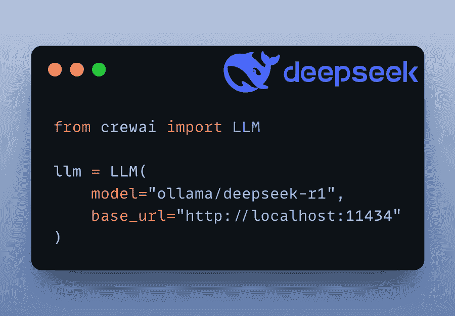
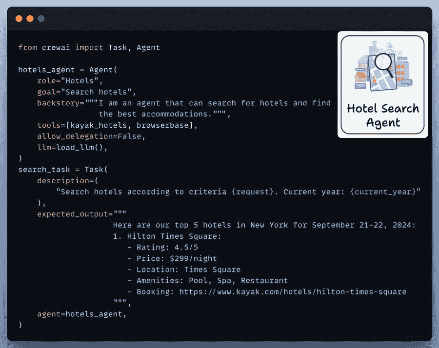

# 多智能体酒店查找器

> 来源：[https://v11enp9ok1h.feishu.cn/docx/J3NVdm09joBJwqxA9qQc78hqnZb](https://v11enp9ok1h.feishu.cn/docx/J3NVdm09joBJwqxA9qQc78hqnZb)

构建一个智能体工作流，解析旅行查询，从Kayak获取实时航班和酒店数据，并总结最佳选项。



#### 技术栈：

+   CrewAI用于多智能体编排

+   Browserbase的无头浏览器工具

+   Ollama用于本地部署DeepSeek-R1

#### 工作流程：

+   解析查询（地点、日期等）以创建Kayak搜索URL

+   访问URL并提取排名前5的航班

+   为每家酒店查找价格和更多信息

+   总结酒店信息

### 实现步骤

#### 定义LLM

CrewAI可以很好地与所有流行的LLM和提供商集成！以下是如何使用Ollama设置本地DeepSeek：



```
from crewai import LLM
llm = LLM(
    model=&quot;ollama/deepseek-llm&quot;,
    base_url=&quot;http://localhost:11434&quot;)
```

#### 酒店搜索代理

该代理通过浏览网页模拟真人搜索酒店。它由browserbase的无头浏览器工具提供支持，可以在Kayak等网站上查找酒店。

