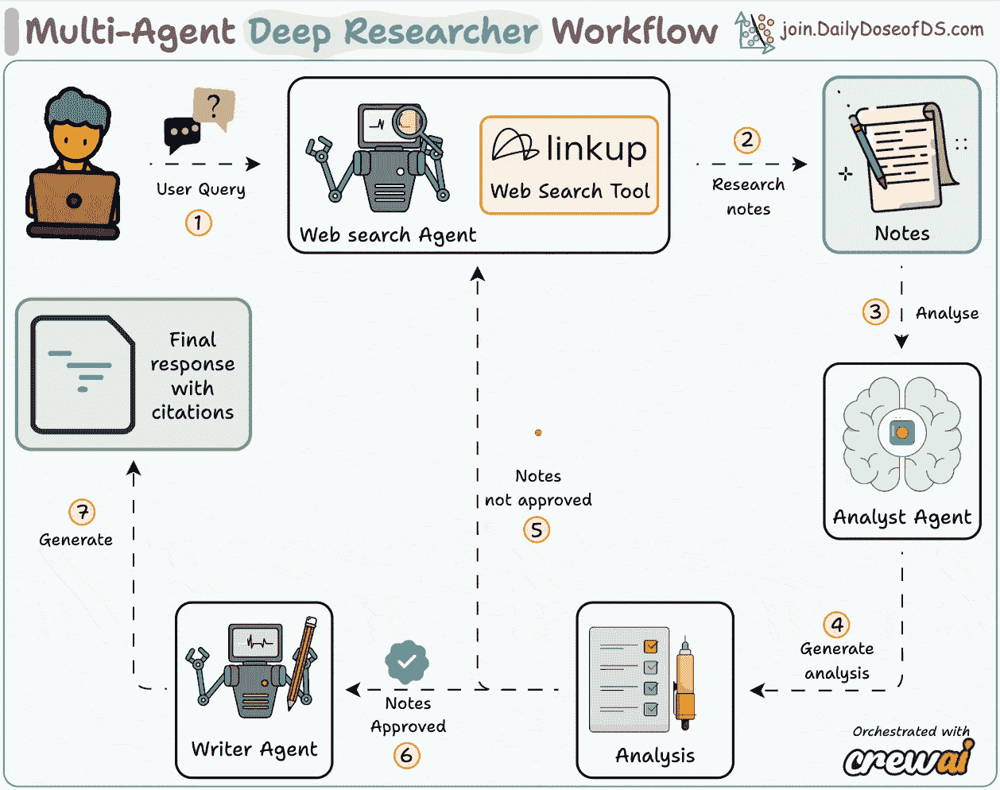
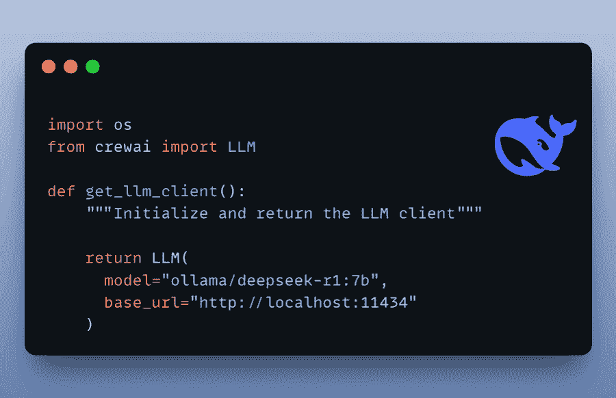
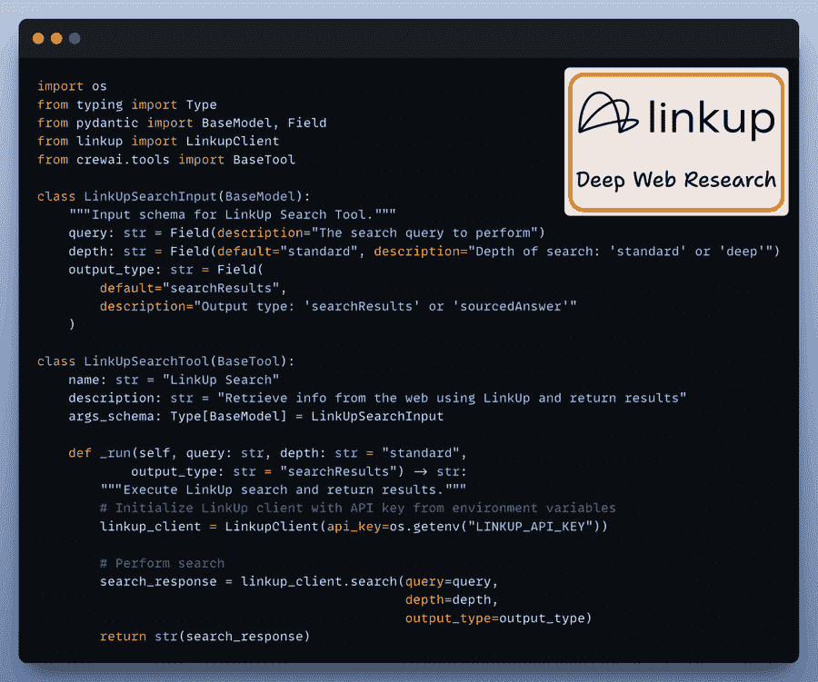

# 多智能体深度研究

> 来源：[https://v11enp9ok1h.feishu.cn/docx/J4U3duXaVoFsvaxIrIMccxBUnJd](https://v11enp9ok1h.feishu.cn/docx/J4U3duXaVoFsvaxIrIMccxBUnJd)

ChatGPT具有深度研究功能。它可以帮助你获取任何主题的详细见解。了解如何构建一个100%本地的替代方案。



### 技术栈：

+   Linkup平台用于深度网络研究

+   CrewAI用于多智能体编排

+   Ollama用于本地部署DeepSeek

+   Cursor作为MCP主机

### 工作流程：

+   用户提交查询

+   网络搜索智能体通过Linkup执行深度网络搜索

+   研究分析师验证并去重结果

+   技术作家撰写带有引用的连贯响应

### 实现

#### 设置大型语言模型

我们将使用Ollama在本地部署DeepSeek-R1。



```
import os
from crewai import LLM

def get_llm_client():&quot;&quot;&quot;初始化并返回LLM客户端&quot;&quot;&quot;return LLM(
        model=&quot;ollama/deepseek-r1:7b&quot;,
        base_url=&quot;http://localhost:11434&quot;)
```

#### 定义网络搜索工具

我们将使用Linkup平台强大的搜索能力，其性能可与Perplexity和OpenAI相媲美，为我们的网络搜索智能体提供支持。这通过定义智能体可以使用的自定义工具来实现。

