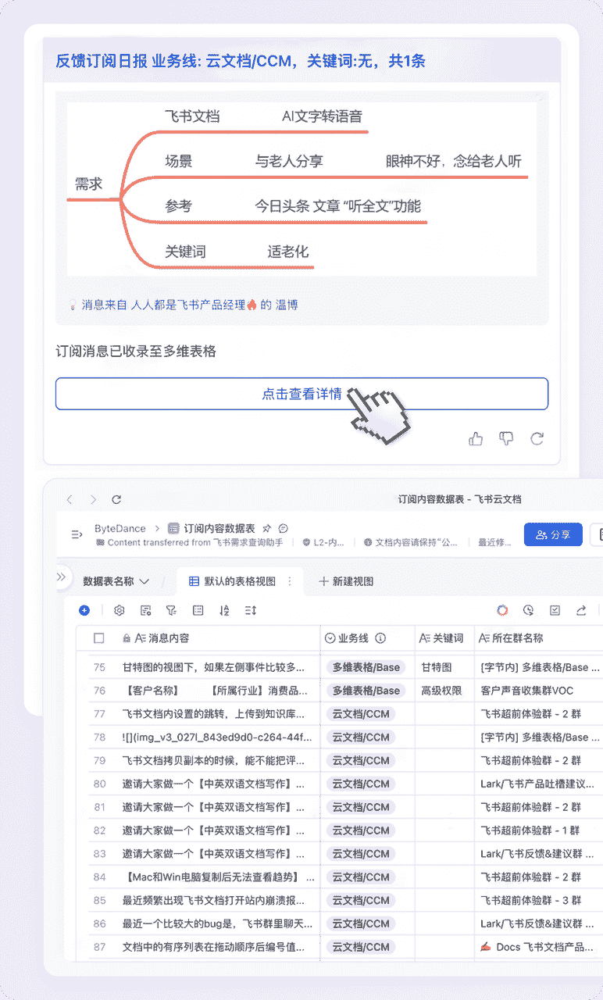
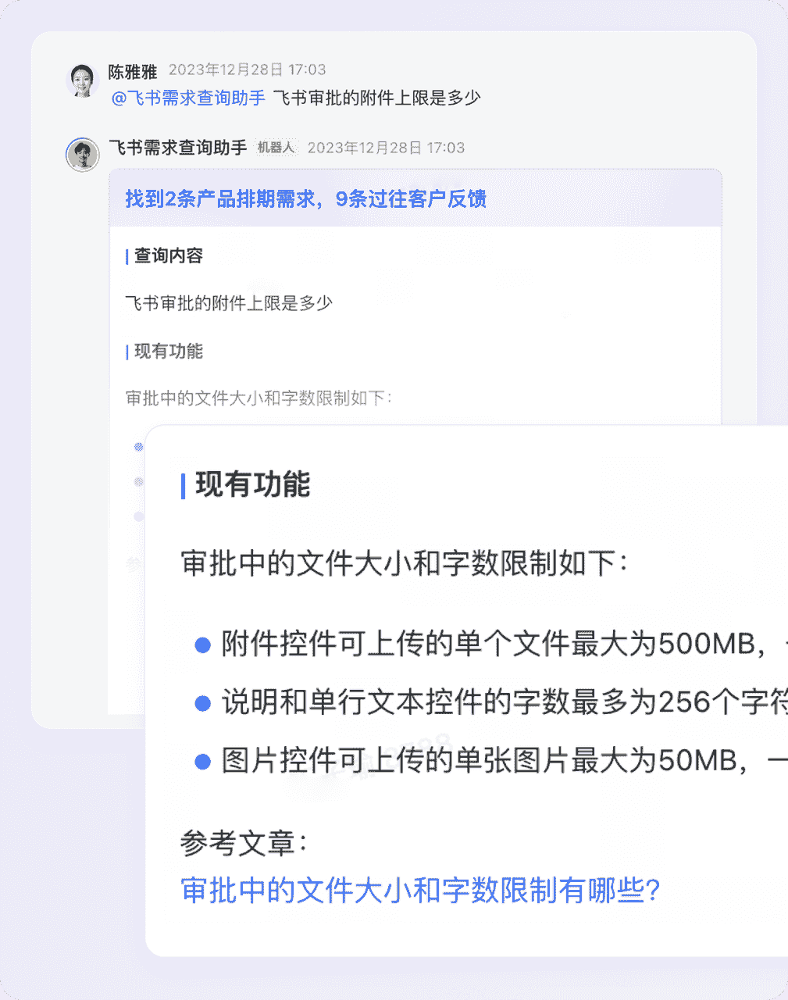

# AI Agent项目案例➡️需求查询助手

> 来源：[https://v11enp9ok1h.feishu.cn/docx/Ab5VdzUfZo4S29xyDqJclzrGnte](https://v11enp9ok1h.feishu.cn/docx/Ab5VdzUfZo4S29xyDqJclzrGnte)

# 🤖需求查询助手

> **「飞书需求查询助手」**是飞书内部使用 飞书智能伙伴创建平台（Aily） 解决业务场景的实践之一，用于帮助 GTM 团队快速查询客户反馈、了解需求进展及负责人，帮助 PM 团队更准确识别高价值需求，让客户的真实反馈更有力地驱动产品迭代发展。

| **应用亮点** | ✅ 支持对客团队快速定位和解答客户问题 |
| --- | --- |
| **应用简介** |  |
| **应用demo** |  |
| **相关文档** | [飞书需求查询助手 最佳实践【分享版】](https://bytedance.larkoffice.com/docx/Ofq9d0YA3ock9TxhnhZcyWten6e) |

1.  通过询问「飞书需求查询助手」，快速了解飞书产品的现有能力及参考链接。

1.  通过询问「飞书需求查询助手」，快速了解飞书待上线的产品排期和负责人，如需开通灰度可以进一步与 PM 沟通、申请开通。

1.  「飞书需求查询助手」能协助收集和整理各种渠道的反馈，并每天发送相应的多维表格给订阅者。

