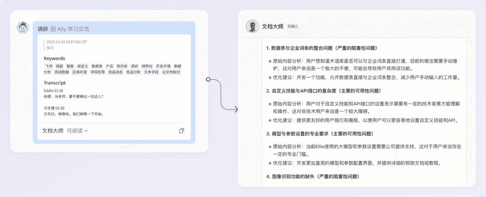

# AI Agent项目案例➡️会议总结助手

> 来源：[https://v11enp9ok1h.feishu.cn/docx/M6fWdoA4aoOksJxovqzciSLCnxf](https://v11enp9ok1h.feishu.cn/docx/M6fWdoA4aoOksJxovqzciSLCnxf)

# 🤖会议总结助手

> 会议是工作高频场景，且单次会议信息密度大，参会方多。因此，尤其需要关注「会议效率和会议效果」，且对会议纪要总结的要求高。会议总结助手可根据企业个性化定义总结内容，快速识别并输出核心相关结论，高效进行业务闭环。

| 应用亮点 | **飞书智能伙伴创建平台提供了让客户自****定义&amp;****精**细化**调优AI会议总结内容的能力：客户**可以按照自身行业业务特性+自身的工作要求设置，进一步提高AI生成的会议总结内容的可用性。例如：投资业务中的“项目会议review”、医药销售中的“销售会议质检”等。 |
| --- | --- |
| 应用截图 |  |
| 相关文档 | [【进阶教程】会议质检、会议总结等在 Aily 的应用场景搭建举例](https://bytedance.larkoffice.com/wiki/Qa6ywgY9UiGRkVkoG2Fc35UdnwH) |