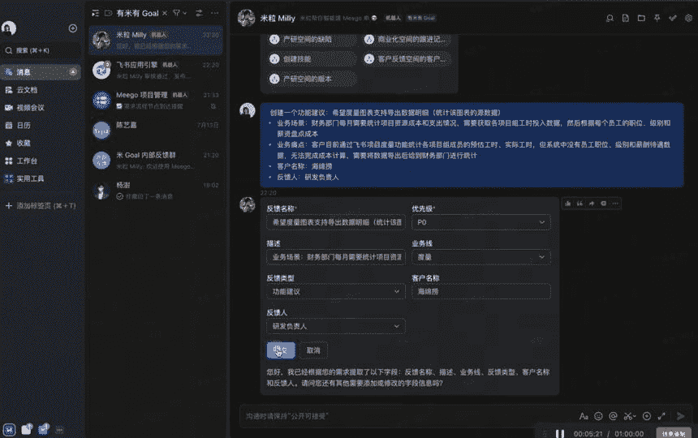
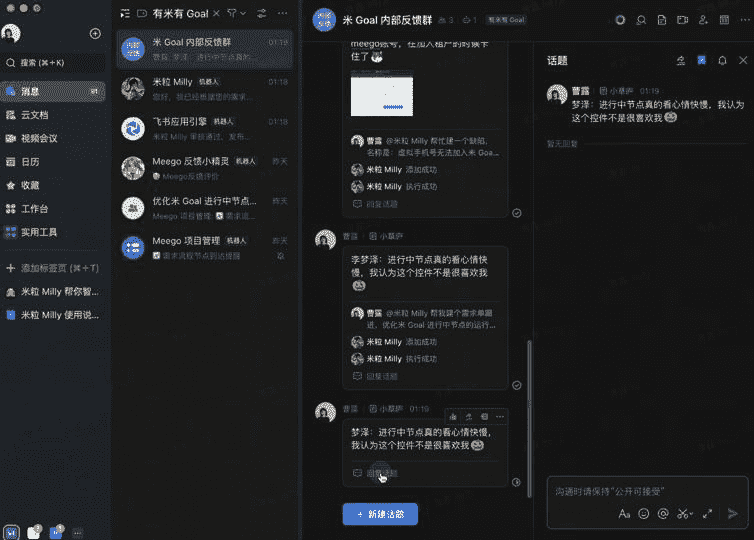
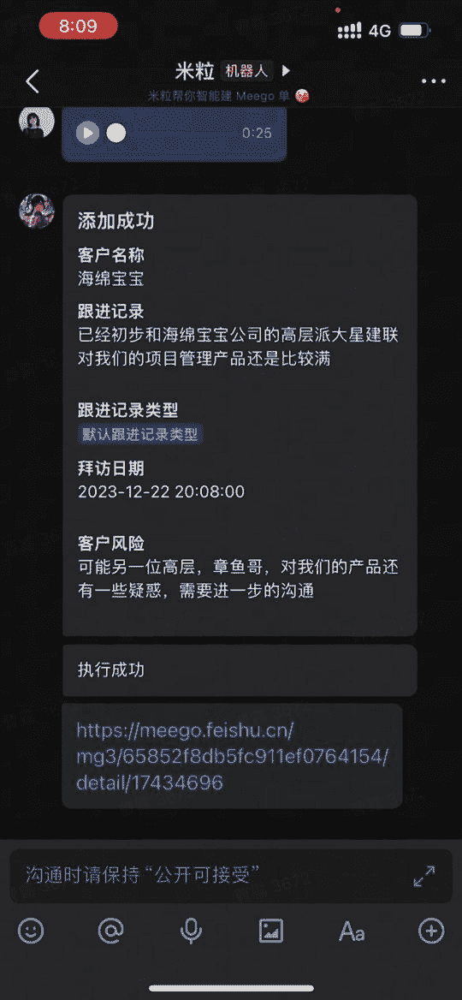

# AI Agent项目案例➡️智能Meego助手

> 来源：[https://v11enp9ok1h.feishu.cn/docx/OMQ0dKyskonaNbxyfhTc4p72nSd](https://v11enp9ok1h.feishu.cn/docx/OMQ0dKyskonaNbxyfhTc4p72nSd)

# 🤖智能Meego助手

> 在 Meego 中建单，通常需要打开电脑使用 Web 端的 Meego 网页端进行操作，在实际的工作场景中，有不少需要快速建单的场景，可以通过AI进一步优化。米粒 Milly 的智能建单能力，能让用户直接在群聊中直接@机器人，或者在单聊中与机器人对话的形式，使用自然语言（语音或文字均可），告诉机器人名称及一些字段填写的信息，即可帮助用户快速建单。

| **应用亮点** | **建单和更新工单智能化**：降低飞书项目操作门槛，实现语音建单、语音流转工单。 |
| --- | --- |
| **应用截图** |  |
| **相关文档** | [米粒 Milly 帮你智能建 Meego 单](https://bytedance.larkoffice.com/wiki/UWxswkn3si2WlTkluMmcgtGtnch) |

**建单流程，必填性校验**

[客服建单.mp4](https://internal-api-drive-stream.feishu.cn/space/api/box/stream/download/all/W4fDbb9jMo5LOMxJkgKcJQLUn0f)

配合 Meego 自动化能力，一键拉群

[话题群.mp4](https://internal-api-drive-stream.feishu.cn/space/api/box/stream/download/all/QJDKbHy1RoHDIgx6VYWce2SAnlT)

[语音建单.mp4](https://internal-api-drive-stream.feishu.cn/space/api/box/stream/download/all/IYtvbkAb8oRWjvxqBj3cJ4y8nhK)