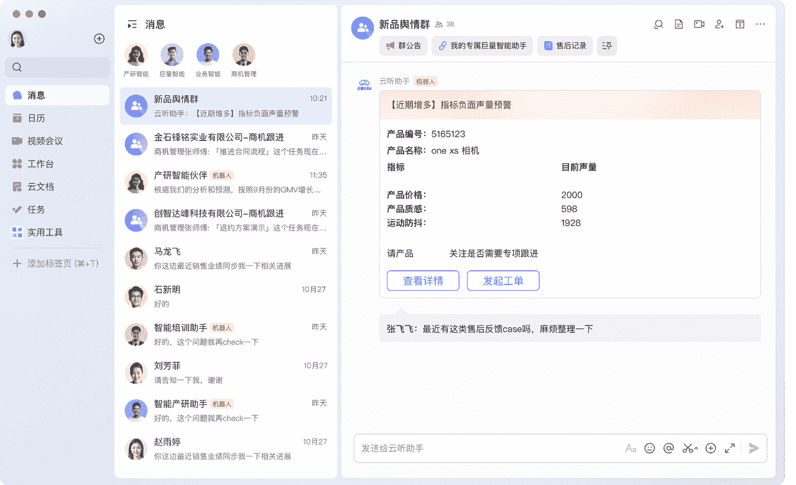
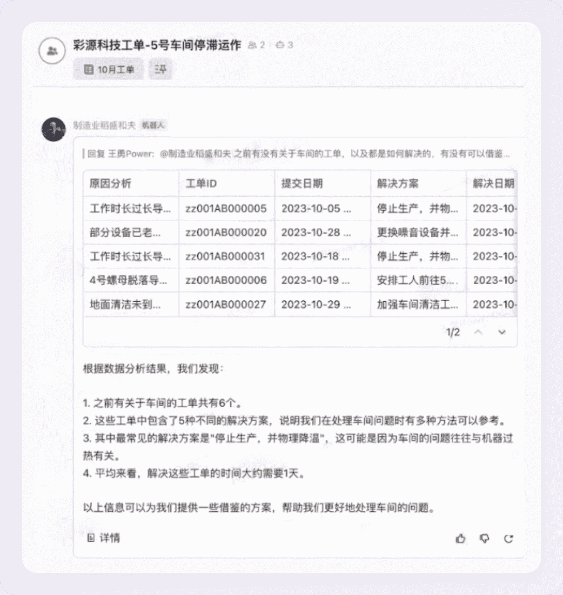

# AI Agent项目案例➡️智能舆情助手

> 来源：[https://v11enp9ok1h.feishu.cn/docx/P3N3dLtF1oEtabxDJu7cUfSgn9b](https://v11enp9ok1h.feishu.cn/docx/P3N3dLtF1oEtabxDJu7cUfSgn9b)

# 🤖智能舆情助手

> 企业 AI 舆情助手，使用 AI 大模型能力赋能企业舆情管理。

+   场景一：定期推送舆情/VOC 总结报告

+   场景二：对话方式快速了解舆情细节数据

+   场景三：紧急舆情自动拉群分配到处理人，并智能生成回复

| 应用亮点 | 业务价值体现： |
| --- | --- |
| 应用截图 | 根据已有舆情数据，通过对话方式了解需求数据，并以图表和文字总结形式呈现。 |
| 相关文档 | [舆情管理 demo 和搭建方案](https://bytedance.larkoffice.com/docx/Mr1kd5SBko2MDzxg9PicM8uQnVb) |

+   高危舆情自动报警并拉群

工单建群后，AI 自动识别过往工单中是否有类似问题

