# 从RAG到Agent：洞悉智能体工程化设计

> 来源：[https://v11enp9ok1h.feishu.cn/docx/CoDMd2t55oHL1wx9xH2cZErwn5b](https://v11enp9ok1h.feishu.cn/docx/CoDMd2t55oHL1wx9xH2cZErwn5b)

## 什么是 AI Agent？

> 想象一下，你想要生成一份关于AI研究最新趋势的报告。如果你使用标准的LLM，你可能需要：

1.  请求总结最近的AI研究论文

1.  查看响应并意识到你需要来源

1.  获取论文列表及引用

1.  发现有些来源已过时，因此优化查询

1.  经过多次迭代后，最终获得有用的输出

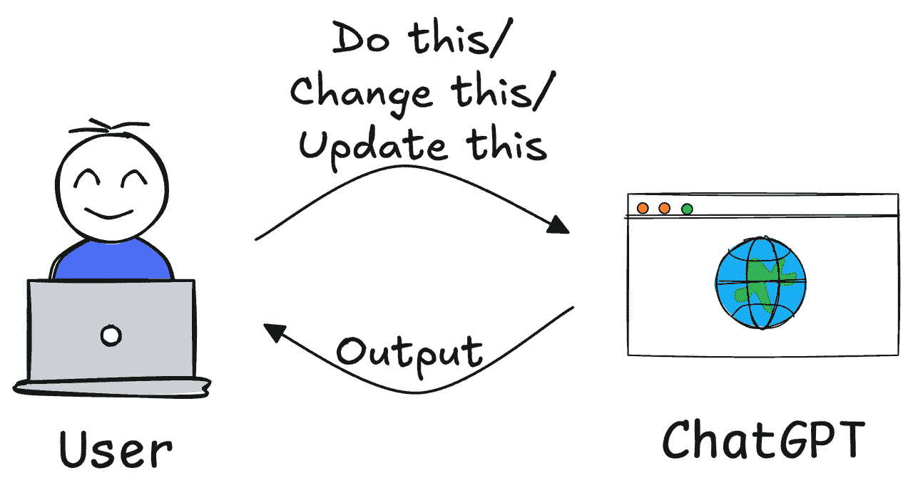

---

### AI Agent 工作流程

这个迭代过程需要时间和精力，要求你在每一步都充当决策者。

现在，让我们看看AI Agent如何以不同方式处理这个问题：

+   **Research agent **Agent 能够自主从arXiv、Semantic Scholar或Google Scholar搜索和检索相关的AI研究论文。

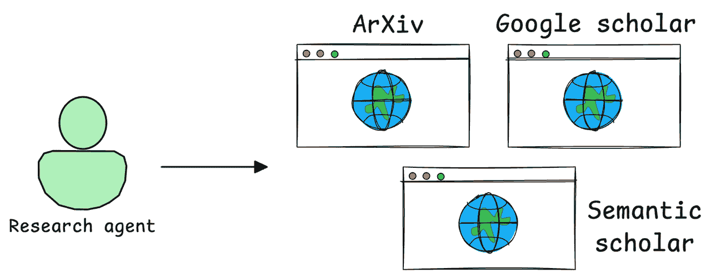

+   **Filteringagent**扫描检索到的论文，基于引用次数、发表日期和关键词识别最相关的论文。

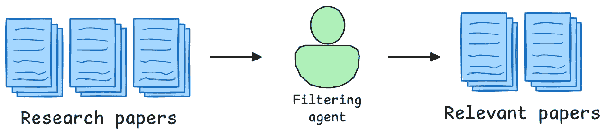

+   **S****u**mmarizationAgent 提取关键见解并将其浓缩成易于阅读的报告。

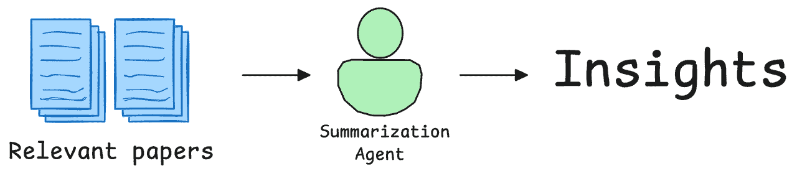

+   FormattingAgent 构建最终报告，确保其遵循清晰、专业的布局。

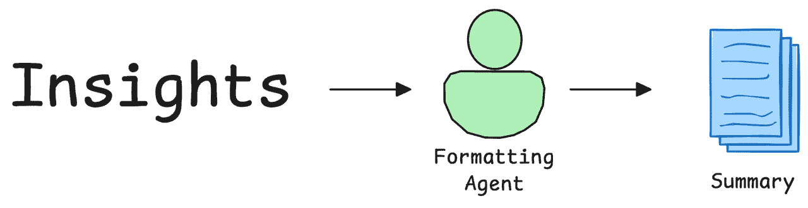

### AI Agent 的定义

在这里，AIAgent不仅执行端到端的研究过程，还能自我优化输出，确保最终报告全面、最新且结构良好——所有这些都不需要人类在每一步进行干预。

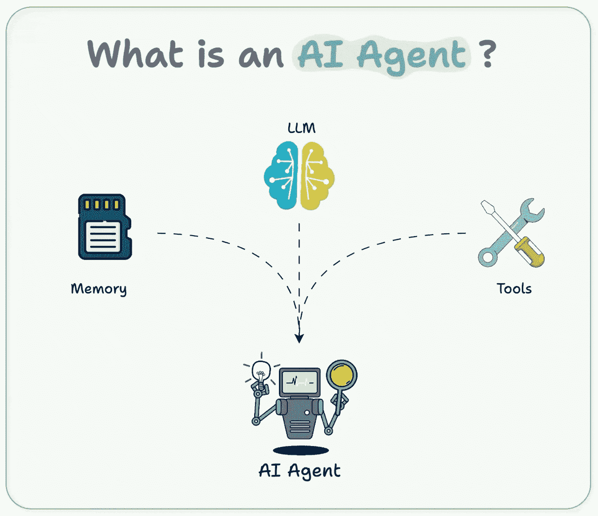

AI Agent是能够自主推理、思考、计划、在需要时找出相关来源并从中提取信息、采取行动，甚至在出现问题时进行自我纠正的自治系统。

## Agent vs LLM vs RAG

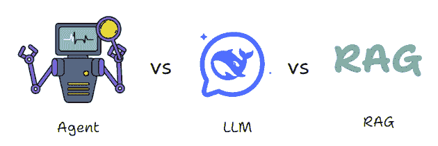

让我们用一个简单的类比来分解：

+   **LLM是大脑**。

+   **RAG是为这个大脑提供新鲜信息**。

+   Agent是使用大脑和工具进行计划和行动的决策者。

#### LLM（大型语言模型）

像GPT-4这样的LLM在大量文本数据上进行训练。它可以推理、生成、总结，但只能使用它已经知道的内容（即其训练数据）。

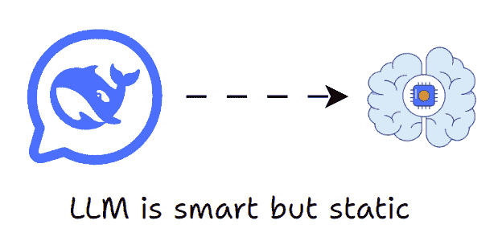

它很智能，但静态。它无法访问网络、调用API或自行获取新事实。

### RAG与Agent功能解析

#### RAG（检索增强生成）

RAG通过检索外部文档（来自向量数据库、搜索引擎等）并在生成响应之前将其作为上下文输入LLM来增强LLM的能力。

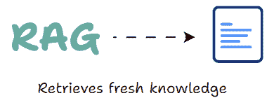

RAG使LLM能够了解更新的相关信息，而无需重新训练。

#### Agent

Agent为这种混合体增加了自主性。

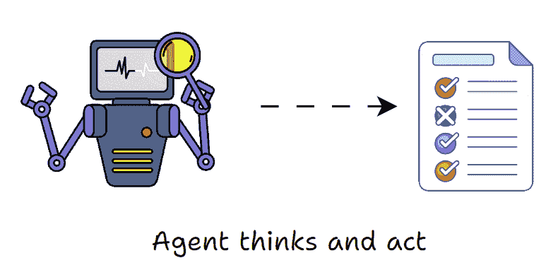

它不仅仅回答问题——它决定要采取什么步骤：是否应该调用工具？搜索网络？总结？存储信息？

Agent使用LLM、调用工具、做出决策，并像真正的助手一样编排工作流程。

## AI Agent 的构建模块

AIAgent旨在自主推理、计划和采取行动。然而，为了有效运作，它们必须基于某些关键原则构建。有六个基本构建模块使AIAgent在现实世界应用中更可靠、更智能且更有用：

1.  角色扮演（Role-playing）

1.  **专注（Focus）**

1.  **工具（Tools）**

1.  **协作（Cooperation）**

1.  **护栏（Guardrails）**

1.  **记忆（Memory）**

让我们探讨这些概念中的每一个，并理解为什么它们对构建优秀的AIAgent至关重要。

### 角色扮演

提升Agent性能的最简单方法之一是给它一个清晰、具体的角色。

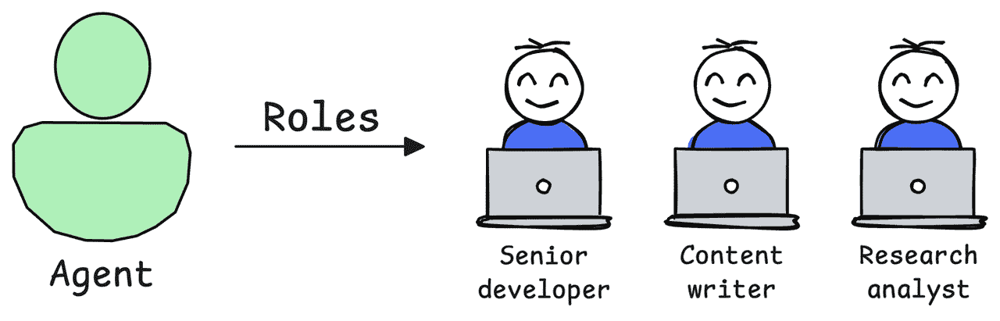

一个通用的AI助手可能会给出模糊的答案。但如果将其定义为"高级合同律师"，它会以法律精度和上下文进行回应。

**为什么？**

因为角色分配塑造了Agent的推理和检索过程。角色越具体，输出就越清晰和相关。

### 专注/任务

专注是减少幻觉和提高准确性的关键。

给Agent太多任务或太多数据没有帮助——反而有害。

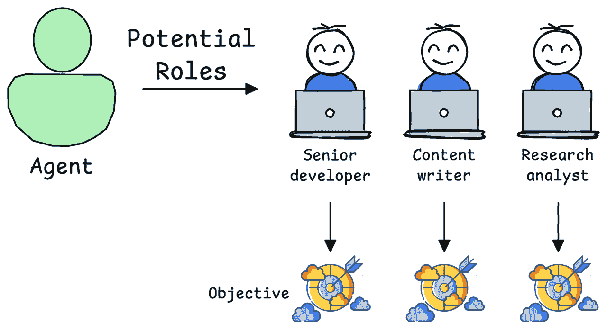

> 超载会导致混乱、不一致和糟糕的结果。

>

> **例如，**营销Agent应该专注于消息传递、语调和受众，而不是定价或市场分析。

>

> 与其尝试让一个Agent做所有事情，更好的方法是使用多个Agent，每个Agent都有特定且狭窄的焦点。专业Agent的表现更好——每次都是如此。

### 工具

当Agent能够使用正确的工具时，它们会变得更智能。

但工具越多≠结果越好。

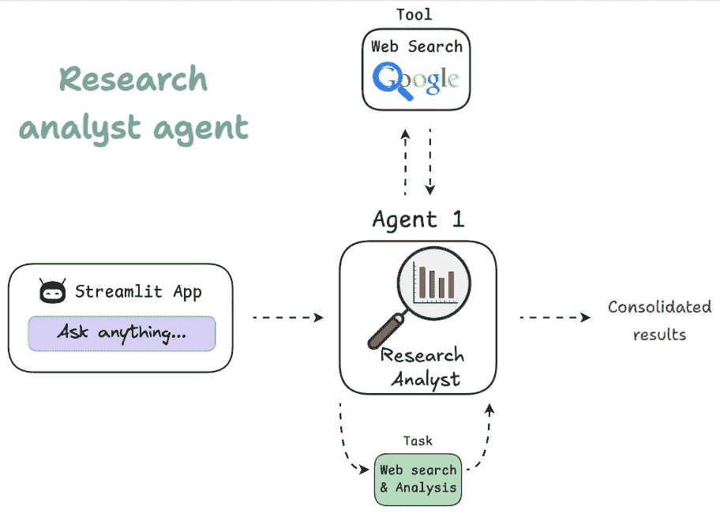

例如，AI研究Agent可以从以下工具中受益：

+   用于检索最近出版物的网络搜索工具。

+   用于浓缩长篇研究论文的总结模型。

+   用于正确格式化参考文献的引用管理器。

但如果你添加不必要的工具——如语音转文本模块或代码执行环境——可能会混淆Agent并降低效率。

###### 自定义工具

虽然基于LLM的Agent擅长推理和生成响应，但它们无法直接访问实时信息、外部系统和专业计算。

工具允许Agent：

+   **搜索网络获取实时数据。**

+   从API和数据库检索结构化信息。

+   **执行代码以进行计算或数据转换。**

+   分析图像、PDF和文档，而不仅仅是文本输入。

CrewAI支持多种可与Agent集成的工具，如下所示：

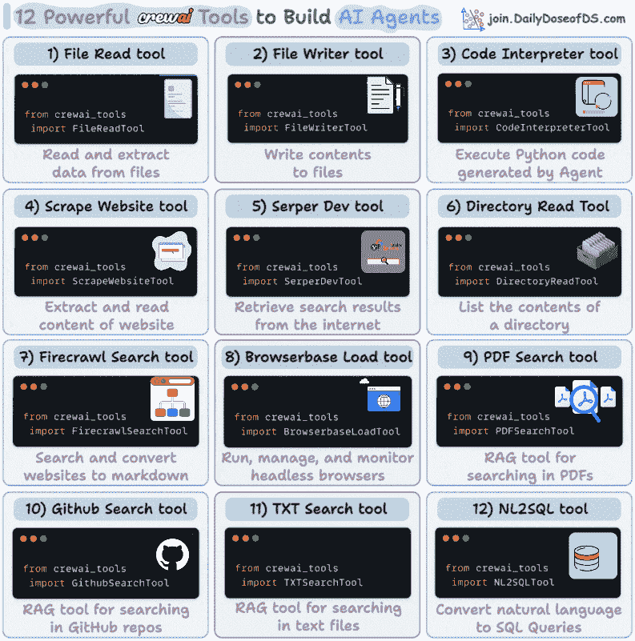

12个强大的CrewAI工具用于构建AIAgent

1.  **文件读取工具**：从文件中读取和提取数据

1.  **文件写入工具**：将内容写入文件

1.  **代码解释器工具**：由Agent执行Python代码

1.  **网页抓取工具**：提取和读取网站内容

1.  **Serper Dev工具**：从互联网检索搜索结果

1.  **目录读取工具**：列出目录内容

1.  **Firecrawl搜索工具**：搜索并将网站转换为markdown

1.  **Browserbase加载工具**：运行、管理和监控无头浏览器

1.  **PDF搜索工具**：用于在PDF中搜索的RAG工具

1.  **GitHub搜索工具**：用于在GitHub仓库中搜索的RAG工具

1.  **TXT搜索工具**：用于在文本文件中搜索的RAG工具

1.  **N2SQL工具**：将自然语言转换为SQL查询

然而，有时你可能需要构建自定义工具。

在此示例中，我们正在CrewAI中构建实时货币转换工具。我们不是让LLM猜测汇率，而是集成一个自定义工具，从外部API获取实时汇率并提供一些见解。

下面，让我们看看如何在CrewAI框架中为你的自定义需求构建一个工具。

首先，确保安装了工具包：

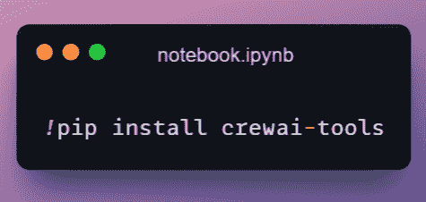

你还需要从这里获取API密钥：https://www.exchangerate-api.com/（免费）。在.env文件中指定它，如下所示：

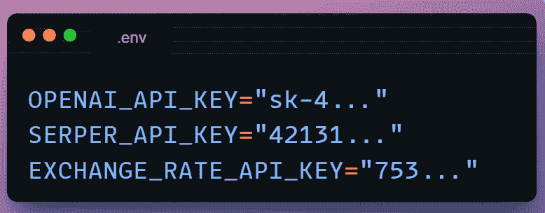

完成后，我们从一些标准导入语句开始：

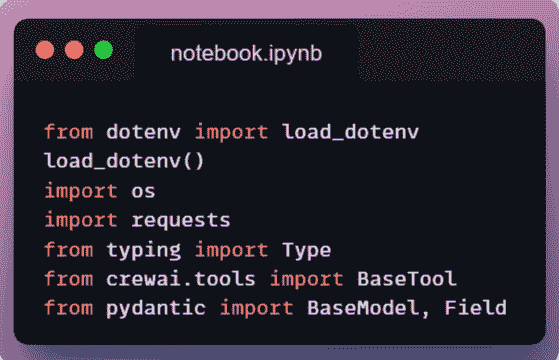

接下来，我们使用Pydantic定义工具期望的输入字段：

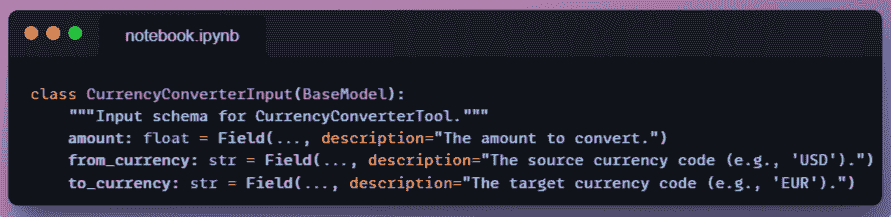

我们向currency_analystAgent分配一个任务：

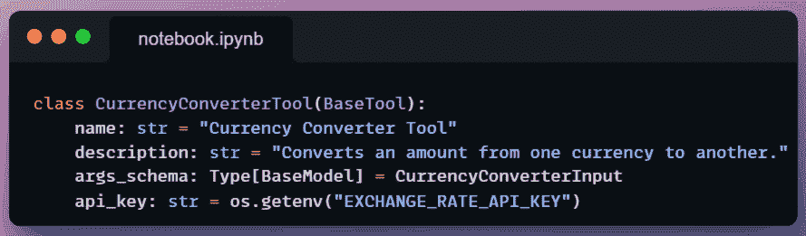

最后，我们创建一个Crew，将Agent分配给任务，并执行它：

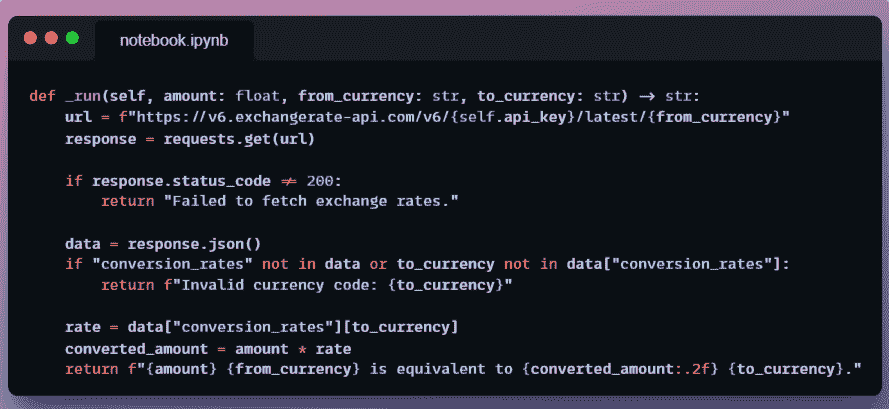

打印响应，我们得到以下输出：

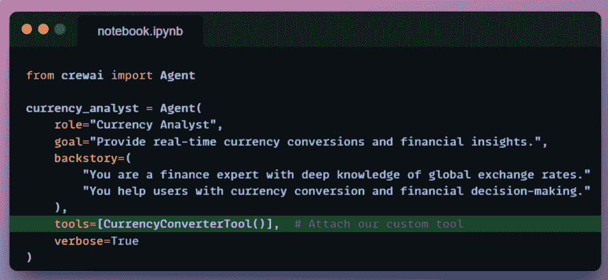

> **输出结果**:

> 将100美元转换为欧元，使用实时汇率约为95.40欧元。

> 在财务背景下，值得注意的是汇率可能因各种因素而波动，如经济指标、利率和地缘政治事件。由于此次转换反映了当前的市场状况，这些状况受到美国和欧元区最新经济数据发布和货币政策的影响。对于计划去欧洲旅行或进行投资的人来说，这些汇率可能会发生变化，因此定期监控它们是有益的。

我们不将工具直接嵌入到每个Crew中，而是将其公开为可重用的MCP工具——通过简单的服务器使其可在多个Agent和流程中访问。

首先，安装所需的包：

```
pip install mcp-server requests python-dotenv
```

我们将继续在.env文件中使用ExchangeRate-API：

```
EXCHANGE_RATE_API_KEY=your_api_key_here
```

现在，我们编写一个轻量级的server.py脚本来公开货币转换工具。我们从标准导入开始：

```
import requests, os
from dotenv import load_dotenv
from mcp.server.fastmcp import FastMCP
```

现在，我们加载环境变量并初始化服务器：

```
load_dotenv()
mcp = FastMCP(&#x27;currency-converter-server&#x27;, port=8081)
API_KEY = os.getenv(&#x27;EXCHANGE_RATE_API_KEY&#x27;)
```

##### 定义工具逻辑

接下来，我们使用@mcp.tool()定义工具逻辑：

```
@mcp.tool()def convert_currency(
    amount: float,
    from_currency: str,
    to_currency: str) -&gt; str:&quot;&quot;&quot;Convert currency using real-time exchange rates.&quot;&quot;&quot;
    response = requests.get(f&quot;https://exchange-rate-api.com/v6/{API_KEY}/pair/&quot;f&quot;{from_currency}/{to_currency}/{amount}&quot;)return (f&quot;{amount} {from_currency.upper()} = &quot;f&quot;{response[&#x27;conversion_result&#x27;]:.2f} {to_currency.upper()}&quot;f&quot; (Rate: {response[&#x27;conversion_rate&#x27;]:.4f})&quot;)
```

这个函数接受三个输入——金额、源货币和目标货币——并使用实时汇率API返回转换结果。

要使工具可访问，我们需要运行MCP服务器。在脚本末尾添加：

```
if __name__ == &quot;__main__&quot;:
    mcp.run(transport=&quot;sse&quot;)
```

##### 连接MCP工具服务器

这将启动服务器并在以下地址公开您的convert_currency工具：http://localhost:8081/sse。

现在，任何CrewAIAgent都可以使用MCPServerAdapter连接到它。让我们从CrewAIAgent中使用这个工具。

首先，我们导入所需的CrewAI类。我们将使用CrewAI的Agent、Task和Crew，以及MCPServerAdapter来连接到我们的工具服务器：

```
from crewai import Agent, Task, Crew
from crewai_tools import MCPServerAdapter
```

接下来，我们连接到MCP工具服务器。定义服务器参数以连接到您正在运行的工具（来自server.py）：

```
server_params = {&quot;url&quot;: &quot;http://localhost:8081/sse&quot;,&quot;transport&quot;: &quot;sse&quot;}
```

现在，我们在Agent中使用发现的MCP工具：

这个Agent被分配了来自远程服务器的convert_currency工具。它现在可以像调用本地定义的工具一样调用这个工具。

##### Agent任务执行

```
currency_agent = Agent(
    role=&quot;Currency Converter&quot;,
    goal=&quot;Convert currency using real-time exchange rates.&quot;,
    backstory=&quot;&quot;&quot;You help users convert between currencies
    using up-to-date market data.&quot;&quot;&quot;
    allow_delegation=False,
    tools=[mcp.tools[&quot;convert_currency&quot;]],)
```

我们给Agent一个任务描述：

```
conversion_task = Task(
    description=&quot;Convert {amount} {from_currency} to {to_currency} using real-time exchange rates.&quot;,
    agent=currency_agent,
    expected_output=&quot;A formatted result with exchange rate.&quot;)
```

最后，我们创建Crew，传入输入并运行它：

```
crew = Crew(
    agents=[currency_agent], tasks=[conversion_task], verbose=True)

result = crew.kickoff(inputs={&quot;amount&quot;: 100,&quot;from_currency&quot;: &quot;USD&quot;,&quot;to_currency&quot;: &quot;INR&quot;})print(result)
```

打印结果，我们得到以下输出：

```
100 USD = 8734.13 INR (Rate: 87.3413)
```

### 多Agent协作

当Agent协作并交换反馈时，多Agent系统的效果最佳。

与其让一个Agent做所有事情，不如让一个由专业Agent组成的团队分担任务并改进彼此的输出。

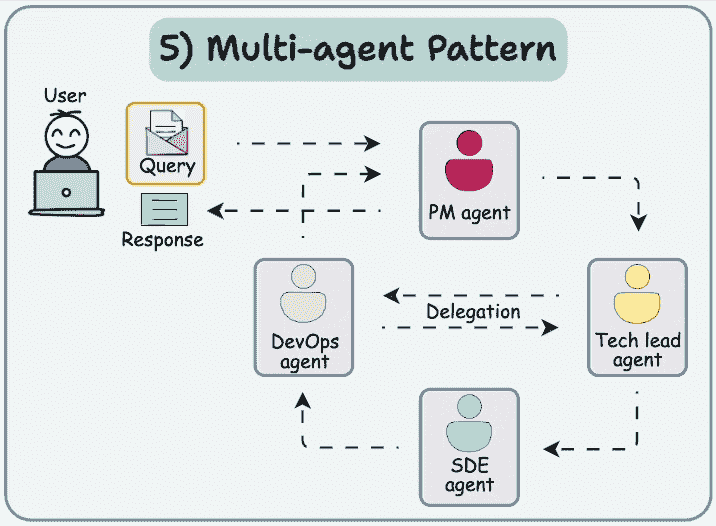

考虑一个AI驱动的金融分析系统：

+   一个Agent收集数据

+   一个Agent评估风险

+   第三个制定策略

+   第四个撰写报告

最佳实践是通过设计工作流来实现Agent协作，使Agent能够交换见解并一起完善他们的响应。

### Guardrails

Agent功能强大，但如果没有约束，它们可能会偏离轨道。它们可能会产生幻觉、无限循环或做出错误的决策。

护栏确保Agent保持正轨并维持质量标准。

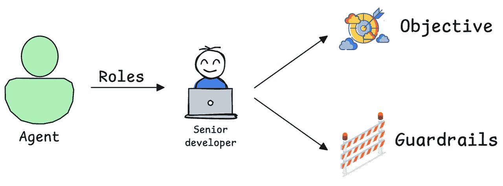

有用的护栏示例包括：

+   **限制工具使用**：防止Agent过度使用API或生成无关查询。

+   **设置验证检查点**：确保输出在进入下一步之前满足预定义标准。

+   **建立fallback机制**：如果Agent未能完成任务，另一个Agent或人工审核者可以介入。

**例如，**AI驱动的法律助手应该避免使用过时的法律或虚假声明——护栏确保了这一点。

### 记忆 (Memory)

最后，我们来讨论记忆，它是AI Agents最关键的组件之一。

没有记忆，Agent每次都会重新开始，丢失所有先前交互的上下文。有了记忆，Agent可以随着时间的推移不断改进，记住过去的行动，并创建更连贯的响应。

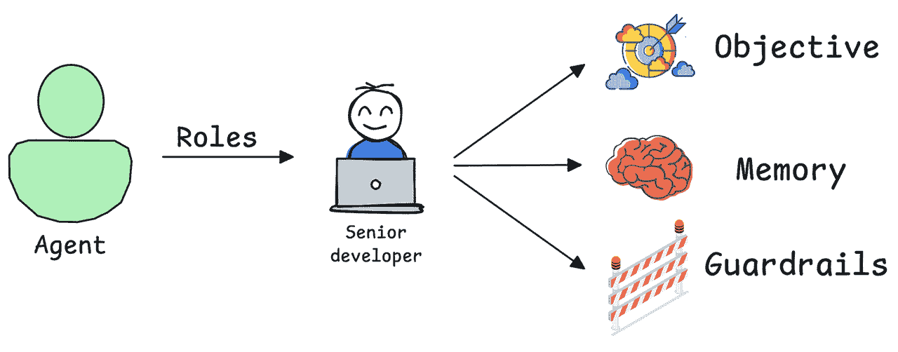

AI Agents中的记忆类型包括：

+   **短期记忆**——仅在执行期间存在（例如，回忆最近的对话历史）。

+   **长期记忆**——在执行后仍然存在（例如，记住多次交互中的用户偏好）。

+   **实体记忆**——存储关于讨论的关键主题的信息（例如，在CRM Agent中跟踪客户详细信息）。

**例如，**在AI辅导系统中，记忆允许Agent回忆过去的课程，定制反馈，并避免重复。