# AI产品经理一定要把Cursor工作流跑通

> 来源：[https://v11enp9ok1h.feishu.cn/docx/SVtodsmepoTAwfxI6yuc5DFknbc](https://v11enp9ok1h.feishu.cn/docx/SVtodsmepoTAwfxI6yuc5DFknbc)

### 用Cursor设计合同管理系统高保真原型

## 创建新项目

**首先，我们新**建一个空白项目文件夹。然后在Cursor中打开这个文件夹。激动人心的时刻到了！我们准备开始"聊天式"开发啦！

## 输入提示词

在空白处按下**Ctrl+L****，调出对话框。这里就是施展魔**法的地方啦！我们要输入详细的提示词，告诉Cursor我们想要什么。作为一个产品经理，写提示词就像写PRD一样重要哦！

我输入了这样的提示词（大家可以参考这个模板）：

我想开发一个 {**合同管理系统**}，现在需要输出高保真的原型图，请通过以下方式帮我完成所有界面的原型设计，并使用这些原界面直接开发一个小程序：

> 1、用户体验分析：先分析这个程序的主要功能和用户需求，确定核心交互逻辑。合同管理具体功能参考文件夹中的mod文件

> 2、产品界面规划：作为产品经理，定义关键界面，确保信息架构合理。

> 3、高保真 UI 设计：作为 UI 设计师，设计贴近真实程序设计规范的界面，使用现代化的 UI 元素，使其具有良好的视觉体验。

> 4、HTML 原型实现：使用 HTML + Tailwind CSS (或 Bootstrap) 生成所有原型界面，并使用 FontAwesome (或其他开源 UI 组件) 让界更加精美、接近真实的 App 设计。

> 拆分代码文件，保持结构清晰：

> 5、每个界面应作为独立的 HTML 文件存放，例如 home.html、profile.html、settings.html 等。

>

index.html 作为主入口，不直接写入所有界面的 HTML 代码，而是使用 iframe 的方式嵌入这些 HTML 片段，并将所有页面直接平铺示在 index 页面中，而不是跳转链接。

**真实感增强：**

界面尺寸应模拟 常见的电脑屏幕。

使用真实的 UI 图片，而非占位符图片 (可从 Unsplash 官方 UI 资源中选择)。

添加独立的用户界面，比如财务门户，法务门户，业务门户，管理者门户。

请按照以上要求生成完整的 HTML 代码，并确保其可用于实际开发。`

mod文件我用的是网址https://doc.zhaoxinms.com/functionList/里的功能，基本涵盖了合同管理系统所需的功能。可以用deepseek读取网页内容生成mod文件放到Cursor的文件夹中。

**输入完这段提示词**

点击发送后，Cursor开始思考了…

然后！它开始一行行地生成代码！我的天！它真的理解了我的需求！首先它创建了一个完整的项目结构：

contract-management-system/

**├── css/**

**│ └── style.css**

**├── js/**

**│ └── main.js**

**├── pages/**

│ ├── dashboard.html

│ ├── contract-list.html

│ ├── contract-detail.html

│ ├── contract-create.html

│ ├── settings.html

│ └── user-profile.html

**└── index.html**

然后它开始逐个文件生成代码！我点开dashboard.html一看，哇塞！一个漂亮的仪表盘界面已经成型了！有数据统计卡片、最近合同列表、待办事项…简直跟我脑子里想的一模一样！

## 查看生成效果

Cursor还贴心地生成了一个index.html作为预览入口。我右键选择"在浏览器中打开"，然后…我的下巴都要惊掉了！一个完整的、可交互的合同管理系统原型就这样出现在我面前！

> 左侧是导航菜单：仪表盘、合同列表、创建合同、设置…

> 顶部有搜索框和用户头像

> 主内容区展示了各种数据

> 所有界面风格统一，配色专业

> 甚至还有hover效果和简单的交互！

这效果，拿去给老板演示绝对能惊艳全场！而且我只用了不到5分钟！

## 进一步优化

作为一个追求完美的产品经理，我觉得还可以再优化一下。我选中合同列表页面，按下Ctrl+L，输入：

请优化合同列表页：

> **增加分页功能**

> **添加按状态筛选的下拉菜单**

> **表格增加排序功能**

> **添加导出Excel按钮**

**Cursor马上理解了需求，几秒钟后就给出了修改后的代码！替换后刷新页面**，哇！一个功能更完善的列表页出现了！这效率，比我跟前端开发沟通再等他改完快多了！

## Cursor更多实用技巧

1.  添加文档作为知识库

Cursor还能上传文档作为知识库！比如我可以上传公司的设计规范文档，然后让Cursor按照规范生成界面。操作步骤：

**点击设置图标**

**选择"知识库"**

**上传PDF或Word文档**

使用时在对话框中输入@，选择文档提问

1.  自定义System Prompt

在设置中可以添加System Prompt，让AI更好地理解和需求。比如我添加了：

你是一名资深产品经理和UI设计师，正在帮助用户设计高保真原型。你非常注重用户体验和界面细节，能够产出符合现代设计规范的原型。你会主动思考用户需求，提出改进建议，而不仅仅是执行指令。

这样Cursor的回答会更符合产品经理的思维方式！

## 生成的项目文档

Cursor还自动生成了一个README.md文件，内容超级专业：

**合同管理系统高保真原型**

**这**是一个使用HTML、CSS和JavaScript构建的合同管理系统高保真原型设计。该原型模拟了真实的企业级应用界面。

功能概述

> 仪表盘：展示合同统计、待办事项和最近活动

> 合同列表：所有合同的可搜索、可分页、可排序列表

> **合同详情**：查看合同详细信息**

> **创建合同：表单创建新合同**

> **设置：系统配置选项**

> **用户资料：个人信息管理**

> **技术栈**

> **HTML5**

> CSS3 (Tailwind CSS)

> **JavaScript**

> Font Awesome 图标库

> **设计特点**

> **现代化企业应用设计风格**

> **响应式布局**

> **交互式组件**

> **专业配色方案**

> **符合当前网页设计趋势**

> **使用说明**

> 打开index.html预览所有界面

> **每个页面也可以单独打开**

> **所有交互都已模拟实现**

> **后续开发建议**

> **连接真实后端API**

> **实现用户认证**

> **添加更多业务功能**

> **优化移动端体验**

这文档水平，直接可以拿去给开发团队用了！省去了我写文档的时间！

## 生成的HTML页面展示

让我们来看看Cursor生成的合同列表页(contract-list.html)的完整代码和效果吧！这部分真的让我惊艳到合不拢嘴～

完整页面展示

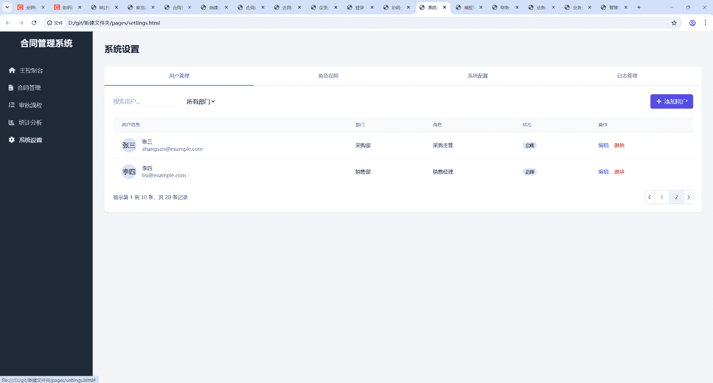

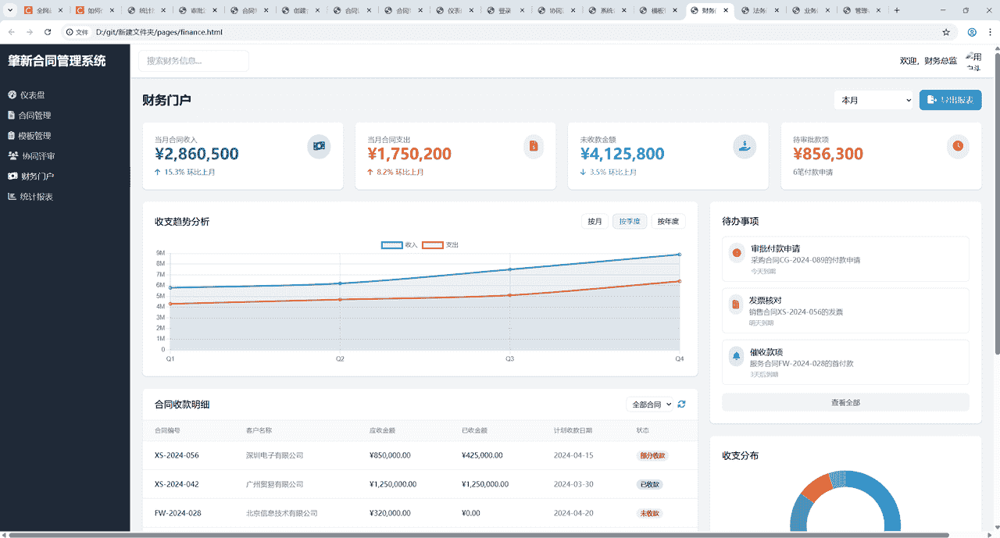

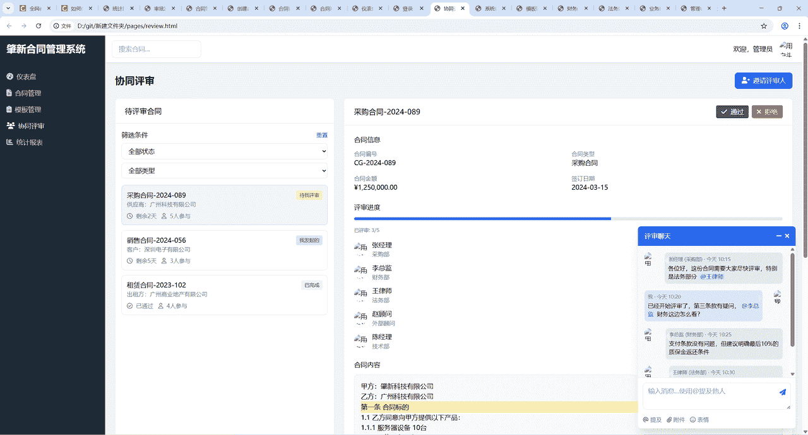

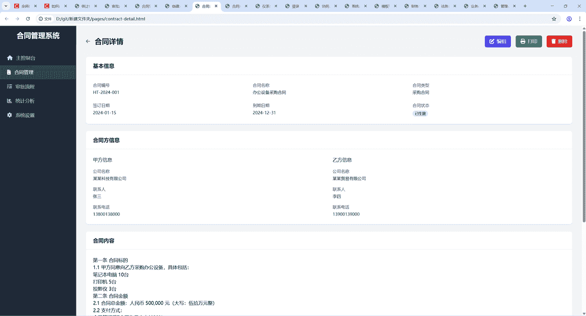

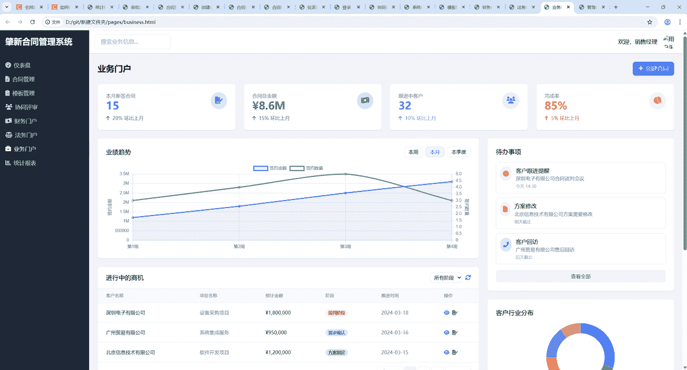

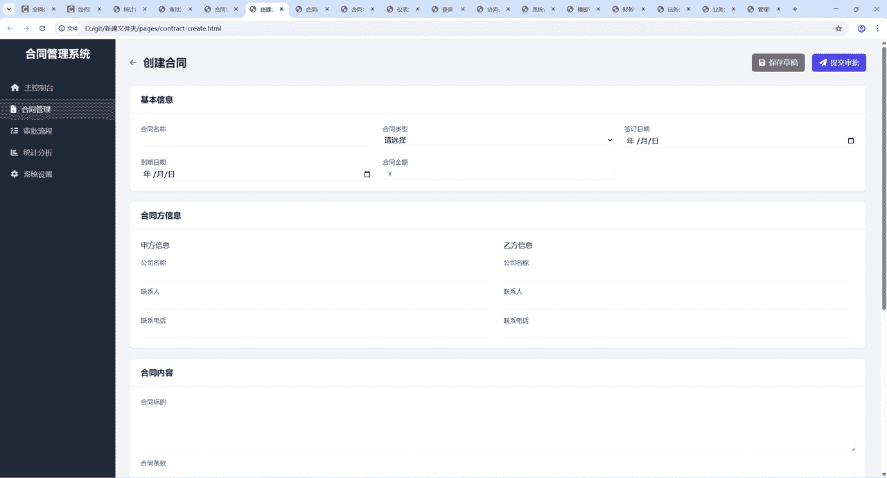

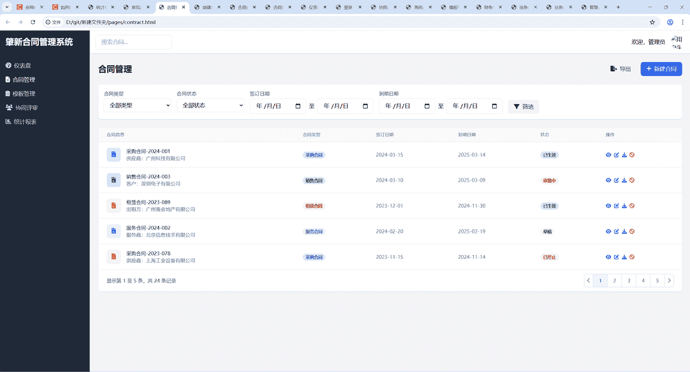

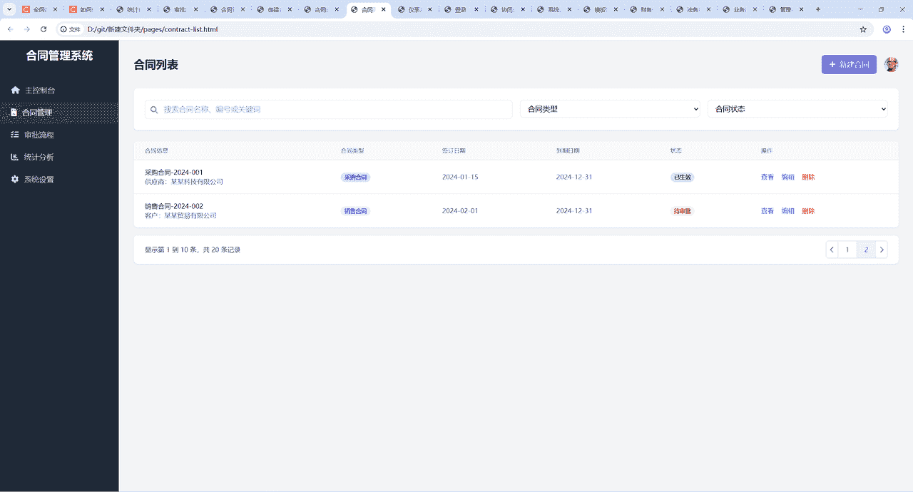

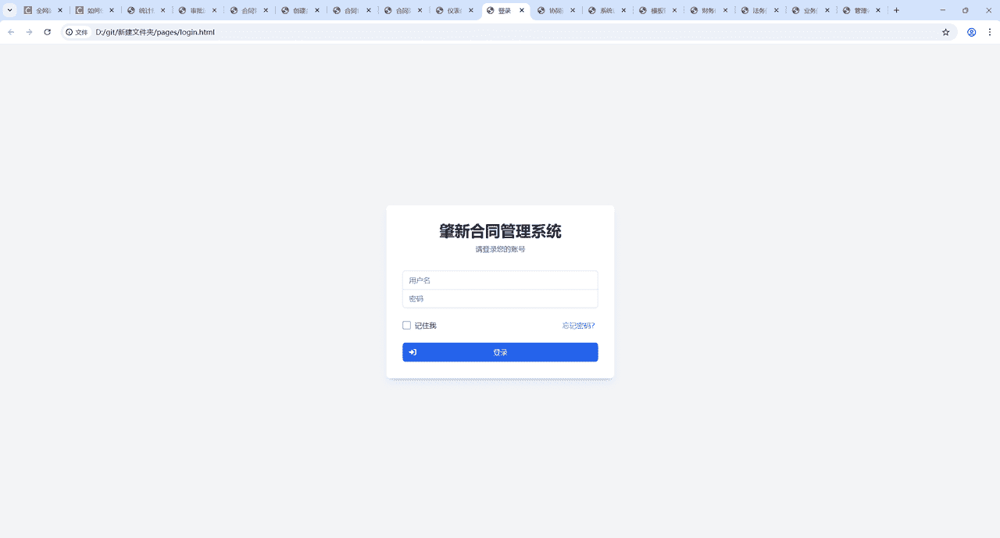

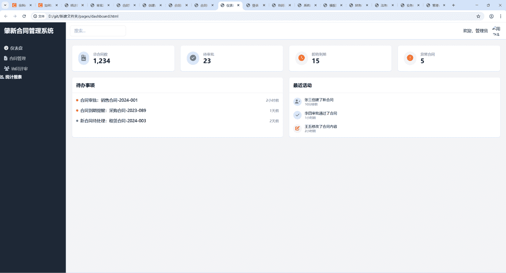

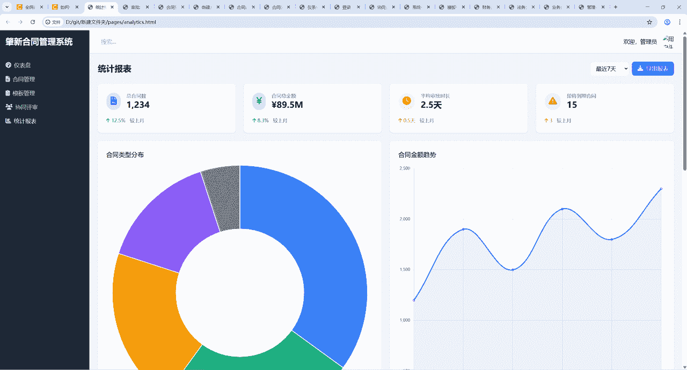

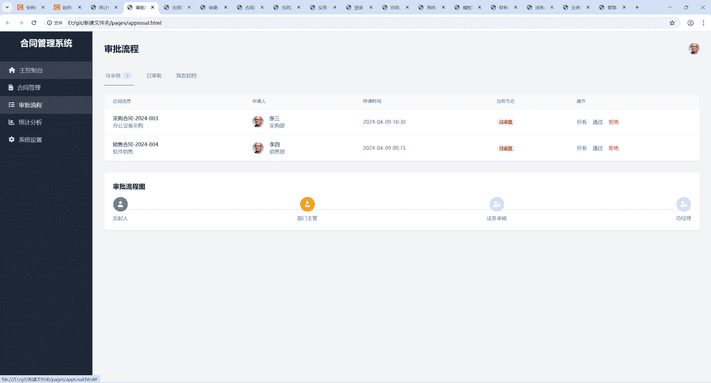

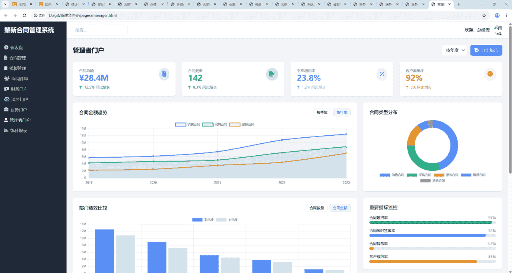

我是真的一下也没管他，自己就生成了

## 页面效果详解

当我在浏览器中打开这个页面时，呈现的效果简直太专业了！让我详细描述一下：

整体布局：

> 左侧是深色导航菜单，当前选中的"合同列表"高亮显示

> 顶部有公司logo、搜索框和用户头像

> 主内容区采用白色背景，层次分明

**合同列表区域：**

<strong和操作栏：

大大的"合同列表"标题清晰可见

右侧有"导出Excel"按钮和状态筛选下拉框

按钮的悬停效果非常顺滑

数据表格：

采用斑马纹设计，行与行之间区分明显

表头有排序图标，点击可以模拟排序功能

合同状态用不同颜色的标签显示（执行中是绿色，待签署是黄色等）

每行数据都有"查看"和"编辑"操作链接

分页组件：

显示当前页码和总条数

上一页/下一页按钮

页码导航，当前页高亮显示

**交互细节：**

鼠标悬停在行上时会有浅灰色背景

点击表头排序图标会有视觉反馈

所有按钮都有精致的悬停效果

搜索框获得焦点时有蓝色光圈

## 惊艳的部分

作为一个产品经理，我最惊喜的是这些细节Cursor都考虑到了：

响应式设计：调整浏览器大小时布局会自动适应

真实数据展示：合同编号、金额等字段格式完全符合业务需求

状态标签：不同状态用不同颜色区分，视觉上非常直观

操作流程：查看、编辑、导出等功能一应俱全

设计规范：完全遵循现代网页设计趋势，间距、字体、颜色都很专业

这个页面拿去做用户测试或者给开发看都完全没问题！而且从代码结构来看，组件化做得很好，后续开发可以直接基于这个原型进行扩展。