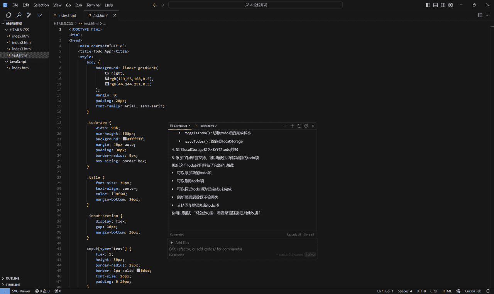
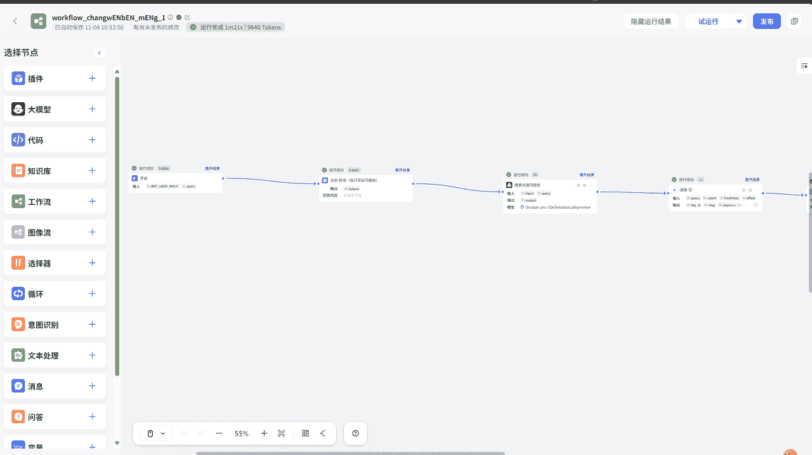
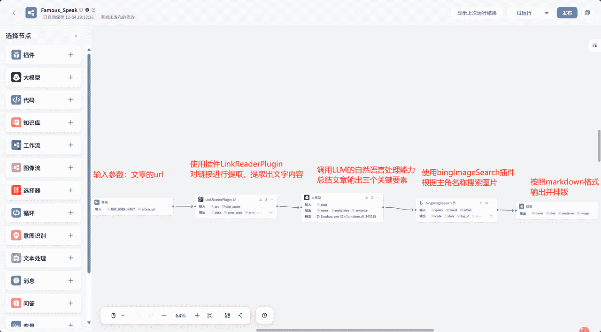
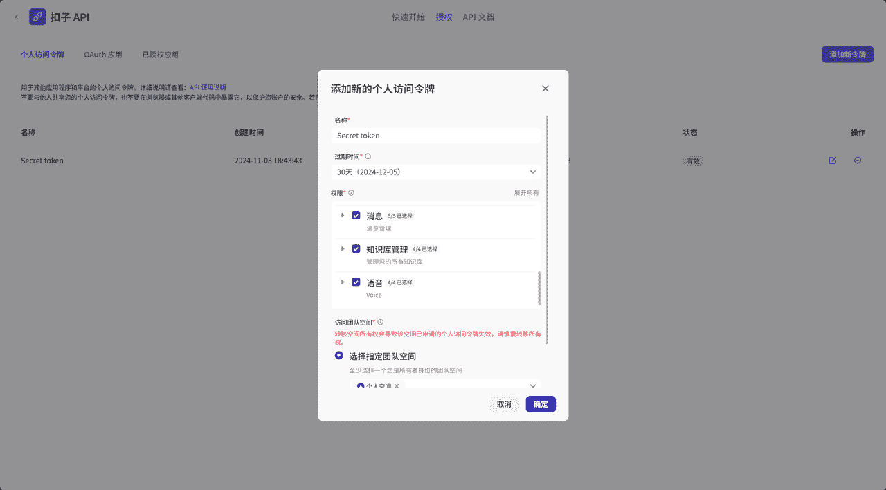
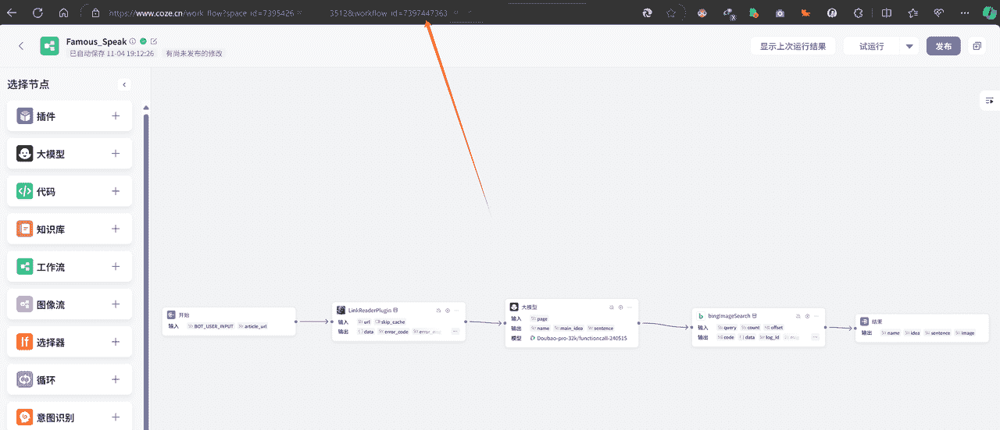
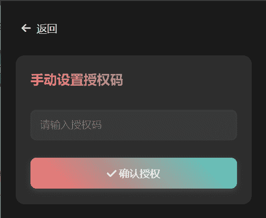

# Cursor + Coze 工作流打造网页内容提取插件 教程

> 来源：[https://v11enp9ok1h.feishu.cn/docx/QkBZd9HMuoE40zxU8zIc5Xr3nAf](https://v11enp9ok1h.feishu.cn/docx/QkBZd9HMuoE40zxU8zIc5Xr3nAf)

## 项目概述

> 💡 本教程将带你使用 Cursor AI 和 Coze 工作流开发一个网页内容提取Chrome插件，让我们一起探索AI辅助开发的魅力。

### 开发背景

作为经常阅读技术文章的开发者，我常常想找到一个便捷的工具来提取和保存文章精华。这促使我萌生了开发一个浏览器插件的想法。在 AI 的协助下，这个想法很快就变成了现实。

应众多小伙伴的请求，我决定分享这次完整的开发历程。

## 技术栈介绍

### 2.1 Cursor：AI 驱动的智能编辑器



### 2.2 Coze：可视化工作流平台



## 功能需求分析

### 核心功能清单：

1.  ✨ 网页链接提取

1.  📝 LLM网页内容总结

1.  🎯 输出三个关键变量：

+   主角

+   文章概括

+   金句提取

1.  🖼️ 主角相关图片搜索

1.  📊 美观的图文总结卡片排版

## 技术架构

> 🏗️ 采用前后端分离架构：

+   后端：基于 Coze 工作流构建业务逻辑

+   前端：Chrome 浏览器插件，提供轻量级交互界面

## 工作流搭建

### 5.1 核心组件配置



#### 关键配置要点：

1.  大模型节点提示词：

plain text prompt：您作为一位资深且专业的文章编辑，能够透彻理解我给出的文章{page}内涵，进而提供以下三部分内容: 1.文章所讲述的主人公 (比如"雷军") 2.精确概括文章的主旨要义3.精准找出文章主人公的精彩金句(如有)

1.  输出节点markdown排版：


&lt;!--  --&gt;

```
👤主角：{{name}}

📷主角图片：
{此处将显示主角图片}

📝文章内容：{{idea}}

💖金句：{{sentence}}
```

⚠️ 特别注意：输出图片变量使用 contentUrl

## Chrome插件开发

### 6.1 Coze关键配置获取

#### 步骤1：获取授权令牌



#### 步骤2：获取工作流ID



## 界面优化

