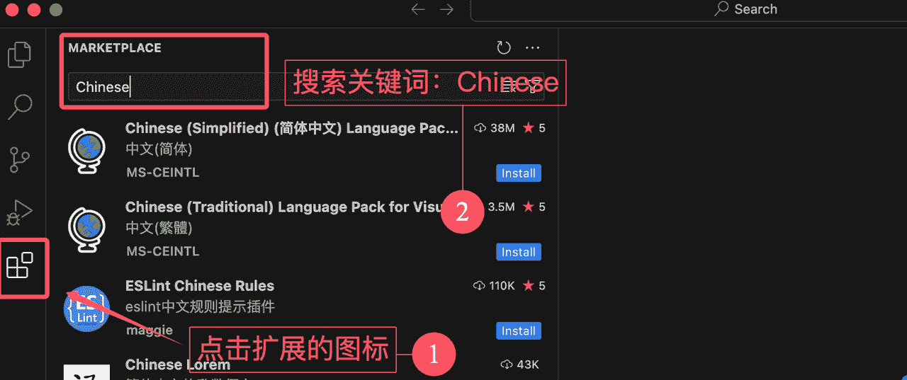
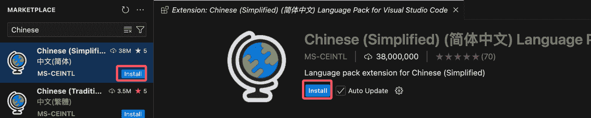
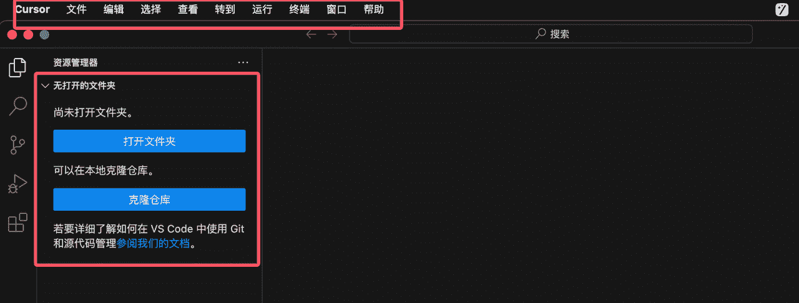

# Cursor 中文设置

> 来源：[https://v11enp9ok1h.feishu.cn/docx/Q66Pd8lzBoeqQmxb7LscqK5hnKh](https://v11enp9ok1h.feishu.cn/docx/Q66Pd8lzBoeqQmxb7LscqK5hnKh)

Cursor 是基于 [VS Code](https://www.runoob.com/vscode/vscode-tutorial.html) 开发的一款编辑器，所以它的扩展使用的也是 VS Code 的扩展市场。

默认 Curosr 的界面上英文的，我们可以通过 VS Code 的扩展市场安装中文包。

VS Code 有一个内置的扩展市场，提供了数千个由社区和微软官方提供的扩展。

接下来我们就在扩展市场中查找中文包，并安装。

VScode 安装汉化包很简单，打开 Curos**r，点击左侧安**装扩展图标，在搜索框输入 Chinese：

然后点击第一个搜索出来选项【Chinese (Simplified) (简体中文)】的 Install 按钮就可以：

安装完成后，重启 Curosr，界面显示的就是中文了。

