# Cursor 界面介绍

> 来源：[https://v11enp9ok1h.feishu.cn/docx/DoLsdIAFHotqbKxgimLcewcTnkf](https://v11enp9ok1h.feishu.cn/docx/DoLsdIAFHotqbKxgimLcewcTnkf)

Cursor 编辑器是一款功能强大且用户友好的代码编辑器，特别适合初学者和中级开发者使用。

本文将详细介绍 Cursor 编辑器的界面，帮助你快速上手并充分利用其功能。

## 1、主界面概览

Cursor 编辑器的主界面设计简洁直观，主要由以下几个部分组成：

+   **菜单栏**：位于窗口的顶部，包含文件、编辑、视图、运行、工具和帮助等菜单项。

+   **侧边栏**：位于窗口的左侧，通常显示项目文件结构、搜索、版本控制等功能。

+   **编辑区**：位于窗口的中央，是编写和编辑代码的主要区域。

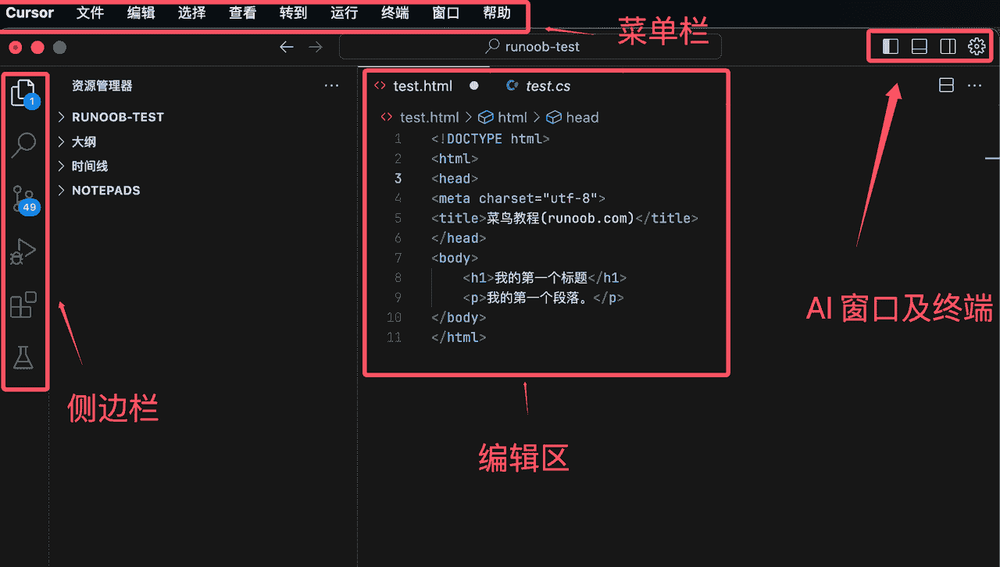

## 2、菜单栏详解

### 2.1 文件菜单

+   **新建文件**：创建一个新的代码文件。

+   **打开文件**：打开一个已存在的代码文件。

+   **保存文件**：保存当前编辑的文件。

+   **另存为**：将当前文件另存为一个新文件。

+   **关闭文件**：关闭当前打开的文件。

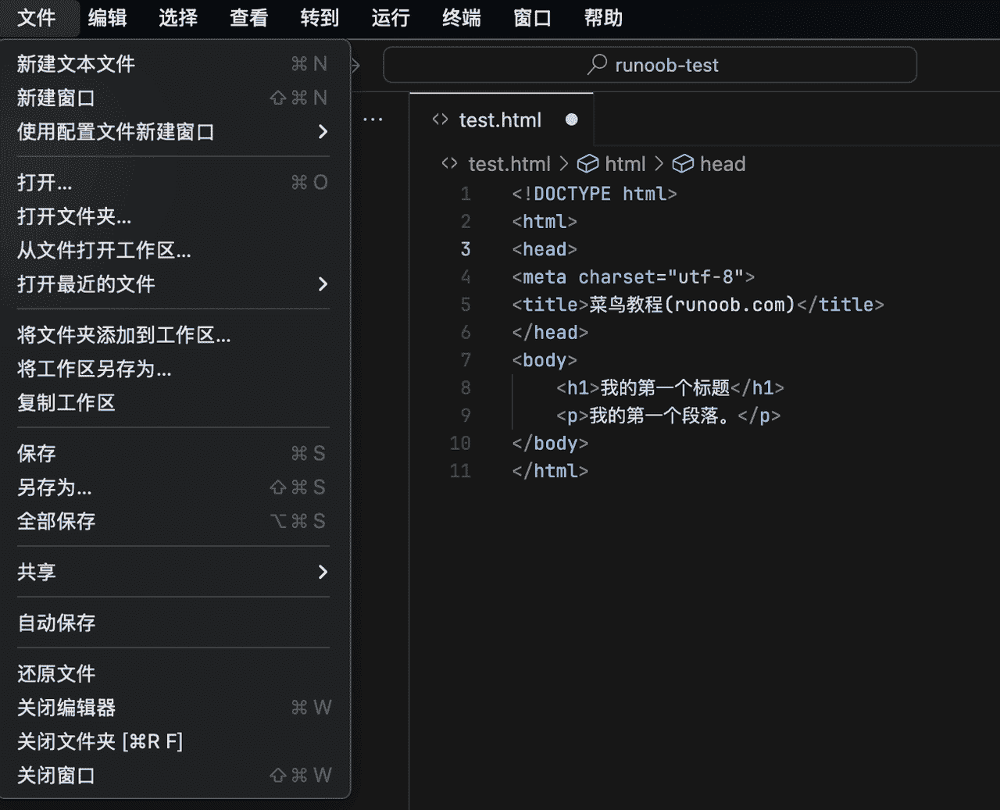

### 2.2 编辑菜单

主要功能：

+   **撤销**：撤销上一次的编辑操作。

+   **重做**：重做上一次撤销的操作。

+   **剪切**：剪切选中的文本。

+   **复制**：复制选中的文本。

+   **粘贴**：粘贴剪贴板中的内容。

+   **查找**：在当前文件中查找指定的文本。

+   **替换**：在当前文件中查找并替换指定的文本。

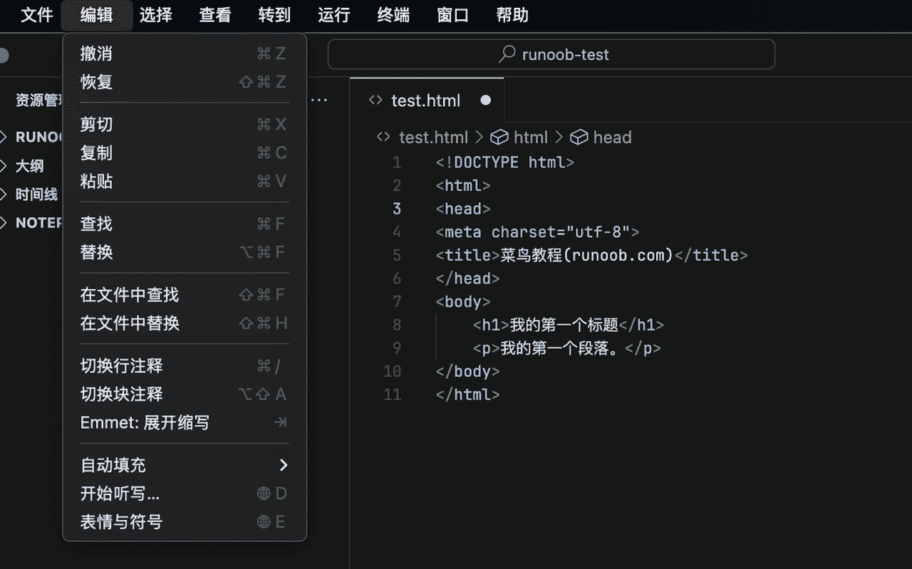

### 2.3 窗口/视图菜单

+   **放大**：放大编辑区的字体。

+   **缩小**：缩小编辑区的字体。

+   **重置缩放**：将编辑区的字体大小恢复到默认值。

+   **全屏**：将编辑器切换到全屏模式。

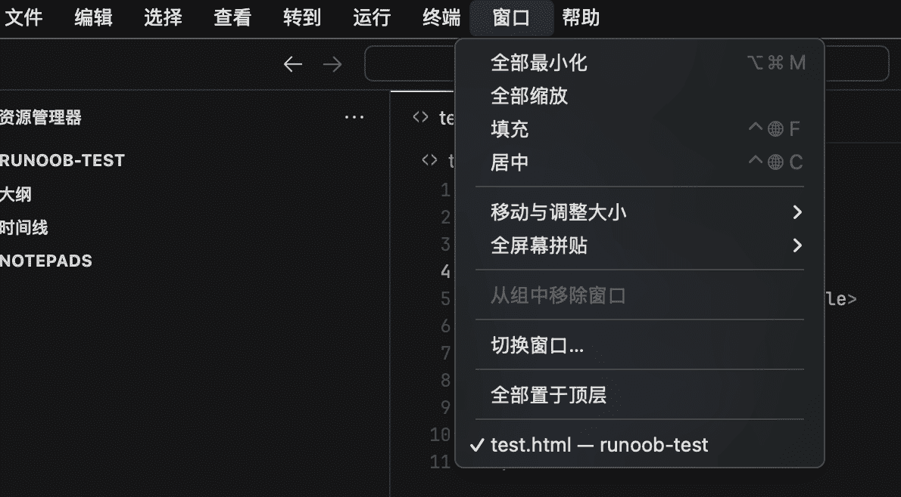

### 2.4 运行菜单

主要功能：

+   **运行**：运行当前编辑的代码。

+   **调试**：启动调试模式，逐步执行代码并查看变量值。

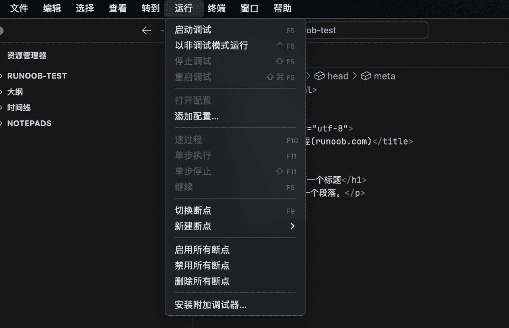

### 2.4 查看菜单

主要功能：

+   **命令面板**：打开命令面板。

+   **外观**：设置各种外观视图的显示与隐藏。

## 3、侧边栏详解

侧边栏是 Cursor 编辑器的一个重要组成部分，提供了多种功能：

+   **命令面板**：打开命令面板。

+   **外观**：显示各种功能面板，比如状态栏。

+   **编辑布局**：设置编辑器的布局方式。

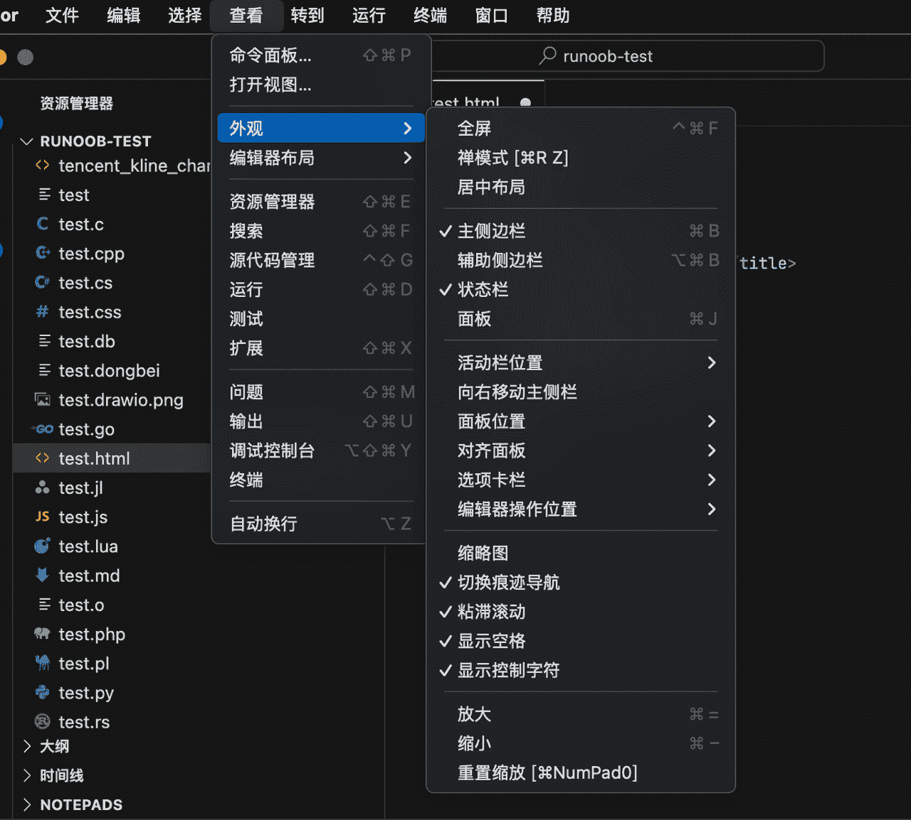

默认情况下，Cursor 的活动栏是水平放置的，这是为了节省空间，方便集成聊天功能。

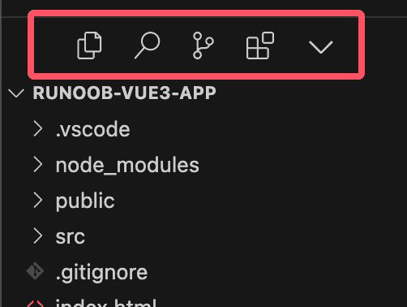

如果您更喜欢传统的垂直活动栏，可以按照以下步骤调整：

+   打开 **Cursor 设置**。

+   搜索并找到 workben**ch.activ**ityBar.orientation，将其值改为 vertical。

+   重启 Cursor 即可生效。

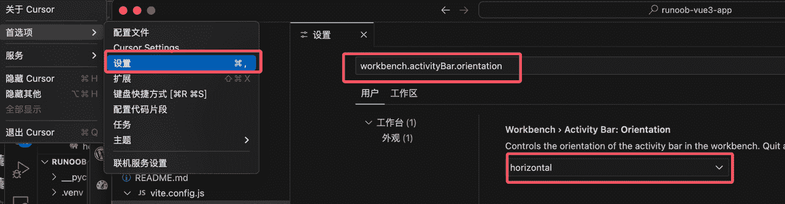

改为 **vertical** 后重启效果：

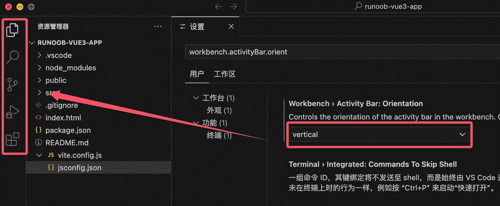

## 4、编辑区详解

编辑区是编写和编辑代码的主要区域，具有以下特点：

+   **语法高亮**：根据代码的语法结构，使用不同的颜色高亮显示代码，提高代码的可读性。

+   **自动补全**：在输入代码时，编辑器会自动提示可能的代码补全选项，提高编码效率。

+   **代码折叠**：可以折叠代码块，方便用户查看和编辑大型代码文件。

+   **多光标编辑**：支持同时编辑多个光标位置，方便批量修改代码。

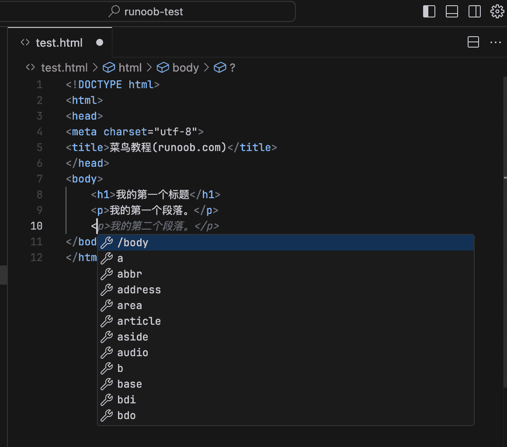

## 5、状态栏详解

状态栏位于窗口的底部，显示当前文件的状态信息，包括：

+   **行号和列号**：显示当前光标所在的行号和列号。

+   **编码格式**：显示当前文件的编码格式，如 UTF-8。

+   **文件类型**：显示当前文件的类型，如 Python、JavaScript 等。

+   **Git 状态**：显示当前文件的 Git 状态，如已修改、已提交等。

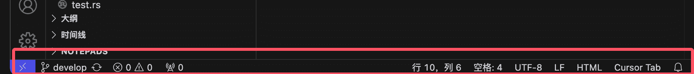