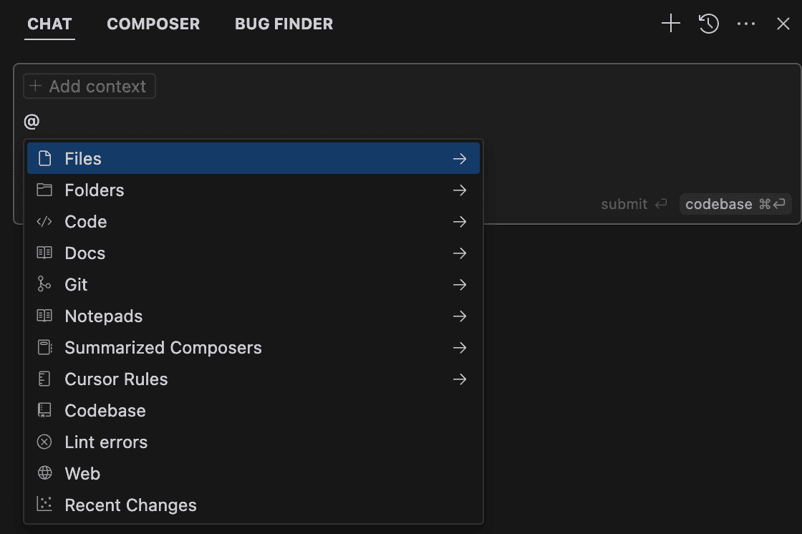

# Cursor @ 符号

> 来源：[https://v11enp9ok1h.feishu.cn/docx/VXtXdV077owvc2xmzBHcMqOinrf](https://v11enp9ok1h.feishu.cn/docx/VXtXdV077owvc2xmzBHcMqOinrf)

在 Cursor 中，**@** 符号是一个强大的工具，用于快速访问和引用各种上下文信息，帮助用户更高效地与 AI 交互。

在任何 AI 交互场景（如 **⌘K**** **命令面板、聊天窗口或终端）中输入 @，会触发上下文关联菜单，自动过滤并推荐当前项目中最相关的资源（如文件、代码片段、文档等）。

+   键盘操作：使用 **↑/↓**** 方向键导航**，Enter 确认选择。若选择的是类别（如 @Files），列表会进一步过滤该类别下的具体资源。

+   文件读取策略：对文件引用可按 **Ctrl/⌘ M** 切换"完整读取"或"摘要读取"模式（例如全文引用或仅关键部分）。

## @ 符号

**@** 符号支持以下主要指令:

### 高级使用技巧

**组合指令: **输入 **@Files src/utils**/helper.js @Codebase，可同时引用指定文件并关联代码库全局上下文，生成高度定制化的代码。

**动态资源集成: **粘贴以 **@** 开头的链接（如 @https://api.example.com/docs），Cursor 会自动解析内容并纳入上下文。

**隐私与配置管理: **通过 **.cursorignore** 文件（类似 .gitignore）排除敏感文件或目录的索引。 在 S**ettin**gs > Features > Docs 中添加自定义文档链接，增强 @Docs 的覆盖范围。

### 典型应用场景示例

**1、代码生成**

+   指令：生成用户登录功能 @Files src/models/user.js @Docs https://jwt.io/introduction

+   结果：基于现有用户模型和 JWT 官方文档生成安全的鉴权逻辑。

**2、错误排查**

+   指令：解释此报错原因 **@Code 12-25** 行 **@Git HEAD~1**

+   结果：结合代码段和最近提交历史分析潜在问题。

**3、跨文件重构**

+   指令：将类组件改为函数式组件 @Folders src/components @Codebase

+   结果：批量转换并确保全局样式和状态管理兼容。