# Cursor 集成终端

> 来源：[https://v11enp9ok1h.feishu.cn/docx/IR9Pd8tb8ocizSxcznmcMV05n2d](https://v11enp9ok1h.feishu.cn/docx/IR9Pd8tb8ocizSxcznmcMV05n2d)

Cursor 基于 Visual Studio Code 构建，保留了 VS Code 的强大功能和熟悉的操作体验，同时加入了 AI 辅助编程功。

Cursor 内置了集成终端，跟 VS Code 集**成终端操**作一样， 我们**可以在菜单栏**上选择"终端"选项，然后选择"新建终端"：

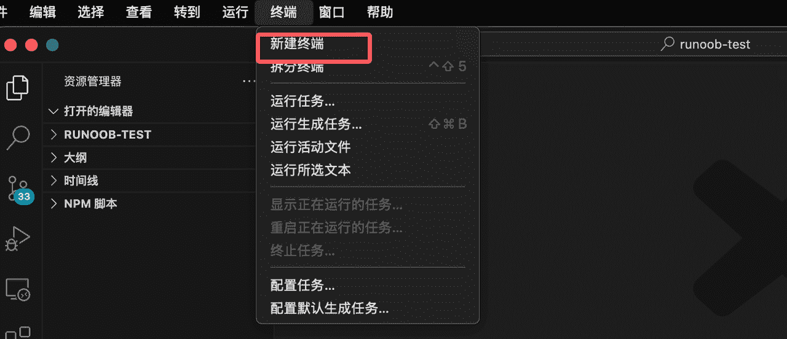

**也可以选择目录下的**文件，右击，在下拉菜单选择"在集成终端打开"：

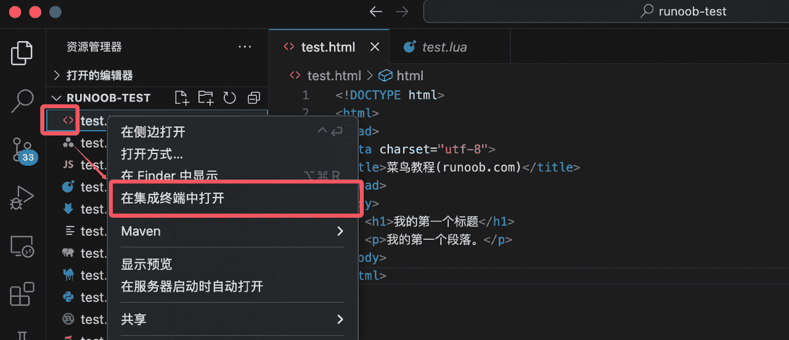

**终端快捷键：**

根据操作系统的不同，我们可以选择不同的终端环境，例如 PowerShell、命令提示符（Command Prompt）、或 Bash。

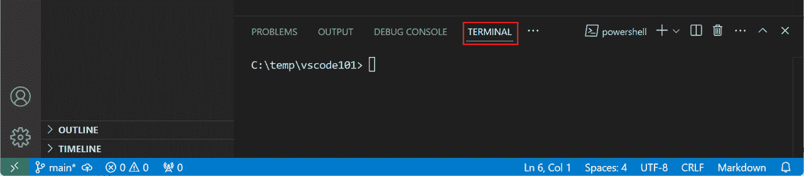

终端中输入以下命令，创建一个新的文件 greetings.txt：

echo "Hello, VS Code" > greetings.txt

工作区的默认文件夹是当前项目的根目录。

创建文件后，"资源管理器（Explorer）"会自动显示新文件。

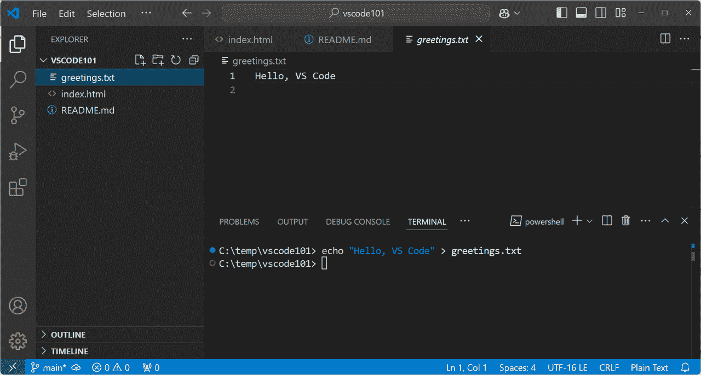

我们可以同时打开多个终端，点击终端右上角的"启动配置（Launch Profile）"下拉菜单，查看可用的终端环境并选择。

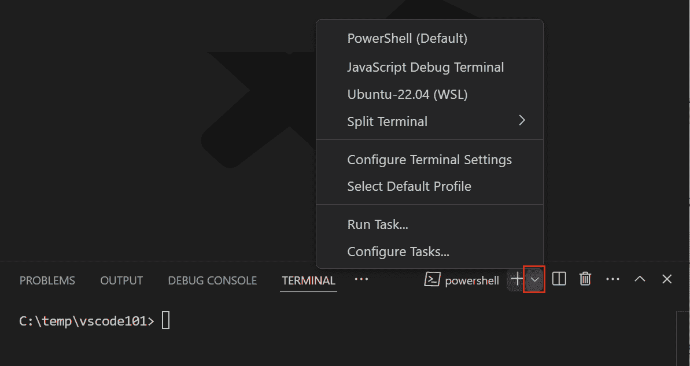

## 使用终端运行命令

终端会打开一个默认的 Shell，如 Bash、PowerShell 或 Zsh，终端的工作目录会从工作区文件夹的根目录开始。

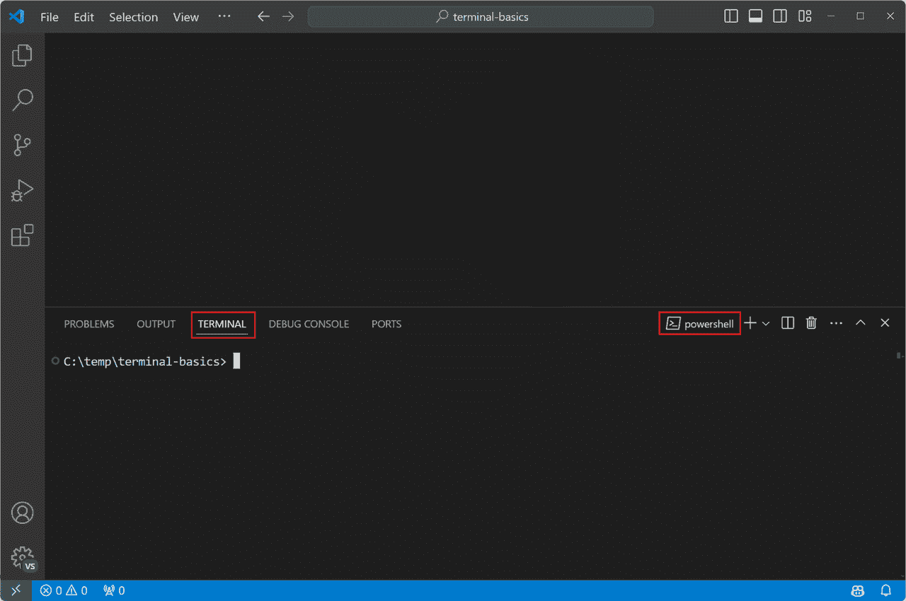

输入类似 ls 或 dir 这样的基本命令来列出当前目录下的文件。

终端会直接显示命令的输出内容：

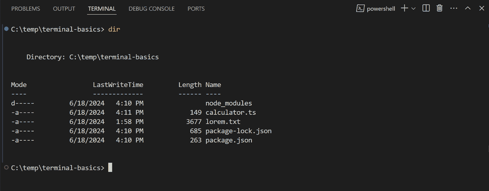

### 与命令输出交互

VS Code 中的终端还提供了与命令输出交互的功能，命令通常会输出文件路径或 URL，你可能希望直接打开或跳转到这些链接。

例如，编译器或代码检查工具可能会返回一个包含文件路径和行号的错误信息。你不需要手动去搜索该文件，只需在终端输出中选择该链接即可直接在编辑器中打开文件。

让我们看看如何与终端中的命令输出进行交互：

1.  打开你之前运行过 ls 或 dir 命令的终端。

1.  在终端中，按住 Ctrl/Cmd 键，将鼠标悬停在文件名上，然后选择该链接。

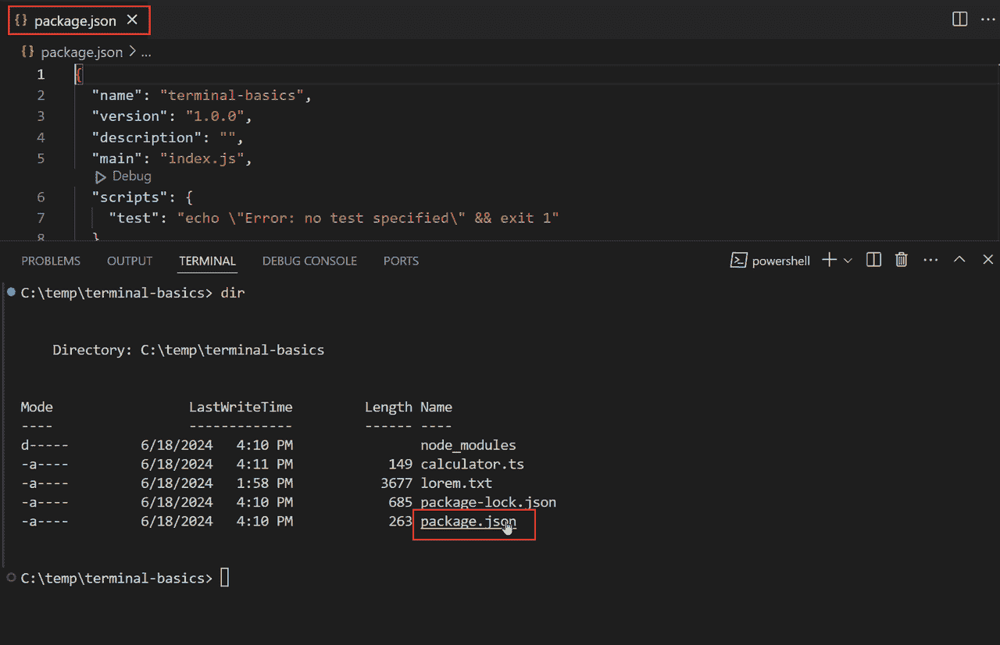

注意，当你将鼠标悬停在输出中的文本上时，它会变成一个链接。

当你选择文件名时，VS Code 会在编辑器中打开选定的文件。

终端输出中的所有文本都是可以点击的，如果你选择终端中的超链接，它会在默认浏览器中打开链接。

### 创建一个包含可用 Shell 命令的 Command.txt 文件

在 PowerShell 中：

```
Get-Command | Out-File -FilePath .\Command.txt
```

在 Bash / Zsh 中：

```
ls -l /usr/bin &gt; Command.txt
```

输入以下命令以搜索 Command.txt 文件中的命令：

在 PowerShell 中：

```
Get-ChildItem *.txt | Select-String &quot;dir&quot;
```

在 Bash / Zsh 中：

```
grep -n &quot;dir&quot; *.txt
```

注意，命令输出中会包含文件名和找到搜索结果的行号，终端会将这些文本识别为链接。

选择其中一个链接，可以在编辑器中打开该文件，并跳转到文件中的特定行。

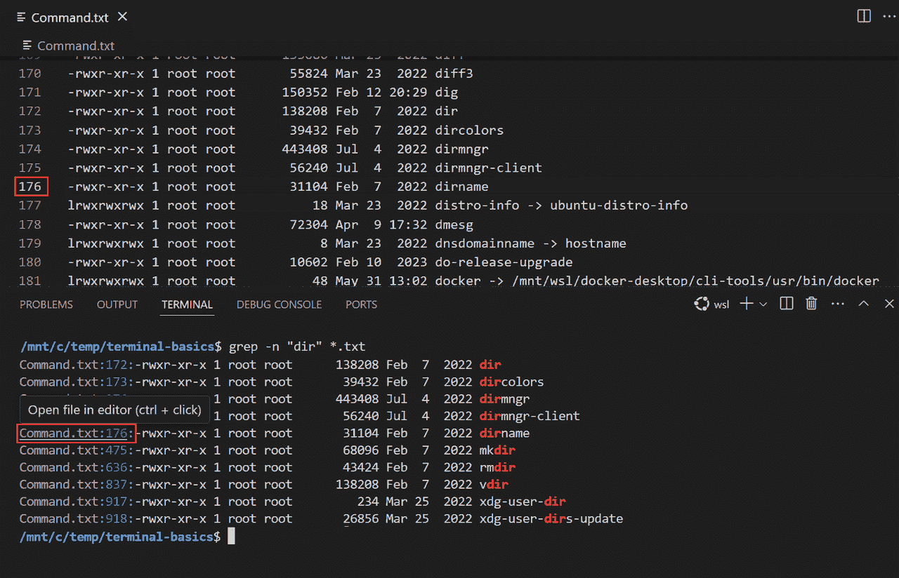

### 浏览历史命令

在使用终端时，我们可能需要查看之前的命令及其输出，或者可能想重新运行某个命令。

我们可以使用快捷键快速浏览历史命令：按下 Ctrl + ↑ 或 ⌘ + ↑ 快捷键，向上滚动至终端历史记录中的上一条命令。

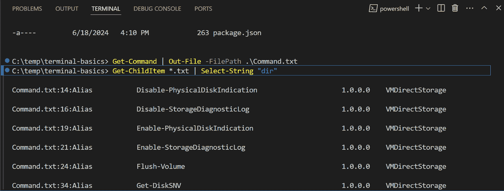

如果你多次按下 Ctrl + ↑，终端会继续向上滚动历史记录。你也可以使用 Ctrl + ↓ 快捷键向下浏览历史记录。

最好我们会看到一个圆形图标出现在某个已运行命令旁边，选择该圆形图标，然后选择"重新运行命令"来重新执行该命令。

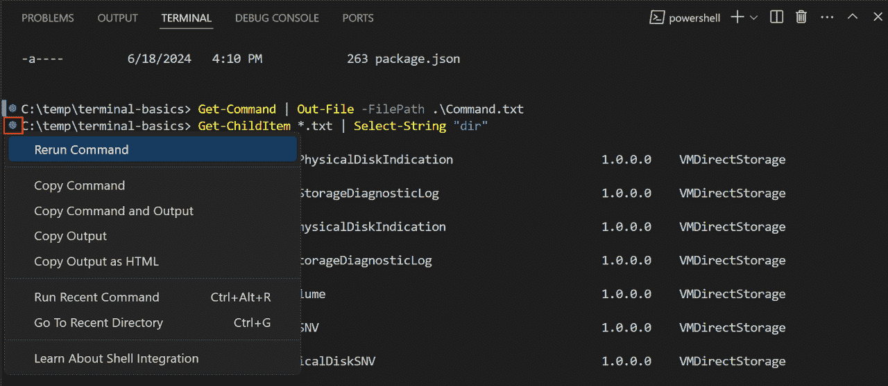

### 不同 Shell 中运行命令

终端支持同时打开多个终端。

例如，我们可以将一个终端用于运行 Git 命令，另一个终端用于运行构建脚本。

在不同 Shell 中添加新终端：选择终端面板中的 ˅ 图标以打开终端下拉菜单，然后从可用的 Shell 中选择一个。

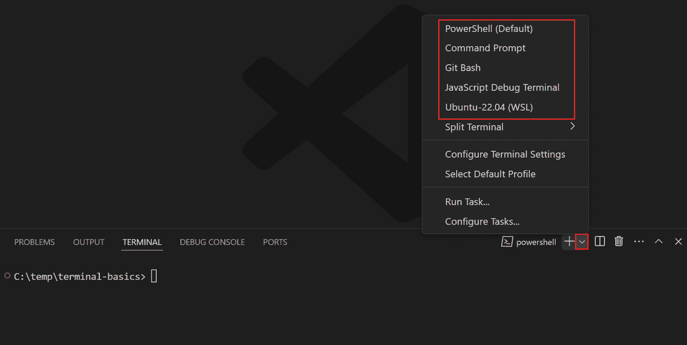

**注意： **可用的 Shell 取决于你电脑上安装的 Shell。

新终端会以你选择的 Shell 打开，你可以像之前一样输入命令。

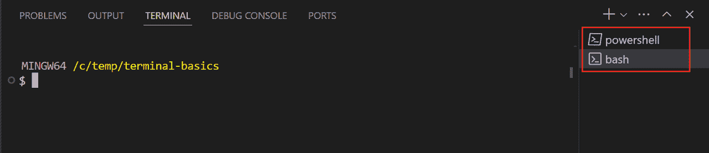

**提示：** 你**也可**以选择** + **图标来为默认 Shell 创建新终端，使用快捷键 ⌃⇧（Ctrl + Shift + `），或者从菜单栏选择 终端 > 新终端 来创建新终端。

我们还可以将终端从终端列表拖动到编辑器区域。

例如，我们将终端标签拖出 VS Code 窗口，使其成为浮动窗口。

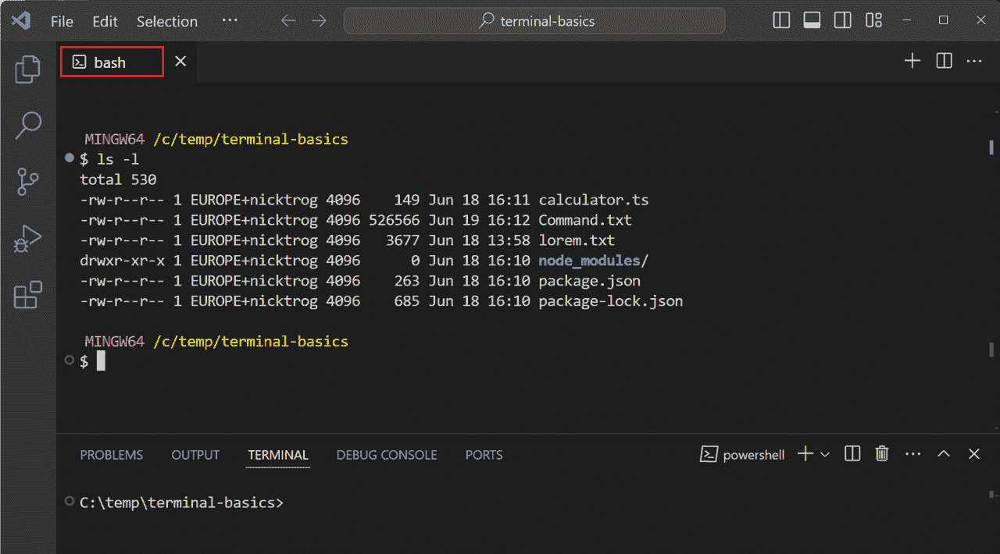

**将终端移动到编辑器区域：**当你将鼠标悬停在终端列表上时，选择垃圾桶图标来关闭已打开的终端。

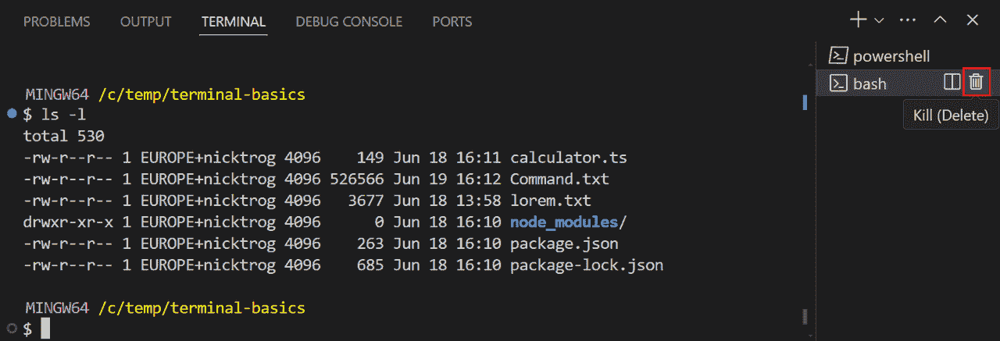